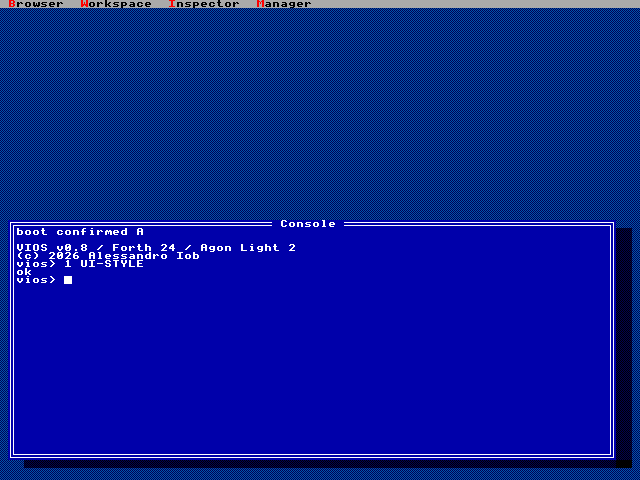

<p align="center">
  
</p>

<h1 align="center">VIOS</h1>

<p align="center">
  <b>A live Forth workstation for the Agon Light 2</b><br>
  A bare-metal Forth system on the eZ80 and a Smalltalk-style windowed GUI on the ESP32,<br>
  developed live, on the machine itself.
</p>

<p align="center">
  <a href="https://vios.iob.dev"></a>
  <a href="https://github.com/alexiob/VIOS/releases/latest"></a>
  <a href="LICENSE"></a>
</p>

<p align="center">
  <b>Website and manual: <a href="https://vios.iob.dev">vios.iob.dev</a></b>
</p>

<p align="center">
  <a href="https://github.com/alexiob/VIOS/releases/latest">Download</a> ·
  <a href="docs/manual/VIOS-MANUAL.md">Manual</a> ·
  <a href="https://vios.iob.dev">Manual online</a> ·
  <a href="docs/USER-GUIDE.md">Quick start</a> ·
  <a href="CHANGELOG.md">Changelog</a>
</p>

---

## Contents

- [What VIOS is](#what-vios-is)
- [A look around](#a-look-around)
  - [The Smalltalk-style desktop](#the-smalltalk-style-desktop)
  - [The Turbo Vision style](#the-turbo-vision-style)
  - [Forth at the console](#forth-at-the-console)
  - [Graphics](#graphics)
- [Features](#features)
- [Getting started](#getting-started)
- [Building from source](#building-from-source)
- [Developing VIOS](#developing-vios)
- [Repository layout](#repository-layout)
- [Documentation](#documentation)
- [Status and limits](#status-and-limits)
- [Credits and license](#credits-and-license)

## What VIOS is

VIOS turns the [Olimex Agon Light 2](https://www.olimex.com/Products/Retro-Computers/AgonLight2/)
into a self-contained Forth workstation, in the spirit of the Smalltalk
environments: everything on screen is live, and you change the running system
from inside it.

- **On the eZ80** runs a resident Forth with 24-bit cells. It drives its own
  UART, timer, SPI, SD card and FAT32, and makes no MOS calls once started.
  Words compile to native direct-threaded code, with a token-threaded engine
  and a portable C reference beside it, all three running the same programs.
- **On the ESP32** runs the VIOS display server: a compositing window system
  with widgets, canvases, sprites and animation, the keyboard, a
  three-voice synthesizer, and the USB link to a host computer.
- **Between them** a framed protocol at 1,152,000 baud carries drawing
  commands one way and events the other. The eZ80 never draws a pixel.

You write Forth in the console or in the GUI tools, keep it in **modules** that
are staged, tested, activated and saved as units, and boot from **two boot
slots** that fall back on their own if a new set fails.

## A look around

Every image here is drawn by the real VIOS display-server code. It's rendered on
a computer for the manual, and the board draws the same pixels.

### The Smalltalk-style desktop

The default style: grey desktop, black-on-white windows with tab titles, and a
world menu. The GUI tools are written in Forth and run on the board.

<table>
  <tr>
    <td width="50%"></td>
    <td width="50%"></td>
  </tr>
  <tr>
    <td><b>Workspace</b>: evaluate any selection; <i>do it</i>, <i>print it</i>, <i>inspect it</i>.</td>
    <td><b>Inspector</b>: stacks, memory, tasks, open handles and system counters, live.</td>
  </tr>
  <tr>
    <td></td>
    <td></td>
  </tr>
  <tr>
    <td><b>Command palette</b>: <kbd>Ctrl</kbd>+<kbd>K</kbd>, type a few letters, <kbd>Enter</kbd>.</td>
    <td><b>Windows</b> from the keyboard: cycle, zoom, move and resize.</td>
  </tr>
</table>

The **Browser** at the top of this page lists modules and their words. Edit a
definition, press <kbd>Ctrl</kbd>+<kbd>S</kbd>, and the module is recompiled,
tested and activated while everything keeps running. The **Manager** saves
modules and writes boot slots.

### The Turbo Vision style

The same software in a Borland Turbo Vision look: blue windows with double
frames, a menu bar and drop shadows. `1 UI-STYLE` switches to it and
`0 UI-STYLE` switches back, at any time, with every window kept.

<table>
  <tr>
    <td width="50%"></td>
    <td width="50%"></td>
  </tr>
  <tr>
    <td><b>Browser</b> and <b>Workspace</b>, Turbo Vision style.</td>
    <td><b>Command palette</b> and window cycling.</td>
  </tr>
  <tr>
    <td colspan="2" align="center"><br>Switching styles at run time.</td>
  </tr>
</table>

### Forth at the console

<table>
  <tr>
    <td width="50%"></td>
    <td width="50%"> defining word"></td>
  </tr>
  <tr>
    <td><b>The console</b>: line editing and history on the ESP32, the REPL on the eZ80.</td>
    <td><b>An extensible compiler</b>: <code>IMMEDIATE</code>, <code>POSTPONE</code>, <code>DOES&gt;</code> and friends.</td>
  </tr>
</table>

```forth
vios> : SQUARE ( n -- n*n ) DUP * ;
ok
vios> 12 SQUARE .
144 ok
vios> : STARS ( n -- ) 0 ?DO 42 EMIT LOOP ;  10 STARS
********** ok
```

### Graphics

<table>
  <tr>
    <td width="50%"></td>
    <td width="50%"></td>
  </tr>
  <tr>
    <td><b>Canvases</b>: retained display lists of lines, shapes, text and icons; the ESP32 redraws only what changed.</td>
    <td><b>Animation</b>: tweens with easing for windows, sprites and canvases.</td>
  </tr>
</table>

## Features

**Forth system (eZ80)**
- Resident Forth with 24-bit cells; native **DIRECT** and **TOKEN** engines and
  a C reference, switchable with `ENGINE`, all three running the same words.
- An extensible compiler: `IMMEDIATE`, `POSTPONE`, `[ ]`, `LITERAL`, `STATE`,
  `EVALUATE`, `FIND`, `CREATE … DOES>`, `MARKER`.
- `SEE` shows any word's source; `TRACE` single-steps it; `LAST-ERROR` keeps
  the failing word, its caller frames and the stack from before the unwind.
- Four preemptive background tasks (`SPAWN`, `PAUSE`, `MS`, `TASK-KILL`,
  `TASKS`) on a 1 kHz tick, with `CRITICAL( … )CRITICAL` and Ctrl-C.

**Modules and boot**
- Source modules are staged, tested on the reference engine, activated and
  rolled back as units, with dependencies pinned by CRC-32.
- `SAVE` writes CRC-checked packages to the SD card; power cuts during a save
  leave old packages intact (tested by pulling the plug).
- Two boot slots: `BOOT-TRIAL` writes the inactive one, the next boot confirms
  it, and a failed trial falls back to the confirmed slot.
- Boots **untethered** from the SD card through MOS; compiled boot modules are
  cached, and `/VIOS/USER.FTH` and `AUTORUN` start your own code.

**Display server and GUI (ESP32)**
- A compositing window manager: overlapping windows, focus, shadows, menus,
  a command palette, keyboard window control, two visual styles.
- Widgets with automatic layout: labels, buttons, check boxes, radio buttons,
  inputs, lists, tabs, text views, progress bars.
- Canvases (retained display lists), icons, sprites, tweens.
- GUI tools in Forth: Browser, Workspace, Inspector and Manager.

**Devices, files and sound**
- Handles and pipes (`OPEN`, `READ`, `WRITE`, `PIPE`), SD files, `/dev/cons`,
  `/dev/tasks`, `/dev/win` (windows as files), and devices written in Forth
  (`DEVICE`).
- A three-voice synthesizer; tunes are written like the `PLAY` statement of
  classic BASICs.

**Host tools**
- `tools/vios_harness.py` serves the board to a host computer as 72 MCP tools
  and JSON-RPC, so a person or an AI assistant can develop on the live board.
- `tools/vios_cli.py`: a terminal console with completion, `:why` and `:trace`.

## Getting started

**You need:** an Agon Light 2 with MOS 3.0.2, a FAT32 microSD card, a VGA
monitor, a PS/2 keyboard, and a USB-C cable to a computer for installing.
The manual's [Hardware and Wiring](docs/manual/VIOS-MANUAL.md#hardware-and-wiring)
chapter has the details.

1. **Download** `vios-X.Y.Z.zip` from the
   [latest release](https://github.com/alexiob/VIOS/releases/latest) and check it:

   ```bash
   cd vios-0.8.0 && shasum -a 256 -c SHA256SUMS
   ```

2. **Install the ESP32 firmware** into the spare A/B slot. The tool backs up
   the flash first, and the old firmware stays bootable. It needs Python with
   `pyserial`.

   ```bash
   python tools/vios_firmware_ab.py --port /dev/cu.usbserial-XXXX install --backup-dir backups esp32/firmware.bin
   ```

3. **Install the SD files** onto the mounted card. This keeps your other
   `autoexec.txt` lines and saved modules.

   ```bash
   python tools/vios_sd_install.py install /Volumes/AGON --resident sd/vios/vios.bin --stub sd/mos/viosboot.bin
   ```

4. **Boot.** Put the card in and power on. The desktop appears with a Console
   window:

   ```text
   boot confirmed A

   VIOS v0.8 / Forth 24 / Agon Light 2
   (c) 2026 Alessandro Iob
   vios>
   ```

Then read [First Boot and Setup](docs/manual/VIOS-MANUAL.md#first-boot-and-setup)
and [The Console and REPL](docs/manual/VIOS-MANUAL.md#the-console-and-repl).
VIOS never writes the eZ80's flash: MOS stays as it is.

## Building from source

You need [AgonDev](https://github.com/AgonPlatform/agondev) v0.22 in
`.tools/agondev`, [PlatformIO](https://platformio.org), Python 3 with a
`.venv`, and clang as `cc` for the host tests.

```bash
make test
```

```bash
make vios-resident viosboot
```

```bash
.venv/bin/pio run -d firmware/esp32-vios -e esp32-vios
```

```bash
.venv/bin/python tools/vios_release.py package
```

`make test` runs about 320 host tests: the Forth system, the display server,
the protocol, the tools and the manual's examples. The last command builds the
same package as a release. [Building](docs/manual/VIOS-MANUAL.md#building)
covers the details, and [docs/RELEASING.md](docs/RELEASING.md) covers
versions, the changelog and publishing a release.

## Developing VIOS

The **host harness** owns the USB port and serves the running board:

```bash
.venv/bin/python tools/vios_harness.py --backend resident --tcp 127.0.0.1:8765
```

```bash
.venv/bin/python tools/vios_cli.py
```

With the harness running, `tools/vios_board_suite.py` runs the on-board
acceptance checks: GUI, GUI tools, console, audio, core words, tasks,
pipelines, handles, tools and the extensible compiler. See
[The Host Harness and MCP Tools](docs/manual/VIOS-MANUAL.md#the-host-harness-and-mcp-tools)
and the [developer handoff](CLAUDE_HANDOFF.md).

## Repository layout

| Path | What is there |
|---|---|
| [`forth/`](forth) | The Forth system: compiler, dictionary, VM, modules |
| [`kernel/`](kernel) | The resident: boot, services, tasks, handles, GUI bindings, tools |
| [`arch/ez80/`](arch/ez80), [`boards/`](boards), [`drivers/`](drivers) | eZ80 assembly, the Agon Light 2 board layer, SD/FAT32 and VDP transport |
| [`firmware/esp32-vios/`](firmware/esp32-vios) | The ESP32 firmware: display server (`lib/vios-vds`), bridge, audio, line editor |
| [`include/`](include) | Shared headers, including the generated `vios/version.h` |
| [`tools/`](tools) | Host harness, CLI, installers, acceptance checks, release packaging |
| [`tests/`](tests) | Host tests (`make test`) |
| [`apps/`](apps) | Example applications |
| [`docs/`](docs) | Manual, specs, bring-up evidence, benchmarks, research |
| [`VERSION`](VERSION), [`CHANGELOG.md`](CHANGELOG.md) | The version, and what changed |

## Documentation

| Document | For |
|---|---|
| [VIOS manual](docs/manual/VIOS-MANUAL.md) ([online](https://vios.iob.dev)) | Everything: building, installing, the Forth language, the GUI, every word, examples |
| [User guide](docs/USER-GUIDE.md) | A short quick start |
| [Changelog](CHANGELOG.md) | What changed in each version |
| [Releasing](docs/RELEASING.md) | Versions, the changelog, cutting and installing a release |
| [Developer handoff](CLAUDE_HANDOFF.md) | Current implementation, hardware and recovery workflow, roadmap |
| [Specs](docs/superpowers/specs) | Design documents for each subsystem |
| [Bring-up evidence](docs/bring-up) | Board runs, acceptance reports, runbooks |
| [Benchmarks](docs/benchmarks) | Engine, rendering and transport measurements |
| [Hardware research](docs/research/hardware.md) | The Agon Light 2 in detail |

## Status and limits

**0.8.0** is the first tagged release. It is tested on the physical board:
- the on-board acceptance suite;
- keyboard typing at the board;
- booting with no SD card;
- power cuts during `SAVE` and `BOOT-TRIAL`.

Known limits are listed in the
[changelog](CHANGELOG.md) and the manual's
[Appendix: Limits and Numbers](docs/manual/VIOS-MANUAL.md#appendix-limits-and-numbers).
For example: fixed-size dictionary and code arenas, no `CATCH`/`THROW`, and a
PS/2 keyboard only.

## Credits and license

VIOS is © 2026 Alessandro Iob and released under the [MIT License](LICENSE).

It builds on the [Agon VDP](https://github.com/breakintoprogram/agon-vdp) firmware
and [vdp-gl](https://github.com/avalonbits/vdp-gl), vendored under `firmware/esp32-vios/vendor/` with their own
licenses and pinned sources. The ESP32 ZDI code derives from the MIT-licensed
Agon recovery project (`tools/esp32-ram/NOTICE.txt`), and the Agon 8×8 font is
by Damien Guard and Lennart Benschop. Archived references under `artifacts/`
and `docs/research/` keep their own notices.
