# VIOS Manual

**VIOS** is a small, malleable operating system for the
[Agon Light 2](https://www.olimex.com/Products/Retro-Computers/AgonLight2/),
built around a resident Forth. You type Forth at a console on the VGA screen or drive the
same system from a Mac; you browse, edit and replace running code in
Smalltalk-style windows; and you keep what you build as checked source modules
on the SD card.

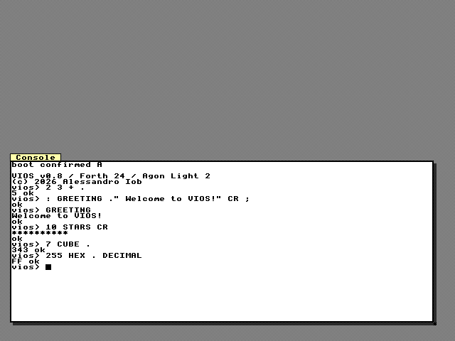

This manual covers building VIOS from source, installing it, setting it up and
using it: the console, the Forth language as VIOS implements it, modules,
tasks, files and devices, the GUI and its tools, sound, and the host tools. It
ends with example programs and a reference of every word.

*Edition: VIOS 0.8.0, October 2026, by Alessandro Iob
([iob.dev](https://iob.dev)). The version is in the `VERSION` file;
what changed is in `CHANGELOG.md`. All screenshots
are rendered on a host computer by the real VIOS display server and GUI code
(see [Images in this manual](#images-in-this-manual)); the board draws the same
pixels.*

## Contents

1. [Introduction](#introduction)
2. [Architecture](#architecture)
3. [Hardware and Wiring](#hardware-and-wiring)
4. [Building](#building)
5. [Installing](#installing)
6. [First Boot and Setup](#first-boot-and-setup)
7. [The Console and REPL](#the-console-and-repl)
8. [The Forth Language](#the-forth-language)
9. [Display and Graphics](#display-and-graphics)
10. [Modules and Persistence](#modules-and-persistence)
11. [Tasks and Preemption](#tasks-and-preemption)
12. [Handles, Pipes and Devices](#handles-pipes-and-devices)
13. [Files and the SD Card](#files-and-the-sd-card)
14. [The GUI](#the-gui)
15. [The GUI Tools](#the-gui-tools)
16. [Audio](#audio)
17. [The Host Harness and MCP Tools](#the-host-harness-and-mcp-tools)
18. [Troubleshooting](#troubleshooting)
19. [Example Programs](#example-programs)
20. [Word Reference](#word-reference)
21. [Appendix: Limits and Numbers](#appendix-limits-and-numbers)

## Introduction

### What VIOS is

VIOS turns the Agon Light 2 into a self-contained Forth workstation. It does
not run on top of MOS or BBC BASIC. At power-on the resident image reaches the
eZ80's RAM in one of two ways: the ESP32 writes it over the ZDI debug link, or,
without that link, MOS starts a small stub that fetches the image from the SD
card or from the ESP32 firmware (*untethered boot*). From then on the CPU runs
VIOS alone and makes no MOS calls.

The ideas come from Forth, from Smalltalk and Lisp machines (a live system
you inspect and change while it runs), and from Unix and Plan 9 (small tools,
pipes, everything reachable as a named device):

- **A native Forth with 24-bit cells.** Two threaded-code engines written in
  eZ80 assembly (*DIRECT*, the default, and *TOKEN*) plus a C reference engine
  that defines the semantics. The compiler keeps the source of every word, so
  `SEE` and the GUI tools show exactly what you typed.
- **Live, transactional development.** Source *modules* are staged, tested,
  activated and rolled back as units; two generations are kept; activation is
  checked against pinned dependencies. Saved modules form A/B *boot slots* on
  the SD card, so a bad update can be reverted.
- **Tasks, handles and devices.** Four preemptive background tasks, pipes
  between them, non-blocking I/O handles on SD files, pipes and `/dev`
  endpoints, and user devices served by Forth words.
- **A windowed GUI on the ESP32.** The ESP32 (the Agon's video processor)
  runs a display server with windows, menus, widgets, editable text views,
  animation and two looks: **Smalltalk** and **Turbo Vision**. The CPU drives
  it with compact operation batches; Forth words (`UI-…`) expose all of it.
- **Smalltalk-like tools.** A *Browser* to read and change modules live, a
  *Workspace* to evaluate code (*do it*, *print it*, *inspect it*), an
  *Inspector* for the stack, tasks, handles and the system, and a *Manager* for
  boot slots and saved modules.
- **Sound.** A three-voice synthesizer on the ESP32 plays notes and tunes
  written as text.
- **Headless control.** A host harness on the Mac owns the USB link and
  offers every operation to a human CLI and, as MCP tools, to LLM clients.
  Everything you can do at the keyboard can be done from the host, and the
  console shows what the host does.

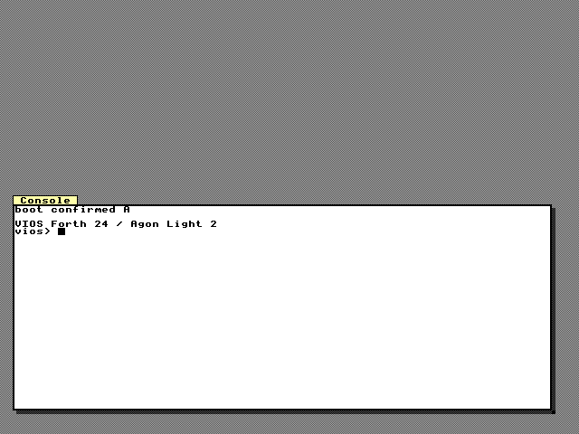

### What VIOS is not (yet)

VIOS is an OS foundation, not a finished system. There is no memory
protection (the eZ80 has none), no general garbage collector or module
unload, no networking on the board, and the running heap is not saved: what
persists is *source* (modules and `USER.FTH`). The compiler and the outer
interpreter are written in C. These limits are spelled out where they matter
and collected in [the appendix](#appendix-limits-and-numbers).

### How to read this manual

- New to VIOS? Read [Architecture](#architecture), then follow
  [Building](#building), [Installing](#installing) and
  [First Boot and Setup](#first-boot-and-setup) in order.
- Already running VIOS? Start at [The Console and REPL](#the-console-and-repl)
  and [The Forth Language](#the-forth-language), then
  [The GUI Tools](#the-gui-tools).
- Looking up a word? Go to the [Word Reference](#word-reference); every word
  has an anchor, for example [`DUP`](#w-dup) or [`UI-WINDOW`](#w-ui-window).

Conventions: `MONOSPACE` is something you type or a file name; **Ctrl+Shift+B**
is a key chord on the Agon's PS/2 keyboard; stack effects are written
`( before -- after )` with the top of the stack on the right. Shell commands
run on the host (macOS or Linux) from the repository root.

### Images in this manual

The screenshots and animations are not mock-ups. `tools/manual/vios_shots.c`
links the real CPU-side code (the Forth system, the `UI-…` words and the GUI
tools) with the real ESP32 display server (`firmware/esp32-vios/lib/vios-vds`)
through a stubbed VDP link, presses keys exactly as the keyboard would, and
saves the 640×480 framebuffer. The scenes are in `docs/manual/scenes/`;
`python3 tools/vios_manual.py media` regenerates every image. Two things
differ from a board: the host build runs the C reference engine (so the
Inspector shows `engine C` where the board shows `DIRECT`), and SD, boot and
task data come from host stubs.

## Architecture

The Agon Light 2 has two processors, and VIOS uses both:

- the **eZ80** runs the operating system itself: a resident Forth with its compiler, tasks, files, modules and the logic of every application;
- the **ESP32** runs the firmware that draws the screen, reads the keyboard, plays sound, talks to your Mac over USB, and loads and supervises the eZ80.

This chapter shows how the pieces fit together. You need none of it to use VIOS, but it explains why some things behave the way they do. Examples are why the screen keeps working while a Forth program hangs, why firmware and resident must be built as a pair, and why the board can boot without the Mac.

### The big picture

```text
  Mac (optional)
  +--------------------------+
  | vios_cli.py   MCP client |
  |        \        /        |
  |     vios_harness.py      |  one serial owner, TCP 127.0.0.1:8765
  +------------+-------------+
               |  USB-C -> CH340, 115200 8N1, COBS/CRC frames, 5 channels
  Agon Light 2 |
  +------------v---------------------------------------------------+
  | ESP32-PICO-D4: VIOS VDP firmware (in app0 or app1)             |
  |                                                                |
  |  control task (core 0)        VDP task and frame task          |
  |  - USB reader, link resend    - VDU parser                     |
  |  - ZDI supervisor             - display server, compositor ----+--> VGA
  |  - boot watchdog              - console, line editor <---------+--- PS/2 keyboard
  |  - firmware A/B trial         - audio engine ------------------+--> audio / buzzer
  |                               - boot server, embedded image    |
  +------+-----------------------------------+---------------------+
         | ZDI debug port                    | UART 1,152,000 baud, RTS/CTS
         | (optional: 2 jumper wires)        | VDU stream + VDU 23,0,E0..E9
  +------v-----------------------------------v---------------------+
  | eZ80F92, 18.432 MHz, 512 KB external RAM                       |
  |  flash: Agon MOS (runs the boot stub at power-on)              |
  |  RAM:   VIOS resident Forth, from 0x040000 --------------------+--> microSD (SPI)
  +----------------------------------------------------------------+
```

### The eZ80: the resident Forth

Everything you type at the `vios>` prompt runs on the eZ80. The **resident** is one binary, `build/vios-resident.bin` (about 195 KB in VIOS 0.8.0), loaded into external RAM at `0x040000`. It is bare metal. Once running, it makes no calls into MOS: it drives its own UART, timer, SPI bus, SD card and FAT32 file system.

Its main parts:

- **The Forth system** (`forth/`): dictionary, outer interpreter and compiler. Cells are 24 bits wide, the eZ80's native word size. Every definition keeps its source text, so `SEE` shows exactly what you typed.
- **Three engines** run the same compiled words. **DIRECT** is native direct-threaded eZ80 code and the default. **TOKEN** is native token-threaded code. **C** is a portable reference interpreter in standard C. You switch with `ENGINE DIRECT`, `ENGINE TOKEN` or `ENGINE C`. Direct threading measured 11–14% faster than token threading. The C engine is the yardstick the tests compare against, and module transactions run on it (see [Modules and Persistence](#modules-and-persistence)).
- **The kernel services** (`kernel/`): console, clock, display, audio, handles and pipes, devices, SD files, modules and boot slots, the GUI client words (`UI-*`), the workbench editor and the GUI tools. Many services are deferred words such as `CONSOLE-EMIT`, `FS-READ` and `DISPLAY-WRITE`, which your own modules can rebind.
- **Tasks**: four background Forth tasks next to the REPL, time-sliced and preempted. See [Tasks and Preemption](#tasks-and-preemption).

There is no MMU and no memory protection. All code shares one address space. Errors inside Forth are caught and reported (see `LAST-ERROR`), but a native routine that writes to the wrong address can corrupt anything.

**Memory map** while VIOS runs:

| Address | Size | Contents |
| --- | --- | --- |
| `0x000000..0x01FFFF` | 128 KB | eZ80 on-chip flash: Agon MOS. VIOS never writes it. |
| `0x040000..` | about 195 KB | The resident: code, constants, initialized data. |
| `..0x0AD815` | about 243 KB | BSS: dictionary, names, compiled code, data space, stacks, module source pool, buffers. |
| `0x0AD815..0x0AEFFF` | about 6 KB | Free (0.8.0). |
| `0x0AF000..0x0AFFFF` | 4 KB | Native stack (top at `0x0B0000`). |
| `0x0B0000..0x0B7FFF` | 32 KB | MOS moslet area. The boot stub runs here during boot. |
| `0x0B8000..0x0BFFFF` | 32 KB | MOS reserved area and MOS heap/stack. Not used by VIOS. |
| `0xB7E000..0xB7FFFF` | 8 KB | On-chip SRAM, where MOS maps it. |

The linker refuses an image whose BSS would run into the stack. Exact BSS figures change with every build; see `build/vios-resident.map`. Fixed capacities such as dictionary entries, stack depths and module limits are listed in [Appendix: Limits and Numbers](#appendix-limits-and-numbers).

### The ESP32: the VIOS VDP firmware

On a stock Agon the ESP32 runs the VDP ("video display processor") firmware, which turns a stream of VDU bytes from the eZ80 into pictures and sound. VIOS keeps that role, built from a pinned copy of the upstream VDP 1.04 source and vdp-gl 1.0.3 with VIOS changes on top. It adds several subsystems:

- **The display server** (`lib/vios-vds`). At power-on the ESP sets a 640×480, 16-colour mode and starts a window compositor before the eZ80 has even loaded. A frame task composes at every vertical blank. Windows, menus, widgets, text views and sprites live on the ESP. The eZ80 drives them with compact batches (`VDU 23,0,E4`) and pulls events back. Two looks are built in: a Smalltalk-like style and a Turbo Vision-like style. Large repaints are composed off-screen in PSRAM and shown at once, so you never see a half-drawn screen. See [The GUI](#the-gui).
- **The console terminal.** The eZ80's console output passes through the ESP on its way to USB. The ESP draws the same bytes into the Console window, or full screen in text mode (Ctrl+Alt+F1 switches). The eZ80 never repaints its own console.
- **The line editor.** While the REPL waits for a line, the ESP edits it locally: cursor keys, Backspace and Delete, Esc, and a four-line history. Typing therefore stays responsive whatever the eZ80 is doing. The finished line is handed over whole. See [The Console and REPL](#the-console-and-repl).
- **The audio engine.** Three voices are synthesized in the sound interrupt, with tunes stored as text and played without the CPU. See [Audio](#audio).
- **The keyboard.** PS/2 only, on the USB-A-shaped socket. The window manager sees every key first and passes unused keys to the eZ80. The PS/2 mouse is disabled in this firmware.
- **The USB multiplexer.** USB serial to the Mac runs at 115200 8N1 through the board's CH340 chip. Instead of a raw terminal, the ESP speaks zero-delimited, COBS-encoded frames with a CRC-32 each, on five channels: 1 console, 2 control commands, 3 status events, 4 host-file requests, 5 link requests. A Forth line from the Mac arrives as one CRC-checked transaction, and only then is it handed to the eZ80. The eZ80 checks the CRC again before running it.
- **Link retransmission.** The CH340 link occasionally drops a few bytes, about one frame in 1,500 to 4,000. The ESP therefore numbers every frame it sends and keeps the last 24 in a ring. When the host sees a gap or a damaged frame, it asks for the missing frame on channel 5. The ESP resends the kept frames byte for byte, or answers "gone" when they have left the ring, and the host delivers everything in order. You see this only in counters: `link_requests`, `link_resent` and `link_gone` in `esp_stats`. Only a "gone" frame, or ten requests without progress, makes the harness report a lost wire.
- **The ZDI supervisor.** ZDI is the eZ80's debug port. With two jumper wires fitted (see [Hardware and Wiring](#hardware-and-wiring)), a separate control task on the ESP can halt the eZ80, read and write its registers and memory, and load code into it. This task owns the USB reader and runs on its own core, independent of the VDP task. It stays reachable even if a graphics command or a Forth program wedges the screen.
- **The boot server.** The firmware contains a copy of the resident it was built with, and serves it to the boot stub on request (`VDU 23,0,E8`).
- **Firmware A/B.** The firmware supervises its own trial after an update. It confirms itself once the eZ80 reports healthy, and falls back to the previous slot otherwise. See [Installing](#installing).

On the ESP, the control task (USB reader, ZDI, watchdog, firmware trial) runs on core 0 at its own priority. The VDU parser and the frame task run on the other core, where the frame task preempts the parser at every vertical blank. Only the VDP task writes to the eZ80's UART, and every USB frame is written whole under a lock. Console, control and event traffic therefore never interleave.

The eZ80 and ESP talk over a UART at 1,152,000 baud with hardware flow control in both directions. The bytes are the ordinary VDU protocol plus private `VDU 23,0,E0..E9` commands, such as console records, the clock, boot health, GUI batches and audio. They are recognized only at a command boundary, so bitmap or audio payload bytes can never be mistaken for commands.

### The boot chain

VIOS boots in one of two ways. The ESP decides at every power-on by probing the ZDI port.

**Untethered boot** (no ZDI wire, the normal case):

```text
 power on
   |
   +-- ESP32: VGA, display server, Console window      (about 1.9 s after power-on)
   |          ZDI probe fails -> "user mode"; answers MOS as a normal VDP
   |
   +-- eZ80: Agon MOS from flash -> boot file on SD -> viosboot (boot stub)
   |          stub: link to 1,152,000 baud, ask ESP for the manifest   (about 2.5 s)
   |          stream the resident into 0x040000, 192-byte CRC'd blocks
   |          whole-image CRC-32 + MOS header check, jump              (about 4.4 s)
   |             (ESP image bad or missing -> /vios/vios.bin from SD)
   |
   +-- resident: start, HEALTH 0                                       (about 5.1 s)
              load confirmed boot bundle (or its compiled cache) from SD
              health check -> HEALTH 1, "BOOT READY"                   (about 7.7 s)
              Console: /VIOS/USER.FTH, AUTORUN, vios> prompt
```

MOS is involved only up to the jump. It initializes the hardware the way the Agon expects, reads the SD card and runs the stub. After that the resident owns the machine. The image normally comes from the ESP firmware, so the resident and the firmware are guaranteed to be a matched pair. The SD copy is the fallback, and a firmware on trial does not count an SD-sourced boot as a success.

**Dev boot** (ZDI wire fitted): the ESP halts the eZ80 and finds its on-chip RAM. It writes and verifies a 46-byte native bootstrap there, which sets up the external RAM. It then writes the embedded resident to `0x040000` over ZDI, has the eZ80 compute the image's CRC-32 itself, and starts it. MOS and the SD card play no part in loading. This path keeps working when the card or MOS is broken. It is also the only mode in which the Mac can inspect the halted CPU. A 30-second boot watchdog restarts the ESP after a failed boot and gives up after three.

Above both paths sits a second layer of A/B on the SD card: two **boot bundles** of source modules with trial, confirm and revert. A module update that fails its boot-time checks falls back to the last confirmed bundle on the next boot. See [Modules and Persistence](#modules-and-persistence).

### The host side

On the Mac, `tools/vios_harness.py` owns the serial port and serves the board to everything else. It offers 72 MCP tools for LLM clients, a newline-delimited JSON-RPC socket on `127.0.0.1:8765` for the CLI and scripts, and a sandboxed directory the board sees as `/host/`. JSON, schemas and networking all stay on the Mac; the board only sees binary frames. The board has no network stack of its own. See [The Host Harness and MCP Tools](#the-host-harness-and-mcp-tools).

## Hardware and Wiring

VIOS targets one board: the **Olimex Agon Light 2**. It runs on the board as shipped. You need no soldering and no extra chips, and the normal setup needs no wires either. Two optional jumper wires give the Mac a debug and recovery path into the eZ80. They are described at the end of this chapter.

### The board

| Part | Details | What VIOS does with it |
| --- | --- | --- |
| Main CPU | Zilog eZ80F92, 24-bit ADL mode, 18.432 MHz crystal | Runs the resident Forth. |
| CPU memory | 512 KB external SRAM (`0x040000..0x0BFFFF`), 128 KB on-chip flash, 8 KB on-chip SRAM | The resident lives in external RAM. The flash holds Agon MOS, which VIOS leaves alone. |
| Coprocessor | ESP32-PICO-D4, dual-core, 4 MB flash, 8 MB PSRAM | Runs the VIOS VDP firmware: display, keyboard, audio, USB link, boot and recovery. |
| Video | VGA (resistor DAC driven by the ESP32) | 640×480 at 16 colours for the GUI. |
| Audio | 3.5 mm jack and an on-board buzzer | Three-voice synthesizer on the ESP32. |
| Keyboard | USB-A-shaped socket carrying **PS/2** signals | Keyboard input. |
| Storage | microSD slot on the eZ80's SPI bus | MOS boot files, VIOS modules, boot bundles and your files (FAT32). |
| Host link | USB-C through a CH340 USB-serial chip to the ESP32's UART0 | Power, plus the 115200-baud framed link to the Mac. |
| Expansion | 34-pin GPIO header, 10-pin UEXT, 4-pin ACCESS.bus, 6-pin ZDI header | Only the GPIO and ZDI headers are used, by the optional recovery wires. |
| Power | 5 V from USB-C, optional LiPo battery with charger | |

The eZ80 has no video hardware of its own. Every pixel and every sound comes from the ESP32, which receives drawing commands from the eZ80 over an internal UART (1,152,000 baud with hardware flow control). The USB socket does not connect to the eZ80 at all. Everything the Mac says reaches the eZ80 through the ESP32.

### What you need

- **An Agon Light 2.** Olimex's Rev. B is the first public revision, and the ZDI pinout below is for Rev. B. Check the revision printed on your board.
- **A microSD card**, formatted FAT32 with an MBR partition table. Up to 32 GB is the conservative choice. The card holds MOS's boot file and the VIOS boot stub (see [Installing](#installing)).
- **A VGA monitor** that accepts 640×480 at 60 Hz, and a VGA cable.
- **A PS/2 keyboard.** The keyboard socket is shaped like USB-A but speaks PS/2. A keyboard with a USB-A plug works only if it also supports PS/2 signalling. Keyboards sold as "USB and PS/2" (often shipped with a small purple or green adapter) plug straight into the socket; you do not use the adapter. A USB-only keyboard does not work, because the board has no USB host controller.
- **A USB-C cable** to power the board. A data cable to a Mac is needed for installing firmware and for the host harness, but not for everyday use.
- **Optional: headphones or a powered speaker** on the audio jack. The buzzer sounds only when the `BUZ_EN1` jumper is closed.
- **Optional: four female-to-male jumper wires and a small breadboard** for the ZDI recovery links.

**Mouse:** the VIOS firmware does not enable the PS/2 mouse. The GUI is driven entirely from the keyboard. The mouse's default pins (ESP32 GPIO26 and GPIO27) are the same pins the ZDI recovery link uses, so firmware with ZDI recovery cannot also drive a mouse on them.

### Jumpers

| Jumper | Setting for VIOS | Why |
| --- | --- | --- |
| `UART_DIS1` (`UART_D`) | **Open** | Open connects the eZ80 to the ESP32. Closed cuts the link and nothing works. |
| `BUZ_EN1` | Your choice | Closed enables the on-board buzzer. |
| `ESP_PROG1` | Leave as shipped | It controls ESP32 bootloader entry. Firmware updates over USB do not need it. |

### Connecting it up

1. Insert the prepared microSD card (see [Installing](#installing)).
2. Connect the VGA monitor and the PS/2 keyboard.
3. Optionally, plug headphones or a speaker into the audio jack.
4. Connect USB-C, to your Mac or to any 5 V USB supply. The board powers up and boots at once.

The board shows up on the Mac as a CH340 serial device, `/dev/cu.usbserial-<suffix>`, for example `/dev/cu.usbserial-210`. The suffix depends on the USB socket or hub, so list the devices before you use any tool. **Opening this serial port resets the board.** Treat starting the harness, `esptool` or any other serial tool as a reboot.

### The ZDI recovery links (optional)

ZDI is the eZ80's on-chip debug interface. With two jumper wires from the GPIO header to the ZDI header, the ESP32 can halt the eZ80, read and write its registers and memory, and load VIOS straight into RAM ("dev boot"). This works whatever is on the SD card or in the eZ80 flash. The Mac can then use the harness's debug tools (`debug_registers`, `memory_read`, `memory_write`, `resume`, `deploy`), and a wedged eZ80 can always be reset from the Mac.

Without the wires the board boots untethered from the SD card (see [Architecture](#architecture)). Fit the wires if you are developing VIOS itself or need deep recovery. Otherwise leave them off.

| Board GPIO header | Signal | ZDI header |
| --- | --- | --- |
| Pin 9 | ESP32 GPIO26, ZDI clock | Pin 4 (ZCL) |
| Pin 8 | ESP32 GPIO27, ZDI data | Pin 6 (ZDA) |

For reference, the Rev. B ZDI header is 1 = 3.3 V, 2 = reset, 3 = GND, 4 = ZCL, 5 = GND, 6 = ZDA. Only pins 4 and 6 are connected. Both ends are on the same board, so no extra ground or power wire is needed.

Making the links with four female-to-male wires and a breadboard:

1. **Unplug USB-C and disconnect any battery first.** Never change wires on a powered board.
2. Make sure `UART_DIS1` is open.
3. Find pin 1 on each header from the board's silkscreen and the Olimex schematic for your revision. Do not rely on a photo or memory: Rev. B changed the ZDI pinout.
4. Plug one wire onto GPIO header pin 9 and one onto ZDI pin 4. Put their male ends in the same numbered breadboard strip, for example A1 and B1.
5. Plug one wire onto GPIO header pin 8 and one onto ZDI pin 6. Put their male ends in another strip, for example A3 and B3.
6. Check that each strip holds exactly one GPIO lead and one ZDI lead. Never join the two GPIO leads to each other, and never join the two ZDI leads to each other. That would short the clock to the data line.
7. Reconnect USB-C. The boot events now say `BOOT VIOS v0.8 ...` and `BOOT VIOS VDP 1.04 ...` followed by `NATIVE RAM ... DONE A5` and `VIOREADY ...` instead of `BOOT user mode`.

**Safety notes:**

- All header signals are 3.3 V logic. Never connect them to 5 V.
- The ESP drives the ZDI clock as an output. Do not connect anything else to GPIO26 or GPIO27 while the links are fitted.
- To boot untethered again, power off and remove both wires. The ESP probes ZDI at every power-on and picks the mode by itself.
- The wires are also required by `tools/vios_ez80_flash.py`, which can rewrite the eZ80 flash. A normal VIOS install never needs that tool (see [Installing](#installing)).

## Building

A VIOS build has two halves that must match:

- the **eZ80 resident** (`build/vios-resident.bin`), built with Make and the AgonDev toolchain;
- the **ESP32 firmware** (`firmware.bin`), built with PlatformIO. It embeds the resident it was built with.

You also build the small **boot stub** (`build/viosboot.bin`) that MOS runs from the SD card. Everything below runs on the Mac and never touches the board.

### Toolchains

| Tool | Version | Where it lives | Used for |
| --- | --- | --- | --- |
| AgonDev | v0.22 | `.tools/agondev/` (override with `AGONDEV=...`) | eZ80 clang, assembler, linker, objcopy |
| PlatformIO | any recent `pio` | `~/.platformio/penv/bin/pio` | ESP32 firmware |
| espressif32 platform | 6.3.0 (pinned in `platformio.ini`) | downloaded by PlatformIO | Arduino-ESP32 2.0.9, GCC 8.4.0+2021r2-patch5 |
| ESP32Time | 2.0.0 (pinned) | downloaded by PlatformIO | RTC library used by the VDP |
| Python | 3.9 or newer | `.venv/` | Build checks, tests, all host tools |
| Python packages | `esptool==5.1.0`, `pyserial==3.5` | `tools/requirements.txt` | Flashing, serial access |
| Host C compiler | system `cc` | | Host tests and the native test fixtures |

None of these is installed by Make, and `.tools/`, `.venv/` and `build/` are ignored by Git. A fresh clone therefore needs this one-time setup:

```sh
# Python environment
python3 -m venv .venv
.venv/bin/pip install -r tools/requirements.txt

# AgonDev v0.22: download agondev-darwin_arm64.tar.gz from the AgonDev
# releases page (github.com/AgonPlatform/agondev) and unpack it as .tools/agondev
mkdir -p .tools
tar -xzf agondev-darwin_arm64.tar.gz -C .tools
.tools/agondev/macos_remove_quarantine.sh      # macOS: clear the download quarantine
ls .tools/agondev/bin/ez80-none-elf-clang

# PlatformIO (if you do not have it): see platformio.org; the project uses
# ~/.platformio/penv/bin/pio. The first build downloads the pinned packages.
```

Check that the unpacked directory is really named `.tools/agondev`, or pass `AGONDEV=/path/to/agondev` to every `make`. Keep the pinned versions. In particular, espressif32 6.4.0 is known to break VDP mode 3 by using more memory.

The VDP sources are vendored, so no network is needed for them. The ESP firmware is built from `firmware/esp32-vios/vendor/agon-vdp` (`breakintoprogram/agon-vdp` commit `61888ab`, VDP 1.04) and `vendor/vdp-gl` (`avalonbits/vdp-gl` commit `48a0b9a`, 1.0.3), with VIOS changes on top. Their archive URLs and SHA-256 values are in `vendor/manifest.json`.

### The paired build

Build the resident first, then the ESP firmware, **in that order and never at the same time**, with the same internal baud rate:

```sh
make test                                    # optional, but run it before, not during
make vios-resident VIOS_INTERNAL_BAUD=1152000
make viosboot
VIOS_INTERNAL_BAUD=1152000 ~/.platformio/penv/bin/pio run -d firmware/esp32-vios -e esp32-vios
```

These are the reasons for the order:

- **The ESP build embeds the resident.** A PlatformIO pre-build script, `firmware/esp32-vios/scripts/embed_vios.py`, reads `build/vios-resident.bin` and compiles it into the firmware's flash as constant data. It also embeds the 46-byte native bootstrap `build/agon-stage0.bin`, the CRC stage `build/agon-crc.bin` and the flash stage `build/agon-flash.bin`, which `make vios-resident` builds too. If any is missing or out of bounds, the ESP build stops.
- **Both ends must agree on the internal UART rate.** `VIOS_INTERNAL_BAUD` sets the eZ80-to-ESP32 link: 1152000 (default), 384000, or 115200 (historical). Make records the rate in `build/vios-resident.baud`. The embed script refuses to build if that file is missing or names a different rate than the ESP build's `VIOS_INTERNAL_BAUD`. The USB link to the Mac is always 115200.
- **Both ends must agree on the GUI.** `VIOS_GUI=1` (default) builds a resident whose workbench draws through the ESP display server, paired with an ESP that boots into the GUI. `VIOS_GUI=0` builds the older VDU text screen. Make records the choice in `build/vios-resident.gui`, and the embed script checks it against its own `VIOS_GUI` environment variable (default 1).
- **`make test` relinks the resident.** Some host tests run `make build/vios-resident.bin` at the default settings. Running them while the ESP build is reading the resident can embed the wrong image.

Make forces a relink when you switch rate or GUI mode, even within the same second. macOS Make compares timestamps at one-second resolution.

To embed a different validated image, set `VIOS_IMAGE=/absolute/path/image.bin` for the ESP build. Its `.baud` and `.gui` sidecars must sit next to it.

### What the build produces

| Output | Made by | What it is |
| --- | --- | --- |
| `build/vios-resident.bin` | `make vios-resident` | The eZ80 resident: a MOS-format ADL image loaded at `0x040000`, stamped with its build identity. About 195 KB in 0.8.0. |
| `build/vios-resident.elf`, `.map` | same | Symbols and link map. Keep the ELF of every image you install if you plan to debug over ZDI. |
| `build/vios-resident.baud`, `.gui` | same | Sidecars with the internal rate and GUI flag. Keep them with the `.bin`. |
| `build/agon-stage0.bin`, `agon-crc.bin`, `agon-flash.bin` | same | Small eZ80 stages the ESP runs over ZDI in dev mode: RAM setup (46 bytes), whole-image CRC, flash programmer. |
| `build/viosboot.bin` | `make viosboot` | The SD boot stub, a MOS moslet at `0x0B0000` (3 KB). |
| `firmware/esp32-vios/.pio/build/esp32-vios/firmware.bin` | `pio run ... -e esp32-vios` | The ESP32 application, at most `0x140000` bytes (one app slot). About 830 KB (849,472 bytes) in 0.8.0. |
| `firmware/esp32-vios/build-manifest.json` | same, post-build | Firmware size and SHA-256, the embedded resident's path, size, SHA-256, CRC-32, baud rate and GUI flag, the native stages, pinned sources and SHA-256 of every build input. |
| `firmware/esp32-vios/include/vios_image.json` | same, pre-build | What was embedded (path, size, SHA-256, CRC-32, baud, GUI). |

PlatformIO also produces a bootloader and a partition table as normal intermediates. They are never installed: VIOS updates write one application slot only.

### The resident build stamp

After linking, `tools/vios_stamp.py` writes the build's identity into the binary. `kernel/vios_boot.c` contains a 4-byte `STMP` marker followed by a zero word. The tool computes the CRC-32 of the whole binary with that word still zero, and stores the result in the word (it uses 1 if the CRC happens to be 0, because 0 means "unstamped"). Restamping gives the same value. The tool fails unless there is exactly one marker. It prints the result (the value differs for every build):

```text
build/vios-resident.bin: build stamp 1A2B3C4D
```

The stamp keys the **boot-module cache**. On a normal boot the resident reads, checks and compiles the modules of the confirmed boot bundle, then saves the compiled result as `/VIOS/CACHE_A.VIC` or `/VIOS/CACHE_B.VIC`. Later boots restore that cache instead of compiling, which takes about 0.9 s instead of about 2.2 s for five modules. The cache is used only when its key matches the build stamp, the bundle CRC and the base dictionary. A new resident therefore never restores a cache compiled by another build: its first boot compiles and rewrites the cache, which costs about 1.4 s extra once. An image loaded straight from the ELF reads stamp 0 and never uses the cache.

### Versions and releases

The version lives in one place, the `VERSION` file at the top of the
repository (`0.8.0` for this edition). `make vios-resident` compiles it into
the resident, whose console greets you with `VIOS v0.8` and the copyright line;
the ESP32 build writes it into the firmware's boot log and into
`build-manifest.json`. `CHANGELOG.md` lists what changed in each version.

A release is a tag `vX.Y.Z` on `main`. Pushing the tag runs the GitHub Actions
workflow `.github/workflows/release.yml`: it checks that the tag, `VERSION`
and `CHANGELOG.md` agree, runs the host tests, builds the resident, the boot
stub and the ESP32 firmware as a matched pair, packages them with
`tools/vios_release.py`, builds this manual's site, and publishes the release
with three files: `vios-X.Y.Z.zip`, `vios-X.Y.Z-SHA256SUMS` and
`vios-X.Y.Z-manual.zip`. The step-by-step process, and how to try a release
build without publishing it, are in
[`docs/RELEASING.md`](https://github.com/alexiob/VIOS/blob/main/docs/RELEASING.md).

### Makefile targets

`make` with no target builds the historical `all`. The targets you normally use are `test`, `vios-resident` and `viosboot`.

| Target | Output | Purpose |
| --- | --- | --- |
| `vios-resident` | `build/vios-resident.bin` (+ `.elf`, `.map`, `.baud`, `.gui`), `build/agon-stage0.bin`, `build/agon-crc.bin`, `build/agon-flash.bin` | The production eZ80 resident and the stages the ESP firmware embeds. |
| `viosboot` | `build/viosboot.bin` | The SD boot stub `/mos/viosboot.bin`. |
| `test` | | Runs the host test suite: `.venv/bin/python -m unittest discover -s tests -v`. Covers the Forth system and C reference, native target code on an eZ80 interpreter, the ESP firmware components under sanitizers, the wire codec, host tools and the harness. Needs AgonDev and a host C compiler. |
| `verify-forth-engine` | `build/verification/forth-engine/` | Assembles, links and disassembles the DIRECT and TOKEN engines and runs the native ABI probes (`tools/verification/forth-engine/check.sh`). |
| `clean` | | Deletes `build/`. |
| `vios` | `build/vios.bin` | The standalone raw Forth image from the first milestone (no SD, no multiplexer). Historical reference. |
| `storage-probe` | `build/storage-probe.bin` | A standalone SD/FAT probe image used during storage bring-up. |
| `all` (default) | `build/monitor.bin` | The first-day C monitor in MOS format. Historical. |
| `raw` | `build/monitor-raw.bin` | The same monitor for the raw RAM bridge. Historical. |
| `esp32-probes` | `build/zdi-probe.bin`, `build/zdi-loader.bin` | ESP32 RAM helpers for ZDI bring-up and eZ80 flash backup (`tools/zdi_backup.py`, `tools/zdi_monitor.py`). Need `XTENSA_CC` and esptool. |
| `build/zdi-instruction-probe.bin` | same | A ZDI instruction-store diagnostic helper (file target, not a phony name). |

Make variables:

| Variable | Default | Meaning |
| --- | --- | --- |
| `VIOS_INTERNAL_BAUD` | `1152000` | eZ80-to-ESP32 UART rate: `115200`, `384000` or `1152000`. Anything else is an error. Must match the ESP build. |
| `VIOS_GUI` | `1` | `1`: workbench drawn by the ESP display server (GUI boot). `0`: VDU text screen. Must match the ESP build. |
| `VIOS_BOOT_BURST` | `32` | Blocks the boot stub requests at a time (1 to 32). |
| `VIOS_BOOT_TIMEOUT` | `12` | Stub wait per reply, in units of 65,536 UART polls (12 is about 0.5 s). |
| `AGONDEV` | `.tools/agondev` | AgonDev install directory. |
| `XTENSA_CC` | PlatformIO's `xtensa-esp32-elf-gcc` | Compiler for the `esp32-probes` helpers only. |
| `BUILD_ID` | `bringup-20261016-01` | Build string of the historical monitor. |

PlatformIO environments in `firmware/esp32-vios/platformio.ini`:

| Environment | Output | Purpose |
| --- | --- | --- |
| `esp32-vios` | `.pio/build/esp32-vios/firmware.bin`, `build-manifest.json` | The normal firmware. |
| `esp32-vios-probe` | `.pio/build/esp32-vios-probe/firmware.bin`, `build-manifest-probe.json` | A minimal ZDI diagnostic. It has no VGA, keyboard, audio or CPU boot; it only halts the CPU and answers USB control commands. Never install it as your normal firmware. |

The ESP build reads these environment variables: `VIOS_INTERNAL_BAUD` (default 1152000), `VIOS_GUI` (default 1) and `VIOS_IMAGE` (default `build/vios-resident.bin`).

### Checking a build before you install it

- `firmware/esp32-vios/build-manifest.json` must name the resident you just built. Its `embedded_vios.sha256` equals `shasum -a 256 build/vios-resident.bin`. Its `internal_baud` and `gui` must be what you intended, and `size` must be below `app0_limit`.
- `make test` passes on a clean tree. Run it before the paired build, not during.
- After installing, the boot events end with `BOOT stub runs this firmware's image` and `HEALTH flag 1` (see [Installing](#installing)).

## Installing

Installing VIOS puts files in two places:

1. **The ESP32 firmware** (`firmware.bin`) goes into one of the ESP32's two application slots, `app0` or `app1`. It contains the VDP, the display server, the audio engine, the USB multiplexer, the boot server and a copy of the eZ80 resident.
2. **The SD card** gets a small boot stub, `/mos/viosboot.bin`, plus a fallback copy of the resident, `/vios/vios.bin` and `/vios/vios.man`, and a `viosboot` line in the MOS boot file.

You never write the eZ80's flash for a normal install. It holds Agon MOS (on the reference board MOS 3.0.2, "Arthur"), which starts the boot stub. The ESP32 bootloader and partition table are never touched either.

Before you start, build both halves (see [Building](#building)): `build/vios-resident.bin` with its `.baud` and `.gui` sidecars, `build/viosboot.bin`, and `firmware/esp32-vios/.pio/build/esp32-vios/firmware.bin`.

### Installing a release

If you don't want to build VIOS yourself, download a release from the
repository's **Releases** page. `vios-X.Y.Z.zip` unpacks to `vios-X.Y.Z/`:

| Path | Contents |
|---|---|
| `esp32/firmware.bin` | the ESP32 application, with the eZ80 resident embedded |
| `esp32/build-manifest.json` | the build's identity: version, image CRCs, baud rate, GUI |
| `sd/` | the SD card files: `mos/viosboot.bin`, `vios/vios.bin`, `vios/vios.man`, `autoexec.txt` |
| `tools/` | `vios_firmware_ab.py` and `vios_sd_install.py` |
| `CHANGELOG.md` | this version's notes |
| `SHA256SUMS` | a checksum for every file |

Check the download, then install the two halves with the release's own tools,
as described in the sections below (use the `esp32/firmware.bin` and `sd/`
files instead of your build outputs):

```sh
cd vios-0.8.0 && shasum -a 256 -c SHA256SUMS
```

```sh
python tools/vios_firmware_ab.py --port /dev/cu.usbserial-210 install --backup-dir backups esp32/firmware.bin
```

```sh
python tools/vios_sd_install.py install /Volumes/AGON --resident sd/vios/vios.bin --stub sd/mos/viosboot.bin
```

The SD installer keeps your other `autoexec.txt` lines and your saved
modules. After a reset the console shows the release's banner, for example
`VIOS v0.8` and `(c) 2026 Alessandro Iob`.

### Find the port, free the port

```sh
ls /dev/cu.usbserial-*                       # e.g. /dev/cu.usbserial-210
lsof /dev/cu.usbserial-210                   # nothing may hold it
```

The suffix depends on the USB socket or hub, so check it every time. Several tools still default to an older suffix (`/dev/cu.usbserial-224130`), so **always pass `--port`**. If the harness is running, take a snapshot of anything you care about (`:snapshot FILE` in the CLI), then stop it. The installer needs exclusive use of the port. It also resets the board several times, which loses unsaved RAM work.

### ESP32 firmware: A/B install

`tools/vios_firmware_ab.py` is the only supported way to write ESP firmware. It uses `esptool` (pinned in `tools/requirements.txt`) and never writes anything except one application slot and one 4 KB sector of the `otadata` partition.

**How the slots work.** The ESP32 flash has two application slots and an `otadata` partition with two 4 KB entries. The bootloader runs the slot named by the valid entry with the highest sequence number. VIOS uses this for A/B updates:

- `install` writes the new image into the slot that is **not** running. The running slot is left alone and stays the fallback.
- Before writing, it saves the `otadata` partition and the old contents of the target slot into the backup directory you name.
- It writes the image, requires esptool's flash hash check, and reads the slot back to compare. A failed write is never retried.
- It adds a new `otadata` entry for the new slot in the sector that does not hold the active entry, so the old entry survives. The new entry is `VALID` but carries a `VIOS-TRIAL` marker.
- It then opens the port, which boots the board, and listens on the event channel for the firmware's verdict (180 s by default).

**Trial and confirm.** A firmware that boots with the trial marker is on trial until the eZ80 it started reports healthy (`HEALTH flag 1`) **and** the boot stub says it ran this firmware's own embedded resident. It then clears the marker itself and reports `FIRMWARE confirmed`. It marks itself invalid and the old slot boots again (`FIRMWARE rollback: ...`) in any of these cases:

| Reason in the event | What happened |
| --- | --- |
| `CPU boot deadline` | The resident did not report healthy within 30 s (counted from the stub's manifest request, or from the ZDI load in dev mode). |
| `no CPU health` | No healthy CPU within 180 s of the ESP starting. |
| `trial restarted 3 times by crashes` | The new firmware crashed (panic, watchdog, brownout) three times before confirming. |
| `the stub refused this image's resident and ran the SD copy` | The embedded resident failed its CRC check, so the board only came up from the SD fallback. |
| `host request` | The host sent the control command `FR`. |

**Install a new build:**

```sh
.venv/bin/python tools/vios_firmware_ab.py --port /dev/cu.usbserial-210 status

.venv/bin/python tools/vios_firmware_ab.py --port /dev/cu.usbserial-210 \
    install firmware/esp32-vios/.pio/build/esp32-vios/firmware.bin \
    --backup-dir backups/ab-$(date +%Y-%m-%d)
```

`--port` belongs before the subcommand. `--backup-dir` is required. `--wait N` changes how long to wait for the verdict, and `--wait 0` skips the wait. The baud rate stays at 115200 (`--baud`), because faster esptool rates are unreliable on this board's USB link. Reads are done in 64 KB chunks and retried on a digest error. Expect the whole install to take several minutes: it backs up a 1.25 MB slot, then writes and reads back the new image.

A good install prints the boot events, then a JSON report, and exits with status 0 only when the verdict is `FIRMWARE confirmed`. On an untethered board the events look like this:

```text
event: BOOT VIOS v0.8 (c) 2026 Alessandro Iob
event: BOOT VIOS VDP 1.04 mux-v1 zdi-edge 1us
event: BOOT retained failures 0
event: FIRMWARE app0 valid trial
event: BOOT user mode: no ZDI; MOS and its stub load the resident
event: BOOT link: MOS answered at the internal rate
event: MOS: Agon Platform MOS Version 3.0.2 Arthur
event: BOOT link: stub switched to 1152000
event: BOOT stub loading the resident over the UART
event: BOOT image sent: 1042 blocks in 2291 ms (build 90 ms, send 1871 ms, slowest send 2517 us)
event: BOOT stub runs this firmware's image
event: HEALTH flag 0
event: HEALTH flag 1
event: FIRMWARE confirmed
```

This is VIOS 0.8.0 installed into `app0`. The `FIRMWARE ... valid trial` and
`FIRMWARE confirmed` lines appear only on the first boot of a newly installed
slot.

The backup directory now holds `otadata-<stamp>.bin` and `app0-<stamp>.bin` or `app1-<stamp>.bin` (whichever slot was overwritten). Keep them. Then restart the harness.

**Status and rollback:**

```sh
# Which slot boots, and the decoded otadata entries
.venv/bin/python tools/vios_firmware_ab.py --port /dev/cu.usbserial-210 status

# Boot the other slot again (it still holds the previous firmware)
.venv/bin/python tools/vios_firmware_ab.py --port /dev/cu.usbserial-210 rollback

# Select a named slot
.venv/bin/python tools/vios_firmware_ab.py --port /dev/cu.usbserial-210 rollback --slot app0

# Put back an exact otadata backup (8192 bytes)
.venv/bin/python tools/vios_firmware_ab.py --port /dev/cu.usbserial-210 \
    rollback --restore backups/ab-2026-10-21/otadata-20261021-000647.bin
```

`rollback` selects a slot without a trial marker. It does not copy any images. To bring back an image you backed up earlier, install that file like any other build. It goes into whichever slot is not running, on trial, and backs up what it replaces:

```sh
.venv/bin/python tools/vios_firmware_ab.py --port /dev/cu.usbserial-210 \
    install backups/ab-2026-10-21/app1-20261021-000647.bin --backup-dir backups/ab-restore
```

Every esptool call and every port open resets the board. `status` and `rollback` therefore reboot it too.

### Prepare the SD card

The eZ80 owns the microSD card. MOS boots from it, and VIOS keeps its modules, boot bundles and your files on it. Use a FAT32 card (MBR partition table). Cards up to 32 GB are the conservative choice.

**With the card in your Mac** (first install, or a card you can remove), use `tools/vios_sd_install.py`:

```sh
make viosboot                        # builds build/viosboot.bin
.venv/bin/python tools/vios_sd_install.py install /Volumes/AGON --dry-run
.venv/bin/python tools/vios_sd_install.py install /Volumes/AGON
.venv/bin/python tools/vios_sd_install.py check /Volumes/AGON --resident build/vios-resident.bin
```

`install CARD` writes these files:

| File | Content |
| --- | --- |
| `/mos/viosboot.bin` | The boot stub (a MOS "moslet", at most 32 KB). MOS runs it as the command `viosboot`. |
| `/vios/vios.bin` | The resident, the stub's fallback copy. |
| `/vios/vios.man` | Its 16-byte manifest: size, CRC-32, GUI flag and internal baud rate (the same bytes the ESP sends). |
| `/autoexec.txt` | Gains one `viosboot` line. Every other line is kept, and the original is saved once as `autoexec.txt.vios-backup`. |
| `/!boot.obey` or `/autoexec.obey` | If the card already has one, the first of them gains the `viosboot` line too. MOS 3 runs only the first of `!boot.obey`, `autoexec.obey`, `autoexec.txt` that exists. The installer never creates an obey file, because that would hide `autoexec.txt`. |

The installer also removes `/vios/boot.cnt`, the counter of unfinished boots, so a fresh install starts clean. Files are written under temporary names and renamed, the image before its manifest. An interrupted install therefore leaves a manifest that does not match the image, and the stub refuses to run it. Module bundles in `/VIOS` are not touched.

The options are as follows:

- `--resident BIN` and `--stub BIN` select other files (defaults `build/vios-resident.bin` and `build/viosboot.bin`).
- The manifest's GUI flag and baud rate come from the `.gui` and `.baud` sidecar files next to the resident, so keep them together. A missing `.gui` sidecar is recorded as 0.
- `--dry-run` prints the report without writing.
- `check CARD [--resident BIN]` verifies a card. It checks the stub header, that the image matches its manifest, that the boot file MOS will run contains `viosboot`, and optionally that the card carries exactly that resident build. It exits non-zero on a problem.

**With the card in the board** (no need to take it out), use `tools/vios_sd_refresh.py`. It writes the same files through the running resident's SD handles:

```sh
# stop the harness first: this tool opens the port itself
.venv/bin/python tools/vios_sd_refresh.py build/sd-refresh.json --port /dev/cu.usbserial-210
.venv/bin/python tools/vios_sd_refresh.py build/sd-stub.json --port /dev/cu.usbserial-210 \
    --stub build/viosboot.bin --stub-only
```

- It always writes `/vios/vios.bin` and `/vios/vios.man`. `--stub BIN` also writes `/mos/viosboot.bin`, and `--stub-only` writes only the stub.
- It does not edit `autoexec.txt`, so the card must already have been set up once with `vios_sd_install.py`.
- The resident has no rename. The tool therefore first overwrites `vios.man` with zeros (a manifest the stub refuses), then writes the image, then writes the real manifest. Afterwards it reads back the manifest and the first 64 KiB of the image.
- Writing goes 100 bytes per command, so a 195 KB resident takes about 5 minutes. The report goes to the JSON file you name, next to a raw serial log.
- Opening the port resets the board, which must then boot to `BOOT READY` on its own. The tool never writes flash.

After every confirmed ESP install, refresh the SD copy too. Then the fallback image matches the firmware.

### Untethered boot

With the firmware installed and the card prepared, the board boots VIOS on its own. No Mac and no ZDI wire are needed:

1. The ESP32 starts, brings up VGA and the display server, and tries the ZDI debug link. With no wire present it reports `BOOT user mode` and lets the eZ80 run normally.
2. MOS starts from the eZ80 flash and runs the boot file on the card, which runs `viosboot`.
3. The stub puts the CPU-to-ESP link on the internal rate (1,152,000 baud). It asks the ESP for the manifest of its embedded resident, then streams the image to `0x040000` in 192-byte blocks with a CRC each, 32 blocks per request.
4. It checks the CRC-32 of the whole image and the MOS header, tells the ESP where the image came from, and jumps to it.
5. The resident starts, loads the confirmed boot bundle of modules from SD, and reports healthy.

The **ESP image comes first** because it is guaranteed to match the firmware: same baud rate, GUI pairing and protocol. The SD copy is the fallback. MOS's command line lets you choose differently, for example if you edit the boot file:

| Command | Effect |
| --- | --- |
| `viosboot` | ESP image first, then `/vios/vios.bin`. |
| `viosboot sd` | SD copy first, then the ESP image (useful for trying a CPU-only build without reflashing the ESP). |
| `viosboot force` | Ignore the unfinished-boot counter (also `viosboot force sd`). |

The stub counts boots in `/vios/boot.cnt`, and the resident clears the count once it is healthy. After three boots that never finished, the stub stays in MOS with `VIOSBOOT: 3 boots did not finish; staying in MOS (viosboot force)`. If neither image is usable it prints `VIOSBOOT: no bootable VIOS image; staying in MOS`. If no card or no stub is found, the console window shows "VIOS: no boot SD card, or no viosboot on it. Insert the VIOS SD card and reset the board." See [First Boot and Setup](#first-boot-and-setup) for the timings.

### Recovery

Recovery goes in levels, from least to most invasive. Use the first one that works.

1. **In VIOS itself.** Kill a stuck task (`TASKS`, then `n TASK-KILL`), inspect the error with `LAST-ERROR`, revert a module with `MODULE-ROLLBACK`, or select the previous boot bundle with `BOOT-REVERT`. See [Modules and Persistence](#modules-and-persistence) and [Troubleshooting](#troubleshooting).
2. **Restart.** Press the reset button, power-cycle the board, or stop and start the harness (opening the port resets the board). In the CLI, `:reboot` restarts from an idle prompt and `:recover` forces it. On an untethered board, though, these restart only the ESP32 and the resident carries on (see [The Host Harness and MCP Tools](#the-host-harness-and-mcp-tools)). A full restart loses RAM work; saved modules come back from SD.
3. **Boot from the other image.** At the MOS prompt (shown when the stub gives up), run `viosboot force` or `viosboot sd`. Or fix the card from the Mac with `vios_sd_install.py install`.
4. **Go back to the previous firmware.** Run `vios_firmware_ab.py ... rollback`, or install a backed-up slot image as shown above. A firmware on trial does this automatically when it fails.
5. **The ZDI supervisor (wire attached).** With the two ZDI links fitted (see [Hardware and Wiring](#hardware-and-wiring)), the ESP boots in dev mode. It halts the eZ80, verifies a 46-byte native bootstrap in on-chip RAM, sets up external RAM, writes and CRC-checks the embedded resident, and starts it. This works whatever is on the SD card or in MOS. In this mode an independent USB control task can always halt the CPU, read registers and memory, and restart everything, even if a graphics command or Forth program has wedged the VDP. The harness exposes this through `debug_registers`, `memory_read`, `memory_write`, `resume`, `deploy` and `reboot(force=true)`. A 30-second boot watchdog restarts the ESP after each of the first two failed boots and leaves the CPU halted, with USB debug available, after the third.

**The eZ80 flash is never written by a normal install, update or recovery.** `tools/vios_ez80_flash.py` exists. It can stage a `MOS.bin` in eZ80 RAM and, with `write ... --approved`, erase and program the flash over the ZDI wire, verified by readback. It was used once, to put MOS 3.0.2 on the reference board. A failed flash write leaves the board unable to boot MOS until it is reprogrammed over ZDI. Treat this tool as a last resort for a board whose MOS is damaged or too old (untethered boot was qualified with MOS 3.0.2), and keep the original flash backup (`backups/ez80/`) at hand. `tools/zdi_backup.py` and `tools/zdi_monitor.py` are bring-up tools from the first day. They load a temporary helper into ESP32 RAM (`make esp32-probes`) to read the eZ80 flash or run a raw monitor. You do not need them.

## First Boot and Setup

This chapter assumes the ESP firmware is installed and the SD card is prepared (see [Installing](#installing)). Plug in USB-C and watch the monitor.

### What you see at power-on

1. **The desktop and a Console window appear almost at once.** The ESP32 starts the display server before the eZ80 has loaded anything. If the screen stays black, check the VGA cable and `UART_DIS1` (see [Troubleshooting](#troubleshooting)).
2. **MOS text appears in the Console window.** The MOS banner (`Agon Platform MOS Version 3.0.2 Arthur` on the reference board) and anything MOS or the boot stub prints go into the Console window. MOS does not get the full screen.
3. **The resident loads.** The stub streams VIOS from the ESP firmware into RAM in about two seconds.
4. **VIOS starts and prints its startup lines** in the Console window, then the banner and the prompt:

```text
boot confirmed A
autorun task 1

VIOS v0.8 / Forth 24 / Agon Light 2
(c) 2026 Alessandro Iob
vios>
```

The startup lines tell you what was loaded:

| Line | Meaning |
| --- | --- |
| `boot confirmed A` | The confirmed boot bundle (slot A or B) of saved modules loaded and passed its health check. |
| `boot trial confirmed B` | A pending trial bundle loaded, passed, and is now the confirmed one. |
| `boot candidate rejected: ...` | A trial bundle failed; VIOS fell back to the confirmed bundle. |
| `boot recovery: built-in kernel, no valid source bundle` | No saved bundle yet. This is normal on a fresh card: you get the plain system. |
| `boot recovery: <error>` | The SD card could not be read (no card, not FAT32, card error). VIOS runs without storage. |
| `user startup: /VIOS/USER.FTH` | Your startup file ran (see below). |
| `user startup failed: <error>` | Your startup file stopped with an error. Boot continues. |
| `autorun task N` | A word named `AUTORUN` was found and started as background task N. |

The whole boot takes about 6 to 8 seconds from power-on to a ready system. These were the phases of one measured boot (firmware main-14, times from the first byte on USB):

| Time | Event |
| --- | --- |
| 1.9 s | ESP firmware running; MOS banner |
| 2.5 s | Boot stub running, link at 1,152,000 baud |
| 4.4 s | Resident image transferred (about 2 s; 0.8.0's 195 KB image takes 2.3 s in 1,042 blocks) |
| 5.1 s | Resident running (`HEALTH flag 0`) |
| 7.7 s | Modules loaded, health check passed (`HEALTH flag 1`, `BOOT READY`) |

Most of the last step is loading the saved modules. Since the boot-module cache was added, a boot whose modules and resident are unchanged spends about 1.2 s there instead of about 2.5 s. To see where your own boot's time went, type [`BOOT-TIMES`](#w-boot-times) at the prompt:

```forth
BOOT-TIMES
```

It prints one line with the milliseconds spent in each step: storage, boot state, modules (with the number of loads, the slowest module, and cache hits and misses), health, finish and total.

If no SD card or no boot stub is found, MOS stays at its prompt. After about 12 seconds the Console window says "VIOS: no boot SD card, or no viosboot on it. Insert the VIOS SD card and reset the board."

### The console

The `vios>` prompt in the Console window is the Forth REPL. Type a line and press Enter:

```forth
2 3 + .
: SQUARE  DUP * ;
7 SQUARE .
```

The line is edited locally on the ESP until you press Enter: Left/Right, Home/End, Backspace, Delete, Esc to clear, and Up/Down for the last four lines. Only then does the whole line go to the eZ80. **F1** switches between the console and the workbench editor. **Ctrl+Alt+F1** switches between the GUI desktop and a full-screen text console. See [The Console and REPL](#the-console-and-repl) and [The GUI](#the-gui).

What you type on the Agon keyboard and what the Mac sends share the same REPL, and host commands appear in the console as ordinary lines. You can watch a script or an LLM work.

### Connecting the Mac

Connect the board's USB-C to your Mac, then start the harness and the CLI in two terminals. Remember that starting the harness resets the board. Wait for the boot to finish, or let `connect` wait for it (up to 120 s).

```sh
ls /dev/cu.usbserial-*
.venv/bin/python tools/vios_harness.py --backend resident \
    --port /dev/cu.usbserial-210 --tcp 127.0.0.1:8765
```

```sh
.venv/bin/python tools/vios_cli.py
```

```text
VIOS console — :help for commands.
vios> 2 3 + .
5
vios> :status
...
```

Type `:help` for the CLI commands. To let Claude use the board too, add the `nc` bridge to your MCP configuration. Both then share the one harness. See [The Host Harness and MCP Tools](#the-host-harness-and-mcp-tools).

### Your startup file: `/VIOS/USER.FTH`

If `/VIOS/USER.FTH` exists on the SD card, VIOS loads it once at every boot. It runs after the saved modules are loaded and before `AUTORUN` starts. Use it for settings and small definitions that you want every time but that are not worth a module. An example:

```forth
\ /VIOS/USER.FTH: runs once at every boot, before AUTORUN
DECIMAL
: HELLO-USER  ." Good morning from USER.FTH" CR ;
HELLO-USER
```

Put it on the card from the Mac with the CLI:

```text
vios> :put user.fth /VIOS/USER.FTH
Wrote <n> bytes to /VIOS/USER.FTH sha256 <first 16 hex digits>
vios> :get /VIOS/USER.FTH
```

The CLI's `:put` uploads a local ASCII text file. Without the Mac, you can write the file from Forth with `OPEN` and `WRITE-ALL` (see [Files and the SD Card](#files-and-the-sd-card)).

Keep in mind:

- The file is loaded like `LOAD`. It is at most 4096 bytes, and every definition must be complete by the end of the file.
- If it fails, boot continues and the Console window shows `user startup failed:` with the error. Fix or delete the file and reboot.
- `USER.FTH` definitions are compiled fresh at every boot. They are not modules: they have no version, test or rollback, and they do not show up in `MODULES`.

### Starting an application at boot: `AUTORUN`

After `USER.FTH`, VIOS looks for a word named `AUTORUN`. If one exists, VIOS starts it as a console-attached background task (`' AUTORUN SPAWN-CON`) and prints `autorun task N`. The REPL stays usable next to it, and `N TASK-KILL` stops it. You can define `AUTORUN` in `USER.FTH` or in a saved module:

```forth
: AUTORUN  ." autorun: ready" CR ;
```

A long-running application loops and yields with `MS` or `PAUSE`. Because it runs as a task, a bug in it cannot take the REPL away from you:

<!-- nocheck -->
```forth
: AUTORUN  BEGIN  ." tick" CR  5000 MS  AGAIN ;
```

See [Tasks and Preemption](#tasks-and-preemption) for `TASKS`, `TASK-KILL` and task output.

### Saving your first module

RAM definitions disappear at the next reboot. To keep code, make it a **module**: a named, versioned piece of source with an optional test word. VIOS checks a module on the C reference engine before it goes live, saves it to SD as an immutable package, and loads it at boot as part of a boot bundle. The full workflow is in [Modules and Persistence](#modules-and-persistence). Here is the shortest path from the Mac, with the harness's `develop` tool:

```json
{"name":"develop","arguments":{"name":"SQ","version":"1",
  "source":": SQUARE ( n -- n*n ) DUP * ;\n: SQUARE-OK ( -- f ) 7 SQUARE 49 = ;\n",
  "test_word":"SQUARE-OK","save":true}}
```

`develop` stages the module (it compiles and runs the test, which must leave exactly one true value), activates it, and saves the package to `/VIOS`. You can do the same on the board in the workbench editor (F1).

The module is now live and saved, but the boot bundle does not include it yet. Put all active modules into a new trial bundle, then reboot:

<!-- nocheck -->
```forth
BOOT-TRIAL
REBOOT
```

During the next boot the trial bundle loads. When it passes the health check you see `boot trial confirmed A` (slot A on a fresh card; trials alternate between A and B), and from then on `SQUARE` is there at every power-on. If the trial had failed, VIOS would have printed `boot candidate rejected:` and booted the previous bundle. [`BOOT-STATUS`](#w-boot-status) shows the confirmed and candidate slots. `BOOT-MANIFEST` lists what the next power cycle will load.

### A checklist for a new board

1. The monitor shows the desktop with the Console window, and the console reaches `vios>`.
2. Typing on the PS/2 keyboard echoes in the Console window.
3. `BOOT-TIMES` shows a total of a few seconds.
4. The Mac's harness attaches and the CLI answers `2 3 + .` with `5`.
5. Optional: `.venv/bin/python tools/vios_board_suite.py build/suite-first` passes every check (see [The Host Harness and MCP Tools](#the-host-harness-and-mcp-tools)).

## The Console and REPL

The console is where you talk to VIOS: a Forth read-evaluate-print loop
(REPL) running on the eZ80. You use it from the Agon's own keyboard and VGA
screen, and the same session is visible from the Mac over USB, where the
host tools can type into it too. This chapter explains what you see, which
keys do what, and how output from host commands and background tasks shows
up.

### Where the console lives

The REPL runs on the eZ80 and writes its output to the ESP32, which does
two things with every byte: it forwards it to USB (for the host harness and
CLI) and it interprets it into an 80-column console screen of its own. The
eZ80 never draws console text itself, so printing is never slowed down by
the display.

How that console screen is shown depends on the display:

- **In the GUI** (the default build), the console is a window titled
  *Console* on the desktop, alongside any application windows. It always
  scrolls to keep the newest output in view. See [The GUI](#the-gui).
- **In the full-screen text console**, the whole screen shows 58 rows of 80
  columns, with a status bar in the last row:
  `VIOS console   F1: editor   Up/Down: history`.
  **Ctrl+Alt+F1** switches between the GUI and the full-screen console at
  any time; the GUI keeps its state while hidden and repaints on return.

Both views show the same text: whatever the console received while it was
hidden appears when you come back to it, including output produced while
the workbench editor had the screen.

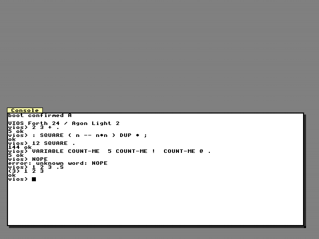

### Prompt, ok and errors

After startup messages (for example `user startup: /VIOS/USER.FTH` or
`autorun task 1`), the REPL prints its banner and prompt:

```text
VIOS v0.8 / Forth 24 / Agon Light 2
(c) 2026 Alessandro Iob
vios>
```

The version in the banner comes from the `VERSION` file (see
[Versions and releases](#versions-and-releases)).

Type a line and press Enter. The whole line is evaluated, then the REPL
prints `ok` if it succeeded or `error:` and a message if it failed, and a
new prompt:

```text
vios> 2 3 + .
5 ok
vios> 2 FOO
error: unknown word: FOO
vios> : DOUBLE ( n -- 2n )
compile> 2 * ;
ok
vios> 21 DOUBLE .
42 ok
```

Output from the line appears right after the line itself, and `ok` follows
the output on the same row unless the output ended with a new line. While a
colon definition is still open at the end of a line, the prompt is
`compile>` instead of `vios>`: the next line continues the definition. An
error discards the unfinished definition and clears the stacks (see
[The Forth Language](#the-forth-language)).

The REPL accepts lines up to 255 characters; a longer line is rejected
whole with `error: input line too long`. The keyboard line editor below
stops at 235 characters.

### Typing at the keyboard: the line editor

While the REPL waits for a line, keys are edited **on the ESP32**, not on
the eZ80. Typing and its echo therefore stay instant even while background
tasks keep the CPU busy. Only when you press Enter is the finished line sent
to the eZ80.

| Key | Effect while editing a line |
| --- | --- |
| Printable keys | insert at the cursor (up to 235 characters; more are ignored) |
| Left / Right | move the cursor one character |
| Home / End | move to the start / end of the line |
| Backspace | delete the character before the cursor |
| Delete | delete the character under the cursor |
| Esc or Ctrl+C | clear the line |
| Up | recall the previous line from the history |
| Down | step forward in the history; past the newest entry, an empty line |
| Enter | submit the line |

The keypad's arrow, Home, End and Enter keys work the same way.

**History** holds the last **4** submitted lines. Empty lines are not
stored, and a line identical to the most recent entry is not stored again.
Recalling a line replaces what you were typing; editing a recalled line and
pressing Enter submits the edited copy.

When something else prints to the console while you are in the middle of a
line (a background task, a host command), the editor redisplays your
partial line on a fresh row at your next keystroke, so your typing is
never mixed into other output.

When you press Enter, the editor erases its own echo and hands the line to
the REPL, which echoes it again as it reads it. That way exactly one copy of
each command appears on the console and in the USB stream.

### Keys while a command runs

While a command is executing, the line editor is off and keys go straight
to the eZ80:

- **Ctrl+C** interrupts the running command. It fails with
  `error: interrupted` at its next safe point, normally within 50 ms, and
  you get the prompt back. This needs the board's 1 kHz tick, which runs
  whenever VIOS was started by MOS (the normal boot); after a development
  load over ZDI there is no tick and Ctrl+C cannot interrupt.
- Other printable keys are queued as input. A running word that calls
  [`KEY`](#w-key) receives them one byte each; arrow and function keys
  produce no bytes. Keys nobody reads become the start of the next command
  line (the REPL echoes them when it gets back to the prompt, and only
  Backspace edits them).

<!-- nocheck -->
```forth
: WAIT-FOR-Y ( -- ) ." press y: " BEGIN KEY DUP EMIT [CHAR] y = UNTIL CR ;
WAIT-FOR-Y
```

### Other keys

| Key | Effect |
| --- | --- |
| F1 | switch between the console and the workbench editor (see [The GUI Tools](#the-gui-tools)) |
| Ctrl+Alt+F1 | switch between the GUI and the full-screen text console |
| F5, F6, F10, Shift+F10, Ctrl+F5, Ctrl+F12, Ctrl+K, Alt+F3 | used by the GUI window manager when the GUI is shown (see [The GUI](#the-gui)) |

The window manager sees every physical key first. Keys it uses (menus,
window switching, a focused application widget) never reach the console;
all others go to the line editor or, while a command runs, to the eZ80.

The console commands `WB-CONSOLE` (show the console and focus it),
`WB-CONSOLE-CLEAR` (forget the captured console text) and `WB-CONSOLE?`
(print `WB-CONSOLE open N home N renderer esp`) do the same from Forth or
from the host.

### Host commands on the console

The host harness and CLI on the Mac send commands over USB into the same
REPL (see [The Host Harness and MCP Tools](#the-host-harness-and-mcp-tools)).
Each request line carries a short envelope: an `@` and 8 hex digits (a
nonce), optionally `!` and a CRC-32, and the REPL answers with a matching
`@NONCE` line after the result. The console view hides all of this framing,
so on screen a host command looks exactly as if it had been typed:

```text
vios> WORDS
 DUP DROP SWAP OVER + - * / MOD AND OR XOR INVERT ...
ok
vios>
```

This makes it easy to watch a script or an LLM work on the board. A few
rules keep the two input sources apart:

- A line from the keyboard and a line from the host are never mixed: a
  finished keyboard line waits until a host line in progress has ended, and
  each line runs whole.
- A Ctrl+C typed by the host while a command runs interrupts it, like the
  keyboard's. A Ctrl+C byte that reaches the REPL at the prompt (from a
  serial terminal, for example) prints `aborted`, discards any unfinished
  definition and clears the stacks.
- `SYNC name` prints `@NAME` on its own line; the harness uses it as a
  marker in the output.

### Output from background tasks

Background tasks (see [Tasks and Preemption](#tasks-and-preemption)) share
the console in two ways:

- A task started with `SPAWN-CON` (and the boot application `AUTORUN`)
  prints to the console, but its text is held in a 128-byte buffer and
  printed only when the REPL has been idle at the prompt for half a second,
  on a fresh line. Task text therefore never lands in the middle of a
  command's output. No new prompt is printed after it; just keep typing.
- A task started with `SPAWN` keeps its output in its own 128-byte buffer;
  read it with `TASK-OUT id`, or redirect it to a pipe or file with
  `TASK-OUTPUT`. When a buffer is full, further bytes are counted as
  dropped (`TASKS` shows the count).

<!-- nocheck -->
```forth
: HEARTBEAT ( -- ) BEGIN ." tick" CR 2000 MS AGAIN ;
' HEARTBEAT SPAWN-CON .
```

```text
vios> ' HEARTBEAT SPAWN-CON .
1 ok
vios>
tick
tick
```

Stop it with `1 TASK-KILL`.

### Console output from your programs

[`EMIT`](#w-emit), [`TYPE`](#w-type), [`.`](#w-dot), [`U.`](#w-udot),
[`CR`](#w-cr), [`SPACE`](#w-space), [`SPACES`](#w-spaces) and `."` write to
the console. The console understands printable ASCII, carriage return,
line feed and backspace; other control bytes are ignored by the console
view (they still reach USB). Lines longer than 80 characters wrap. For
colours, graphics and raw VDP commands use the display words in
[Display and Graphics](#display-and-graphics) or a GUI window.

```forth
: RULER ( n -- ) 0 ?DO I 10 MOD [CHAR] 0 + EMIT LOOP CR ;
: BOX ( -- ) ." +----+" CR ." |VIOS|" CR ." +----+" CR ;
25 RULER BOX
```

## The Forth Language

VIOS is programmed in Forth. The resident Forth on the eZ80 is the shell, the
compiler and the language of every application, module and GUI tool. This
chapter teaches the language as VIOS implements it and documents where it
differs from other Forths. If you already know Forth, read
[Cells and numbers](#cells-and-numbers), [Malleability: redefinition and DEFER](#malleability-redefinition-and-defer)
and [Differences from ANS Forth](#differences-from-ans-forth) first.

Every example in a `forth` block below runs as written, in order, at the
`vios>` prompt (see [The Console and REPL](#the-console-and-repl)). Error
transcripts are shown as plain text.

### A first session

Forth reads a line as a sequence of words separated by spaces. Numbers go on
the data stack; words take their arguments from the stack and leave results
there. [`.`](#w-dot) prints and removes the top number.

```forth
2 3 + .
```

```text
vios> 2 3 + .
5 ok
```

New words are defined with [`:`](#w-colon) and [`;`](#w-semi). A definition
is compiled at once and can be used immediately, interactively or in later
definitions:

```forth
: SQUARE ( n -- n*n ) DUP * ;
: CUBE ( n -- n^3 ) DUP SQUARE * ;
7 SQUARE .  3 CUBE .
```

```text
vios> 7 SQUARE .  3 CUBE .
49 27 ok
```

The text in parentheses is a comment. By convention it states the word's
*stack effect*: what it takes (left of `--`) and what it leaves (right).
This manual writes every word's effect that way.


### Cells and numbers

A *cell* is the unit the stacks and memory words work with. In VIOS a cell
is **24 bits (3 bytes)**, the eZ80's native word size in ADL mode. The host
build used for tests computes with the same 24-bit cells, masked from 32-bit
C integers, so arithmetic is bit-for-bit identical on the Mac and the board.

| Interpretation | Range |
| --- | --- |
| Signed (`.`, `<`, `/`) | -8388608 .. 8388607 |
| Unsigned (`U.`, `U<`) | 0 .. 16777215 |
| Flag | 0 is false; true is -1 (all 24 bits set, hex FFFFFF) |
| In memory | 3 bytes, little-endian, no alignment |

Arithmetic wraps modulo 2^24:

```forth
8388607 1+ .
-1 U.
```

```text
8388607 1+ .
-8388608 ok
-1 U.
16777215 ok
```

Division truncates toward zero, as in C: [`/`](#w-slash) of -7 by 2 is -3,
and [`MOD`](#w-mod) takes the sign of the dividend. Division by zero fails
with `arithmetic error`. [`*/`](#w-starslash) has no double-width
intermediate: `a b c */` is `a b * c /` in 24 bits.

```forth
-7 2 / .  7 -2 MOD .  100 3 4 */ .
```

#### Number syntax and BASE

A token that is not a word is parsed as a number in the current radix,
held in the variable [`BASE`](#w-base) (2..36, initially 10). Digits above 9
are letters; input is case-insensitive. Two prefixes override BASE for one
number: `$` for hexadecimal and `%` for binary. A sign comes first:

```forth
$FF .  %1010 .  -$10 .
HEX FF . 10 . DECIMAL
36 BASE ! ZZ . DECIMAL
```

```text
$FF .  %1010 .  -$10 .
255 10 -16 ok
HEX FF . 10 . DECIMAL
FF 10 ok
```

Output from `.` and `U.` also uses BASE. A token whose value does not fit
in 24 bits fails with `number outside 24-bit range`; a token that is neither
a word nor a number fails with `unknown word: NAME`. `$-10` is not a number
(the sign must come before the prefix).

[`HEX`](#w-hex) and [`DECIMAL`](#w-decimal) set BASE. Each background task
has its own BASE (copied from its spawner when it starts), and module
source is always compiled in decimal, so a `HEX` typed at the prompt never
changes how a module loads.

### The stacks

VIOS has three stacks, all of cells:

| Stack | Foreground depth | In a background task | Used by |
| --- | --- | --- | --- |
| Data stack | 256 | 64 | arguments and results |
| Return stack | 256 | 64 | return addresses, `>R` / `R>` |
| Loop stack | 32 frames | 16 frames | `DO` loops (`I`, `J`) |

The loop stack is separate from the return stack, unlike most Forths: `I`
still works after `>R`, but `EXIT` from inside a loop must be preceded by
[`UNLOOP`](#w-unloop). Overflowing or underflowing a stack is a recoverable
error (`data stack overflow`, `return stack underflow`, and so on).

The common stack words:

| Word | Effect | | Word | Effect |
| --- | --- | --- | --- | --- |
| [`DUP`](#w-dup) | `( x -- x x )` | | [`NIP`](#w-nip) | `( a b -- b )` |
| [`DROP`](#w-drop) | `( x -- )` | | [`TUCK`](#w-tuck) | `( a b -- b a b )` |
| [`SWAP`](#w-swap) | `( a b -- b a )` | | [`?DUP`](#w-qdup) | `( x -- 0 \| x x )` |
| [`OVER`](#w-over) | `( a b -- a b a )` | | [`2DUP`](#w-2dup) | `( a b -- a b a b )` |
| [`ROT`](#w-rot) | `( a b c -- b c a )` | | [`2DROP`](#w-2drop) | `( a b -- )` |
| [`-ROT`](#w--rot) | `( a b c -- c a b )` | | [`2SWAP`](#w-2swap) | `( a b c d -- c d a b )` |
| [`DEPTH`](#w-depth) | `( -- n )` | | [`2OVER`](#w-2over) | `( a b c d -- a b c d a b )` |

[`.S`](#w-dots) shows the stack without changing it, bottom first, with the
depth in angle brackets:

```forth
1 2 3 ROT .S
DROP DROP DROP
```

```text
1 2 3 ROT .S
<3> 2 3 1
ok
```

The return-stack words [`>R`](#w-gtr), [`R>`](#w-rgt) and [`R@`](#w-rfetch)
park a value while you work below it. Use them only inside a definition and
always move the value back before `;`: the definition returns through the
top of the return stack, so a leftover value is taken as a return address.
On the host test build that fails cleanly with `invalid memory`; on the
board it is a jump to whatever address the value names, which can hang or
reset the machine. The same happens if you type them at the prompt.

```forth
: SUM3 ( a b c -- a+b+c ) >R + R> + ;
1 2 3 SUM3 .
```

When a command fails, VIOS clears all three stacks. Keep that in mind at the
prompt: an error loses what you had on the stack.

### Words and definitions

A *word* is a named dictionary entry. Names are 1 to 31 characters of any
printable non-space characters and are case-insensitive: the reader converts
every token to upper case before looking it up, so `dup`, `Dup` and `DUP`
are the same word. (Text inside strings keeps its case.)

The dictionary holds up to 512 entries, of which about 250 are used by the
system at boot. A colon definition is compiled into *two* code formats at
once, token code and direct-threaded code (see [Execution engines](#execution-engines)),
and its source text is kept so that [`SEE`](#w-see) can show it:

```forth
: GREET ( -- ) ." Hello from VIOS" CR ;
GREET
SEE GREET
```

```text
SEE GREET
: GREET ." Hello from VIOS" CR ;
word GREET xt 255 kind 1 token 67020 direct 134830 token-bytes 14 direct-bytes 25
ok
```

The stored source is the canonical text the compiler read: upper case,
single spaces, comments removed. The second line gives the word's execution
token (`xt`), its kind (0 primitive, 1 colon, 2 constant, 3 variable,
4 deferred, 5 native), the addresses and sizes of both code forms (the
numbers above come from the host build; on the board they are eZ80
addresses), and,
for words loaded from a module, the module name and version.

A definition becomes visible only when `;` completes it. Until then the name
cannot be found, so a word cannot call itself by name; use
[`RECURSE`](#w-recurse):

```forth
: FACT ( n -- n! ) DUP 1 > IF DUP 1- RECURSE * ELSE DROP 1 THEN ;
10 FACT .
```

If anything fails while a definition is being compiled (an unknown word, an
unbalanced `IF`, a full dictionary), the half-built definition is discarded
completely; nothing of it remains in the dictionary. Definitions may span
several lines at the prompt: while one is open, the prompt reads
`compile>`.

Definitions cannot nest (`nested definition`), and some words are refused
inside them; the error names the reason (`compile-only word`,
`interactive tool inside definition`).

#### How a line is read

For each token the reader tries, in this order:

1. **Outer commands** such as `LOAD`, `DIR`, `SAVE`, `MODULES` (only when no
   definition is open). These parse their own arguments from the rest of the
   line; see [Files and the SD Card](#files-and-the-sd-card) and
   [Modules and Persistence](#modules-and-persistence).
2. **Parser keywords**: `:` `;` `IF` `ELSE` `THEN` `BEGIN` `UNTIL` `AGAIN`
   `WHILE` `REPEAT` `DO` `?DO` `LOOP` `+LOOP` `LEAVE` `RECURSE` `EXIT`
   `IS` `'` `[']` `CHAR` `[CHAR]` `S"` `."` `[` `]` `LITERAL` `IMMEDIATE`
   `POSTPONE` `DOES>` and the tools `WORDS` `.S` `SEE` `RESOURCES` `ENGINE`
   `TRACE` `LAST-ERROR` `ABORT` `SYNC` (plus `TASKS`, `TASK-OUT`,
   `TASK-SLICE` and, on the board, `BENCH`). These are handled by the
   compiler itself. They are not dictionary entries: `WORDS` does not list
   them, `'` cannot take their execution token, and defining a word with the
   same name has no effect on them. The control-structure and string keywords
   can still be used in your own compiling words through
   [`POSTPONE`](#w-postpone) (see [Extending the compiler](#extending-the-compiler)).
3. **Dictionary words**, newest definition first. Interactively the word
   runs; inside a definition a call to it is compiled, unless the word is
   *immediate*, in which case it runs at once, during compilation.
4. **Numbers**, as described above.

#### Comments

`(` starts a comment that ends at the next `)`; `\` starts a comment that
ends at the end of the line. Both are recognised by the tokenizer whenever a
token *begins* with them, so no space is needed after them:

```forth
1 ( one ) 2 (two) + . \ prints 3
```

Inside `S"` and `."` text, `(` and `\` are ordinary characters. One
consequence: the internal word [`(+LOOP)`](#w-lppluslooprp) can never be
typed, because the reader takes it for a comment.

### Control structures

Control words compile branches, so they work only inside definitions; at
the prompt they fail with `compile-only word`. Conditions are flags: zero is
false, anything else is true.

#### IF ELSE THEN

```forth
: CLASSIFY ( n -- )
  DUP 0< IF ." negative" ELSE DUP 0= IF ." zero" ELSE ." positive" THEN THEN
  DROP CR ;
-5 CLASSIFY  0 CLASSIFY  12 CLASSIFY
```

Comparison words leave flags: [`=`](#w-eq), [`<>`](#w-ltgt), [`<`](#w-lt),
[`>`](#w-gt), [`U<`](#w-ult), [`U>`](#w-ugt), [`0=`](#w-0eq),
[`0<`](#w-0lt), [`0>`](#w-0gt) and [`WITHIN`](#w-within)
(`n lo hi WITHIN` is true for lo <= n < hi). Combine flags with
[`AND`](#w-and), [`OR`](#w-or), [`XOR`](#w-xor); invert one with `0=`
([`INVERT`](#w-invert) flips all bits, which is the same only for -1 and 0).

#### BEGIN loops

`BEGIN ... flag UNTIL` repeats until the flag is true.
`BEGIN ... flag WHILE ... REPEAT` tests at the top. `BEGIN ... AGAIN` loops
forever; leave it with [`EXIT`](#w-exit).

```forth
: HALVES ( n -- ) BEGIN DUP WHILE DUP . 2 / REPEAT DROP CR ;
: POWERS ( -- ) 1 BEGIN DUP . 2* DUP 1000 > UNTIL DROP CR ;
20 HALVES POWERS
```

`FIRST-SQUARE-OVER` keeps its argument on the return stack while it searches and leaves through `EXIT` once the square is large enough (the `R> DROP` balances the `>R` before leaving):

```forth
: FIRST-SQUARE-OVER ( n -- m ) >R 1 BEGIN DUP DUP * R@ > IF R> DROP EXIT THEN 1+ AGAIN ;
50 FIRST-SQUARE-OVER .
```

#### The execution budget

A command typed at the prompt (each word executed interactively) may run at
most **1,000,000 VM instructions**. A runaway loop therefore ends with an
error instead of hanging the console:

```text
vios> : FOREVER BEGIN AGAIN ;
ok
vios> FOREVER
error: execution budget exhausted
```

A million instructions is plenty for interactive work: the loop below runs
300,000 iterations (about 900,000 instructions). Time spent inside native
services, such as waiting in `MS`, does not count. Work that should run
indefinitely belongs in a background task, which is scheduled in slices and
has no total budget (see [Tasks and Preemption](#tasks-and-preemption)).
On the board you can also stop a running command with Ctrl+C.

```forth
: SUMTO ( n -- sum ) 0 SWAP 0 DO I + LOOP ;
300000 SUMTO .
```

(The sum is reduced modulo 2^24, as all arithmetic is.)

#### Counted loops: DO LOOP

`limit start DO ... LOOP` runs the body with the index going from start up
to limit-1. [`I`](#w-i) is the innermost index, [`J`](#w-j) the next outer
one.

```forth
: TABLE ( -- ) 4 1 DO 4 1 DO I J * . LOOP CR LOOP ;
TABLE
```

`DO` always runs the body at least once; with start equal to limit it would
count all the way round 2^24 values. When the count can be zero, use
[`?DO`](#w-qdo), which skips the loop instead:

```forth
: STARS ( n -- ) 0 ?DO [CHAR] * EMIT LOOP CR ;
5 STARS  0 STARS
```

`n +LOOP` adds n to the index and stops when the index crosses the boundary
between limit-1 and limit, in either direction, so negative steps count
down:

```forth
: EVENS ( -- ) 10 0 DO I . 2 +LOOP CR ;
: COUNTDOWN ( -- ) 0 10 DO I . -3 +LOOP CR ;
EVENS COUNTDOWN
```

[`LEAVE`](#w-leave) exits the innermost loop at once and continues after its
`LOOP`. To return from the whole definition from inside a loop, drop the
loop frame first with `UNLOOP`, then `EXIT`:

```forth
: FIRST-DIVISOR ( n -- d ) DUP 2 ?DO DUP I MOD 0= IF DROP I UNLOOP EXIT THEN LOOP ;
91 FIRST-DIVISOR .  13 FIRST-DIVISOR .
```

Nesting is limited by the loop stack (32 active loops in the foreground,
16 in a task) and, at compile time, by the compiler's control stack (64 open
structures) and 16 pending `LEAVE`/`?DO` exits per definition.

### Variables, constants and data space

[`VARIABLE`](#w-variable) creates a word that pushes the address of a cell
(initialised to 0). [`@`](#w-fetch) fetches a cell, [`!`](#w-store) stores
one, [`+!`](#w-plusstore) adds to one and [`?`](#w-q) prints one.
[`CONSTANT`](#w-constant) creates a word that pushes a value.

```forth
VARIABLE HITS
3 HITS !  2 HITS +!  HITS ?
100 CONSTANT LIMIT
LIMIT HITS @ - .
```

Variables, `CREATE`d buffers and all string literals live in **data space**,
one 8192-byte arena. [`HERE`](#w-here) is its next free address.
[`CREATE`](#w-create) makes a word that pushes the current `HERE`; then
[`ALLOT`](#w-allot) reserves zeroed bytes, [`,`](#w-comma) appends a cell and
[`C,`](#w-ccomma) a byte:

```forth
CREATE PRIMES 2 , 3 , 5 , 7 ,
PRIMES 3 CELLS + @ .
CREATE SCRATCH 32 ALLOT
SCRATCH 32 [CHAR] - FILL  SCRATCH 10 TYPE CR
```

[`CELLS`](#w-cells) converts a count of cells to bytes (`n 3 *`) and
[`CELL+`](#w-cellplus) adds 3. Bytes are read and written with
[`C@`](#w-cfetch) and [`C!`](#w-cstore); [`FILL`](#w-fill),
[`ERASE`](#w-erase) and [`MOVE`](#w-move) work on ranges, and
[`DUMP`](#w-dump) shows memory in hex:

```forth
S" VIOS" SCRATCH SWAP MOVE
SCRATCH 4 TYPE CR
```

Rules that differ from other Forths:

- `CREATE`, `ALLOT`, `HERE`, `,`, `C,`, `VARIABLE`, `CONSTANT` and `DEFER`
  are ordinary words, so they also work inside definitions: that is how you
  write your own defining words with [`DOES>`](#w-doesgt) (see
  [Extending the compiler](#extending-the-compiler)). Words that grow the
  dictionary are refused in background tasks.
- `ALLOT` refuses negative sizes (`negative ALLOT`), and a request that does
  not fit fails with `data space full`. If that happens on the first `ALLOT`
  after a `CREATE`, the new word is removed again, so no name is left
  pointing past the end of data space.
- No alignment is ever required; a cell can start at any byte address.

#### Memory addresses: board and host

On the board, addresses are real eZ80 addresses and `@`, `!`, `C@`, `C!`
accept any of them. There is no memory protection: a store through a wrong
address overwrites whatever is there, including the resident system. The
host build used for testing only maps the dictionary regions (token code at
hex 10000, direct code at hex 20000, data space at hex 40000) and reports
`invalid memory` for anything else, which makes such bugs easy to find
before they reach the board.

### Strings and characters

[`S"`](#w-sq) reads text up to the next `"` on the same line and leaves its
address and length; [`TYPE`](#w-type) prints such a pair. [`."`](#w-dotq)
prints text directly (it is `S" ..." TYPE`). One space after the opening
word is skipped; everything else, including case, is kept:

```forth
S" Agon Light 2" TYPE CR
: BANNER ( -- ) ." VIOS " S" Forth" TYPE CR ;
BANNER
S" hello" NIP .
```

Every string literal is copied into data space with a trailing zero byte,
both inside definitions and at the prompt. Typing `." hi"` interactively
therefore uses 3 bytes of data space each time; in a long session prefer
`CR` and `EMIT`, or put repeated text in a word. A missing closing quote
fails with `unterminated string`.

[`CHAR`](#w-char) pushes the code of the first character of the next token
at the prompt; inside definitions use [`[CHAR]`](#w-lbcharrb). Both keep
the character's case. [`EMIT`](#w-emit) prints one character,
[`SPACE`](#w-space) and [`SPACES`](#w-spaces) print blanks,
[`BL`](#w-bl) is 32, and [`COUNT`](#w-count) unpacks a counted string
(length byte first).

```forth
CHAR A .  CHAR a .
: VOWEL? ( c -- flag ) DUP [CHAR] A = OVER [CHAR] E = OR OVER [CHAR] I = OR
  OVER [CHAR] O = OR SWAP [CHAR] U = OR ;
CHAR E VOWEL? .  CHAR X VOWEL? .
CREATE MSG 3 C, CHAR Y C, CHAR E C, CHAR S C,
MSG COUNT TYPE CR
```

There is no `ACCEPT`, `KEY?` or pictured numeric output (`<# # #>`).
[`KEY`](#w-key) waits for one input byte; see
[The Console and REPL](#the-console-and-repl) for where keys come from.

### Execution tokens

Every dictionary entry has an *execution token* (xt): its index in the
dictionary, starting at 1. [`'`](#w-tick) pushes the xt of the next word at
the prompt; [`[']`](#w-lbtickrb) compiles one inside a definition.
[`EXECUTE`](#w-execute) runs an xt.

```forth
' DUP .
: APPLY ( n xt -- ) EXECUTE . ;
5 ' DUP APPLY DROP
: TWICE ( xt -- ) DUP EXECUTE EXECUTE ;
: HI ( -- ) ." hi " ;
' HI TWICE CR
```

Execution tokens are also how background tasks are started (`' WORD SPAWN`)
and how devices and GUI callbacks name their handlers.

### Malleability: redefinition and DEFER

VIOS keeps the system malleable at run time: you can redefine any
dictionary word, including primitives, at the prompt. The rule to remember
is that **a call is bound when it is compiled**. Defining a new word with an
old name affects only code compiled afterwards; words compiled earlier keep
calling the definition that existed when they were compiled.

```forth
: TONE-NAME ( -- ) ." beep" ;
: ALERT ( -- ) TONE-NAME CR ;
: TONE-NAME ( -- ) ." chime" ;
ALERT
TONE-NAME CR
```

```text
ALERT
beep
TONE-NAME CR
chime
```

The same holds for constants: their value is compiled into callers as a
literal. Both definitions stay in the dictionary (`WORDS` lists both), and
lookups find the newest one.

When callers *should* follow a change, use a deferred word.
[`DEFER`](#w-defer) creates a binding slot; [`IS`](#w-is) stores an xt in
it; calling the deferred word runs whatever is bound now:

```forth
DEFER ALARM
: ALARM-TEXT ( -- ) ." ring ring" ;
' ALARM-TEXT IS ALARM
: WAKE-UP ( -- ) ALARM CR ;
WAKE-UP
: ALARM-QUIET ( -- ) ." (silent)" ;
' ALARM-QUIET IS ALARM
WAKE-UP
```

`IS` works interactively and inside definitions (`['] WORD IS NAME`).
Calling a deferred word that was never bound fails with
`invalid execution token`; `IS` on a word that is not deferred fails with
`IS requires deferred word`. `SEE` on a deferred word shows `kind 4`.

#### Replaceable service bindings

The kernel defines six deferred words as conventional hooks for programs:

| Binding | Effect | Bound at boot to |
| --- | --- | --- |
| [`CONSOLE-EMIT`](#w-console-emit) | `( c -- )` | `EMIT` |
| [`CONSOLE-KEY`](#w-console-key) | `( -- c )` | `KEY` |
| [`CLOCK-MS`](#w-clock-ms) | `( -- u )` | `MILLIS` |
| [`FS-READ`](#w-fs-read) | `( addr u dest cap -- n ior )` | `FILE-READ` |
| [`FS-WRITE`](#w-fs-write) | `( addr u src n -- ior )` | `FILE-WRITE` |
| [`DISPLAY-WRITE`](#w-display-write) | `( addr u -- )` | `VTYPE` |

Write your programs against these names when you want their output, input,
clock or storage to be replaceable later, by you or by a module, without
recompiling them. The system's own words do *not* go through them: `EMIT`,
`TYPE` and `.` always write to the console, and `MS` uses the board's
tick. Rebinding `CONSOLE-EMIT` therefore cannot cut you off from the REPL.

```forth
VARIABLE EMITTED
: COUNTING-EMIT ( c -- ) 1 EMITTED +! EMIT ;
: REPORT ( -- ) S" logged" 0 DO DUP I + C@ CONSOLE-EMIT LOOP DROP CR ;
' COUNTING-EMIT IS CONSOLE-EMIT
REPORT  EMITTED ?
' EMIT IS CONSOLE-EMIT
```

A module may rebind a service while it loads, but it may not *unbind* one
that was active before (`cannot unbind an active service during module
activation`); see [Modules and Persistence](#modules-and-persistence).

### Extending the compiler

The compiler can be extended from Forth: you can write words that run while a
definition is being compiled, build your own control structures, and define
new defining words. These are the classic Forth tools; VIOS implements them on
all three engines.

**Immediate words.** [`IMMEDIATE`](#w-immediate) marks the word just defined
as immediate: inside a definition it runs at once instead of being compiled.
[`POSTPONE`](#w-postpone) `name` compiles what `name` would do inside a
definition, so an immediate word can lay down code. A new control word built
on `IF`:

```forth
: UNLESS ( flag -- ) POSTPONE 0= POSTPONE IF ; IMMEDIATE
: CHECK ( n -- ) 0> UNLESS ." not positive " THEN ;
-5 CHECK  7 CHECK CR
```

```text
not positive
```


`SEE` shows ` immediate` at the end of an immediate word's metadata line.
`IMMEDIATE` applies only to a word defined in the same unit (the same line
or `LOAD`, or the same module); it cannot re-flag a module's words from the
console.

**Compile-time arithmetic.** [`[`](#w-lb) switches to interpreting inside a
definition and [`]`](#w-rb) switches back; [`LITERAL`](#w-literal) compiles
the number on the stack. [`STATE`](#w-state) holds true while compiling.

```forth
: SECONDS-PER-DAY [ 60 60 * 24 * ] LITERAL ;
SECONDS-PER-DAY .
```

```text
86400
```

**Defining words.** Because [`CREATE`](#w-create), [`ALLOT`](#w-allot) and
[`,`](#w-comma) now work inside definitions, [`DOES>`](#w-doesgt) can give
the words a defining word makes their own behaviour: each child pushes its
data address and runs the code after `DOES>`. [`>BODY`](#w-gtbody) gives a
child's data address from its execution token.

```forth
: CONST ( x "name" -- ) CREATE , DOES> @ ;
42 CONST ANSWER  ANSWER .
: ARRAY ( n "name" -- ) CREATE CELLS ALLOT DOES> ( i -- addr ) SWAP CELLS + ;
10 ARRAY SCORES  77 3 SCORES !  3 SCORES @ .
' ANSWER >BODY @ .
```

```text
42 77 42
```

Callers of a `DOES>` child inline its data address, so it runs about as fast
as a dedicated "does" primitive would.

**Text as code.** [`EVALUATE`](#w-evaluate) `( addr u -- )` interprets a
string as if typed, sharing the compiler state, so it also works as a text
macro inside an immediate word. It nests up to 4 levels deep and takes at most
512 bytes of text per level.

```forth
S" 2 3 + ." EVALUATE
: SQ S" DUP *" EVALUATE ; IMMEDIATE
: CUBE3 DUP SQ * ;  4 CUBE3 .
```

**Looking words up.** [`FIND`](#w-find) `( c-addr -- c-addr 0 | xt 1 | xt -1 )`
looks up a counted string (1: immediate, -1: normal; parser keywords give 0).
[`COMPILE,`](#w-compilecomma) `( xt -- )` compiles a call to a word into the
open definition.

**Throwing code away.** [`MARKER`](#w-marker) `name` makes a word that, when
run, removes itself and everything defined after it, and gives back the
dictionary entries, code, data and source-map space they used:

```forth
MARKER SCRATCH
: TEMP1 1 ; : TEMP2 2 ;
SCRATCH
```

A marker refuses to cut through module words, a `DEFER` still bound to a word
it would remove, or code a live task might run. Use modules for code you keep.

**Where they run.** Words that grow the dictionary (`CREATE`, `,`, `ALLOT`,
`COMPILE,`, `EVALUATE`, markers ...) work at the prompt and in module source,
but are refused in background tasks, in a module's test word and in observer
hooks. Immediate words used in module source run on the C reference engine
inside the module's transaction, so a module that fails to compile still
leaves nothing behind.

### Execution engines

The compiler emits every colon definition in two forms at once:

- **Token code**: one-byte opcodes with three-byte operands. Compact
  (token arena 16 KiB).
- **Direct-threaded code**: three-byte native addresses of primitive
  routines; each colon definition starts with a native `CALL` to the
  shared `DOCOL` entry, so a call to a colon word is one threaded cell
  (direct arena 32 KiB).

Three engines execute them, with identical semantics, stacks and error
checks:

| `ENGINE` name | Runs | Where |
| --- | --- | --- |
| `C` | token code, in the portable C reference interpreter | board and host |
| `TOKEN` | token code, in eZ80 assembly | board only |
| `DIRECT` | direct-threaded code, in eZ80 assembly | board only (the board default) |

[`ENGINE`](#w-engine) switches between them at any time, for example
`ENGINE TOKEN`. Because every word exists in both forms, switching needs no
recompilation. The name of the reference engine is `C`; `ENGINE REFERENCE`
is rejected (`engine unavailable`). `ENGINE` is refused while background
tasks are live. Module loading always compiles and tests in the reference
engine and then returns to the engine you had.

```forth
ENGINE C
RESOURCES
```

On the board, [`BENCH`](#w-bench) times a set of micro-benchmarks (arithmetic,
calls, branches, loops, memory) on all three engines with the 288 kHz timer
and prints each sample, so you can compare them on your own hardware.

### Inspecting the system

| Tool | Shows |
| --- | --- |
| [`WORDS`](#w-words) | every dictionary entry, oldest first |
| [`SEE name`](#w-see) | stored source and metadata of a word |
| [`.S`](#w-dots) | the data stack |
| [`RESOURCES`](#w-resources) | engine, dictionary and arena use, stack peaks |
| [`DUMP`](#w-dump) | memory in hex (`addr u DUMP`) |
| [`LAST-ERROR`](#w-last-error) | the last runtime failure, with callers |
| [`TRACE name n`](#w-trace) | single-step a word |

`RESOURCES` prints one line (this one is from a fresh host build; on the
board the engine is `DIRECT` and the numbers differ):

```text
engine C words 289/512 token-bytes 1789 direct-bytes 4387 data-bytes 76 source-bytes 1711 map-entries 339/1792 data-peak 1 return-peak 0
```

`words` is used/maximum dictionary entries; the byte counts are used space
in the token arena (16384 bytes), direct arena (32768), data space (8192)
and source arena (8192); `map-entries` is the source map that `TRACE` and
`LAST-ERROR` use (used/maximum); the peaks are the deepest data and return stacks
since the last reset. The exact numbers depend on the build and on what
your boot modules define.

`DUMP` prints each byte as two hex digits and starts a new line, headed by
the address, at every 16-byte boundary, so a dump that starts in the middle
of a 16-byte block has no address on its first line:

```forth
S" ABCDEFGH" DUMP
```

All of these tools are interactive only; inside a definition they fail with
`interactive tool inside definition`.

### Errors

When something goes wrong, the current command stops, the console prints
`error:` and a message, and VIOS recovers:

- all three stacks are cleared;
- an unfinished definition is discarded;
- the dictionary, data space, variables and BASE stay as they were.

```text
vios> 1 2 3 FROB
error: unknown word: FROB
vios> .S
<0>
ok
```

The messages you will meet most:

| Message | Cause |
| --- | --- |
| `unknown word: NAME` | not a word, keyword or number |
| `data stack underflow` / `overflow` | too few arguments / more than 256 cells |
| `return stack underflow` / `overflow` | unbalanced `>R`/`R>`, recursion deeper than 256 |
| `loop stack underflow` / `overflow` | `I`/`J`/`UNLOOP` outside a loop, more than 32 nested loops |
| `invalid memory` | an address outside the mapped regions on the host build, or a write outside data space during a module transaction (on the board ordinary `@`/`!` are not checked) |
| `arithmetic error` | division by zero, or -8388608 divided by -1 |
| `execution budget exhausted` | more than 1,000,000 instructions in one command |
| `interrupted` | Ctrl+C on the board |
| `number outside 24-bit range` | a literal that does not fit a cell |
| `compile-only word` | `IF`, `DO` and friends outside a definition |
| `unbalanced control flow` | `;` with an open `IF`/`BEGIN`/`DO`, or `THEN` without `IF` |
| `nested definition` | `:` inside a definition |
| `use ['] in definitions` / `use [CHAR] in definitions` | `'` or `CHAR` in a definition |
| `invalid execution token` | `EXECUTE` of 0 or a bad xt, an unbound `DEFER` |
| `dictionary full` / `code dictionary full` / `source dictionary full` / `data space full` | an arena is exhausted (see [Limits](#limits)) |
| `missing name` / `token too long` | a defining word without a name, a token over 31 characters |
| `unterminated string` | `S"` or `."` without the closing quote |

#### ABORT

[`ABORT`](#w-abort) clears the stacks, discards any unfinished definition and
ignores the rest of the line (in a file being loaded, the rest of the file).
It acts the moment the reader sees it, even inside a definition, so it
cannot be compiled into a word as a run-time "abort with error". Use it at
the prompt to start clean:

```forth
1 2 3 ABORT
```

```forth
DEPTH .
```

```text
vios> 1 2 3 ABORT
ok
vios> DEPTH .
0 ok
```

#### LAST-ERROR

[`LAST-ERROR`](#w-last-error) reports the most recent runtime failure of a
foreground command, captured *before* the stacks were cleared:

```text
vios> : BAD 1 0 / ;
ok
vios> : CALLER 5 BAD ;
ok
vios> CALLER
error: arithmetic error
vios> LAST-ERROR
last-error serial 2 engine DIRECT stale 0 base 10 message 61726974686D65746963206572726F72 ip 67017 word 424144 offset 8 src / ds-depth 3 rdepth 1 ldepth 0 ds 0 1 5
frame 0 word 43414C4C4552 offset 7 src BAD
ok
```

The fields are: a serial number of the failure; the engine; `stale 1` if
the dictionary has changed since (the source tokens may then be wrong);
BASE; the message; the failing word, the code offset in it and the source
token there (`src /`); the depths of the three stacks; the top 8 data cells,
newest first; then one `frame` line per caller, innermost first (up to 16).
The message and the word names are printed as **hex-encoded bytes** so the
line is safe to parse: `61726974...` is "arithmetic error", `424144` is
"BAD", `43414C4C4552` is "CALLER". On the Mac, the CLI's `:why` command
decodes it for you (see [The Host Harness and MCP Tools](#the-host-harness-and-mcp-tools)).
Failures inside background tasks are recorded per task instead (`TASKS`).

#### TRACE

[`TRACE name n`](#w-trace) runs a word one VM instruction at a time, for at
most n steps (1 to 100000), and prints the state before each instruction:

```forth
: SQ2 ( n -- n*n ) DUP * ;
: SUMSQ ( a b -- a*a+b*b ) SQ2 SWAP SQ2 + ;
3 4 TRACE SUMSQ 20 .
```

```text
step 1 word SUMSQ+0 src SQ2 depth 2 rdepth 0 top 4
step 2 word SQ2+0 src DUP depth 2 rdepth 1 top 4
step 3 word SQ2+1 src * depth 3 rdepth 1 top 4
step 4 word SQ2+2 src ; depth 2 rdepth 1 top 16
step 5 word SUMSQ+4 src SWAP depth 2 rdepth 0 top 16
...
step 11 word SUMSQ+10 src ; depth 1 rdepth 0 top 25
trace returned steps 11
25 ok
```

Each line shows the word and code offset about to run, the source token it
was compiled from, the data and return stack depths and the top of the data
stack. The offsets depend on the engine (token code offsets in the `C` and
`TOKEN` engines, direct-code offsets in `DIRECT`). If the word fails, the
trace ends with `trace failed`; if it runs out of steps, with
`trace step limit reached`.

The source tokens come from a source map of 1792 entries shared by every word
defined since boot. After many definitions in one session, words defined later
trace with `src -` instead of their tokens; `LAST-ERROR` shows `-` the same way.
A reboot (or a fresh boot that loads your modules) clears the map.

### Differences from ANS Forth

VIOS Forth follows the classic Forth model but is not an ANS/Forth-2012
system. The main differences:

- **24-bit cells**, 3 bytes, no alignment. `CELLS` is `3 *`.
- **Symmetric division**: `/` and `MOD` truncate toward zero. `*/` has no
  double-cell intermediate. There are no double-cell words (`M*`, `UM/MOD`,
  `D+` ...).
- **Keywords instead of immediate words**: control structures and string
  words are parser keywords, not dictionary entries. `FIND` returns 0 for them
  and `'` refuses them, but [`POSTPONE`](#w-postpone) handles them, so
  `: UNLESS POSTPONE 0= POSTPONE IF ; IMMEDIATE` works. `POSTPONE` of a
  parsing keyword (`S"`, `."`, `[CHAR]`, `[']`, `IS`, `POSTPONE`) is refused.
- **No `FORGET`**: use [`MARKER`](#w-marker), or modules, to remove code.
  There is no `CS-PICK`/`CS-ROLL`; the control-flow stack is internal.
- **`'` and `CHAR` are interpretation-only**; use `[']` and `[CHAR]` in
  definitions.
- **Separate loop stack**: `>R` inside a `DO` loop does not hide `I`; still
  `UNLOOP` before `EXIT` from a loop.
- **`ABORT` is an interactive command**, not a compilable word.
- **Errors clear the stacks** and are reported as messages, not throw
  codes; there is no `CATCH`/`THROW`.
- **A per-command execution budget** of 1,000,000 instructions in the
  foreground.
- **Calls are bound at compile time**; use `DEFER`/`IS` for late binding.
- Not provided: `PICK`, `ROLL`, `2@`, `2!`, `CASE`, `VALUE`/`TO`, `K`,
  `ACCEPT`, `KEY?`, `.R`, `U.R`, pictured numeric output, `CMOVE`,
  `ALIGN`, `CHARS`. Most are a one-line definition away, for example:

```forth
: CHARS ( n -- n ) ;
: 2@ ( addr -- x2 x1 ) DUP CELL+ @ SWAP @ ;
: 2! ( x2 x1 addr -- ) SWAP OVER ! CELL+ ! ;
CREATE PAIR 2 CELLS ALLOT
10 20 PAIR 2!  PAIR 2@ . .
```

### Limits

The capacities that matter while programming (all from the code; the full
list is in [Appendix: Limits and Numbers](#appendix-limits-and-numbers)):

| Resource | Limit | Source |
| --- | --- | --- |
| Dictionary entries | 512 | `include/vios/config.h` |
| Name length | 31 characters | `forth/system.c` |
| Name pool (all word names) | 5120 bytes | `forth/system.c` (`VIOS_FORTH_NAME_BYTES`) |
| `EVALUATE` nesting / text | 4 levels, 512 bytes each | `forth/system.c` (`EVAL_POOL`) |
| Token code arena | 16384 bytes | `forth/system.c` |
| Direct code arena | 32768 bytes | `forth/system.c` |
| Data space | 8192 bytes | `forth/system.c` |
| Source arena (for `SEE`) | 8192 bytes | `forth/system.c` |
| Data / return stack | 256 / 256 cells | `include/forth/vm.h` |
| Loop stack | 32 frames | `include/forth/vm.h` |
| Task data / return / loop stack | 64 / 64 / 16 | `include/forth/system.h` |
| Open control structures while compiling | 64 | `forth/system.c` |
| Pending `LEAVE`/`?DO` exits | 16 per definition | `forth/system.c` |
| Source-map entries (for `TRACE`/`LAST-ERROR` source tokens) | 1792 | `forth/system.c` |
| Native services | 150 | `forth/system.c` |
| Instructions per interactive command | 1,000,000 | `forth/system.c` |
| `TRACE` steps | 1..100000 | `forth/system.c` |
| REPL input line | 255 characters | `forth/system.c` |

When the source-map pool is full, later definitions still compile and run;
only their source tokens are missing from `TRACE` and `LAST-ERROR` (shown as
`-`).

## Display and Graphics

The Agon's picture is generated by its ESP32, the VDP. VIOS gives you two
ways to put things on the screen:

- **The GUI display server** on the ESP32: windows, surfaces, menus, widgets,
  sprites and animation, driven from Forth with the `UI-` words. This is
  what you normally use, and it is described in [The GUI](#the-gui).
- **Raw VDP access**: a small set of words that send VDU commands straight to
  the VDP and read back characters and pixels, as BBC BASIC does on a stock
  Agon. They are useful for experiments, for full-screen graphics in other
  screen modes, and for talking to VDP features VIOS has no wrapper for.

This chapter covers the raw layer and how it coexists with the GUI.

### The VIOS display mode

At power-on the ESP32 selects **mode 0: 640x480 pixels, 16 colours, 60 Hz**
and starts the GUI compositor in it, before the eZ80 has even loaded VIOS.
The GUI and the console (both the Console window and the full-screen text
console) are drawn only in this mode. [`VDP-INFO`](#w-vdp-info) asks the VDP
what it is doing:

```forth
VDP-INFO
```

```text
vdp width 640 height 480 colours 16 mode 0 console-dropped 0
```

`console-dropped` counts console input bytes the eZ80 had to discard
because its input buffers were full; it should stay 0.

### Raw VDU output

[`VDU`](#w-vdu) sends one byte to the VDP; [`VTYPE`](#w-vtype) sends a
string of bytes. These are the same VDU byte streams documented for the
Agon VDP and BBC BASIC: printable bytes are drawn as text at the VDP's text
cursor, and control codes start commands (for example `VDU 17,n` sets a
colour, `VDU 25,...` plots, `VDU 23,...` reaches system and graphics
functions).

```forth
: VDU2 ( u -- ) DUP 255 AND VDU 8 RSHIFT VDU ;   \ send u as a 16-bit little-endian value
CREATE BELL 1 C, 7 C,
BELL COUNT VTYPE
```

Unlike `TYPE`, `VDU` and `VTYPE` bypass the console: the bytes are not part
of the console text, are not echoed to USB, and the console view does not
know about them.

The convenience words wrap the common commands:

| Word | Effect | VDU sequence |
| --- | --- | --- |
| [`CLS`](#w-cls) | `( -- )` clear the text area | 12 |
| [`COLOUR`](#w-colour) | `( n -- )` text colour: n < 128 foreground, 128+n background | 17, n |
| [`MODE`](#w-mode) | `( n -- )` change screen mode and check it | 22, n |
| [`PLOT`](#w-plot) | `( mode x y -- )` graphics operation | 25, mode, x; y; |
| [`CHAR@`](#w-charfetch) | `( x y -- c )` character at text column x, row y | 23, 0, &83, x; y; |
| [`PIXEL@`](#w-pixelfetch) | `( x y -- rgb index )` pixel colour at graphics point x, y | 23, 0, &84, x; y; |
| [`VDP-INFO`](#w-vdp-info) | `( -- )` print the mode | 23, 0, &86 |
| [`BEEP`](#w-beep) | `( freq ms -- status )` a note on audio channel 0 | 23, 0, &85, ... |

`CHAR@`, `PIXEL@`, `VDP-INFO`, `MODE` and `BEEP` wait for the VDP's reply
and fail with a timeout error (for example `VDP pixel timeout`) after about
one second without one.

### Colours

In mode 0 the 16 palette entries are, by default:

| Index | Colour | Index | Colour |
| --- | --- | --- | --- |
| 0 | black | 8 | dark grey |
| 1 | red | 9 | bright red |
| 2 | green | 10 | bright green |
| 3 | yellow | 11 | bright yellow |
| 4 | blue | 12 | bright blue |
| 5 | magenta | 13 | bright magenta |
| 6 | cyan | 14 | bright cyan |
| 7 | light grey | 15 | white |

`n COLOUR` sets the text foreground; `128 n + COLOUR` sets the text
background. Graphics colours are set with `VDU 18,mode,colour` (GCOL):

```forth
: GCOL ( colour -- ) 18 VDU 0 VDU VDU ;
10 COLOUR  128 COLOUR
12 GCOL
```

`PIXEL@` returns the pixel's colour as a packed RGB cell (red + green*256 +
blue*65536, 8 bits each) and its palette index:

```forth
0 0 PIXEL@ . .
```

### Plotting

[`PLOT`](#w-plot) sends `VDU 25,mode,x;y;`. Coordinates are 16-bit. By
default the VDP uses BBC BASIC *logical* coordinates: the screen is 1280 by
1024 units whatever the mode, with (0,0) at the bottom left. `VDU 23,0,&C0,0`
switches to plain pixel coordinates with (0,0) at the top left, and
`VDU 23,0,&C0,1` back. `PIXEL@` uses the same coordinate system as `PLOT`;
`CHAR@` uses text columns and rows.

Common plot codes (all with absolute coordinates):

| Mode | Operation |
| --- | --- |
| 4 | move to x, y |
| 5 | draw a line to x, y in the graphics foreground colour |
| 69 | plot a single point |
| 85 | filled triangle using the last two points and x, y |
| 101 | filled rectangle from the last point to x, y |
| 149 | circle outline through x, y around the last point |
| 157 | filled circle |

```forth
: MOVE-TO ( x y -- ) 4 -ROT PLOT ;
: LINE-TO ( x y -- ) 5 -ROT PLOT ;
: RECT ( x0 y0 x1 y1 -- ) 2SWAP MOVE-TO 101 -ROT PLOT ;
: TRIANGLE ( -- ) 100 100 MOVE-TO 400 100 LINE-TO 250 400 LINE-TO 100 100 LINE-TO ;
TRIANGLE
600 600 900 800 RECT
```

### Reading the screen back

`x y CHAR@` returns the character code shown at text column x, row y, or 0
if the VDP does not recognise the glyph. The VDP matches glyphs against the
*current* text colours, so set the colours the text was drawn with first
(on the full-screen console, `3 COLOUR 128 COLOUR`); otherwise even correct
text reads back as 0.

```forth
0 0 CHAR@ .
```

### Screen modes

[`MODE`](#w-mode) changes the VDP's screen mode and then asks the VDP which
mode it is in; if the VDP refused the change, `MODE` fails with
`VDP mode rejected` (the VDP then stays in, or restores, its previous mode).
The modes of the VDP firmware VIOS ships:

| Mode | Resolution | Colours | Notes |
| --- | --- | --- | --- |
| 0 | 640x480 | 16 | the VIOS display mode (GUI and console) |
| 1 | 640x480 | 4 | |
| 2 | 640x480 | 2 | |
| 3 | 640x240 | 64 | |
| 4 | 640x240 | 16 | |
| 5 | 640x240 | 4 | |
| 6 | 640x240 | 2 | |
| 7 | 640x480 | 16 | teletext |
| 8 | 320x240 | 64 | |
| 9 | 320x240 | 16 | |
| 10 | 320x240 | 4 | |
| 11 | 320x240 | 2 | |
| 12 | 320x200 | 64 | |
| 13 | 320x200 | 16 | |
| 14 | 320x200 | 4 | |
| 15 | 320x200 | 2 | |
| 16 | 800x600 | 4 | |
| 17 | 800x600 | 2 | |
| 18 | 1024x768 | 2 | |
| 129-134, 136-143 | as mode n-128 | | double-buffered variants |

A mode change clears the screen and resets the palette, text and graphics
colours, viewports and cursor.

<!-- nocheck -->
```forth
13 MODE
4 0 0 PLOT  157 640 512 PLOT
```

**Leaving mode 0 suspends the GUI and the console view.** The GUI
compositor and the console renderer only draw in mode 0, so in any other
mode the screen shows only what you draw with VDU commands. VIOS keeps
running normally: the console still works over USB and the keyboard still
types into the REPL, but you will not see your typing on the screen. Type
`0 MODE` (blind, if necessary) to return; the GUI notices the new
framebuffer and repaints everything, console included.

### Raw drawing and the GUI

In mode 0 the GUI compositor owns the screen. It redraws any part of the
screen where something changed: a window moved, text arrived in the
Console window, a widget updated. Whatever you plot with raw VDU commands
underneath it stays only until the compositor next repaints that area. Raw
drawing is fine for quick experiments; for anything that should stay on the
screen alongside windows, draw into a GUI surface or use sprites with the
`UI-` words (see [The GUI](#the-gui)). For a full-screen raw graphics
program, switch to another mode, draw, and return with `0 MODE` when you
are done.

### The DISPLAY-WRITE binding

[`DISPLAY-WRITE`](#w-display-write) `( addr u -- )` is a deferred word bound
to `VTYPE` at boot. Programs that send raw display bytes through
`DISPLAY-WRITE` instead of `VTYPE` can later be pointed elsewhere (a log,
a test buffer, another renderer) with `IS`, without recompiling. The
console never goes through it, so rebinding it cannot hide the console.

```forth
VARIABLE DISPLAY-BYTES
: COUNT-DISPLAY ( addr u -- ) DUP DISPLAY-BYTES +! VTYPE ;
' COUNT-DISPLAY IS DISPLAY-WRITE
S" Hi" DISPLAY-WRITE  DISPLAY-BYTES ?
' VTYPE IS DISPLAY-WRITE
```

### A beep

[`BEEP`](#w-beep) plays a note on VDP audio channel 0 at a fixed volume and
returns the VDP's status byte (non-zero when the note was accepted). Both
the frequency in Hz and the duration in milliseconds must fit in 16 bits.
For music, envelopes and the VIOS audio engine, see [Audio](#audio).

```forth
440 250 BEEP DROP
```

## Modules and Persistence

Everything you type at the console lives in RAM and is gone at the next power
cycle. To keep code, you put it in a **module**: a named, versioned piece of
Forth source that VIOS compiles in a protected transaction, keeps verbatim,
can roll back, saves to the SD card as a package and loads again at boot.

This chapter explains what a module is, how to build, test, activate and roll
one back, how packages and the two boot slots work, and what is and is not
kept across a restart.

### What a module is

A module is exact ASCII source text, at most 4096 bytes, with:

| Field | Meaning |
| --- | --- |
| name | 1 to 31 printable characters, for example `MATH` |
| version | 1 to 31 printable characters, your choice (`1`, `1.2`, `2026-10-21`) |
| test word | optional: a word the source defines that must leave exactly one true flag |
| dependencies | up to 4 other modules, each pinned by the CRC-32 of its source |
| source CRC-32 | computed by VIOS; the module's identity |

VIOS keeps the source text itself, not only the compiled code. That is what
lets it show you the exact source later ([`MODULE-SOURCE`](#w-module-source),
the GUI Browser), save it as a package and rebuild the module at boot.

Limits of the module system:

| Limit | Value |
| --- | --- |
| Modules | 8 |
| Source per module | 4096 bytes, ASCII (tab, CR, LF and printable characters) |
| Source pool for all retained generations | 32768 bytes |
| Dependencies per module | 4 |
| Generations kept per module | 2 (current and previous) |

A module's source runs in a **transaction** with these rules, so loading a
module can never leave a half-built dictionary behind:

- It starts in `DECIMAL`, whatever your console `BASE` is.
- It may define words, variables, constants and deferred words, and run
  initialisation code, but it may not do I/O: [`EMIT`](#w-emit), [`.`](#w-dot),
  `CR`, `KEY` and every device service fail with "I/O disabled during module
  transaction". [`SPAWN`](#w-spawn) and the interactive tools (`WORDS`, `SEE`,
  `TASKS`, ...) are unavailable too.
- It must end outside a definition and leave the data stack empty.
- It has a budget of 1,000,000 instructions.
- If a test word is given, it runs after the source and must return exactly
  one non-zero value. Whatever the test writes to memory is thrown away; only
  the effects of the source itself become live.
- It may not unbind a deferred service word that is currently in use.

If any rule is broken, or any word fails, the whole transaction is undone and
the dictionary is exactly as before.

### Building a module from the console

At the console, a module is built with a few commands. They are handled by
the command interpreter, not compiled, so you type them on their own lines,
never inside a colon definition:

| Command | Effect |
| --- | --- |
| `MODULE-BEGIN name version test` | start a new source in the builder (`-` = no test word) |
| `MODULE-DEP name crc` | pin a dependency: module `name` with source CRC `crc` (8 hex digits) |
| `MODULE-DATA hex` | append source bytes as hex digits (110 bytes per line fit every console path) |
| `MODULE-STAGE` | compile and test the source in a dry run, keep it pending |
| `MODULE-ACTIVATE name` | compile it for real and make it live |
| `MODULE-DISCARD` | throw away the pending module and the builder |
| `MODULE-ROLLBACK name` | undo the latest activation |

The source travels as hex so that any character, including spaces, line
breaks and `\` comments, reaches VIOS unchanged. You rarely type it yourself:
the GUI Browser, the host CLI and the MCP tools (`module_stage`, `develop`)
do the encoding for you. The resident accepts up to 232 hex digits (116
bytes) per `MODULE-DATA` line, but a console line is limited to 235
characters, so 110 bytes (220 digits) per line is the safe choice. To produce `MODULE-DATA` lines on the Mac by hand:

```sh
python3 -c 'import sys;h=open(sys.argv[1],"rb").read().hex().upper();[print("MODULE-DATA",h[i:i+220]) for i in range(0,len(h),220)]' math.fth
```

Here is a complete example. The source of module `MATH` version `1` is:

```text
: SQUARE ( n -- n*n ) DUP * ;
: CUBE ( n -- n^3 ) DUP SQUARE * ;
: MATH-OK 3 CUBE 27 = ;
```

`MATH-OK` is its test word. Begin, send the source and stage it:

```forth
MODULE-BEGIN MATH 1 MATH-OK
MODULE-DATA 3A205351554152452028206E202D2D206E2A6E202920445550202A203B0A3A20435542452028206E202D2D206E5E3320292044555020535155415245202A203B0A3A204D4154482D4F4B20332043554245203237203D203B0A
MODULE-STAGE
```

```text
staged MATH crc32 4156190836
```

[`MODULE-STAGE`](#w-module-stage) compiled the source, ran `MATH-OK`, and then
undid everything: the module is now *pending*, and `CUBE` does not exist yet
(typing `5 CUBE .` now gives "unknown word: CUBE"). Staging is your safe check
that the source compiles and passes its test. Only one module can be pending
at a time; activate or discard it before you stage another.

Activate it to make the words live:

```forth
MODULE-ACTIVATE MATH
5 CUBE .
MODULES
```

```text
125 module MATH version 1 crc32 4156190836 bytes 89 deps 0 active 1 previous 0
```

[`MODULE-ACTIVATE`](#w-module-activate) compiles the source again in a new
transaction (the test word runs again) and only then updates the module
records. If that fails, nothing changes. [`MODULES`](#w-modules) lists every
active module; CRCs are printed in decimal (4156190836 is hex `F7BA7074`).

### Dependencies

A module that uses words from another module names it, pinned by the source
CRC-32 of the exact generation it was written against. `GEOM` uses `CUBE`
from `MATH` version 1 (CRC `F7BA7074`):

```text
: AREA ( w h -- a ) * ;
: BOX ( n -- vol ) CUBE ;
```

```forth
MODULE-BEGIN GEOM 1 -
MODULE-DEP MATH F7BA7074
MODULE-DATA 3A2041524541202820772068202D2D20612029202A203B0A3A20424F582028206E202D2D20766F6C20292043554245203B0A
MODULE-STAGE
MODULE-ACTIVATE GEOM
4 BOX .
```

Staging and activation fail with "missing or stale module dependency" if
`MATH` is not live or its current source has a different CRC. Dependencies
also decide the order in which modules are saved and loaded at boot.
`MODULES` shows each pin as a `dependency GEOM module MATH crc32 ...` line.

### Generations, rollback and discard

Each module keeps two generations: the **current** one and the **previous**
one. Activating a new version moves current to previous. Version 2 of `MATH`
computes `CUBE` without calling `SQUARE`:

```forth
MODULE-BEGIN MATH 2 MATH-OK
MODULE-DATA 3A205351554152452028206E202D2D206E2A6E202920445550202A203B0A3A20435542452028206E202D2D206E5E3320292044555020445550202A202A203B0A3A204D4154482D4F4B20332043554245203237203D203B0A
MODULE-STAGE
MODULE-ACTIVATE MATH
MODULES
```

```text
staged MATH crc32 358789367
module MATH version 2 crc32 358789367 bytes 88 deps 0 active 1 previous 1
module GEOM version 1 crc32 3299743760 bytes 50 deps 1 active 1 previous 0
dependency GEOM module MATH crc32 4156190836
```

A few things to know about generations:

- **Redefinition, not replacement.** Version 2 defines new words with the
  same names. Code compiled earlier (here `BOX` in `GEOM`) keeps calling the
  words it was compiled against, as usual in Forth. `GEOM` is now pinned to a
  generation of `MATH` that is no longer current; see the boot slot section
  for what that means.
- **Rollback covers the latest activation only.**
  [`MODULE-ROLLBACK`](#w-module-rollback) `MATH` removes everything the last
  activation compiled and restores the module records as they were. It works
  only for the most recent activation in the whole system and only while no
  module is pending.
- **A third accept retires the oldest generation.** When you activate a
  third version, the oldest one is retired: rollback still undoes the latest
  activation, but the retired generation is gone from the module records. Its
  compiled code and source stay allocated (unnamed) until the next restart,
  so each accept uses some dictionary and source pool space. When a pool is
  full, staging refuses cleanly ("module source pool full"); save your work
  and restart to reclaim the space. The GUI Browser shows word, code and source-map use
  after each accept and asks you to save and restart above 80 %.
- [`MODULE-DISCARD`](#w-module-discard) drops a pending module (and any
  half-built one in the builder) without touching live code.
- [`MODULE-SOURCE`](#w-module-source) `MATH` prints the current source as
  `source-hex` lines; `MODULE-SOURCE MATH PREVIOUS` prints the previous one.

Roll version 2 back, so that `GEOM`'s pin is current again:

```forth
MODULE-ROLLBACK MATH
MODULES
```

```text
module MATH version 1 crc32 4156190836 bytes 89 deps 0 active 1 previous 0
module GEOM version 1 crc32 3299743760 bytes 50 deps 1 active 1 previous 0
dependency GEOM module MATH crc32 4156190836
```

### Typical errors

| Message | Cause |
| --- | --- |
| `module test must return one true flag` | the test word left 0, nothing, or more than one value |
| `I/O disabled during module transaction` | the source prints or reads at load time |
| `native I/O disabled during module transaction` | the source calls a device service at load time |
| `module initialization leaves stack values` | the source left numbers on the stack |
| `incomplete module definition` | the source ends inside a `:` definition |
| `discard or activate the pending module first` | another module is already staged |
| `no matching staged module` | `MODULE-ACTIVATE` with a name that is not pending |
| `missing or stale module dependency` | a pinned module is not live or has another CRC |
| `only the latest activation has a rollback checkpoint` | rollback of an older activation |
| `module inventory full (8 modules)` | the ninth module |
| `module source pool full (32768 bytes)` | retired generations filled the pool: save and restart |

### Packages: SAVE and MODULE-LOAD

[`SAVE`](#w-save) writes a module's current generation to the SD card as a
**package** (`.VIM` file): a 260-byte header (name, version, test word, the
pinned dependencies, length and CRC of the source), the exact source, and a
CRC-32 over the whole file.

```forth
SAVE GEOM
```

```text
saved /VIOS/2E5A9E54/2BE19214.VIM
```

The default path is **content-addressed**: the directory is the CRC-32 of the
module name, the file name is the CRC-32 of the package. A package file is
never overwritten: saving the same package again is harmless, and different
data at an existing path is refused as a collision. Files are written as
`.TMP`, read back, compared and only then renamed, so an interrupted save
cannot leave a damaged package under its final name.

`SAVE` first saves every module the module depends on, recursively, using the
pinned generation (the previous one if the dependency has moved on since; if
neither generation matches, it fails with "dependency source no longer
retained"). With a second argument it also writes a copy under a name of your
choice, which needs an 8.3 name with an extension:

```forth
SAVE MATH /VIOS/MATH.VIM
```

[`MODULE-LOAD`](#w-module-load) reads a package, checks the header and both
CRCs, and compiles and activates it in one transaction (its dependencies must
already be live):

```forth
MODULE-LOAD /VIOS/MATH.VIM
```

Saving a package does not make it load at boot. Boot loads the modules listed
in the confirmed **boot slot**, described next.

### Boot slots A and B

VIOS keeps two boot slots on the SD card, `/VIOS/BOOT_A.VIB` and
`/VIOS/BOOT_B.VIB`. Each is a small **bundle**: a list of module names, the
paths of their packages and their source CRCs, in dependency order, protected
by a CRC-32. A boot record (journaled in two files, `/VIOS/BOOT0.REC` and
`/VIOS/BOOT1.REC`, the newer valid one wins) says which slot is
**confirmed**, which one was the **previous** confirmed slot, and whether a
**candidate** is waiting to be tried.

The commands:

| Command | Effect |
| --- | --- |
| [`BOOT-TRIAL`](#w-boot-trial) | save every active module and write them into the slot that is not confirmed; mark it as the candidate |
| [`BOOT-STATUS`](#w-boot-status) | show confirmed, candidate, state, the slot loaded at this boot, record generation |
| [`BOOT-MANIFEST`](#w-boot-manifest) | read-only: what a power cycle would load, module by module, with package health |
| [`BOOT-CONFIRM`](#w-boot-confirm) | confirm the running trial (normally already done by startup) |
| [`BOOT-REVERT`](#w-boot-revert) | cancel a pending trial, or swap back to the previous confirmed slot |
| [`BOOT-TIMES`](#w-boot-times) | how long each startup step took, including the boot-module cache |

`BOOT-TRIAL` takes **all** active modules, not just one. It fails with "boot
bundle has missing/stale dependency" if a module is pinned to a generation
that is no longer current, as `GEOM` was after `MATH` version 2. Fix that by
staging the dependent module again with the new CRC, or by rolling back.

```forth
BOOT-TRIAL
BOOT-STATUS
BOOT-MANIFEST
```

```text
boot confirmed NONE candidate A state PENDING current NONE generation 1
manifest NONE confirmed none
manifest A candidate modules 2 crc32 1517667278
manifest-module A MATH version 1 crc32 4156190836 package ok
manifest-module A GEOM version 1 crc32 3299743760 package ok
```

What happens at the next boot (after `REBOOT` or a power cycle):

1. If a candidate is pending, VIOS marks it as tried, loads its modules and
   runs a health check (a Forth self-test, a display query to the ESP and an
   SD sync). If everything passes, the candidate **becomes confirmed
   automatically** and the console shows `boot trial confirmed A`.
2. If the candidate fails, the console shows `boot candidate rejected:` and
   the reason, and VIOS boots the confirmed slot instead.
3. If the confirmed slot fails too, it tries the previous confirmed slot (and
   makes it the confirmed one if it works).
4. If no slot works, VIOS starts the built-in kernel with no modules:
   `boot recovery: built-in kernel, no valid source bundle`.

Because a healthy trial confirms itself, you normally never type
`BOOT-CONFIRM`; it succeeds without changes when the running slot is already
confirmed. `BOOT-REVERT` never reboots: it cancels a pending candidate, or, if
none is pending, makes the previous confirmed slot the confirmed one again for
the next boot.

Both slots live on the same FAT32 card: the A/B scheme protects you from a
bad *update*, not from a damaged card.

### The boot-module cache

Compiling every module at each boot takes time (about 2.2 s for a typical
set). After a slot's modules are loaded, VIOS saves a snapshot of what the
loads added (dictionary, compiled code, data space and module records) to
`/VIOS/CACHE_A.VIC` or `/VIOS/CACHE_B.VIC`. The next boot of the same slot
restores the snapshot instead of compiling (measured: 857 ms instead of
2,168 ms).

The cache never decides what runs:

- It is keyed by the resident build stamp (a CRC of the firmware binary), the
  slot bundle's CRC and the state of the base dictionary. A new firmware, a
  new `BOOT-TRIAL` or any other difference makes it stale.
- The bundle is still read and checked first, and after a restore every
  module's identity is checked against the bundle.
- On any mismatch or damage VIOS compiles the packages as usual and rewrites
  the cache. Unstamped builds (host builds, ELF loads) never use it.

`BOOT-TIMES` reports the result as `cache hit`, `stale`, `corrupt`, `absent`,
`unstamped`, `identity` or `saved`, with hit, miss and save counts:

```forth
BOOT-TIMES
```

```text
boot-times storage 41 state 12 modules 857 (0 loads, slowest - 0; cache hit hits 1 misses 0 saves 0; read 0 check 0 compile 0) health 325 finish 3 total 1238 ms
```

(An illustration of a cached boot: no package was compiled, so `loads` is 0.
Your board prints its own numbers; the host build prints zeros.)

### What is and is not persisted

| Kept across a restart | Not kept |
| --- | --- |
| Modules in the confirmed boot slot (current generation) | Words typed at the console outside a module |
| Package files written by `SAVE` or `BOOT-TRIAL` | The pending (staged) module and the rollback checkpoint |
| Boot records and slot bundles | Previous and retired generations |
| `/VIOS/USER.FTH` and any other file you write | Variable values changed after boot (module initialisation runs again) |
| | Tasks, handles, pipes and devices |
| | Tunes stored on the ESP, windows and other GUI state |

For settings that are not code, such as a preferred `BASE` or a startup
message, put Forth lines in `/VIOS/USER.FTH`. VIOS loads it once at each boot
after the boot slot (see [Files and the SD Card](#files-and-the-sd-card)).
A word named `AUTORUN` in a boot module is started as a task after that (see
[Tasks and Preemption](#tasks-and-preemption)).

### The everyday workflow

The cycle is always the same: **edit, stage, activate, save, trial,
confirm**.

1. **Edit** the source: in the GUI Browser's code pane, in a file on the Mac,
   or in your head.
2. **Stage** it: compile and run its test in a dry run. Fix and repeat until
   it passes.
3. **Activate** it: the words go live. Try them at the console. If version 2
   misbehaves, `MODULE-ROLLBACK` it.
4. **Save** it: `SAVE name` writes the package (optional, `BOOT-TRIAL` saves
   too, but it is a cheap checkpoint).
5. **Trial** it: `BOOT-TRIAL` writes all active modules into the inactive
   slot.
6. **Restart** and check: `REBOOT` (or power-cycle), then `BOOT-STATUS`. The
   console said `boot trial confirmed` and `current` is the new slot. If the
   trial was rejected, the old slot booted and nothing is lost.

From the console the whole cycle looks like this (source lines shortened):

<!-- nocheck -->
```forth
MODULE-BEGIN MATH 3 MATH-OK
MODULE-DATA 3A2053515541...
MODULE-STAGE
MODULE-ACTIVATE MATH
SAVE MATH
BOOT-TRIAL
REBOOT
```

From the Mac, the MCP tool `develop` does stage, activate and (optionally)
save in one call and stops at the first failure; `boot_trial`, `boot_status`
and `boot_manifest` do the rest (see
[The Host Harness and MCP Tools](#the-host-harness-and-mcp-tools)).

**In the GUI**, open the System Browser with Ctrl+Shift+B, pick a module, and
edit its source in the code pane. **Ctrl+S** (Accept) stages and activates the
text in one step; errors appear in the status line. The pane menu
(Shift+F10) has *Save to SD*, *Revert* and *Rollback*. A word outside any
module is simply re-evaluated when you accept it. The Browser is described in
[The GUI Tools](#the-gui-tools); `BOOT-TRIAL` and the restart are the same as
from the console.

## Tasks and Preemption

VIOS runs up to four **background tasks** beside the console. A task is
any Forth word started with [`SPAWN`](#w-spawn) or
[`SPAWN-CON`](#w-spawn-con): a clock in the corner, a music player, a
filter in a pipeline, a game loop. The console (the **foreground**) stays
usable while tasks run, and on the board a timer tick shares the CPU between
them even when nobody yields.

### The model

- There are **4 task slots**, numbered 1 to 4. A task id is its slot number.
- Each task has its own data stack (64 cells), return stack (64 cells), loop
  stack (16 nested loops), its own `BASE` and a 128-byte output ring.
- All tasks share one dictionary and one data space with the foreground:
  a `VARIABLE` is visible to everybody.
- The foreground is whatever the console is running. It is not a slot and
  cannot be killed; Ctrl-C interrupts it.
- A new task starts with an empty stack and the `BASE` of whoever spawned
  it. Changing `BASE` inside a task (for example with `HEX`) does not affect
  the console.

A task's life:

| State | Number | Meaning |
| --- | --- | --- |
| free | 0 | slot never used |
| ready | 1 | waiting for its next slice |
| sleeping | 2 | in [`MS`](#w-ms) or [`FRAME-WAIT`](#w-frame-wait) until its wake time |
| done | 3 | the word returned |
| failed | 4 | an error stopped it (the message is kept) |
| killed | 5 | stopped by [`TASK-KILL`](#w-task-kill) |

[`TASK-STATE`](#w-task-state) `( id -- n )` returns the number. A slot is
reused once its task is no longer ready or sleeping.

### Starting a task

[`SPAWN`](#w-spawn) `( xt -- id )` starts a word as a task and returns its id.
Its output goes to its private ring, which you read with
[`TASK-OUT`](#w-task-out):

```forth
: COUNTDOWN 5 0 DO 5 I - . 20 MS LOOP ." liftoff" CR ;
' COUNTDOWN SPAWN CONSTANT T1
T1 .
200 MS
T1 TASK-STATE .
TASK-OUT 1
```

```text
1 3 task-out 1 hex 352034203320322031206C6966746F66660D0A dropped 0
```

`TASK-OUT` prints the bytes in hexadecimal (`35 20 34 ...` is `5 4 3 2 1
liftoff`) and empties the ring, so it is meant for tools. If the task prints
more than 128 bytes before you collect them, the rest is counted as
`dropped`.

[`SPAWN-CON`](#w-spawn-con) `( xt -- id )` is the same, but the task's output
goes to the console. To keep background text from landing in the middle of
your typing or of a command's reply, it waits in the ring and is printed
once the console has been idle for half a second, on a fresh line, like a
shell's background-job messages:

<!-- nocheck -->
```forth
: TICK BEGIN 1000 MS ." tick" CR AGAIN ;
' TICK SPAWN-CON .
```

```text
vios> ' TICK SPAWN-CON .
2 ok
vios>
tick
tick
```

Two consequences of the 128-byte ring: a console task that prints more than
128 bytes while the console is busy (or within half a second) loses the rest
(the `dropped` count in [`TASKS`](#w-tasks) shows it), and a slot whose
console text has not been printed yet is not reused.

If a task needs more than four slots' worth of work, combine the jobs in one
word; the slot limit is fixed in the resident.

### Yielding and sleeping

| Word | In a task | In the foreground |
| --- | --- | --- |
| [`PAUSE`](#w-pause) | end this slice now | give every ready task one slice |
| [`MS`](#w-ms) `( u -- )` | sleep u ms without using the CPU | wait u ms, running tasks meanwhile |
| [`FRAME-WAIT`](#w-frame-wait) | sleep to the next 60 Hz frame | wait for the next frame |
| `KEY` | read the task's input handle; wait while it is empty | read the keyboard, running tasks meanwhile |

The task clock counts the eZ80's 288 kHz timer, so `MS` needs no round trip
to the ESP. `FRAME-WAIT` wakes on multiples of 50/3 ms, which gives a render
loop a steady 60 frames per second whatever its drawing took. Measured on the
board: 60.0 frames per second idle, beside a busy task, and while the
foreground computes.

In the foreground, Ctrl-C interrupts a long `MS` or `FRAME-WAIT` like any
other command.

### Preemption

On the board, the timer interrupt **preempts** tasks at safe points between
Forth instructions, so a task that never calls `PAUSE` cannot freeze the
others or the console:

- A background slice lasts at most **4 ms**.
- While a task is ready, the foreground is interrupted every **4 ms** for one
  scheduler round, even in the middle of a long computation.
- When only sleeping tasks exist, the foreground runs undisturbed until the
  next wake time.
- While a command runs, the console is checked for Ctrl-C every 50 ms.

The cost of the tick itself is measured at about 0.35 % of CPU time. A
long computation beside a busy task takes roughly twice as long, because
both share the CPU; with preemption off, the task would starve until the
computation ends.

Each slice also has an **instruction budget**, set with
[`TASK-SLICE`](#w-task-slice) `n` (64 to 65535, default 1024). With preemption
on, the 4 ms tick usually ends a slice first. The budget is the only limit
when preemption is off and on host builds.

[`PREEMPT`](#w-preempt) `( flag -- )` turns tick preemption off (`0`) or on
again (non-zero). With it off, tasks switch only at `PAUSE`, `MS`,
`FRAME-WAIT`, a waiting `KEY`, the end of a slice budget, or while the
console is idle: cooperative multitasking, fully deterministic.
[`PREEMPT-STATS`](#w-preempt-stats) shows the state:

```forth
0 PREEMPT  1 PREEMPT
PREEMPT-STATS
```

```text
preempt on switches 3244 ignored 0 critical 0
```

`switches` counts tick switches; `ignored` counts ticks that arrived while
switching was not allowed (inside `CRITICAL(`, while compiling, during a
module transaction or `TRACE`); `critical` is the current `CRITICAL(` depth.
On a host build the first word is `none`: there is no tick source.

### Critical sections

Because a tick can switch tasks between any two instructions, a
read-modify-write of a shared variable such as `COUNTER @ 1+ COUNTER !` can
lose updates when two tasks do it at once. Wrap it in
[`CRITICAL(`](#w-criticallp) ... [`)CRITICAL`](#w-rpcritical): no tick
switches tasks in between.

```forth
VARIABLE COUNTER
: BUMP 1000 0 DO CRITICAL( COUNTER @ 1+ COUNTER ! )CRITICAL PAUSE LOOP ;
' BUMP SPAWN DROP  ' BUMP SPAWN DROP
: BOTH-DONE? 1 TASK-STATE 3 =  2 TASK-STATE 3 =  AND ;
: WAIT-BOTH BEGIN 10 MS BOTH-DONE? UNTIL ;
WAIT-BOTH COUNTER @ .
```

```text
2000
```

Rules for critical sections:

- Keep them short: a few words. While one task is inside, no tick switches
  anything.
- Each task (and the foreground) has its own depth, and a background slice
  whose instruction budget (`TASK-SLICE`) runs out inside a section continues
  until `)CRITICAL`, so a section is never split. The `PAUSE` after
  `)CRITICAL` above just gives the other task its turn.
- Sections nest up to 255 deep. A forgotten `)CRITICAL` cannot hang the
  system: the normal execution budget still applies, and a command that fails
  resets the depth.
- Use them also around multi-part VDU sequences that must reach the display
  unbroken.

### Watching and stopping tasks

[`TASKS`](#w-tasks) lists all four slots:

```forth
TASKS
```

```text
task-slice 1024
task 1 state done xt 255 name 42554D50 slices 1001 steps 18004 depth 0 rdepth 1 ds-peak 2 rs-peak 1 out 0 dropped 0 error - base 10
task 2 state done xt 255 name 42554D50 slices 1001 steps 18004 depth 0 rdepth 1 ds-peak 2 rs-peak 1 out 0 dropped 0 error - base 10
task 3 state free xt 0 name - slices 0 steps 0 depth 0 rdepth 0 ds-peak 0 rs-peak 0 out 0 dropped 0 error - base 0
task 4 state free xt 0 name - slices 0 steps 0 depth 0 rdepth 0 ds-peak 0 rs-peak 0 out 0 dropped 0 error - base 0
```

Both `BUMP` tasks are done; slot 1, where `COUNTDOWN` ran, was reused.
Names and error texts are printed as hex bytes (`42554D50` is `BUMP`) so that tools can parse every line. For a readable list, read
`/dev/tasks` (see [Handles, Pipes and Devices](#handles-pipes-and-devices)):
it prints `id state name slices steps error` in plain text.

[`TASK-KILL`](#w-task-kill) `( id -- )` stops a task. It moves to state 5,
the rest of its output is delivered where possible, and every handle it owns
is closed:

```forth
: FOREVER BEGIN 5 MS AGAIN ;
' FOREVER SPAWN CONSTANT F
50 MS  F TASK-STATE .
F TASK-KILL  F TASK-STATE .
```

```text
2 5
```

A task that fails keeps its error message. Typical ones:

| Error | Cause |
| --- | --- |
| `KEY unavailable in background task` | `KEY` in a task without an input handle ([`TASK-INPUT`](#w-task-input)) |
| `native service unavailable in background task` | a service that only the foreground may call, such as `REBOOT` |
| `task stack exceeds saved capacity` | more than 64 data or return stack cells, or 16 nested loops |
| `broken pipe` | the task's output pipe has no reader any more |
| `killed` | `TASK-KILL` |

Device services (`VDU`, file words, sound, handles) are safe to call from
tasks. `LOAD`, `INCLUDE`, the module commands and the other console
commands are not words, so a task cannot run them.

**Ctrl-C** interrupts the foreground command (prints `error: interrupted`),
including a runaway `BEGIN AGAIN` typed at the console, but it does not stop
tasks. Use `TASKS` and `TASK-KILL` for those. At the prompt, Ctrl-C clears
the line.

### Task output and input

Where a task's output goes depends on how it was started:

| Started with | `EMIT`, `TYPE`, `.`, `CR` go to |
| --- | --- |
| `SPAWN` | the private ring; read it with `TASK-OUT id` |
| `SPAWN-CON` | the console, after half a second of console idle |
| `SPAWN` + [`TASK-OUTPUT`](#w-task-output) | a handle: a pipe, a file, `/dev/cons`, ... |

[`TASK-OUTPUT`](#w-task-output) `( id h -- )` and
[`TASK-INPUT`](#w-task-input) `( id h -- )` attach a handle as a task's
standard output or input; the task takes ownership of the handle and it is
closed when the task ends. A task's `KEY` then reads from the input handle,
waits while a pipe is empty, and returns `-1` at end of input. This is how
[`PIPELINE`](#w-pipeline) joins two tasks; see
[Handles, Pipes and Devices](#handles-pipes-and-devices).

Attach handles right after `SPAWN`, inside `CRITICAL(` ... `)CRITICAL`, so the
new task cannot run before it is wired up:

```forth
: SHOUT ." to a file" CR ;
S" /VIOS/SHOUT.TXT" 2 OPEN CONSTANT OUTH
CRITICAL( ' SHOUT SPAWN DUP OUTH TASK-OUTPUT )CRITICAL
CONSTANT T3
100 MS  T3 TASK-STATE .
S" /VIOS/SHOUT.TXT" FILE-REMOVE .
```

### AUTORUN: an application at boot

If, after boot, a word named `AUTORUN` exists (normally defined in a module
of the confirmed boot slot), VIOS starts it with `' AUTORUN SPAWN-CON` and
prints `autorun task N`. It runs as a task, not in the foreground, so the
console stays usable and you can stop a misbehaving application with
`TASK-KILL`. A failure to start is reported as `autorun failed:` and boot
continues. The boot order is: boot slot modules, the console, `/VIOS/USER.FTH`,
then `AUTORUN`.

A module for a clock that runs from power-on might contain:

<!-- nocheck -->
```forth
VARIABLE SECONDS
: AUTORUN BEGIN 1000 MS 1 SECONDS +! AGAIN ;
```

### Tips

- Prefer `MS` or `FRAME-WAIT` in loops: a sleeping task costs nothing.
- Give every endless task a way out, or remember its id for `TASK-KILL`.
- Keep the data stack balanced in task loops: a slow leak ends in `task stack
  exceeds saved capacity`.
- Use `SPAWN` and `TASK-OUT` while you develop a task; switch to `SPAWN-CON`
  once its output is short and occasional.

## Handles, Pipes and Devices

VIOS borrows a small idea from Unix and Plan 9: files, pipes, the console
and your own services are all reached through **handles** with the same four
words, [`OPEN`](#w-open), [`READ`](#w-read), [`WRITE`](#w-write) and
[`CLOSE`](#w-close). A task's standard input and output can be any handle,
so small words can be joined into pipelines.

### The handle model

A handle is a small number, 1 to 8. Each one refers to one of:

| Kind | Opened with | Notes |
| --- | --- | --- |
| file | `OPEN` of an SD path such as `/VIOS/LOG.TXT` | 4 file streams at a time; see [Files and the SD Card](#files-and-the-sd-card) |
| host | `OPEN` of `/host/...` | a file on the Mac, served by the harness over USB |
| pipe | [`PIPE`](#w-pipe), or `OPEN` of a user device | 128-byte buffer, 4 pipes at a time |
| null | `OPEN` of `/dev/null` | reads end at once, writes vanish |
| cons | `OPEN` of `/dev/cons` (write only) | bytes go to the console |
| snapshot | `OPEN` of `/dev/tasks` (read only) | a text list of the task slots |

Every handle has a **direction**, given when it is opened: mode `1` reads,
mode `2` writes. There is no read-write mode and no seek; a file opened for
writing is created or truncated.

Every handle also has an **owner**: the task that opened it (0 is the
foreground). When a task ends, is killed or fails, VIOS closes every handle
it owns. Handles opened at the console stay open until you close them.

Limits: 8 handles, 4 SD file streams, 4 pipes, 4 user devices, paths up to
127 printable characters (no spaces).

### OPEN, READ, WRITE, CLOSE

| Word | Stack | Result |
| --- | --- | --- |
| [`OPEN`](#w-open) | `( addr u mode -- h )` | handle 1..8, or a negative error code |
| [`READ`](#w-read) | `( addr u h -- n )` | bytes read, 0 at end of input, or a negative error code |
| [`WRITE`](#w-write) | `( addr u h -- n )` | bytes accepted (may be fewer than u), or a negative error code |
| [`CLOSE`](#w-close) | `( h -- n )` | 0, or a negative error code |

These primitives **never block**. Error codes are small negative numbers:

| Code | Meaning |
| --- | --- |
| -1 | try again: the pipe is empty (read) or full (write) |
| -2 | broken pipe: no reader is left |
| -3 | bad handle: not open |
| -4 | nothing free: no handle, pipe, file stream or task slot |
| -5 | path: invalid path, file not found, no such device |
| -6 | I/O error reported by the SD card or the host |
| -7 | wrong mode or direction |

The text of the last error is shown by [`HANDLES`](#w-handles) as
`io-error ...`.

Write a file and read it back:

```forth
CREATE BUF 128 ALLOT
S" /VIOS/NOTE.TXT" 2 OPEN CONSTANT H
S" remember the milk" H WRITE .
H CLOSE .
S" /VIOS/NOTE.TXT" 1 OPEN CONSTANT H2
BUF 128 H2 READ DUP .  BUF SWAP TYPE CR
BUF 128 H2 READ .
H2 CLOSE .
```

```text
17 0 17 remember the milk
0 0
```

The second `READ` returns 0: end of file.

### Blocking: READ-WAIT and WRITE-ALL

Blocking is a policy, so it lives in Forth on top of the primitives, and you
can redefine it:

- [`READ-WAIT`](#w-read-wait) `( addr u h -- n )` calls `READ`; while it
  returns -1 it calls [`PAUSE`](#w-pause) and tries again. It returns the
  byte count, 0 at end of input, or another error code.
- [`WRITE-ALL`](#w-write-all) `( addr u h -- n )` writes until all u bytes
  are taken, calling `PAUSE` whenever the pipe is full. It returns 0, or the
  first error code.

```text
: READ-WAIT >R BEGIN 2DUP R@ READ DUP -1 = WHILE DROP PAUSE REPEAT R> DROP >R 2DROP R> ;
```

Because they `PAUSE`, other tasks run while you wait.

### Pipes

[`PIPE`](#w-pipe) `( -- r w )` creates a pipe and returns its read handle
and its write handle (write handle on top). If nothing is free it returns an
error code and 0 instead.

```forth
PIPE CONSTANT W CONSTANT R
S" hello" W WRITE .
BUF 128 R READ .  BUF 5 TYPE CR
BUF 128 R READ .
W CLOSE .
BUF 128 R READ .
R CLOSE .
```

```text
5 5 hello
-1 0 0 0
```

The pipe holds up to 128 bytes. Reading an empty pipe returns -1 while a
writer exists and 0 (end of input) once the last writer has closed. Writing
to a pipe whose reader has closed returns -2, broken pipe:

```forth
PIPE CONSTANT W2 CONSTANT R2
R2 CLOSE .
S" x" W2 WRITE .
W2 CLOSE .
```

```text
0 -2 0
```

### Task input and output

[`TASK-OUTPUT`](#w-task-output) `( id h -- )` makes h a task's standard
output; [`TASK-INPUT`](#w-task-input) `( id h -- )` makes h its standard
input. The task then owns the handle. Its `EMIT`, `TYPE`, `.` and `CR` go to
the output handle (a full pipe makes the task wait), and its `KEY` reads the
input handle (an empty pipe makes it wait; end of input gives -1).

Wire a task right after `SPAWN`, inside `CRITICAL(` ... `)CRITICAL`, so that
it cannot run before it is connected:

```forth
: NUMBERS 10 0 DO I . LOOP CR ;
PIPE CONSTANT PW CONSTANT PR
CRITICAL( ' NUMBERS SPAWN DUP PW TASK-OUTPUT )CRITICAL DROP
BUF 128 PR READ-WAIT  BUF SWAP TYPE
BUF 128 PR READ-WAIT .
PR CLOSE .
```

```text
0 1 2 3 4 5 6 7 8 9
0 0
```

When `NUMBERS` returns, its task ends and VIOS closes the write end it owned,
so the second `READ-WAIT` sees end of input.

### PIPELINE

[`PIPELINE`](#w-pipeline) `( xt1 xt2 -- id1 id2 )` does all of that for two
words: it creates a pipe, starts xt2 with [`SPAWN-CON`](#w-spawn-con) reading
the pipe, starts xt1 with [`SPAWN`](#w-spawn) writing it, and returns both task
ids (xt2's on top). It is the Forth version of `producer | filter`:

```forth
: SAY S" hello pipes" TYPE CR ;
: UPPER BEGIN KEY DUP -1 <> WHILE DUP 97 123 WITHIN IF 32 - THEN EMIT REPEAT DROP ;
' SAY ' UPPER PIPELINE 2DROP
```

```text
HELLO PIPES
```

`UPPER` is a classic filter: it reads `KEY` until -1 and writes what it
wants. Its output reaches the console as soon as the console is idle.
The variables [`PL-R`](#w-pl-r) and [`PL-W`](#w-pl-w) hold the pipe's two
handles; they are internal to `PIPELINE`.

### Built-in devices

| Path | Mode | Behaviour |
| --- | --- | --- |
| `/dev/null` | read or write | reads return 0 (end); writes report every byte as written |
| `/dev/cons` | write | bytes go to the console |
| `/dev/tasks` | read | a snapshot of the task slots, one line each: `id state name slices steps error` |
| `/dev/win`, `/dev/win/...`, `/dev/ui/tree` | read; write where the file accepts it | the display server's windows and widgets as text files: see [Windows as files: /dev/win](#windows-as-files-devwin) |

```forth
S" /dev/cons" 2 OPEN CONSTANT CON
S" straight to the console" CON WRITE .
CON CLOSE .
```

`/dev/tasks` is taken when you open it (up to 512 bytes of text) and only
one reader can have it open at a time. Unlike [`TASKS`](#w-tasks), it shows
names in plain text:

```forth
100 MS
S" /dev/tasks" 1 OPEN CONSTANT DT
BUF 128 DT READ  BUF SWAP TYPE
DT CLOSE .
```

```text
1 done UPPER 3 318 -
2 done SAY 1 7 -
3 free - 0 0 -
4 free - 0 0 -
0
```

### Your own devices

[`DEVICE`](#w-device) `( addr u xt -- )` creates `/dev/NAME`, served by a
Forth word, Plan 9 style. Each `OPEN` of the device creates a pipe and starts
the word as a task on the other end:

- opened for **reading**, the task's output is what you read;
- opened for **writing**, what you write is the task's `KEY` input.

A read device that produces ten numbers:

```forth
: TEN 10 0 DO I . LOOP ;
S" ten" ' TEN DEVICE
S" /dev/ten" 1 OPEN CONSTANT TD
BUF 128 TD READ-WAIT  BUF SWAP TYPE CR
TD CLOSE .
```

A write device that counts the bytes it is sent:

```forth
VARIABLE GOT
: TALLY BEGIN KEY DUP -1 <> WHILE DROP 1 GOT +! REPEAT DROP ;
S" tally" ' TALLY DEVICE
S" /dev/tally" 2 OPEN CONSTANT TH
S" twelve bytes" TH WRITE-ALL .
TH CLOSE .
100 MS  GOT @ .
```

```text
0 0 12
```

Closing your end gives the server end of input (`KEY` returns -1), so it
finishes. Device names are 1 to 11 characters; at most 4 devices exist.
`S" ten" 0 DEVICE` removes one, and calling `DEVICE` again with the same name
replaces its word. Each open needs a free pipe, two free handles and a free
task slot, otherwise `OPEN` returns -4.

### HANDLES

[`HANDLES`](#w-handles) lists every open handle, every device and the last
I/O error:

```forth
HANDLES
```

```text
device /dev/ten xt 266
device /dev/tally xt 269
io-error pipe empty
```

With handles open, each one gets a line such as
`handle 1 kind file write owner 0 bytes 17 path /VIOS/NOTE.TXT`, with
`buffered N` added for a pipe.

### Handles from the host

Two commands let host tools move bytes through any handle without Forth
buffers: [`HANDLE-PUT`](#w-handle-put) `h HEX` writes bytes given in hex
and prints `put N`, and [`HANDLE-GET`](#w-handle-get) `h n` reads up to 64
bytes and prints `get HEX` (`get -` at end of input). The CLI's `:put` and
`:get` file copies are built on them.

```text
vios> S" /VIOS/LOG.TXT" 2 OPEN .
1 ok
vios> HANDLE-PUT 1 48656C6C6F0A
put 6
ok
```

### Mac files as handles

While the harness runs on the Mac, any path starting with `/host/` is a file
in the harness's host directory (`~/VIOS-host` by default; the harness
option `--host-root` changes it, and `--host-root ""` turns the service off).
`OPEN`, `READ`, `WRITE`, `CLOSE`, `LOAD` and `INCLUDE` work on them; each
operation is one request over USB (up to 200 bytes), and a request times out
after about a second if no harness answers (`OPEN` returns -5).

```forth
S" /host/hello.txt" 2 OPEN CONSTANT HH
S" written on the Agon" HH WRITE-ALL .
HH CLOSE .
```

Edit a program on the Mac and run it on the Agon:

<!-- nocheck -->
```forth
LOAD /host/app.fth
```

## Files and the SD Card

The Agon's SD card holds the boot files, your saved modules and any files
your programs write. VIOS reads and writes it directly through a FAT32
driver on the eZ80; nothing goes through MOS once VIOS runs. While the host
harness runs on the Mac, files there can be reached too, under `/host/`.

### Card format and path rules

- The card must be **FAT32**. Other formats are refused ("not FAT32").
- Names are **8.3**: up to 8 characters, a dot, up to 3 characters
  (`NOTES.TXT`, `APP.FTH`). Long names are not supported.
- Names are case-insensitive: `/vios/vios.bin` and `/VIOS/VIOS.BIN` are the
  same file.
- Paths are **absolute** and start with `/`; there is no current directory.
- A path is 1 to 127 printable characters with no spaces.
- Directories must exist before you write into them. `SAVE` and
  `BOOT-TRIAL` create `/VIOS` and the package directories themselves.

### What is on the card

A card prepared with `tools/vios_sd_install.py` and used for a while looks
like this:

| Path | Written by | Contents |
| --- | --- | --- |
| `/autoexec.txt` | the installer (one `viosboot` line added) | MOS runs it at power-on |
| `/mos/viosboot.bin` | the installer | the boot stub: loads VIOS from the ESP or from the SD copy |
| `/vios/vios.bin`, `/vios/vios.man` | the installer | SD copy of the VIOS resident and its manifest (size, CRC) |
| `/vios/boot.cnt` | the boot stub | unfinished-boot counter; VIOS deletes it once healthy |
| `/VIOS/BOOT0.REC`, `/VIOS/BOOT1.REC` | `BOOT-TRIAL`, startup | the journaled boot record |
| `/VIOS/BOOT_A.VIB`, `/VIOS/BOOT_B.VIB` | `BOOT-TRIAL` | the two boot slots (module lists) |
| `/VIOS/CACHE_A.VIC`, `/VIOS/CACHE_B.VIC` | startup | boot-module cache, one per slot |
| `/VIOS/xxxxxxxx/yyyyyyyy.VIM` | `SAVE`, `BOOT-TRIAL` | module packages, content-addressed |
| `/VIOS/USER.FTH` | you | Forth source loaded at every boot |
| anything else | you | your files |

`/vios` and `/VIOS` are the same directory (case-insensitive names). Files
ending in `.TMP` are temporaries of an interrupted save; VIOS writes every
package, cache and slot through a temporary and a rename, so the final name
is either complete or absent. See [Modules and Persistence](#modules-and-persistence)
for packages, slots and the cache, and [Installing](#installing) for the boot
files.

### Listing a directory: DIR

[`DIR`](#w-dir) `path` lists one directory, one line per entry:

```forth
DIR /VIOS
```

```text
entry BOOT0.REC size 32 dir 0
entry BOOT_A.VIB size 348 dir 0
entry 2E5A9E54 size 0 dir 1
entry USER.FTH size 41 dir 0
```

`dir 1` marks a subdirectory. From the Mac, the CLI's `:ls /VIOS` shows the
same list, and `:put LOCAL /PATH` and `:get /PATH [LOCAL]` copy text files to
and from the card.

### Running source files: LOAD and INCLUDE

[`LOAD`](#w-load) `path` reads a Forth source file and evaluates it, exactly
as if you had typed it. [`INCLUDE`](#w-include) is the same command under its
other common name. Both are console commands: type them on their own, not
inside a definition.

```forth
S" /VIOS/LIB.FTH" S" : DOUBLE 2 * ;" FILE-WRITE .
S" /VIOS/APP.FTH" S" INCLUDE /VIOS/LIB.FTH 21 DOUBLE ." FILE-WRITE .
LOAD /VIOS/APP.FTH
```

```text
0 0 42
```

Rules:

- A source file is at most **4096 bytes** and must not contain NUL bytes.
- Files can `LOAD` or `INCLUDE` other files up to **4 deep**.
- A file must end outside a definition, or `LOAD` fails with "incomplete
  definition in source file".
- Commands such as `MODULE-LOAD`, `DIR` or another `LOAD` work inside a
  file, one per line or between words, as at the console.
- Unlike module source, a loaded file may print, open files, spawn tasks:
  it runs as ordinary console input.
- Words defined by `LOAD` are ordinary RAM definitions: they are gone after a
  restart unless the file is loaded again. To keep code, make it a module.

`/host/` paths load files from the Mac (see below), which is the fastest
edit-and-run loop: edit on the Mac, `LOAD /host/app.fth` on the Agon.

### USER.FTH: your startup file

If `/VIOS/USER.FTH` exists, VIOS prints `user startup: /VIOS/USER.FTH` and
loads it once at every boot, after the boot slot's modules and before
`AUTORUN`. It is the place for settings and small conveniences that are not
worth a module:

<!-- nocheck -->
```forth
\ /VIOS/USER.FTH
DECIMAL
: HI ." Hello from USER.FTH" CR ;
HI
```

If it fails, the console shows `user startup failed:` and the error, the
stacks are reset, and boot continues; fix the file (from the Mac with
`:put`, or with `FILE-WRITE`) or delete it with `FILE-REMOVE`. An endless
loop in `USER.FTH` is stopped by the normal execution budget.

### Whole files: FILE-READ, FILE-WRITE, FILE-REMOVE

For small files, three words move a whole file at once. They return **0 for
success**, not a Forth true flag:

| Word | Stack | Result |
| --- | --- | --- |
| [`FILE-WRITE`](#w-file-write) | `( addr u src n -- ior )` | create or replace file addr u with n bytes from src; 0 ok, 1 error, 2 if n > 4096 |
| [`FILE-READ`](#w-file-read) | `( addr u dest cap -- n ior )` | read the whole file into dest (at most cap, at most 4096 bytes); length and 0, or 0 and 1 |
| [`FILE-REMOVE`](#w-file-remove) | `( addr u -- ior )` | delete a file or an empty directory; 0 ok, 1 error |

[`FS-ERROR`](#w-fs-error) prints the last file system message, and
[`SD-MOUNT`](#w-sd-mount) `( -- ior )` mounts the card again, for example
after you swapped it (0 = mounted).

```forth
CREATE BUF 256 ALLOT
S" /VIOS/HELLO.TXT" S" Hello, SD card!" FILE-WRITE .
S" /VIOS/HELLO.TXT" BUF 256 FILE-READ . DUP .  BUF SWAP TYPE CR
S" /VIOS/NOPE.TXT" BUF 256 FILE-READ . .  FS-ERROR
S" /VIOS/HELLO.TXT" FILE-REMOVE .
```

```text
0 0 15 Hello, SD card!
1 0 file not found
0
```

`FILE-WRITE` flushes the file to the card before it returns, so the data
survives a power cut right after. `FILE-READ` fails with "file exceeds
buffer" when the file is larger than cap; read big files as a stream
instead. These words work on SD paths only, not on `/host/`.

Common `FS-ERROR` messages: `file not found`, `path not found`, `invalid
name` (not 8.3), `access denied or full`, `file exceeds buffer`, `not
mounted`, `not FAT32`, `disk full: short file write`, `write protected`.

### Streams: OPEN, READ, WRITE, CLOSE

For files of any size, open a handle and move data in pieces (see
[Handles, Pipes and Devices](#handles-pipes-and-devices) for the full
handle model and error codes). Up to 4 files can be open at once. A file
opened for writing (mode 2) is created or truncated; there is no append mode
and no seek.

```forth
S" /VIOS/BIG.DAT" 2 OPEN CONSTANT BH
: FILL-BIG 50 0 DO BUF 100 BH WRITE DROP LOOP ;
FILL-BIG  BH CLOSE .
S" /VIOS/BIG.DAT" BUF 256 FILE-READ . .  FS-ERROR
```

```text
0 1 0 file exceeds buffer
```

The file is 5000 bytes, too big for `FILE-READ`. Count its bytes with a
read loop:

```forth
VARIABLE FH
: FILE-SIZE ( addr u -- n )
  1 OPEN FH !  0
  BEGIN BUF 256 FH @ READ  DUP 0 > WHILE + REPEAT
  DROP  FH @ CLOSE DROP ;
S" /VIOS/BIG.DAT" FILE-SIZE .
S" /VIOS/BIG.DAT" FILE-REMOVE .
```

```text
5000 0
```

`READ` returns 0 at the end of the file and a negative code on an error,
so `0 >` ends the loop either way.

### Files on the Mac: /host/

While `tools/vios_harness.py` runs on the Mac, every path that starts with
`/host/` names a file in the harness's host directory, `~/VIOS-host` unless
you start the harness with `--host-root DIR` (`--host-root ""` turns the
service off):

```sh
.venv/bin/python tools/vios_harness.py --backend resident --tcp 127.0.0.1:8765 --host-root ~/VIOS-host
```

`LOAD`, `INCLUDE`, `OPEN`, `READ`, `WRITE` and `CLOSE` accept `/host/`
paths; `FILE-READ`, `FILE-WRITE`, `FILE-REMOVE` and `DIR` do not. Paths
are relative to the host directory and cannot use `..` or escape it through
a symbolic link; at most 4 host files are open at once. Each operation is one request
over the USB link carrying up to 200 bytes; without a harness the request
times out after about a second and `OPEN` returns -5.

<!-- nocheck -->
```forth
LOAD /host/game.fth
```

### Limits

| Limit | Value |
| --- | --- |
| File system | FAT32, 8.3 names, absolute paths |
| Path length | 1..127 printable characters, no spaces |
| `LOAD` / `INCLUDE` file size | 4096 bytes |
| `LOAD` / `INCLUDE` nesting | 4 |
| `FILE-READ` / `FILE-WRITE` size | 4096 bytes |
| Open files | 4 SD streams, 8 handles in total |
| Module package | 260-byte header + source (up to 4096) + 4-byte CRC |
| `/host/` request | 200 bytes per read or write; 4 open host files |

The console command `SYNC name` only prints `@name`; it is a marker for host
tools and does not flush the card. VIOS flushes on its own: `FILE-WRITE`
before it returns, streams when they are closed.

## The GUI

VIOS boots into a windowed desktop. The windows, menus, widgets and animations
are not drawn by the eZ80: they live in a *display server* on the ESP32 that
also generates the VGA picture. Your Forth program states what exists ("a
window here, a button in it, this text in that list") and later asks what the
user did. Everything that must react within a frame, such as moving the focus,
opening a menu, scrolling a list or editing a line of text, happens on the ESP
without the CPU.

This chapter explains the model and every `UI-` word. The next chapter,
[The GUI Tools](#the-gui-tools), describes the Browser, Workspace, Inspector
and Manager built on top of it, and has the complete keyboard reference.

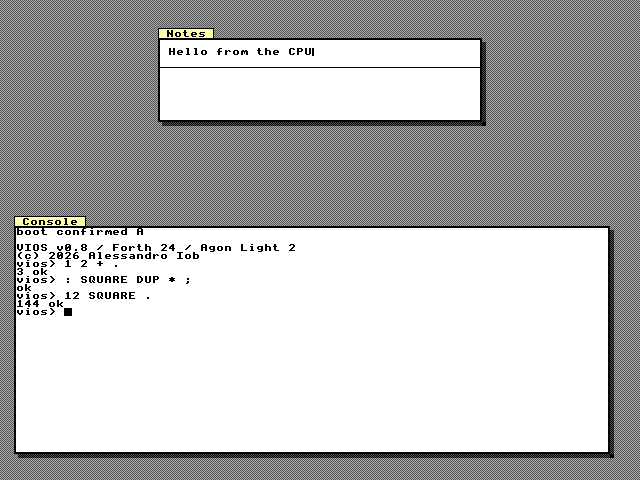

### How it works

The CPU and the ESP talk over the VDP serial link:

- **Ops go one way, in batches.** Each `UI-` word encodes one small op (a few
  bytes) and sends it inside a `VDU 23,0,&E4,len,...` packet. The ESP checks the
  length of the whole packet before applying any of it, so a damaged packet is
  dropped without side effects.
- **Composition is the ESP's job.** At every vertical blank the ESP composes the
  damaged parts of the screen, top to bottom, from the desktop pattern, the
  windows (back to front, with shadows) and the sprites, and never shows a
  half-drawn window. About 3 ms of each 16.7 ms frame go to composing; damage that
  does not fit carries over to the next frame.
- **Events are pulled.** Keys go to the ESP's window manager first. What it uses
  (a menu key, Tab between widgets, typing into an input field) never reaches the
  CPU; what it produces are *semantic events*: "button 5 pressed", "row 3
  selected", "command 100 chosen", "close requested". They wait in a 16-entry
  queue on the ESP until the CPU asks for them with [`UI-NEXT`](#w-ui-next) or
  [`UI-EVENT`](#w-ui-event). When the GUI tools are running they switch on the
  *nudge*: the ESP sends a one-byte packet when an event arrives, so the CPU only
  polls when there is something to fetch.
- **Unused keys still reach Forth.** A key that no window-manager binding and no
  widget wants goes to the CPU's keyboard input as before, unless the focused
  window drops it (see [`UI-KEYS`](#w-ui-keys)).

At power-on the ESP starts the display server before the eZ80 has loaded, so the
desktop and the **Console** window (the REPL) appear at once. **Ctrl+Alt+F1**
switches between the desktop and a full-screen text console at any time; the
server keeps all windows while hidden and repaints them when you come back.

Most `UI-` words only send bytes, so they also run on the host build and in
background tasks (they check their arguments and report errors the same way).
Five words wait for a reply from the ESP and therefore work only in the
foreground on the board: [`UI-SYNC`](#w-ui-sync), `UI-EVENT`, `UI-NEXT`,
[`UI-WGET`](#w-ui-wget) and [`UI-TEXT@`](#w-ui-textfetch).

### Ids and limits

All objects are numbered. Some numbers belong to the system:

| Object | Range for the CPU | Taken by the system | Use in your programs |
|---|---|---|---|
| Windows | 0..26 | 20..24 GUI tools, 26 workbench | 0..19 |
| Surfaces | 0..10 | 5..9 GUI tools, 10 workbench | 0..4 |
| Widgets | 0..63, shared by all windows | 40..63 GUI tools | 0..39 |
| Menus | 0..15 | 0 world menu or menu bar, 12, 14, 15 tool pane menus | 1..11, 13 |
| Commands | ids 0..65023, 64 defined at a time | $7F00..$7FFF GUI tools (11 commands) | other ids |
| Sprites | 0..15 | 15 is the pointer | 0..14 |

Other limits: window titles 31 characters, command labels 23, menu titles 15,
16 items per menu and 3 levels of submenus, widget text 47, list rows 31
characters and 1024 rows shared by all lists, 4 TextViews of 4096 bytes each
(shared with the tools), 16 running tweens, 4096 bytes of sprite pixels, 8
events buffered on the CPU and 16 on the ESP.

### Surfaces and cells

Text lives in *surfaces*: grids of character cells, up to 80 x 60. A cell is a
character and an attribute byte, `fg + 16 * bg`, where both are palette
indices. Indices 0..3 are black, red, yellow and white in every style; 4..15
belong to the style, so a surface meant to look the same everywhere uses 0..3.
The attribute 48 (`3 16 * 0 +`) is black on white.

A *window* shows a surface (or part of one). Several windows may show the same
surface, and you can draw into a surface whether or not a window shows it.

```forth
0 40 10 48 UI-SURFACE                    \ surface 0: 40 x 10 cells, black on white
1 0 160 120 40 10 UI-VISIBLE UI-DECOR OR UI-SHADOW OR UI-WINDOW
S" Notes" 1 UI-TITLE
S" Hello from the CPU" 0 1 1 48 UI-TYPE  \ surface 0, column 1, row 1
0 0 3 40 1 2 48 UI-FILL                  \ row 3: glyph 2 is a one-pixel horizontal line
0 19 1 3 TRUE UI-CARET                   \ a blinking bar caret after the text
1 UI-FOCUS  UI-COMMIT
```

[`UI-SURFACE`](#w-ui-surface) `( id cols rows attr -- )` creates or clears a
surface. [`UI-TYPE`](#w-ui-type) `( addr len id col row attr -- )` writes text,
[`UI-FILL`](#w-ui-fill) `( id col row w h char attr -- )` fills a rectangle,
[`UI-SCROLL`](#w-ui-scroll) `( id dy attr -- )` scrolls the whole surface (a
positive `dy` moves the text up) and [`UI-CARET`](#w-ui-caret)
`( id col row shape blink -- )` places a caret (shape 0 off, 1 block, 2
underline, 3 bar) that the ESP blinks by itself. Characters 1 and 2 are the
server's one-pixel vertical and horizontal line glyphs.

### Windows

[`UI-WINDOW`](#w-ui-window) `( id surface x y cols rows flags -- )` opens a
window. `x y` is the pixel position of the top-left corner of the *client
area* (the frame and the title are drawn around it); `cols rows` is its size in
cells. The flags add up:

| Flag | Value | Meaning |
|---|---|---|
| [`UI-VISIBLE`](#w-ui-visible) | 1 | shown |
| [`UI-DECOR`](#w-ui-decor) | 2 | frame and title in the current style; only visible, decorated windows can take the focus |
| [`UI-SHADOW`](#w-ui-shadow) | 4 | drop shadow |
| [`UI-ACTIVE`](#w-ui-active) | 8 | drawn as the active window (the server manages it as the focus moves) |
| [`UI-FREE-X`](#w-ui-free-x) | 16 | never snap this window's x |
| [`UI-MODAL`](#w-ui-modal) | 32 | a dialog: dims everything below it, keeps the focus, Esc becomes a close request |

The usual value for an application window is 7 (visible, decorated, shadow).

**Snapping.** At 4 bits per pixel a cell is exactly four bytes wide, so text
draws fastest when the client area starts on a multiple of 8 pixels. By default
the server therefore rounds every window's x to 8; y is free. `1 UI-SNAP`
allows any x for all windows, `8 UI-SNAP` restores the default, and the
`UI-FREE-X` flag exempts a single window.

Once a window exists:

```forth
1 200 80 40 10 UI-PLACE                  \ move (pixels) and resize (cells) in one step
1 UI-RAISE                               \ to the front, without the keyboard
1 0 1 UI-VIEW                            \ show the surface from row 1
1 0 0 UI-VIEW
1 UI-FOCUS                               \ to the front, with the keyboard
UI-COMMIT
```

- [`UI-TITLE`](#w-ui-title) `( addr len id -- )` sets the title. Smalltalk
  draws it in a tab above the top-left corner, Turbo Vision centres it in the
  top frame.
- [`UI-FOCUS`](#w-ui-focus) `( id -- )` raises the window, marks it active and
  sends a FOCUS event; [`UI-RAISE`](#w-ui-raise) only raises it.
- [`UI-FLAGS`](#w-ui-flags) `( id flags -- )` replaces the flags (clearing
  `UI-VISIBLE` hides a window without closing it),
  [`UI-CLIENT`](#w-ui-client) `( id surface -- )` shows another surface, and
  [`UI-VIEW`](#w-ui-view) `( id col row -- )` scrolls a window over a surface
  larger than itself.
- [`UI-CLOSE`](#w-ui-close) `( id -- )` closes the window. Its widgets are
  forgotten, its surface stays.

The user moves windows with the keyboard too, all handled on the ESP: **F6** and
**Shift+F6** cycle the focus, **F5** zooms the focused window to nearly the
whole screen and back, **Ctrl+F5** enters move/resize mode (arrows move by 8
pixels, Shift+arrows resize by a cell, Enter keeps, Esc reverts), and **Ctrl+W**
or **Alt+F3** ask to close it. The server never closes a window by itself: a
close request arrives as a WIN event, and your program decides (see
[Events](#events)). Moves, zooms and restores are reported the same way.

### Styles: Smalltalk and Turbo Vision

The same windows, widgets and commands can be presented in two styles, switched
at any time with [`UI-STYLE`](#w-ui-style): `0 UI-STYLE` for Smalltalk (the
default) and `1 UI-STYLE` for Turbo Vision. Every window is re-decorated and
repainted; nothing else changes.

| | Smalltalk (0) | Turbo Vision (1) |
|---|---|---|
| Desktop | grey dither | blue dither |
| Windows | white body, black 1-pixel border, title in a tab above the top-left corner | blue body, double frame when active, title centred in the top frame |
| Shadow | 4 pixels | two cells right, one cell down |
| Menu 0 | the *world menu*, a pop-up opened with F10 | the *menu bar* along the top row, opened with F10 or Alt+letter |
| Status line | none | bottom row, lists commands flagged `UI-STATUS` with their keys |
| Selection | inverted in the focused widget, grey bar elsewhere | green bar |

```forth
1 UI-STYLE                               \ Turbo Vision
0 UI-STYLE                               \ back to Smalltalk
```

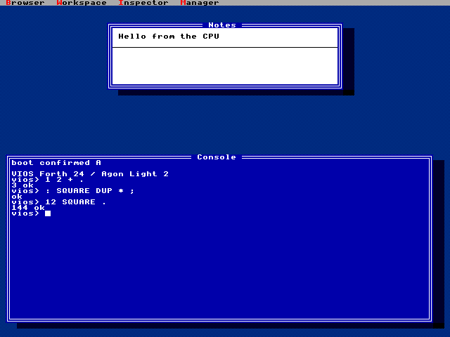

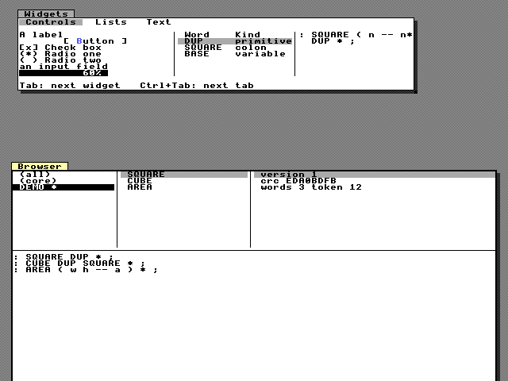

Because the GUI tools put their four commands directly into menu 0 (not into
submenus), the Turbo Vision menu bar shows *Browser Workspace Inspector
Manager* as top-level entries: F10 or Alt+B then opens the Browser at once
instead of a pulldown.

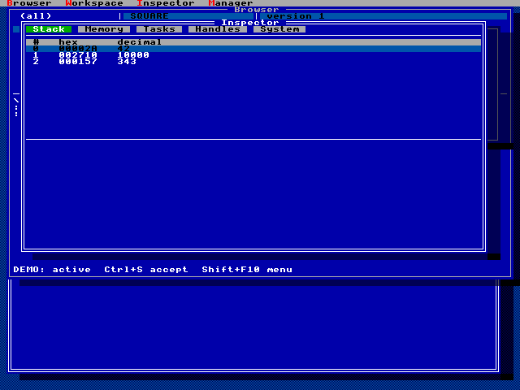

### Batching: UI-BEGIN and UI-COMMIT

Without a batch, every `UI-` word sends its op at once. To avoid showing a
half-built window, the ESP *holds* composition after any change until it sees a
COMMIT op, or for at most 33 ms. Wrap anything bigger than one op in
[`UI-BEGIN`](#w-ui-begin) and [`UI-COMMIT`](#w-ui-commit):

```forth
UI-BEGIN
  S" Notes (edited)" 1 UI-TITLE
  S" Second line" 0 1 2 48 UI-TYPE
UI-COMMIT
```

`UI-BEGIN` collects the ops in a 250-byte buffer on the CPU (a full buffer is
sent and collecting continues), and `UI-COMMIT` sends the rest with a COMMIT, so
the whole change appears in one frame. Batching also saves time: the link
carries one packet instead of many. A lone `UI-COMMIT` after a few unbatched
words is fine too; it just ends the hold early.

[`UI-SYNC`](#w-ui-sync) `( -- epoch generation errors )` asks the server for
its state: how many resets it has seen, how many batches it has applied and how
many ops it has refused since the last reset. A growing error count means some
op referred to something that does not exist.

<!-- nocheck -->
```forth
UI-SYNC . . .                            \ errors generation epoch
```

### Commands and menus

A *command* is an action with a number, a label and optionally a key. You
define it once with [`UI-COMMAND`](#w-ui-command)
`( addr len id flags vk mods ascii -- )`; the ESP then offers it in menus, in
the command palette and through its accelerator, in both styles, and sends a
COMMAND event when it is chosen.

- The label may mark a mnemonic letter with `&` (`S" &Quit"`); `&&` is a
  literal ampersand.
- `flags` adds [`UI-ENABLED`](#w-ui-enabled) (2, needed to be chosen at all),
  [`UI-CHECKED`](#w-ui-checked) (4, a `*` in menus) and
  [`UI-STATUS`](#w-ui-status) (8, shown on the Turbo Vision status line).
- The accelerator is `vk` (a virtual key, for example 159..170 for F1..F12;
  0 for none) or else the character `ascii`, plus `mods`: [`UI-CTRL`](#w-ui-ctrl)
  1, [`UI-SHIFT`](#w-ui-shift) 2, [`UI-ALT`](#w-ui-alt) 4. For Ctrl+letter pass
  the letter (113 for Ctrl+Q). Menus show the key text, such as `Ctrl+Q`.

[`UI-MENU`](#w-ui-menu) `( item1 .. itemN n addr len menu -- )` defines menu
0..15. Note the order: the items, then their count, then the title. An item is a
command id, [`UI-SEPARATOR`](#w-ui-separator), or `m UI-SUBMENU` to open menu
`m` as a submenu. [`UI-POPUP`](#w-ui-popup) `( id menu -- )` binds a menu to a
window as its pop-up menu, opened with **Shift+F10** while the window has the
focus (255 restores the default, the world menu). [`UI-STATE`](#w-ui-state)
`( id flags -- )` changes a command's flags later, for example to grey it out or
tick it.

```forth
S" &New note"   200 UI-ENABLED 0 UI-CTRL 110 UI-COMMAND     \ Ctrl+N
S" &Word wrap"  201 UI-ENABLED UI-CHECKED OR 0 0 0 UI-COMMAND
S" &Large font" 202 0 0 0 0 UI-COMMAND                       \ defined but disabled
S" &Quit"       203 UI-ENABLED UI-STATUS OR 0 UI-CTRL 113 UI-COMMAND
201 202 2 S" View" 2 UI-MENU                                 \ menu 2: View
200 2 UI-SUBMENU UI-SEPARATOR 203 4 S" Notes" 1 UI-MENU      \ menu 1: Notes
1 1 UI-POPUP                                                 \ Shift+F10 in window 1
201 UI-ENABLED UI-STATE                                      \ untick Word wrap
UI-COMMIT
```

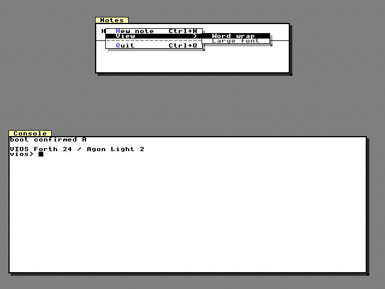

The user reaches commands in several ways, all on the ESP:

- **Menus.** F10 opens menu 0 (the world menu in Smalltalk, the first entry of
  the menu bar in Turbo Vision); Alt+letter opens the menu-bar entry with that
  mnemonic (Turbo Vision); Shift+F10 opens the focused window's pop-up menu.
  Inside a menu, Up/Down move, Enter or the mnemonic letter chooses, Right opens
  a submenu (or the next menu-bar entry), Left closes it (or goes to the
  previous entry), Esc closes one level.
- **The command palette.** **Ctrl+K** or **Ctrl+Shift+P** opens a list of every
  enabled command; typing filters it (letters in order, case ignored),
  Backspace removes a letter, Enter runs the selection.
- **Accelerators** work whenever no menu is open, before the focused widget
  sees the key. They are global: Ctrl+Q above fires whichever window has the
  focus, and the COMMAND event tells you which one.

Menu 0 is shared: the GUI tools define it as their *World* menu with Browser,
Workspace, Inspector and Manager. Redefining menu 0 replaces it.

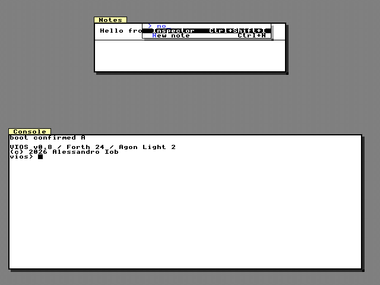

### Widgets

Widgets are controls drawn by the ESP into a window's surface. They take keys
and clicks locally and report what happened as events. Create one with
[`UI-WIDGET`](#w-ui-widget) `( id window kind parent col row w h flags -- )`:

| Kind | Value | What it is | Text | Value |
|---|---|---|---|---|
| [`UI-BOX`](#w-ui-box) | 1 | invisible container that lays out its children | - | - |
| [`UI-LABEL`](#w-ui-label) | 2 | one line of text | caption | - |
| [`UI-BUTTON`](#w-ui-button) | 3 | push button `[ Go ]` | caption | - |
| [`UI-CHECK`](#w-ui-check) | 4 | check box `[x]` | caption | 0 or 1 |
| [`UI-RADIO`](#w-ui-radio) | 5 | radio button `(*)`; same parent = one group | caption | 0 or 1 |
| [`UI-INPUT`](#w-ui-input) | 6 | one-line input field, 47 characters | contents | caret position |
| [`UI-LIST`](#w-ui-list) | 7 | scrolling list or table | table header | selected row |
| [`UI-PROGRESS`](#w-ui-progress) | 8 | progress bar with percentage | - | 0..100 |
| [`UI-TEXTVIEW`](#w-ui-textview) | 9 | multi-line text editor ([Text views](#text-views)) | - | dirty flag |
| [`UI-TABS`](#w-ui-tabs) | 10 | a row of tabs | labels separated by `\|` | selected tab |

Flags: [`UI-HIDDEN`](#w-ui-hidden) 1, [`UI-DISABLED`](#w-ui-disabled) 2,
[`UI-WF-FILL`](#w-ui-wf-fill) 4 (a root box that covers the whole client area
and follows the window's size), [`UI-READONLY`](#w-ui-readonly) 8 (TextView),
[`UI-TREE`](#w-ui-tree) 16 and [`UI-PAGER`](#w-ui-pager) 32 (lists).

Widget ids are global: id 5 is one widget, whatever window it is in, and
creating a widget with an id in use replaces the old one. The widgets of a
window are forgotten when it closes.

**Layout.** You can place a widget at `col row w h` in client cells, but it is
easier to let boxes do it. [`UI-LAYOUT`](#w-ui-layout) `( id layout gap -- )`
makes a box arrange its children in creation order, as a column
([`UI-COLUMN`](#w-ui-column), 1) or a row ([`UI-ROW`](#w-ui-row), 2), with
`gap` empty cells between them. [`UI-WSIZE`](#w-ui-wsize)
`( id fixed weight -- )` gives a child a fixed number of cells along the box's
direction, or (with `fixed` 0) a share of what is left, by weight. Boxes nest,
and the layout follows the window when it is resized or zoomed. In the gap
between two *panes* (lists, text views, boxes) the server draws a one-pixel
divider line; gaps next to buttons, labels and inputs stay blank.

**Setting and reading.** [`UI-WTEXT`](#w-ui-wtext) `( addr len id -- )` and
[`UI-WVALUE`](#w-ui-wvalue) `( id value -- )` set the text and value columns of
the table above. [`UI-WGET`](#w-ui-wget) `( id addr -- value len )` reads them
back (at most 25 characters of text). [`UI-WFOCUS`](#w-ui-wfocus) `( id -- )`
moves the keyboard to a widget, [`UI-WDELETE`](#w-ui-wdelete) `( id -- )`
deletes it with its children.

**Lists and tables.** [`UI-ITEMS`](#w-ui-items) `( id count -- )` sets the number
of rows, [`UI-ITEM`](#w-ui-item) `( addr len id index -- )` sets one row.
[`UI-COLUMNS`](#w-ui-columns) `( w1 .. wn n id -- )` turns a list into a table
of up to 8 columns: rows and the header (the widget text) then separate their
cells with a tab character (9). A `UI-TREE` list sends EXPAND events for Right
and Left; your program rewrites the rows (indent them, mark them with `+` or
`-`). A `UI-PAGER` list sends PAGE events when the user moves past its first or
last row, so a long or endless sequence can be shown a page at a time (the
Inspector's memory view works this way).

The keys each widget understands are listed in the
[keyboard reference](#keyboard-reference). In short: **Tab** and **Shift+Tab**
move between the focusable widgets of the window in creation order, **Space**
presses buttons and toggles check boxes and radios, **Enter** presses buttons
and activates inputs and lists, lists move with the arrows, PgUp/PgDn,
Home/End and type-ahead, and **Ctrl+Tab** changes the tab of the window's tabs
widget.

This program builds a window with one widget of every kind. The small helpers
`W` (create a widget in this window) and `TAB2` (join two strings with a tab)
keep it short:

```forth
4 CONSTANT GAL   3 CONSTANT GSF
CREATE RB 48 ALLOT   VARIABLE RL
: R+ ( addr len -- )  DUP >R  RB RL @ + SWAP MOVE  R> RL +! ;
: TAB2 ( a1 u1 a2 u2 -- addr len )  2SWAP 0 RL !  R+  9 RB RL @ + C!  1 RL +!  R+  RB RL @ ;
CREATE NL 10 C,
: W ( id kind parent -- )  >R GAL SWAP R> 0 0 0 0 0 UI-WIDGET ;
: GALLERY ( -- )
  UI-BEGIN
  GSF 62 11 48 UI-SURFACE
  GAL GSF 24 24 62 11 UI-VISIBLE UI-DECOR OR UI-SHADOW OR UI-WINDOW
  S" Widgets" GAL UI-TITLE
  0 GAL UI-BOX UI-NONE 0 0 0 0 UI-WF-FILL UI-WIDGET   0 UI-COLUMN 1 UI-LAYOUT
  1 UI-TABS 0 W   1 1 0 UI-WSIZE   S" Controls|Lists|Text" 1 UI-WTEXT
  2 UI-BOX 0 W    2 0 1 UI-WSIZE   2 UI-ROW 1 UI-LAYOUT
  3 UI-BOX 2 W    3 24 0 UI-WSIZE  3 UI-COLUMN 0 UI-LAYOUT
  4 UI-LABEL 3 W     4 1 0 UI-WSIZE   S" A label" 4 UI-WTEXT
  5 UI-BUTTON 3 W    5 1 0 UI-WSIZE   S" &Button" 5 UI-WTEXT
  6 UI-CHECK 3 W     6 1 0 UI-WSIZE   S" &Check box" 6 UI-WTEXT   6 1 UI-WVALUE
  7 UI-RADIO 3 W     7 1 0 UI-WSIZE   S" Radio &one" 7 UI-WTEXT   7 1 UI-WVALUE
  8 UI-RADIO 3 W     8 1 0 UI-WSIZE   S" Radio &two" 8 UI-WTEXT
  9 UI-INPUT 3 W     9 1 0 UI-WSIZE   S" an input field" 9 UI-WTEXT
  11 UI-PROGRESS 3 W 11 1 0 UI-WSIZE  11 60 UI-WVALUE
  10 UI-LIST 2 W     10 0 1 UI-WSIZE
  8 10 2 10 UI-COLUMNS   S" Word" S" Kind" TAB2 10 UI-WTEXT
  10 3 UI-ITEMS
  S" DUP" S" primitive" TAB2 10 0 UI-ITEM
  S" SQUARE" S" colon" TAB2 10 1 UI-ITEM
  S" BASE" S" variable" TAB2 10 2 UI-ITEM
  12 UI-TEXTVIEW 2 W  12 0 1 UI-WSIZE
  S" : SQUARE ( n -- n*n )" 12 UI-TEXT  NL 1 12 UI-TEXT+  S"   DUP * ;" 12 UI-TEXT+
  13 UI-LABEL 0 W    13 1 0 UI-WSIZE   S" Tab: next widget   Ctrl+Tab: next tab" 13 UI-WTEXT
  GAL UI-FOCUS
  UI-COMMIT ;
GALLERY
```

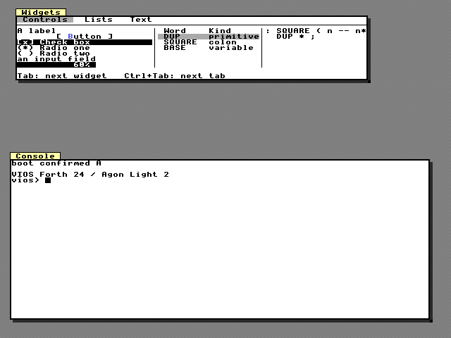

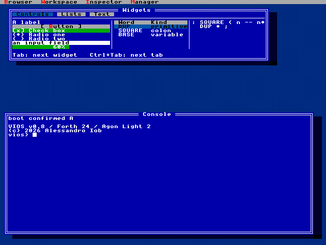

#### Appending rows: UI-ROW+

[`UI-ROW+`](#w-ui-rowplus) `( addr len id -- )` appends one row to list `id`
(protocol op 92), like [`UI-TEXT+`](#w-ui-textplus) appends text. `UI-ROW`
without the `+` is the layout constant 2 for [`UI-LAYOUT`](#w-ui-layout).

```forth
10 0 UI-ITEMS                            \ list 10 starts empty
S" first" 10 UI-ROW+  S" second" 10 UI-ROW+
```

### Text views

A TextView ([`UI-TEXTVIEW`](#w-ui-textview)) is a small text editor run by the
ESP: up to 4096 bytes in lines ending in a line feed, with a caret, a selection,
scrolling and a 1 KB clipboard, all without the CPU. The GUI tools use it for
the Browser's code pane, the Workspace and the read-only report panes. Four can
exist at a time, including the tools' own.

- [`UI-TEXT`](#w-ui-text) `( addr len id -- )` replaces the text,
  [`UI-TEXT+`](#w-ui-textplus) appends to it.
- [`UI-SELECT`](#w-ui-select) `( id caret anchor -- )` sets the caret and the
  selection (byte offsets; equal values mean no selection).
- [`UI-INSERT`](#w-ui-insert) `( addr len id -- )` replaces the selection with
  up to 200 bytes and selects what it inserted.
- [`UI-TEXT@`](#w-ui-textfetch) `( id addr max -- len )` copies the text back
  to the CPU.
- `UI-WVALUE` on a TextView sets or clears its *dirty* flag. The first edit after
  the flag was cleared sends one CHANGE event.

```forth
12 8 2 UI-SELECT                         \ select "SQUARE" in the gallery's text view
S" SQ" 12 UI-INSERT                      \ now ": SQ ( n -- n*n )", "SQ" selected
12 0 UI-WVALUE                           \ not dirty
UI-COMMIT
```

<!-- nocheck -->
```forth
CREATE BUF 256 ALLOT
12 BUF 256 UI-TEXT@ BUF SWAP TYPE        \ needs the ESP: prints the text
```

With the [`UI-READONLY`](#w-ui-readonly) flag the caret moves and text can be
selected and copied, but not changed. A TextView also turns four keys into TEXT
events for the program: **Ctrl+S** (*accept*), **Ctrl+D** (*do it*), **Ctrl+P**
(*print it*) and **Ctrl+I** (*inspect it*). For the last three, with nothing
selected, the server first selects the caret's line. The event carries the
selection, so the program can read exactly that range and evaluate it; this is
how the [Workspace](#the-workspace) works. **Ctrl+[** and **Ctrl+]** add or
remove two spaces at the start of every selected line. Tab leaves the view
(there is no tab character).

### Events

Every user action that matters to the program becomes an event in the ESP's
queue. [`UI-NEXT`](#w-ui-next) `( -- kind id arg true | false )` takes the next
one, decoded; [`UI-EVENT`](#w-ui-event) `( addr -- len )` stores the raw bytes
(`seq kind id` and up to 26 argument bytes) and returns the length, 0 if none.
Both first look in the CPU's 8-event ring and poll the ESP when it is empty.

`arg` is the first two argument bytes as an unsigned number (just the first if
there is only one). Most events need nothing more:

| Kind | Value | id | arg | More (UI-EVENT bytes) |
|---|---|---|---|---|
| [`UI-EV-ACTIVATE`](#w-ui-ev-activate) | 2 | widget | window | |
| [`UI-EV-SELECT`](#w-ui-ev-select) | 3 | widget (list, tabs) | row or tab | window |
| [`UI-EV-CHANGE`](#w-ui-ev-change) | 4 | widget | new value (input: text length) | window |
| [`UI-EV-TEXT`](#w-ui-ev-text) | 5 | TextView | low byte: 1 accept, 2 do it, 3 print it, 4 inspect it | selection start, end, window |
| [`UI-EV-FOCUS`](#w-ui-ev-focus) | 6 | window now focused (255 none) | previous window | |
| [`UI-EV-POINTER`](#w-ui-ev-pointer) | 7 | window under the pointer (255 desktop) | x | y, column, row, part, buttons |
| [`UI-EV-EXPAND`](#w-ui-ev-expand) | 8 | tree list | row | window, 1 open / 0 close |
| [`UI-EV-PAGE`](#w-ui-ev-page) | 9 | pager list | low byte: 1/255 down/up, 2/254 page down/up | window |
| [`UI-EV-OVERFLOW`](#w-ui-ev-overflow) | 14 | 0 | events lost | |
| [`UI-EV-ERROR`](#w-ui-ev-error) | 15 | 0 | refused op + 256 * offset | |
| [`UI-EV-WIN`](#w-ui-ev-win) | 16 | window | low byte: 1 moved, 2 close request, 3 zoomed, 4 restored | x, y, cols, rows |
| [`UI-EV-COMMAND`](#w-ui-ev-command) | 17 | focused window | command id | source: 1 menu, 2 key, 3 palette |
| [`UI-EV-ANIMDONE`](#w-ui-ev-animdone) | 18 | window or sprite | target + 256 * property | |
| [`UI-EV-CANVAS`](#w-ui-ev-canvas) | 19 | canvas | x in canvas pixels | y, the item under the point (255 none) |

For "low byte" rows take `arg 255 AND`, because the second byte of `arg` is
already the next argument.

Kind 20 carries the text lines of `/dev/win/N/event` files to the handle
layer (see [Windows as files: /dev/win](#windows-as-files-devwin)); while such a
file is open, that node's events never reach `UI-NEXT`.

Some practical points:

- Polling costs a round trip over the serial link. Handle every waiting event,
  then wait a little (`20 MS`) before asking again, rather than spinning.
- The ESP queue holds 16 events. If your program does not read them, the oldest
  are dropped and an OVERFLOW event says how many.
- The event words wait for the ESP, so they run only in the foreground task,
  never in a background task.
- The GUI tools take their own events (commands $7F00..$7FFF, their windows 20
  to 24 and widgets 40 to 63) out of the stream before `UI-NEXT` sees it, so your
  loop never receives them. They handle them when the REPL is idle again.

A convenient pattern is to copy the event into three variables and test them
with a small helper:

```forth
VARIABLE KIND   VARIABLE WHO   VARIABLE ARG
: EVENT? ( -- flag )  UI-NEXT DUP IF >R ARG ! WHO ! KIND ! R> THEN ;
: IS? ( kind id -- flag )  WHO @ =  SWAP KIND @ =  AND ;
: CLOSING? ( window -- flag )  UI-EV-WIN SWAP IS?  ARG @ 255 AND 2 =  AND ;
```

`UI-EV-ACTIVATE 5 IS?` is then true when button 5 was pressed, and
`1 CLOSING?` when the user asked to close window 1.

### Tutorial: a window with widgets and an event loop

This section builds a small "Greeter" window step by step: a label, an input
field, a check box, an answer line and two buttons. Type each step at the
console (or put them in a file and `LOAD` it). It reuses `EVENT?`, `IS?` and
`CLOSING?` from the previous section.

**Step 1: a surface and a window.** Window 2 shows surface 1, 40 x 9 cells, at
pixel 160, 120. The window needs a surface even if only widgets will be in it,
because widgets draw into the surface.

```forth
2 CONSTANT GWIN   1 CONSTANT GSURF
GSURF 40 9 48 UI-SURFACE
GWIN GSURF 160 120 40 9 UI-VISIBLE UI-DECOR OR UI-SHADOW OR UI-WINDOW
S" Greeter" GWIN UI-TITLE
GWIN UI-FOCUS  UI-COMMIT
```

**Step 2: the widgets.** A root box (id 20) with `UI-WF-FILL` covers the client
area and stacks its children in a column with one empty row between them. Each
child takes one row (`1 0 UI-WSIZE`). The two buttons sit side by side in a
second box (id 25) laid out as a row. Building everything inside `UI-BEGIN` ...
`UI-COMMIT` makes the window appear complete in one frame.

```forth
UI-BEGIN
20 GWIN UI-BOX UI-NONE 0 0 0 0 UI-WF-FILL UI-WIDGET   20 UI-COLUMN 1 UI-LAYOUT
21 GWIN UI-LABEL 20 0 0 0 0 0 UI-WIDGET   21 1 0 UI-WSIZE   S" Your name:" 21 UI-WTEXT
22 GWIN UI-INPUT 20 0 0 0 0 0 UI-WIDGET   22 1 0 UI-WSIZE
23 GWIN UI-CHECK 20 0 0 0 0 0 UI-WIDGET   23 1 0 UI-WSIZE   S" &Shout" 23 UI-WTEXT
24 GWIN UI-LABEL 20 0 0 0 0 0 UI-WIDGET   24 1 0 UI-WSIZE
25 GWIN UI-BOX 20 0 0 0 0 0 UI-WIDGET     25 1 0 UI-WSIZE   25 UI-ROW 2 UI-LAYOUT
26 GWIN UI-BUTTON 25 0 0 0 0 0 UI-WIDGET  S" &Greet" 26 UI-WTEXT
27 GWIN UI-BUTTON 25 0 0 0 0 0 UI-WIDGET  S" &Close" 27 UI-WTEXT
22 UI-WFOCUS
UI-COMMIT
```

You can already use the window: type into the field, Tab to the check box and
press Space, Tab to the buttons. All of that happens on the ESP; the CPU is not
involved yet.

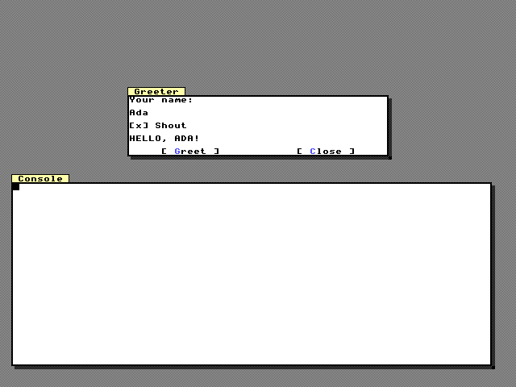

**Step 3: reading the field and answering.** `GREET` reads the input field with
`UI-WGET` (which returns the value, here the caret position, and the text
length), builds "Hello, name!" in a buffer, upper-cases it when the check box
is ticked, and shows it in label 24.

```forth
CREATE NAME 32 ALLOT
CREATE ANSWER 48 ALLOT   VARIABLE ALEN
: A+ ( addr len -- )  DUP >R  ANSWER ALEN @ + SWAP MOVE  R> ALEN +! ;
: UPCASE ( addr len -- )
  BOUNDS ?DO I C@ DUP 97 123 WITHIN IF 32 - I C! ELSE DROP THEN LOOP ;
: GREET ( -- )
  0 ALEN !  S" Hello, " A+
  22 NAME UI-WGET NIP  NAME SWAP A+  S" !" A+
  23 NAME UI-WGET DROP  IF ANSWER ALEN @ UPCASE THEN
  ANSWER ALEN @ 24 UI-WTEXT ;
```

**Step 4: the event loop.** `GSTEP` handles every event that is waiting: the
Greet button and Enter in the input field (both ACTIVATE events) greet, the
Close button and a close request (Ctrl+W) end the loop. `GREETER` repeats it
every 20 ms until done, then closes the window.

```forth
VARIABLE GDONE
: GHANDLE ( -- )
  UI-EV-ACTIVATE 26 IS?  UI-EV-ACTIVATE 22 IS?  OR IF GREET THEN
  UI-EV-ACTIVATE 27 IS?  GWIN CLOSING?  OR IF TRUE GDONE ! THEN ;
: GSTEP ( -- )  BEGIN EVENT? WHILE GHANDLE REPEAT ;
: GREETER ( -- )
  FALSE GDONE !
  BEGIN GSTEP 20 MS  GDONE @ UNTIL
  GWIN UI-CLOSE ;
```

Run it on the board:

<!-- nocheck -->
```forth
GREETER
```

The REPL is busy while `GREETER` runs. To keep the console free, give the loop
its own key to stop it, or run the loop only from the console when you need it:
the event words cannot run in a background task. When the loop ends,
`GWIN UI-CLOSE` removes the window and its widgets; run steps 1 and 2 again to
reopen it.

### Animation and tweens

The ESP can move windows and sprites smoothly by itself.
[`UI-ANIMATE`](#w-ui-animate) `( target id prop from to ms easing -- )` starts
a *tween*:

- `target` is [`UI-TWEEN-WINDOW`](#w-ui-tween-window) or
  [`UI-TWEEN-SPRITE`](#w-ui-tween-sprite);
- `prop` is [`UI-X`](#w-ui-x) or [`UI-Y`](#w-ui-y) in pixels, or for a window
  [`UI-SCROLL-ROW`](#w-ui-scroll-row) / [`UI-SCROLL-COL`](#w-ui-scroll-col)
  (scrolling the surface inside it);
- `from` and `to` are signed, `ms` is the duration (0 jumps at once);
- `easing` is [`UI-LINEAR`](#w-ui-linear), [`UI-IN-OUT`](#w-ui-in-out),
  [`UI-OUT`](#w-ui-out) or [`UI-SPRING`](#w-ui-spring), which overshoots and
  settles back.

The tween advances once per frame, so it costs the CPU one op however long it
runs. A new tween on the same object and property replaces the running one; up
to 16 run at once. [`UI-STOP`](#w-ui-stop) `( target id prop -- )` freezes one
where it is. When a tween ends, an ANIMDONE event reports it.

```forth
UI-TWEEN-WINDOW 1 UI-Y 480 80 700 UI-SPRING UI-ANIMATE   \ the Notes window drops in
```

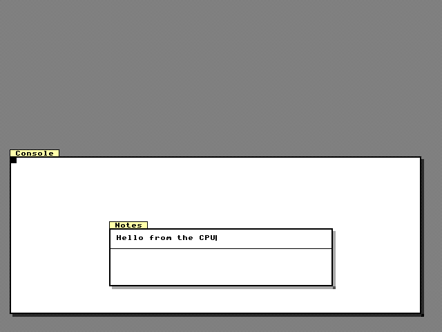

Window x positions are still snapped to 8 pixels during a tween unless the
window has `UI-FREE-X` or the snap is 1; y moves pixel by pixel.

### Canvases and icons

A **canvas** puts pixel graphics into a window: lines, rectangles, filled
boxes, ovals, discs, two-colour stipples, text at any pixel and icons. You
describe the picture once as a **display list** that the ESP keeps, then
change single items. The CPU never sends pixels and keeps no copy of the
picture: only a two-byte *pen* (the current canvas and colour).

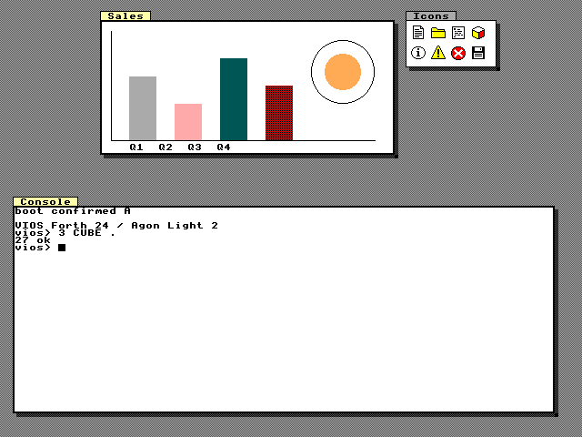

**The model.**

- A canvas is a `w × h` pixel rectangle placed on a **surface** at pixel
  position `x y` (x a multiple of 8). Every window that shows the surface
  shows the canvas, and it scrolls with the window. When the surface's *cells*
  scroll (console style), the canvas stays where it is.
- It has a background colour, or it is *transparent* (the surface's text
  shows through wherever nothing is drawn).
- Its **items** have ids 0–254 and draw in id order, higher ids on top.
  Setting an item that exists replaces it, so you can leave gaps in the
  numbering and fill them later.
- The ESP keeps a 4-bit backing raster per canvas and redraws only the part
  an edit touched, at the start of the next frame and within the frame's time
  budget. A canvas therefore costs about what the same area of text costs to
  compose, however many items it has.
- Colours are palette indices 0–15. Indices 4–15 change with the style
  (Smalltalk or Turbo Vision); 0–3 look the same in both.

| Limit | Value |
|---|---|
| Canvases | 8 (ids 0–7) |
| Canvas size | up to 640 × 480; all rasters together at most 256 KB |
| Items | 255 per canvas (ids 0–254) |
| Text item | up to 20 characters |
| Bitmaps | 32 ids: 0–23 your own (up to 64 × 64, 4 bits per pixel), 24–31 built-in 16 × 16 icons |

**Drawing.** Create the canvas with [`UI-CANVAS`](#w-ui-canvas), choose it
and a colour with [`UI-PEN`](#w-ui-pen), then set items:

| Word | Stack | Item |
|---|---|---|
| [`UI-DOT`](#w-ui-dot) | ( item x y -- ) | one pixel |
| [`UI-LINE`](#w-ui-line) | ( item x0 y0 x1 y1 -- ) | a line, both ends included |
| [`UI-RECT`](#w-ui-rect) | ( item x y w h -- ) | a 1-pixel outline |
| [`UI-BAR`](#w-ui-bar) | ( item x y w h -- ) | a filled rectangle |
| [`UI-OVAL`](#w-ui-oval) | ( item x y w h -- ) | an ellipse outline in the box |
| [`UI-DISC`](#w-ui-disc) | ( item x y w h -- ) | a filled ellipse |
| [`UI-STIPPLE`](#w-ui-stipple) | ( item x y w h colour2 -- ) | a checker of the pen colour and colour2: the 16-colour way to shade |
| [`UI-PRINT`](#w-ui-print) | ( addr n item x y -- ) | text in the 8×8 font at any pixel, transparent background |
| [`UI-ICON`](#w-ui-icon) | ( item x y bitmap -- ) | a bitmap; its transparent colour is skipped |

The shapes all go through one native word, [`UI-SHAPE`](#w-ui-shape), so
they cost no dictionary slots beyond their colon definitions. Coordinates are
canvas pixels and may be negative; everything is clipped to the canvas.

**Editing.** [`UI-NUDGE`](#w-ui-nudge) ( item dx dy -- ) moves an item,
[`UI-INK`](#w-ui-ink) ( item colour -- ) recolours it,
[`UI-ERASE`](#w-ui-erase) ( item -- ) deletes it, and
[`UI-WIPE`](#w-ui-wipe) deletes them all. [`UI-CANVAS-AT`](#w-ui-canvas-at)
moves the whole canvas on its surface, and
[`UI-CANVAS-FLAGS`](#w-ui-canvas-flags) shows it, hides it, makes it
transparent or (with flags −1) deletes it. A tween can slide a canvas
without the CPU: target [`UI-TWEEN-CANVAS`](#w-ui-tween-canvas) in
[`UI-ANIMATE`](#w-ui-animate).

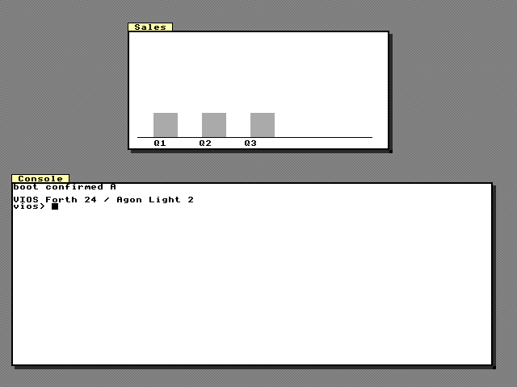

A bar chart in which one bar later changes:

```forth
2 40 18 48 UI-SURFACE                                \ surface 2: 40x18 cells
5 2 160 100 40 18 UI-VISIBLE UI-DECOR OR UI-SHADOW OR UI-WINDOW
S" Sales" 5 UI-TITLE
3 2 0 0 320 144 3 UI-CV-VISIBLE UI-CANVAS             \ canvas 3 fills it, white
3 0 UI-PEN  0 10 130 300 130 UI-LINE                  \ item 0: the axis
3 4 UI-PEN  1 20 60 30 70 UI-BAR                      \ item 1: a bar in colour 4
            2 70 90 30 40 UI-BAR                      \ item 2: another
3 0 UI-PEN  S" Q1  Q2" 3 20 134 UI-PRINT              \ item 3: the captions
UI-COMMIT
1 0 -20 UI-NUDGE  UI-COMMIT                           \ later: bar 1 grows 20 px
```

**Icons.** Eight 16 × 16 icons are built into the firmware as bitmaps 24–31:
[`UI-ICON-DOCUMENT`](#w-ui-icon-document), `UI-ICON-FOLDER`, `UI-ICON-WORD`,
`UI-ICON-MODULE`, `UI-ICON-INFO`, `UI-ICON-WARNING`, `UI-ICON-ERROR` and
`UI-ICON-DISK`. Your own bitmaps (ids 0–23) are defined with
[`UI-BITMAP`](#w-ui-bitmap) ( bitmap w h transparent -- ) and filled with
[`UI-BITS`](#w-ui-bits) ( addr n bitmap offset -- ): 4 bits per pixel, two
pixels a byte, rows packed. The bitmap pool is shared by all canvases.

```forth
4 2 0 0 160 24 3 UI-CV-VISIBLE UI-CANVAS              \ a strip of icons on surface 2
4 0 UI-PEN
: ICONS ( -- ) 8 0 DO  I  I 20 * 4 +  4  I 24 +  UI-ICON  LOOP ;
ICONS UI-COMMIT
```

**Events.** A click inside a visible canvas also queues a
[`UI-EV-CANVAS`](#w-ui-ev-canvas) event: the canvas id, the point in canvas
pixels and the topmost item there (255 for none), besides the ordinary pointer
event. With the keyboard pointer (Ctrl+F12) this works without a mouse.

**Resetting.** [`UI-RESET`](#w-ui-reset) drops every canvas and your
bitmaps; the built-in icons stay.


### Sprites and the pointer

Sprites are small 4-bit bitmaps drawn above all windows, higher ids on top. A
sprite is up to 64 x 64 pixels; all sprites share a 4096-byte pixel pool on the
ESP.

- [`UI-SPRITE`](#w-ui-sprite) `( id w h hotx hoty transparent -- )` defines
  one, hidden: its size, its *hotspot* (the pixel that sits at the sprite's
  position) and the colour index that is transparent.
- [`UI-PIXELS`](#w-ui-pixels) `( addr len id offset -- )` sends the pixels:
  rows of `(w + 1) / 2` bytes, the high nibble is the left pixel.
- [`UI-SPRITE-AT`](#w-ui-sprite-at) `( id x y -- )` moves it,
  [`UI-SPRITE-SHOW`](#w-ui-sprite-show) `( id flag -- )` shows or hides it.

```forth
HEX
CREATE BALL                              \ 8 x 8, colour F transparent, 0 outline, 2 yellow
  FF C, 00 C, 00 C, FF C,   F0 C, 22 C, 22 C, 0F C,
  02 C, 22 C, 22 C, 20 C,   02 C, 22 C, 22 C, 20 C,
  02 C, 22 C, 22 C, 20 C,   02 C, 22 C, 22 C, 20 C,
  F0 C, 22 C, 22 C, 0F C,   FF C, 00 C, 00 C, FF C,
DECIMAL
1 8 8 4 4 15 UI-SPRITE
BALL 32 1 0 UI-PIXELS
1 320 60 UI-SPRITE-AT  1 TRUE UI-SPRITE-SHOW
UI-TWEEN-SPRITE 1 UI-Y 60 400 900 UI-SPRING UI-ANIMATE  \ and it bounces
```

Sprite 15 ([`UI-CURSOR`](#w-ui-cursor)) is the pointer.
[`UI-ARROW`](#w-ui-arrow) `( id -- )` gives a sprite the built-in 12 x 16
arrow, and [`UI-POINTER`](#w-ui-pointer) `( x y buttons -- )` reports a pointer
position and button state to the server the way a mouse driver would: the arrow
moves there, a press focuses the window under it (and clicks the widget there),
and each button change sends a POINTER event.

```forth
UI-CURSOR UI-ARROW
320 240 0 UI-POINTER                     \ the arrow appears at the centre
```

Without a mouse, **Ctrl+F12** turns the keyboard into the pointer: the arrows
move it by 8 pixels (Shift: 1 pixel), Space or Enter clicks, Esc or Ctrl+F12
again leaves.

### Raw mode and reset

[`UI-RAW`](#w-ui-raw) `( flag -- )` hands the screen to the classic VDU
drawing words: `TRUE UI-RAW` stops the compositor from drawing, `FALSE UI-RAW`
takes the screen back and repaints everything. Use it around code that draws
with `PLOT` and friends directly (see [Display and Graphics](#display-and-graphics)).

[`UI-RESET`](#w-ui-reset) resets the whole server: every window, surface,
sprite, widget, command and menu goes, the style returns to Smalltalk and the
snap to 8. The server's own Console window comes back at once, and the GUI
tools reinstall their commands and world menu, so the desktop stays usable.
Close your own windows with `UI-CLOSE` when you only want to tidy up, and keep
`UI-RESET` for test setups.

### Windows as files: /dev/win

Every window and widget the display server holds is also a set of text files
under `/dev/win`, in the spirit of Plan 9's window system. You can build,
inspect and drive a user interface with nothing but
[`OPEN`](#w-open), [`READ`](#w-read), [`WRITE`](#w-write) and
[`CLOSE`](#w-close) (see [Handles, Pipes and Devices](#handles-pipes-and-devices)),
from Forth, from a task, or from the Mac. The ESP renders and parses the text,
so the files always show the server's real state; the CPU only keeps the read
position of each open handle.

| File | Read | Write |
|---|---|---|
| `/dev/win` | one line per node: `id kind parent name rect` (windows first, then widgets in creation order) | — |
| `/dev/win/new` | the id of the node made last | `kind parent name`, one node per line |
| `/dev/win/N/ctl` | the node's properties, one per line | commands, one per line |
| `/dev/win/N/text` | the content: a label's text, a list's rows, a text view's text, a window's title | replaces the content (later writes on the same handle append) |
| `/dev/win/N/event` | the node's events as text lines (a stream: a read waits for the next) | — |
| `/dev/ui/tree` | Forth source that rebuilds every window and widget | — |

`N` is a widget id (`0`–`63`) or `w` and a window id (`w0`–`w26`). Names
show spaces as `_` and `-` when empty. Kinds are `window`, `box`, `label`,
`button`, `check`, `radio`, `input`, `list`, `progress`, `text` (a text view)
and `tabs`.

**Making nodes.** Write `window - Title` to `/dev/win/new` for a window (it
gets the lowest free id and its own 32 × 12 surface), or `kind parent name`
for a widget whose parent is a window (`w0`) or a box. The new node takes the
lowest free id; reading `/dev/win/new` gives the id made last, and `/dev/win`
lists them all.

**ctl commands:** `rect a b c d` (a window: x y cols rows in pixels and
cells; a widget: col row w h), `text T`, `name T`, `show 0|1`, `flags F`,
`focus`, `raise` (a window), `value V`, `layout L G` and `size F W` (boxes and
their children), `style S` (a widget's look: 0 normal, 1 strong, 2 fault, drawn
in red), `theme T` (the whole display: 0 Smalltalk, 1 Turbo Vision), `close`
(a window, freeing the surface it was given) and `delete`. From Forth,
[`UI-WSTYLE`](#w-ui-wstyle) ( id style -- ) sets a widget's style.

A small window built from the console with two helper words:

```forth
CREATE BUF 256 ALLOT
: SPIT ( addr u path pu -- ) 2 OPEN >R R@ WRITE DROP R> CLOSE DROP ;
: SLURP ( path pu -- ) 1 OPEN >R BUF 256 R@ READ BUF SWAP TYPE R> CLOSE DROP ;
S" window - Greeter" S" /dev/win/new" SPIT
S" /dev/win" SLURP
```

```text
w0 window - Greeter 64 64 32 12
```

```forth
S" label w0 msg" S" /dev/win/new" SPIT
S" button w0 hello" S" /dev/win/new" SPIT
S" rect 2 2 20 1" S" /dev/win/0/ctl" SPIT
S" Hello from a file!" S" /dev/win/0/text" SPIT
S" rect 2 5 12 1" S" /dev/win/1/ctl" SPIT
S" text &Again" S" /dev/win/1/ctl" SPIT
S" /dev/win/1/ctl" SLURP
```

```text
kind button
parent w0
name hello
rect 2 5 12 1
show 1
flags 0
value 0
count 0
layout 0 0
size 0 1
focus 1
style 0
text &Again
```

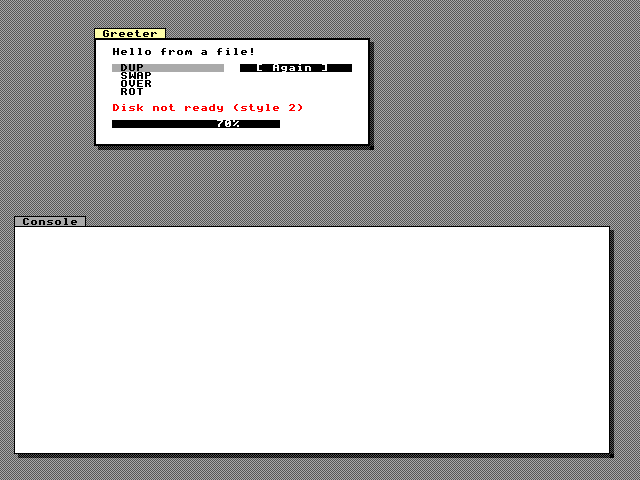

**Events as a stream.** Opening `/dev/win/N/event` routes that node's events
into a pipe as lines such as `activate`, `change 1`, `select 7`, `page -1`,
`moved 80 48 40 16`, `close` or `command 12 1`, instead of
[`UI-NEXT`](#w-ui-next). A task can wait on it with
[`READ-WAIT`](#w-read-wait) without polling the display server; closing the
file hands the node's events back to `UI-NEXT`.

<!-- nocheck -->
```forth
CREATE EV 64 ALLOT
: CLICKS ( -- )   \ a task: count the button's activations on the console
  S" /dev/win/1/event" 1 OPEN >R
  BEGIN EV 64 R@ READ-WAIT DUP 0 > WHILE EV SWAP TYPE REPEAT
  DROP R> CLOSE DROP ;
' CLICKS SPAWN-CON .
```

**Snapshots.** `/dev/ui/tree`, and the word [`UI-SNAPSHOT`](#w-ui-snapshot)
that prints it, give Forth source (`UI-SURFACE`, `UI-WINDOW`, `UI-WIDGET`,
`UI-ITEM`... lines) that rebuilds the current windows and widgets. Save it to
a file and `LOAD` it to restore a layout, text views' text included (written
with [`UI-TEXT`](#w-ui-text), [`UI-TEXT+`](#w-ui-textplus) and
[`UI-CH`](#w-ui-ch) for newlines and quotes). [`UI-WNAME`](#w-ui-wname) ( addr len id -- ) gives a
widget the name `/dev/win` shows.


### Off-screen composition

Most changes damage a small part of the screen and are composed directly into
the visible framebuffer within the frame budget. A change that damages more
than half the screen (the workbench opening or closing, the desktop coming back
after Ctrl+Alt+F1) would otherwise sweep down the screen over a dozen frames.
For those, the ESP copies the screen into a 150 KB shadow framebuffer in PSRAM,
composes there, and copies the finished rows back at once, so you see the old
picture and then the new one. After half a second it presents whatever is done,
so a continuous flood of output cannot freeze the screen.

### Performance notes

- **Batch.** One `UI-BEGIN` ... `UI-COMMIT` around a window's construction is
  both faster on the link and nicer to look at. The ESP also defers widget
  drawing to the end of each batch, so a widget is drawn once, not once per op.
- **Let the ESP do the work.** Keep text in surfaces, lists and TextViews and
  let the ESP scroll, edit and select; move things with tweens instead of
  sending a new position every frame.
- **Do not spin on events.** Poll, handle everything that waited, then `MS`.
- **Keep x on 8 pixels** for windows that show a lot of text. Free x costs two
  partial stores per glyph row instead of one.
- **Reuse ids.** Recreating a widget with the same id replaces it cleanly;
  `UI-ITEMS` with a smaller count shrinks a list without touching other lists.

## The GUI Tools

VIOS comes with four development tools in the spirit of a Smalltalk
environment, built on the display server described in [The GUI](#the-gui):

| Tool | Window | Shortcut | What it is for |
|---|---|---|---|
| **Browser** | 20 | Ctrl+Shift+B | modules, their words, facts and dependencies; edit and accept source |
| **Workspace** | 21 | Ctrl+Shift+W | a scratch text where you evaluate selections (do it, print it, inspect it) |
| **Inspector** | 22 | Ctrl+Shift+I | the data stack, memory, tasks, handles and system state |
| **Manager** | 23 | Ctrl+Shift+M | boot slots and module packages, behind a confirmation dialog |

The ESP does all the navigation, scrolling and editing inside the tool
windows. The CPU only fills the panes and acts on what you choose. The tools'
engine (`kernel/vios_tools.c`) runs from the REPL's idle hook: it acts when the
console is waiting for input, exactly as if you had typed the command there.
While a program runs in the foreground, the tool windows still scroll and edit,
but your choices (an accept, a refresh) are carried out only when the program
returns to the prompt.

### Opening the tools

- **Keyboard.** Ctrl+Shift+B, Ctrl+Shift+W, Ctrl+Shift+I and Ctrl+Shift+M open
  the Browser, Workspace, Inspector and Manager from anywhere. A tool that is
  already open is brought to the front instead.
- **World menu.** In the Smalltalk style, F10 opens the *World* menu with the
  four tools. In the Turbo Vision style the same four commands are the entries of
  the menu bar along the top: F10 runs the first (Browser), Alt+B, Alt+W, Alt+I,
  Alt+M run the others.
- **Command palette.** Ctrl+K (or Ctrl+Shift+P) and type part of the name.
- **From Forth.** [`TOOL`](#w-tool) `( n -- )` opens or focuses tool `n`: 0
  Browser, 1 Workspace, 2 Inspector, 3 Manager. `-1 TOOL` closes all of them.

<!-- nocheck -->
```forth
0 TOOL                                   \ the Browser
-1 TOOL                                  \ close every tool window
```

Close a tool with **Ctrl+W** (or Alt+F3) while it has the focus. Inside every
tool, **Tab** and **Shift+Tab** move between panes, **Ctrl+Tab** and
**Ctrl+Shift+Tab** change tabs, **Ctrl+R** refreshes the contents and
**Shift+F10** opens the tool's own menu (the *pane menu*). Keys that a tool
window does not use are dropped rather than passed to the console.

The tools' accelerators are global: Ctrl+Shift+B/W/I/M and Ctrl+R are taken by
the window manager in every window, including your own.

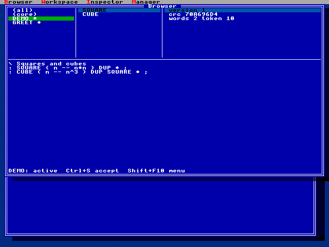

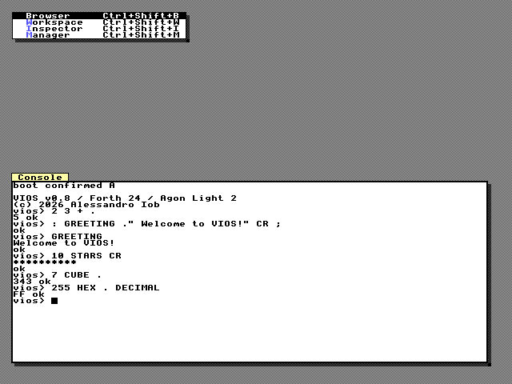

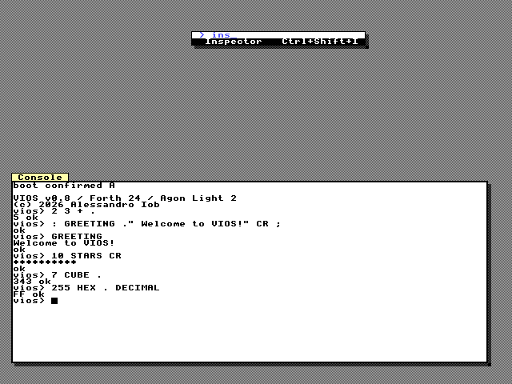

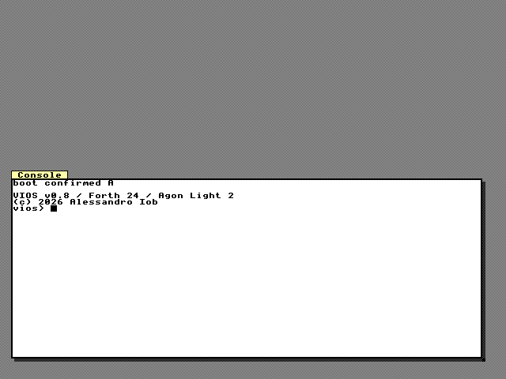

### The Browser

The Browser has three list panes along the top, a code pane below them and a
status line at the bottom.

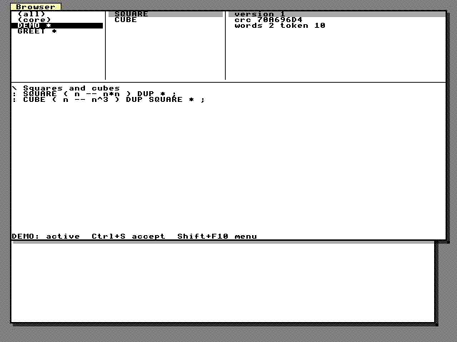

- **Modules pane** (left): `(all)` (every word in the dictionary), `(core)`
  (words that belong to no module), then each module, marked with `*` when it is
  active. Moving the selection updates the other panes at once.
- **Words pane** (middle): the words of the selected module. Typing a letter
  jumps to the next word starting with it.
- **Info pane** (right). For a module: `version`, `crc` (of the source), the
  number of `words` and `token` bytes, one `needs NAME ok` or `needs NAME stale`
  line per dependency (stale when the dependency's source changed since), and a
  `used by NAME` line for every module that depends on this one. For a word: its
  kind (`primitive`, `colon`, `constant`, `variable`, `defer`, `native`) and
  `xt`, its `token` and `direct` code sizes, its `module` and, for constants and
  variables, its `value`.
- **Code pane**: the exact source of the selected module, or the retained source
  of the selected word. It is an ordinary editable text view.
- **Status line**: what the selection is and what you can do, for example
  `DEMO: active  Ctrl+S accept  Shift+F10 menu`.

**Accept (Ctrl+S in the code pane).** What happens depends on what is shown:

- *A module.* The code pane's text becomes the module's new source: it is
  streamed into the workbench draft, compiled and tested in isolation (stage),
  then activated, the same revision-checked steps as F5 and F6 in the
  [text workbench](#the-text-workbench). On success the status line says
  `DEMO active; words 52% code 31% map 20%`, showing how full the dictionary,
  the code space and the source map are. Every accept keeps the replaced
  version's code until the next restart, so when any of them passes 80 % the
  line names the fullest one instead, for example `DEMO active; code 84%: save,
  restart`.
  On failure it says `not accepted:` and the reason, and the live module is not
  touched. After an accept the words and info panes show the new version at
  once; the code pane keeps your text.


- *A single word.* The text (at most 255 bytes) is evaluated, so the word is
  redefined, the way a Smalltalk method accept works. For a word that belongs to
  a module the status line warns that this redefines it *outside* its module: the
  module's source is unchanged.

**Pane menu (Shift+F10):**

| Item | Effect |
|---|---|
| Accept | as Ctrl+S |
| Save to SD | save the module's *active* source as its package on the SD card (`DEMO: saved to SD`). Edits you have not accepted are not saved. When it fails, the status line says `not saved:` and the reason, for example while the text workbench holds a modified draft of another module |
| Revert | reload the selected module's live source into the code pane, dropping your edits |
| Refresh (Ctrl+R) | re-read the module list and the selected module |

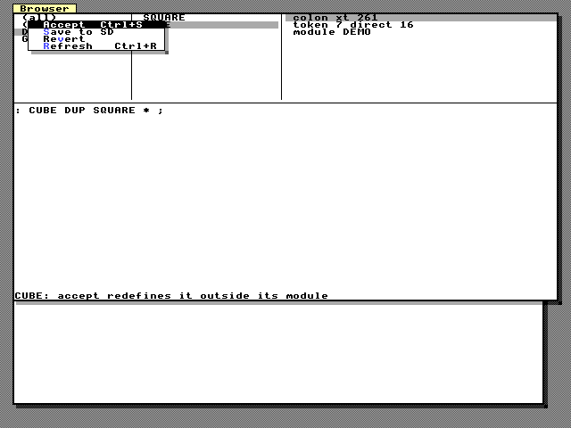

The panes are separated by one-pixel divider lines, vertical between the lists
and horizontal above the code pane.

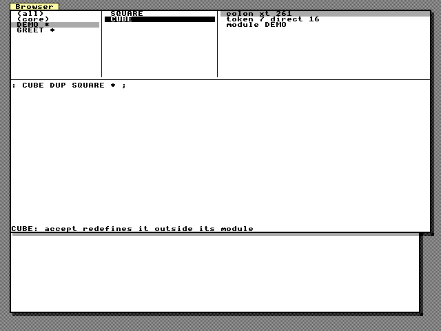

### The Workspace

The Workspace is a text view for trying things out. It opens with a reminder:

```text
\ Ctrl+D do it, Ctrl+P print it, Ctrl+I inspect it
3 4 + .
```

Select some text (Shift with the arrow keys, or Ctrl+A for everything) and
press a key; with nothing selected the key works on the caret's line, which it
selects first. The selection may be up to 255 bytes. Evaluation uses the same
data stack as the console.

| Key | Name | Effect |
|---|---|---|
| Ctrl+D | do it | evaluate; anything printed goes to the Console window |
| Ctrl+P | print it | evaluate and insert the output (its first 40 printable characters) after the selection, selected; if nothing was printed, the values the evaluation left on the stack, which stay there |
| Ctrl+I | inspect it | evaluate, then show the stack in the Inspector (opened if needed) |

On an error the message is inserted after the selection, selected, so one
Backspace removes it: `NO-SUCH-WORD error: unknown word: NO-SUCH-WORD`.

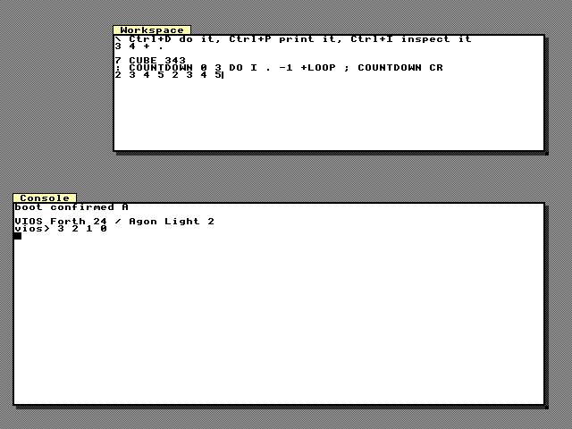

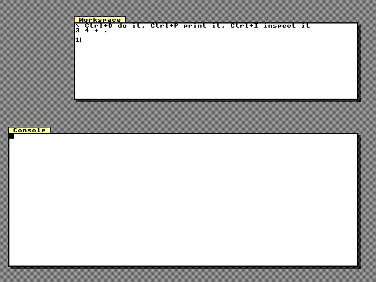

### The Inspector

The Inspector has five tabs over a table and a read-only detail pane. Change
tabs with Ctrl+Tab, or Left/Right while the tabs have the focus. The contents
are a snapshot: press **Ctrl+R** to refresh.

| Tab | Table | Detail pane |
|---|---|---|
| Stack | the data stack, top first: position, hex and decimal | `SEE` of the selected value when it is an execution token |
| Memory | 16 rows of 8 bytes: the address and the bytes in hex (`--` where nothing can be read) | |
| Tasks | id, name and state of every task | the `TASKS` report |
| Handles | | the handles report |
| System | | the `RESOURCES` report, then the display server's epoch, error count and frame count and how many times the ESP restarted |

**Memory paging.** The memory table never ends: moving Up from the first row
shows 8 bytes earlier, Down from the last row 8 bytes later, PgUp and PgDn at
the edges move by 64 bytes. To jump somewhere, put the address on the stack
(for example in the Workspace) and choose **Go to address** from the pane menu.

**Pane menu (Shift+F10):** Refresh, Go to address (the top of the data stack
becomes the memory view's start), Kill task (on the Tasks tab: asks for
confirmation, then `TASK-KILL`s the selected task; Enter on a task does the
same).

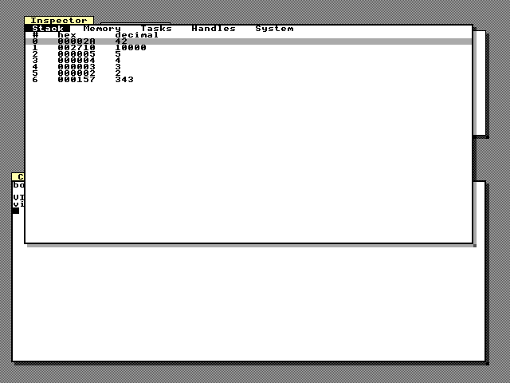

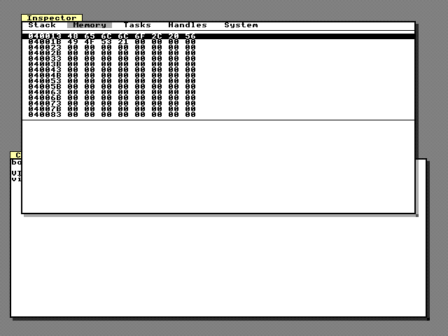

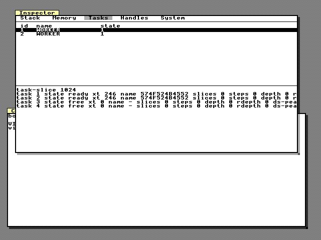

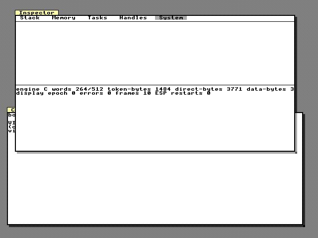

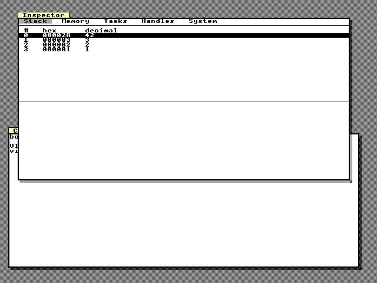

### The Manager

The Manager has two tabs.

- **Boot**: three actions, *Trial the candidate slot*, *Confirm the running
  slot* and *Revert to the confirmed slot*, with the boot status and manifest in
  the detail pane (see [Modules and Persistence](#modules-and-persistence)).
  Enter on an action asks for confirmation first.
- **Modules**: every module with its version and whether it is active. Enter
  asks to save the selected module to SD; **Rollback** in the pane menu asks to
  roll back its latest activation.

The result (`done`, or `failed:` and the reason) appears in the detail pane.

The confirmation is a modal **Confirm** dialog (window 24) with **Yes** and
**No** buttons. It dims the rest of the screen and keeps the focus until you
answer. **No** has the focus, so Enter on its own cancels; Tab (or Shift+Tab)
moves to Yes, then Enter or Space confirms. Esc also cancels.

**Pane menu (Shift+F10):** Refresh, Save to SD, Rollback.

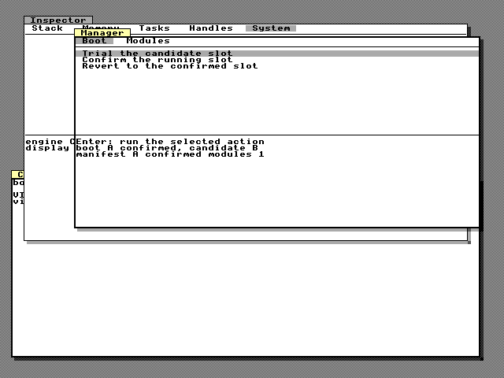

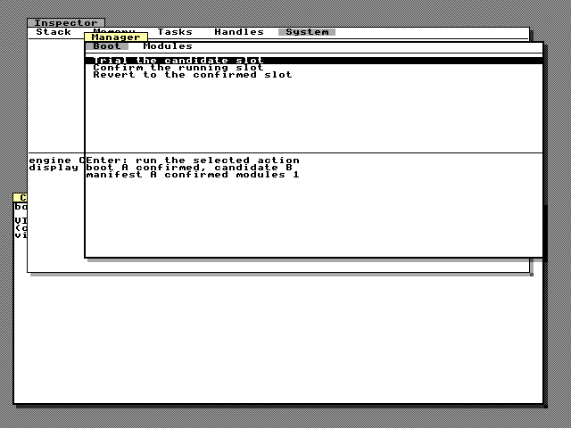

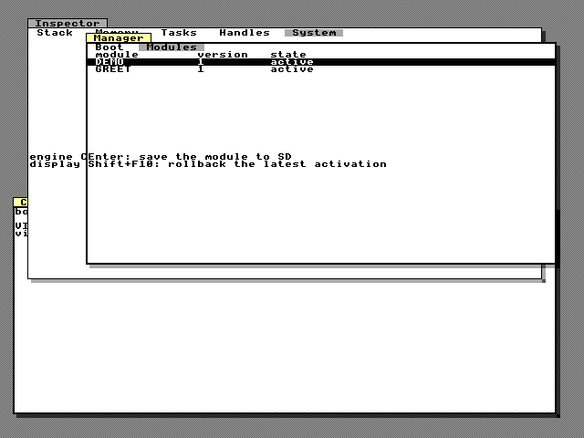

### Keyboard reference

Keys are resolved on the ESP in this order: an open menu or palette, the
keyboard pointer, move/resize mode, the menu keys, the command palette, command
accelerators, window keys, the focused widget, and finally (if nothing used the
key and the window allows it) the CPU's keyboard input.

#### Display and windows

| Key | Action |
|---|---|
| Ctrl+Alt+F1 | switch between the GUI desktop and the full-screen text console |
| F1 | console and text workbench: switch between them |
| F6 / Shift+F6 | bring the window at the back to the front and focus it / send the focused window to the back and focus the new top one |
| F5 | zoom the focused window to almost the whole screen, or restore it |
| Ctrl+F5 | move/resize mode (see below) |
| Ctrl+W, Alt+F3 | ask to close the focused window (the program decides) |
| Esc | in a modal dialog: ask to close it |
| Ctrl+F12 | keyboard pointer on or off (see below) |

#### Menus and commands

| Key | Action |
|---|---|
| F10 | Smalltalk: open the world menu. Turbo Vision: open the first menu-bar entry |
| Alt+letter | Turbo Vision: open the menu-bar entry with that mnemonic |
| Shift+F10 | open the focused window's pop-up (pane) menu, else the world menu |
| Ctrl+K, Ctrl+Shift+P | command palette |
| accelerators | as defined by the commands, e.g. Ctrl+Shift+B, Ctrl+R |
| in a menu: Up / Down | previous / next item (separators are skipped) |
| in a menu: Enter, mnemonic letter | choose the item |
| in a menu: Right / Left | open the submenu (menu bar: next entry) / close it (menu bar: previous entry) |
| in a menu: Esc | close one level |
| in the palette: letters, Backspace | filter the commands (letters in order), remove a letter |

#### Move/resize mode (Ctrl+F5) and keyboard pointer (Ctrl+F12)

| Key | Move/resize mode | Keyboard pointer |
|---|---|---|
| arrows | move the window by 8 pixels | move the pointer by 8 pixels |
| Shift+arrows | shrink or grow the window by one cell | move the pointer by 1 pixel |
| Enter | keep the new geometry (reported as a WIN event) | click |
| Space | | click |
| Esc | restore the old geometry | leave pointer mode |
| other keys | ignored while the mode lasts | |

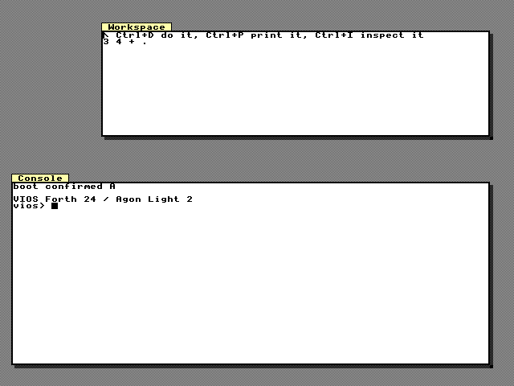

#### Widgets

| Widget | Keys |
|---|---|
| any | Tab / Shift+Tab: next / previous widget of the window, in creation order. Ctrl+Tab / Ctrl+Shift+Tab: next / previous tab of the window's tabs widget |
| Button | Space or Enter: press |
| Check box | Space: toggle |
| Radio button | Space: select. Up / Down: select the previous / next radio of the group |
| Input field | Left, Right, Home, End move; Backspace, Delete; printable characters insert; Enter: activate |
| List, table | Up, Down, PgUp, PgDn, Home, End; a letter jumps to the next row starting with it; Enter: activate. Tree lists: Right / Left expand / collapse. Pager lists: moving past the first or last row asks the program for more |
| Tabs | Left / Right: previous / next tab |

#### Text views (Browser code pane, Workspace, detail panes)

| Key | Action |
|---|---|
| arrows, PgUp, PgDn | move the caret (Up/Down keep the column) |
| Home / End | start / end of the line |
| Ctrl+Home / Ctrl+End | start / end of the text |
| Shift + any of the above | extend the selection |
| Ctrl+A | select all |
| Ctrl+C / Ctrl+X / Ctrl+V | copy / cut / paste (an ESP clipboard of 1 KB, shared by all text views) |
| Enter, Backspace, Delete, printable characters | edit (not in read-only views) |
| Ctrl+[ / Ctrl+] | indent / de-indent the selected lines by two spaces |
| Ctrl+S | accept (Browser) |
| Ctrl+D / Ctrl+P / Ctrl+I | do it / print it / inspect it (Workspace) |
| Tab | leave the view (there is no tab character) |

#### Tools

| Key | Action |
|---|---|
| Ctrl+Shift+B / W / I / M | open or focus the Browser / Workspace / Inspector / Manager |
| Ctrl+R | refresh the focused tool |
| Enter | Inspector Tasks tab: kill the task. Manager: run the action or save the module (after confirmation) |
| Esc, Enter on No | cancel a confirmation |

#### Text workbench

| Key | Action |
|---|---|
| Tab | switch the focus between the browser and the editor |
| Up / Down | browser: move the selection. Editor: previous / next line |
| Left / Right | browser: from modules to their words / back to the modules. Editor: move the caret |
| Home, PgUp / End, PgDn | browser: first / last entry. Editor: start / end of the line |
| Enter | browser: edit the selected module (or the selected word's module). Editor: new line |
| Backspace, Delete, printable characters | edit the source |
| Ctrl+Space | widen the editor to 80 columns and back |
| F5 / F6 / F7 / F8 | stage and test / activate / save to SD / undo the last edit |
| F10 | close the workbench |
| F1 | switch to the console |

### The text workbench

Before the windowed tools, VIOS had a *text workbench*: a full-screen module
browser, inspector and source editor on the 80 x 60 text screen. It is still
there, and it is also what the Browser's accept uses underneath. Under the GUI
it opens as a full-screen window (window 26) above the desktop and owns the
keyboard while open, so F5, F6 and F10 mean stage, activate and close there,
not zoom, next window and menu.

Open it with `WB-OPEN` at the console or with **F1** from the console; **F10**
closes it and **F1** goes back to the console, keeping the draft. The screen
has the browser on the left (modules, or the words of one module), the
inspector at the top right (the selected word or module, the data stack and
`BASE`, dictionary use) and the source editor below it, with the draft's state
(`MODIFIED`/`CLEAN`, `STAGED`, `ACTIVE`, `SAVED`, size and revision) and the
last error along the bottom. There is one draft of up to 4096 bytes and one undo
step. Kernel words are read-only; choosing a module word edits its module.

The `WB-` names are console *commands*, not dictionary words: type each on a
line of its own, with its arguments after it; they cannot be compiled into a
definition. Most print a `WB-STATUS` line describing the draft. Every editing
command takes the draft's current *revision* and refuses a stale one, so two
clients (the keyboard and the host harness, say) cannot overwrite each other.
This session creates, tests, activates and saves a module:

```forth
WB-NEW HELLO 1 0
```

The status line now says `revision 2`. Insert `: SEVEN 7 ;` and a line feed
(given in hex) at offset 0, which makes it revision 3, and read it back:

```forth
WB-PATCH 2 0 0 3A20534556454E2037203B0A
WB-SOURCE 0 12
```

Stage (compile and test in isolation), activate, and use it:

```forth
WB-STAGE 3
WB-ACTIVATE 3
SEVEN .
```

Save the active module to the SD card:

```forth
WB-SAVE 3
```

| Command | Arguments | Effect |
|---|---|---|
| [`WB-OPEN`](#w-wb-open) / [`WB-CLOSE`](#w-wb-close) | | open / close the workbench (the draft stays) |
| [`WB-STATUS`](#w-wb-status) | | print the draft's state |
| [`WB-NEW`](#w-wb-new) | module version discard | start an empty draft (discard 1 drops a modified one) |
| [`WB-EDIT`](#w-wb-edit) | module discard | load an active module's source |
| [`WB-PATCH`](#w-wb-patch) | revision offset remove hex | replace bytes (at most 80 new bytes, `-` for none) |
| [`WB-META`](#w-wb-meta) | revision version test | set the version and test word (`-` for none) |
| [`WB-UNDO`](#w-wb-undo) | revision | undo the last edit (F8) |
| [`WB-STAGE`](#w-wb-stage) / [`WB-ACTIVATE`](#w-wb-activate) / [`WB-SAVE`](#w-wb-save) | revision | F5 / F6 / F7 |
| [`WB-SOURCE`](#w-wb-source) | offset count | print up to 80 bytes of the draft in hex |
| [`WB-BROWSE`](#w-wb-browse) | `MODULES` or `WORDS` [module] | list modules or words |
| [`WB-SELECT`](#w-wb-select) | `MODULE` name or `WORD` index | select in the browser |
| [`WB-KEY`](#w-wb-key) | code modifiers | press a key (256..267: Up, Down, Left, Right, Home, End, Delete, F5, F6, F7, F8, F10) |
| [`WB-VIEW`](#w-wb-view) | row count | print screen rows in hex |
| [`WB-ZOOM`](#w-wb-zoom) / [`WB-ZOOM?`](#w-wb-zoomq) | 0 or 1 | wide editor on or off / show it |
| [`WB-CONSOLE`](#w-wb-console), [`WB-CONSOLE?`](#w-wb-consoleq), [`WB-CONSOLE-CLEAR`](#w-wb-console-clear) | | show the console, show its state, clear it |
| [`WB-REPAINT`](#w-wb-repaint), [`WB-REDRAW`](#w-wb-redraw) | | repaint; full recovery after raw `VDU`/`MODE` use |
| [`WB-FLUSH`](#w-wb-flush), [`WB-FLUSH-FENCED`](#w-wb-flush-fenced), [`WB-COMPOSE`](#w-wb-compose), [`WB-RENDER-STATS`](#w-wb-render-stats) | | painting diagnostics |

The screen is painted by the deferred word [`WB-PAINT`](#w-wb-paint), which
runs at the idle boundary with a temporary stack and a budget of 4096
instructions. If you replace it and your painter fails, painting stops but the
draft is safe; put the default back with:

```forth
' WB-PAINT-DEFAULT IS WB-PAINT
```

(followed by `WB-REDRAW` on the board).

### Console and editor

The REPL is the **Console** window on the desktop (74 x 28 cells, scrolling
through 58 lines). Its last row reminds you of the keys:
`VIOS console   F1: editor   Up/Down: history`. **F1** switches between the
console and the text workbench, **Ctrl+Alt+F1** between the desktop and a
full-screen text console with the same contents. See
[The Console and REPL](#the-console-and-repl) for line editing and history.

## Audio

VIOS has a small synthesizer on the ESP32: **three voices**, each playing a
square, triangle, sawtooth or noise wave, driven by short commands from
Forth. Tunes are stored on the ESP as text in a compact music notation and
played there with sample-accurate timing, so a melody costs the eZ80 one
command to start and nothing while it plays.

### Where the sound comes out

The Agon Light 2 has one audio path: the ESP32's 8-bit DAC feeds an
amplifier that drives both the **3.5 mm jack** and the on-board **buzzer**.
They are the same signal, not two devices. The jack always works; the
buzzer sounds only when the `BUZ_EN1` jumper is closed.

The engine mixes the three voices at 16384 samples per second inside the
existing sound interrupt. It has no task and no timer of its own, which
leaves about 13 KB more internal ESP memory free than the original VDP audio
system.

### The words

| Word | Stack | Effect |
| --- | --- | --- |
| [`TONE`](#w-tone) | `( freq ms -- )` | square tone on the first idle voice (voice 0 if all are busy) |
| [`TUNE`](#w-tune) | `( addr u slot -- )` | store tune text (up to 255 bytes) in slot 0..7; u = 0 frees the slot |
| [`PLAY`](#w-play) | `( slot voice -- )` | play the tune in a slot on voice 0..2 |
| [`STOP`](#w-stop) | `( voice -- )` | silence voice 0..2; `-1 STOP` silences all |
| [`VOLUME`](#w-volume) | `( n -- )` | master volume 0..127 (default 127) |
| [`SOUND?`](#w-soundq) | `( -- mask )` | bit n set while voice n is sounding |

All of them except `SOUND?` are fire-and-forget: they send a few bytes to the
ESP and return at once, so they are cheap to call from tasks. `SOUND?` waits
for the ESP's answer. Ranges are checked on the ESP: `TONE` limits the
frequency to 8191 Hz, `VOLUME` limits the volume to 127, and `PLAY` ignores
an empty slot or a voice above 2. Only `TUNE` checks on the eZ80: a text
longer than 255 bytes fails with "TUNE text over 255 bytes".

```forth
440 300 TONE
660 300 TONE
SOUND? .
```

The two tones play together on voices 0 and 1, so `SOUND?` prints 3 on the
board. `TONE` frequencies go up to 8191 Hz; the volume of a tone is the
default voice volume (12 of 15).

### Tune notation

A tune is a string of letters and numbers, like the `PLAY` statement of old
home computer BASICs. Case does not matter and spaces are ignored, so you can
group notes into bars.

| Token | Meaning | Default |
| --- | --- | --- |
| `c d e f g a b` | a note in the current octave; `a` in octave 4 is 440 Hz | |
| `#` or `+` after a note | sharp (one semitone up) | |
| `-` after a note | flat (one semitone down) | |
| number after a note or rest | its length: 1 whole, 2 half, 4 quarter, 8 eighth ... up to 64 | the `l` length |
| `.` after the length | dotted: one and a half times as long | |
| `r` or `p` | a rest, with optional length and `.` | |
| `o`n | octave 0..8 | 4 |
| `<` and `>` | one octave down / up | |
| `l`n | default note length 1..64 | 4 |
| `t`n | tempo in quarter notes per minute, 32..255 | 120 |
| `v`n | voice volume 0..15 | 12 |
| `w`n | waveform: 0 square, 1 triangle, 2 sawtooth, 3 noise | 0 |
| `q`n | how many eighths of each note sound, 1..8 (8 = legato) | 7 |
| `*` | jump back to the start of this slot: loop forever | |
| `&`n | continue with the tune in slot n | |

Details:

- A note lasts 240 / (tempo x length) seconds: at `t120`, a quarter note
  (`l4`) is half a second.
- `q7` lets each note sound for 7/8 of its length and leaves a short gap, so
  repeated notes are heard separately. `q8` joins notes together.
- Sharps and flats may cross an octave: `b#` is the next octave's `c`, `c-`
  the previous octave's `b`, as long as the result stays within octaves 0..8.
- Numbers have at most three digits.
- `w3` (noise) is pitched: the noise generator is clocked at the note's
  frequency, so higher notes sound brighter. It is good for drums and
  effects.
- `PLAY` starts a voice with the defaults (`o4 l4 t120 v12 w0 q7`); settings
  then carry over through `*` and `&` jumps.
- A voice stops when its tune ends, or when it follows more than 4 jumps in a
  row without reaching a note or rest (so `*` alone cannot hang a voice).
- A tune longer than 255 bytes is split over several slots chained with `&`.

When you store a tune, the ESP checks the whole text first. An invalid tune
(an unknown letter, `o9`, `t20`, `l65`, `v16`, `w4`, `q0`, `&8`) is not
stored, and voices keep playing what they had. The host harness's audio
status (`AS`) shows the failing slot and the offset of the bad token.

### Playing tunes

Store a tune once, then play it as often as you like:

```forth
S" t140 l8 cdefg>c" 0 TUNE
0 0 PLAY
```

Here is a little melody, the start of the *Ode to Joy*, with a bass line on
a second voice. The melody is 16 beats and so is the bass, so they end
together:

```forth
S" t120 l4 eefg gfed ccde e.d8d2" 1 TUNE
S" t120 o3 l2 c<g>c<g>c<g>c1" 2 TUNE
1 0 PLAY  2 1 PLAY
```

Since tunes play on the ESP, your program carries on immediately. To wait
until the music ends, poll `SOUND?`:

```forth
: WAIT-MUSIC ( -- ) BEGIN 50 MS SOUND? 0= UNTIL ;
```

Use a loop for background music; it costs the eZ80 nothing while it plays:

```forth
S" t160 w1 v10 l8 o5 ceg>c<gec4 *" 3 TUNE
3 2 PLAY
-1 STOP
```

A drum loop with the noise waveform:

```forth
S" w3 v8 l16 o6 c r c r c c r8 *" 4 TUNE
```

Two slots chained into one longer tune; the second line loops back to the
first:

```forth
S" t120 l4 eefg gfed ccde e.d8d2 &6" 5 TUNE
S" eefg gfed ccde d.c8c2 &5" 6 TUNE
5 0 PLAY
0 STOP
```

`TUNE` on a slot that is playing stops the voices using it. `S" " 7 TUNE`
(length 0) frees slot 7. Tunes live in the ESP's memory: they are lost when
the ESP restarts, so store them again at startup (in a module's word, or in
`/VIOS/USER.FTH`).

### Volume

Each voice has its own volume (`v`n in a tune, 12 for tones) and the master
`VOLUME` scales all three:

```forth
64 VOLUME
127 VOLUME
```

### BEEP and VDU 7

Two older ways to make a sound still work and share the same three voices:

- `7 VDU` (the ASCII bell) plays a 750 Hz beep for 125 ms on voice 0, if
  voice 0 is idle.
- `BEEP ( freq ms -- flag )` uses the original VDP sound command on voice 0
  and waits for the reply: `flag` is 1 if the note was accepted, 0 if voice 0
  was busy.

MOS programs that use the VDP's `VDU 23,0,&85` sound commands on channels 0
to 2 are mapped onto the same voices. Sample playback and envelopes of the
original VDP audio system are not available.

### Sound from a task

The audio words are allowed in background tasks. A task can play a jingle
when something happens without slowing the rest of the program:

```forth
: JINGLE ( -- ) S" t200 l16 o5 cegc>c" 0 TUNE  0 2 PLAY ;
' JINGLE SPAWN DROP
100 MS
```

## The Host Harness and MCP Tools

The host harness, `tools/vios_harness.py`, connects your Mac to the board. It is the only program that opens the board's USB serial port. Everything else on the Mac reaches the board through it: the human CLI (`tools/vios_cli.py`), MCP clients such as Claude, and the on-board acceptance suite. VIOS runs fine without it. You need the harness only when you want to drive the board from the Mac.

### How it fits together

```text
  MCP client (Claude)   tools/vios_cli.py   acceptance scripts
        |  stdio              |  TCP               |  TCP
        |  (via nc)           |                    |
        +-------------+-------+--------------------+
                      |  newline-delimited JSON-RPC on 127.0.0.1:8765
              tools/vios_harness.py   (one process, one lock)
                      |  COBS/CRC frames, 115200 8N1
              /dev/cu.usbserial-XXX  (CH340 on the board)
                      |
              ESP32 USB multiplexer -> eZ80 Forth REPL, supervisor, events
```

- **One serial owner.** The harness opens the port once and keeps it open. All tool calls go through one lock, so requests from the CLI and from Claude never interleave on the wire. Do not open the port with anything else while the harness runs. That includes a serial terminal, `esptool`, `tools/vios_firmware_ab.py` and `tools/vios_sd_refresh.py`. The port is opened exclusively, so a second opener fails anyway.
- **Opening the port resets the board.** On this board, opening the USB serial device resets it. The first `connect` can therefore take a full boot (allow up to 120 s), and every harness restart is also a board restart. Unsaved RAM work is lost when that happens.
- **Two front ends.** With `--tcp 127.0.0.1:8765` the harness serves newline-delimited JSON-RPC (one JSON object per line) on loopback TCP. Several clients can connect at once and share the board. Without `--tcp` it speaks MCP over its own stdin/stdout, and only that one client can use it.
- **Loopback only, no authentication.** The TCP server refuses any bind address other than `127.0.0.1`. Anyone who can open a socket on your Mac can drive the board, so do not forward this port.
- **The protocol.** It is JSON-RPC 2.0 with MCP lifecycle version `2025-11-25`. On TCP the transport is a plain line protocol, not MCP Streamable HTTP. Frames are limited to 1 MiB.
- **JSON stays on the Mac.** The board never parses JSON. Over USB the harness and the ESP32 exchange compact binary frames: console, control, events, host-file requests and link requests each have their own channel. See [Architecture](#architecture).

### Starting the harness

Find the board's port first, then start the harness against it:

```sh
ls /dev/cu.usbserial-*
lsof /dev/cu.usbserial-210                 # must print nothing: nobody owns the port
lsof -nP -iTCP:8765 -sTCP:LISTEN           # must print nothing: no harness running

.venv/bin/python tools/vios_harness.py --backend resident \
    --port /dev/cu.usbserial-210 --tcp 127.0.0.1:8765
```

The harness prints `VIOS /host/ serves /Users/you/VIOS-host` and `VIOS TCP listening on 127.0.0.1:8765` on stderr. It does not touch the board until a client calls `connect`.

Always pass `--port`. The default (`/dev/cu.usbserial-224130`) is a suffix from an earlier USB setup. The suffix changes with the USB socket or hub you use, so check `ls /dev/cu.usbserial-*` each time.

| Flag | Default | Meaning |
| --- | --- | --- |
| `--backend resident` | `ram` | Use the installed VIOS firmware. **Always pass it.** The `ram` default is the historical bring-up bridge that uploads a temporary RAM image. |
| `--port DEV` | `/dev/cu.usbserial-224130` | Serial device of the board. |
| `--tcp 127.0.0.1:PORT` | stdio | Serve loopback TCP instead of MCP stdio. Only `127.0.0.1` is accepted. |
| `--host-root DIR` | `~/VIOS-host` | Mac directory the board sees as `/host/`. Pass `--host-root ""` to switch the service off. |
| `--image FILE` | `build/vios-resident.bin` | CPU image used only by the explicit `deploy` tool. |
| `--log FILE` | `docs/bring-up/vios-harness.jsonl` | Raw serial evidence log (every byte, timestamped). Git ignores this file. |
| `--fast-console` | off | Historical RAM-bridge option. Resident source always uses atomic framed lines. |

Stop the harness with Ctrl+C. When TCP clients disconnect, the harness and the board session keep running.

### Connecting Claude (MCP)

The simplest arrangement is one TCP harness shared by you and Claude. Claude's MCP stdio is bridged to the running harness with `nc`. The bridge opens no serial port of its own:

```json
{
  "mcpServers": {
    "vios": {
      "command": "/usr/bin/nc",
      "args": ["127.0.0.1", "8765"]
    }
  }
}
```

If no human CLI is needed, the harness can be the MCP server itself. Stop any TCP harness first, because two owners cannot share the port. Use absolute paths:

```json
{
  "mcpServers": {
    "vios": {
      "command": "/path/to/agon-light-2/.venv/bin/python",
      "args": ["/path/to/agon-light-2/tools/vios_harness.py",
               "--backend", "resident", "--port", "/dev/cu.usbserial-210"]
    }
  }
}
```

The client's first board call must be `connect`. Listing tools does not open the port.

A raw TCP session looks like this, one JSON object per line:

```json
{"jsonrpc":"2.0","id":1,"method":"initialize","params":{"protocolVersion":"2025-11-25","capabilities":{},"clientInfo":{"name":"me","version":"1"}}}
{"jsonrpc":"2.0","method":"notifications/initialized"}
{"jsonrpc":"2.0","id":2,"method":"tools/call","params":{"name":"connect","arguments":{}}}
{"jsonrpc":"2.0","id":3,"method":"tools/call","params":{"name":"evaluate","arguments":{"source":": SQUARE DUP * ;\n7 SQUARE . CR"}}}
```

Each tool result is a JSON document carried in one text content item. `isError` is true when the tool failed or the Forth code raised an error. Malformed requests or arguments get JSON-RPC errors. The schemas returned by `tools/list` are the authority for argument limits.

### The CLI

`tools/vios_cli.py` is a plain terminal console that attaches to the TCP harness:

```sh
.venv/bin/python tools/vios_cli.py                 # harness on 127.0.0.1:8765
.venv/bin/python tools/vios_cli.py --port 8765 --timeout 30
```

**Its `--port` is the TCP port of the harness (default 8765), not the serial device.** The CLI has no serial code at all. The other flags are `--timeout` and `--rpc-timeout`. `--timeout` (default 15 s, at most 300) is how long one Forth line may run before the CLI reports it as pending. `--rpc-timeout` (default 130 s) is how long the CLI waits for any harness reply, and it covers a full board boot.

On start the CLI calls `connect` and prints `VIOS console — :help for commands.` Then you type Forth lines. Each line is at most 235 printable ASCII bytes, and tabs become spaces. The prompt shows the session state:

| Prompt | Meaning |
| --- | --- |
| `vios> ` | Idle. Type Forth. |
| `compile> ` | A colon definition is unfinished. Finish it with `;` or cancel with `:abort`. |
| `pending> ` | The last line is still running (for example waiting in `KEY`). Use `:input` and `:await`. |
| `uncertain> ` | A request failed in a way that leaves the result unknown. Use `:await` or `:recover`. |

Tab completes words from the live dictionary. Lines that start with `:` are CLI commands:

| Command | What it does |
| --- | --- |
| `:help [NAME]` | Without a name, list these commands. With a name, explain a word or command from the live system (kind, help text or `SEE` source). |
| `:complete PFX` | List dictionary words starting with `PFX`. Tab does the same at the prompt. |
| `:graph` | Module activation order, dependency edges with their CRCs, and dependents. |
| `:events` | Console text you did not request: lines typed on the Agon keyboard with their results, and console-task output. |
| `:ls [/PATH]` | List an SD directory (8.3 names, sizes, `/` for directories). Defaults to `/`. |
| `:put LOCAL /PATH` | Upload a local ASCII text file to an SD path (8.3 names). |
| `:get /PATH [LOCAL]` | Print an SD file, or save it to a new local file (an existing file is never overwritten). |
| `:describe KIND [ID]` | Typed descriptor: `word NAME`, `module NAME`, `task N`, `handle N` or `error`. |
| `:why` | Explain the last runtime error: message, failing word and offset, callers, and the data stack as it was before unwinding. |
| `:trace WORD [N]` | Single-step `WORD` for up to `N` instructions (default 200) and print each step. |
| `:status` | Show dictionary and VM resource counters. |
| `:words` | List all words. |
| `:wb ACTION` | Workbench `open`, `close`, `status`, `view` or `redraw`. |
| `:snapshot [FILE]` | Summarize live, dirty, staged and persisted state. With `FILE`, also save the full JSON record (the file must not exist). |
| `:await` | Keep waiting for a pending line without sending new source. |
| `:resync` | Recover a lost reply frame at an idle prompt. It never resends your request, so the outcome of that request stays unknown. |
| `:input HEX` | Send 1 to 16 bytes to a pending line, for example `:input 41` for a `KEY` that waits for `A`. Hex `1D` is reserved. Follow it with `:await`. |
| `:abort` | Cancel an unfinished definition at the idle prompt. |
| `:reboot` | Restart the firmware from a synchronized idle prompt. |
| `:recover` | Force a supervisor restart even when the session is pending or uncertain. Unsaved RAM work is lost (see below). |
| `:quit` | Disconnect this client. The harness and the board keep running. |

Two rules keep the CLI honest:

- **It never retries.** If a request fails halfway, the CLI says so and leaves the result marked uncertain. It never sends the request again.
- **Pending execution blocks new source.** `KEY` gets only the bytes you send with `:input`.

`:recover` differs with and without the ZDI wire. With the wire (dev boot), the supervisor halts the eZ80 and reloads the image embedded in the ESP firmware, so all RAM state is gone. Without the wire (untethered boot), the ESP cannot reset the eZ80. `:recover` then restarts only the ESP32: the resident keeps running with its RAM state, reports itself healthy again when the ESP comes back, and the harness reattaches. If the eZ80 itself is wedged, stop and restart the harness (opening the port resets the whole board) or press the board's reset button. See [Troubleshooting](#troubleshooting).

### MCP tool reference

The harness registers 72 tools. Tools marked **wire** need the ZDI recovery links (a dev boot). On an untethered board the ESP cannot reach the eZ80's debug port.

#### Session and recovery

| Tool | Description |
| --- | --- |
| `connect` | Attach to the running resident firmware. Nothing is uploaded. Waits up to 120 s for `BOOT READY`. Safe to call twice. |
| `reboot` | Restart the firmware and reattach on the same port. `force=true` abandons pending or unknown execution and loses unsaved RAM state. Optional `timeout`. |
| `deploy` | **wire.** Replace CPU RAM with the `--image` file and verify every byte. A development and recovery operation; normal attachment never needs it. |
| `resync` | Recover a lost reply frame at a quiet idle prompt without rebooting. Never replays the request; its outcome is reported as unknown. |
| `abort` | Cancel input or an unfinished definition at the idle REPL. A program stuck in `KEY` needs `console_input` or `reboot(force=true)`. |
| `debug_registers` | **wire.** Briefly pause the CPU to read its registers, then restore the previous run state. |
| `memory_read` | **wire.** Read 1 to 65536 bytes of RAM in `0x040000..0x0BFFFF`, CRC-checked. |
| `memory_write` | **wire.** Write 1 to 256 bytes below `0x0AF000` and verify by readback. A trusted systems operation: it can break running code. |
| `resume` | **wire.** Resume the existing CPU PC after a debug pause. Does not reboot. |

#### Running Forth

| Tool | Description |
| --- | --- |
| `evaluate` | Evaluate ASCII Forth lines (up to 65536 characters per call, 235 bytes per line). Definitions, stacks, `BASE` and the engine persist across calls; multi-line definitions work. Optional `timeout` (default 15 s). |
| `await_result` | Wait for a timed-out evaluation to finish, without sending any source. |
| `console_input` | Send 1 to 16 bytes (hex) to a pending evaluation, for example the key a `KEY` waits for. |
| `events` | Return and clear console text the host did not request: lines typed on the Agon keyboard with their results, and console-task output. |
| `benchmark` | Run the built-in validated hardware benchmarks (up to 120 s). |

#### Inspection

| Tool | Description |
| --- | --- |
| `words` | List the resident dictionary. |
| `inspect_word` | `SEE` source and word metadata (kind, address) for one word. |
| `stacks` | The data stack, as `.S` shows it. |
| `resources` | Dictionary capacity and observed VM resource counters. |
| `complete` | Complete a word, outer command or compiler word from the live dictionary (`prefix`, optional `limit`). |
| `help` | Explain an outer command or compiler word, or show a live word's kind, metadata and source. |
| `describe` | Typed descriptor (kind, identity, generation) for one word, module, task, handle, or the last error. |
| `last_error` | The last foreground runtime failure captured before unwinding: message, failing word and offset, caller frames, top stack cells, depths, engine, `BASE`. Includes `stale=true` if the dictionary changed since. |
| `trace` | Single-step one word (one instruction per dispatch, any engine) and return each step: word, offset, depths, top of stack. The word's side effects happen as usual. |
| `tasks` | The four background task slots: state, word, slices, executed steps, stack depths and peaks, output bytes and drops, error. |
| `task_output` | Drain one background task's output ring (`id` 1 to 4). |
| `handles` | Open handles (SD files, pipes, `/dev/null`, `/dev/cons`, `/dev/tasks`) with owner, direction, byte counts and the last I/O error. |
| `snapshot` | Read-only structured record of live state: modules with exact sources, draft, stacks, `BASE`, engine and boot slot, plus a live/dirty/staged/persisted summary. Fails closed on a torn read. |

#### Modules and persistence

| Tool | Description |
| --- | --- |
| `modules` | List module versions, CRC32 values (decimal) and pinned dependencies. |
| `module_source` | Exact retained module source plus a host-computed SHA-256 (`previous=true` for the retained older generation). |
| `module_stage` | Validate and stage exact module source with pinned dependencies and an optional test word. Does not activate. |
| `module_activate` | Activate the staged module after validating it again. |
| `module_discard` | Discard the staged module. |
| `module_rollback` | Restore a module's retained previous generation. |
| `module_save` | Save a module package to SD, by default at its content-addressed path under `/VIOS`. |
| `module_load` | Load a saved package from SD, then stage and activate it. |
| `module_graph` | Dependency edges with CRC satisfaction, reverse dependents and activation order. |
| `develop` | One explicit cycle: pin named live dependencies, stage (validate and test), activate, optionally save. Reports each step and stops at the first failure without retrying. |
| `load` | Evaluate a raw Forth source file from SD (or from `/host/`). |
| `boot_status` | Confirmed, candidate and current boot slots and the trial state. |
| `boot_manifest` | Read-only: what a power cycle would load. Lists module name, version, source CRC32 and package health in the confirmed and candidate boot bundles on SD. |
| `boot_trial` | Write all active modules into the inactive boot bundle and mark it pending. Does not reboot. |
| `boot_confirm` | Confirm the currently running trial after validation. |
| `boot_revert` | Select the confirmed or previous boot slot for the next boot. Does not reboot. |

#### SD card

| Tool | Description |
| --- | --- |
| `sd_list` | List an SD directory: 8.3 names, sizes, directory flags. |
| `sd_put` | Upload text or hex bytes to an SD file through a handle (create or replace; not power-fail atomic). |
| `sd_get` | Download an SD file of up to 64 KiB as text and hex, with its SHA-256. |

#### Workbench (text editor)

These are the headless equivalents of the workbench keys. Edits are checked against the draft `revision` so that a stale client cannot overwrite newer work.

| Tool | Description |
| --- | --- |
| `wb_status` | Draft revision and workbench state. |
| `wb_open` | Open the workbench, keeping any existing draft. |
| `wb_close` | Close the workbench and keep its draft. |
| `wb_browse` | Browse `MODULES` or `WORDS`, optionally filtering words by module. |
| `wb_select` | Select a module by name or a word by catalog index. |
| `wb_edit` | Load a module's exact active source into the draft. A dirty draft is replaced only with `discard=true`. |
| `wb_new` | Start a new module draft (name and version). A dirty draft is replaced only with `discard=true`. |
| `wb_patch` | Apply one atomic, revision-checked patch of at most 80 ASCII bytes (`offset`, `remove`, `source`). |
| `wb_undo` | Restore the one source and cursor undo snapshot. |
| `wb_metadata` | Set the draft's version and optional test word, keeping pinned dependencies. |
| `wb_stage` | Validate and test the exact draft without activating it. |
| `wb_activate` | Activate the staged draft after revision and catalog checks. |
| `wb_save` | Save the active draft to SD. |
| `wb_source` | Read the exact draft text in bounded chunks with revision checks. |
| `wb_view` | Read rows of the 80-column workbench screen model with text and packed attributes. |
| `wb_key` | Inject a semantic workbench key (ASCII, or 256 to 267 for special keys) with modifier bits. |
| `wb_redraw` | Invalidate and recompose the workbench screen. |
| `wb_flush` | Send changed screen spans in bounded batches and return the flush counters. |
| `wb_render_stats` | Cumulative renderer counters and 288 kHz timer ticks (`reset=true` zeroes them). |

#### ESP32 side (display, keyboard, audio, link)

These read the ESP32 directly over the control channel. The eZ80 keeps running and is not involved.

| Tool | Description |
| --- | --- |
| `esp_stats` | ESP counters: glyphs drawn, USB console bytes and writes, time the VDP parser was blocked, parser time, frame and vblank timing, and the USB link counters `link_requests`, `link_resent` and `link_gone`. `reset=true` zeroes them after reading. |
| `esp_console` | The exact text of the console as the ESP renders it (rows 0 to 57 plus status row 58), read without disturbing the screen. |
| `esp_gui` | Display server status line (windows, frames, errors, style). With `vk`, `ascii` and `mods` it presses and releases one key at the window manager. With `pixels` it returns framebuffer colour indices at up to 64 points. |
| `esp_inject` | Type 1 to 32 characters at the PS/2 boundary, as if on the Agon keyboard (printable, BS, TAB, CR, ESC). The resulting lines appear in `events`. |
| `esp_audio` | Audio engine state, read without the CPU: busy voices, master volume, notes started, last tune error, per-voice frequency, wave and position, sample rate and free heap. |
| `esp_probe` | Key-to-glyph latency probe. With `char`, arm it for one printable character; without, report n/min/median/p95/max in microseconds. |
| `esp_g0` | GUI memory and timing probe (gate G0): heap after a mode change, blitter benchmark, scanline map and tear test. A diagnostic that draws on screen and then restores the console. |

### Sharing files with the board: `/host/`

While the harness runs with the resident backend, any path that starts with `/host/` on the board refers to a file under `--host-root` on your Mac (default `~/VIOS-host`, created if missing). You can edit on the Mac and run on the Agon:

<!-- nocheck -->
```forth
LOAD /host/app.fth
```

`OPEN`, `READ`, `WRITE` and `CLOSE` work on `/host/` paths too, like SD paths (see [Handles, Pipes and Devices](#handles-pipes-and-devices)). The service has these limits:

- Paths are relative to the host root. Absolute paths, `..` and symlinks that leave the root are refused.
- At most four host files are open at a time.
- Each board request carries at most 240 bytes and waits about one second for the Mac's reply.
- `/host/` exists only while the harness is running and idle enough to answer. Without the harness the board reports an error for `/host/` paths. Everything else keeps working.

### Snapshots and resync

- **`snapshot`** (CLI `:snapshot FILE`) records what is live, dirty, staged and persisted: every module with its exact source, the editor draft, the stacks, `BASE`, the engine and the boot slot. Take one before anything risky, such as a reboot, a firmware install or an experiment. The `persisted` flag means the module's exact name and CRC32 are in the confirmed boot bundle on SD, so a power cycle brings it back. RAM-only definitions are not persisted.
- **`resync`** (CLI `:resync`) re-establishes framing when a reply was lost. One example is a byte from the physical keyboard merging into a request. It works only at a quiet idle prompt and never resends the request, because that request may or may not have run.

The USB link itself already recovers lost frames: the ESP numbers every frame it sends and resends frames on request (see [Architecture](#architecture)). The harness also repeats one read-only tool once after a resync: `snapshot`, `tasks`, `handles`, `last_error`, `sd_list`, `sd_get`, `boot_status`, `boot_manifest`, `esp_stats` or `esp_console`. Such results carry `wire_loss_recovered: true`. Mutating tools are never repeated.

### The on-board acceptance suite

`tools/vios_board_suite.py` runs the acceptance checks on the real board through the TCP harness on `127.0.0.1:8765`. Start the harness first (as above), with the board booted into the GUI. The suite has no serial-port option of its own.

```sh
.venv/bin/python tools/vios_board_suite.py build/suite-$(date +%Y%m%d)
.venv/bin/python tools/vios_board_suite.py build/suite-gui --only gui,gui_tools
.venv/bin/python tools/vios_board_suite.py build/suite-soak --soak-minutes 30
```

Each check writes its own JSON report into the output directory. The runner writes `suite.json` with one status per check and exits non-zero if any check failed. Checks that need an idle task table pause and later restart a running `AUTORUN` task.

| Check | Script | What it covers |
| --- | --- | --- |
| `gui` | `vios_gui_accept.py` | Display server: a decorated window is opened, moved, raised and closed (pixels checked); a Ctrl+S accelerator becomes a `COMMAND` event; an input and a button widget; no protocol errors; frame work and vblank start within budget. Uses window and surface 3 only. |
| `gui_tools` | `vios_gui_tools_accept.py` | The GUI tools via injected keys: browser (Ctrl+Shift+B), workspace (Ctrl+Shift+W), inspector (Ctrl+Shift+I), manager (Ctrl+Shift+M, an action is cancelled with Esc); text read-back speed; frame budgets. |
| `console` | `vios_console_accept.py` | The full-screen text console, read back from the framebuffer with `CHAR@`; editor and console round trips. Switches with Ctrl+Alt+F1 and back. |
| `audio` | `vios_audio_accept.py` | `TONE`, stored tunes, tune errors with slot and offset, looping tunes and `STOP`, `BEEP` acknowledgement, `VOLUME`, ESP heap. Ends with a short melody for you to listen to. |
| `core_words` | `vios_core_words_accept.py` | The DIRECT, TOKEN and C reference engines agree on a set of core-word cases. |
| `tasks` | `vios_tasks_accept.py` | Background tasks, preemption and console latency. |
| `pipeline` | `vios_pipeline_accept.py` | A producer's output feeding a consumer's `KEY` through a pipe. |
| `handles` | `vios_handles_accept.py` | Handles, pipes and devices; writes and removes `/VIOS/IOTEST.TXT`. |
| `tools` | `vios_tools_accept.py` | Source maps, the SD file service and native `TYPE`; writes and removes `/VIOS/SVCTEST.TXT`. |
| `incremental` | `vios_incremental_accept.py` | Workbench compositor regressions. **Replaces the current draft**, so it runs only with `--with-incremental`. Save your draft first. |

None of the default checks changes the boot slots, saved modules or the workbench draft. They define temporary RAM words, so take a snapshot first if your RAM session matters. `--soak-minutes N` adds `tools/vios_soak.py` afterwards. The soak repeats REPL arithmetic, a snapshot, a 1000-byte pipeline, an editor round trip and, every tenth iteration, an SD round trip, and it stops at the first failure. On firmware main-51 all nine default checks pass.

A few older drivers open the serial port themselves, so stop the harness before you run them. Each takes `--port`:

- `tools/vios_resident_acceptance.py`. Its `boot` phase changes the SD boot slots and refuses a card with a confirmed user bundle.
- `tools/vios_resident_recovery.py --exercise-resets`. This deliberately discards RAM state.
- `tools/vios_coldboot_capture.py`. This records cold boots without sending anything.

## Troubleshooting

Each entry below gives a symptom, its likely cause and the fix. Two habits prevent most trouble:

- **Look at the events.** The ESP reports every boot step on the USB event channel: `BOOT ...`, `HEALTH ...`, `FIRMWARE ...`, `MOS: ...`, `ERR ...`. Install logs, `tools/vios_coldboot_capture.py` and the harness log (`docs/bring-up/vios-harness.jsonl`) all show them.
- **Take a snapshot before anything risky.** Use `:snapshot FILE` in the CLI, or the `snapshot` tool. A reset loses RAM work. Only saved modules in the confirmed boot bundle come back.

### The board is not found, or the wrong port

**Symptom:** a tool fails with "No such file or directory", "could not open port", or `connect` times out.

**Cause:** the USB serial suffix changes with the USB socket and hub. Several tools still default to an old suffix, `/dev/cu.usbserial-224130`.

**Fix:**

```sh
ls /dev/cu.usbserial-*
```

Pass the device you see to every tool with `--port`, for example `--port /dev/cu.usbserial-210`. If nothing is listed:

- check that the cable carries data (some USB-C cables are charge-only);
- try another socket or skip the hub;
- check that macOS sees a CH340 device (System Information, USB).

The CLI is different: its `--port` is the harness's TCP port (8765), not a serial device.

### "Address already in use", or the port is locked

**Symptom:** the harness exits with `Address already in use` on 127.0.0.1:8765. Or `connect`, `esptool`, `vios_firmware_ab.py` or `vios_sd_refresh.py` fails because the serial port is busy or cannot be locked exclusively.

**Cause:** another harness, terminal or tool owns the port or the TCP socket. Only one process can own the serial port.

**Fix:** find the owner, then reuse it or stop it:

```sh
lsof -nP -iTCP:8765 -sTCP:LISTEN
lsof /dev/cu.usbserial-210
```

If a harness is already running, connect the CLI or Claude to it instead of starting another. Before using a tool that opens the port itself (the firmware installer, the SD refresher, the older acceptance drivers), snapshot your work and stop the harness with Ctrl+C.

### Every harness start reboots the board

**Symptom:** RAM definitions are gone after you restart the harness or run an installer.

**Cause:** on this board, opening the USB serial port resets it. This is expected.

**Fix:** keep one harness running and attach clients to it. Save work as modules (see [Modules and Persistence](#modules-and-persistence)) or put startup code in `/VIOS/USER.FTH`.

### The screen stays black

**Cause and fix:**

- No VGA signal: check the cable and that the monitor accepts 640×480 at 60 Hz. The desktop appears within about two seconds of power-on, before the eZ80 has loaded.
- The ESP firmware is not running. Read the boot events from the Mac: `vios_firmware_ab.py --port ... status` shows which slot boots. If the slot holds something other than VIOS, install the firmware again (see [Installing](#installing)).

### Boot stops at the MOS prompt

**Symptom:** the Console window shows the MOS prompt, or one of these messages:

| Message | Cause | Fix |
| --- | --- | --- |
| "VIOS: no boot SD card, or no viosboot on it." | No card, the card is unreadable, or its boot file does not run `viosboot`. | Insert the card. Check it on the Mac with `vios_sd_install.py check /Volumes/AGON`, and run `install` if needed. Remember that MOS 3 runs only the first of `!boot.obey`, `autoexec.obey`, `autoexec.txt` that exists. |
| `VIOSBOOT: no ESP image, trying /vios/vios.bin` | The firmware's embedded resident failed its CRC check or did not answer. The stub falls back to the SD copy. | If the boot then succeeds, a firmware on trial rolls itself back; otherwise reinstall the firmware. |
| `VIOSBOOT: no bootable VIOS image; staying in MOS` | Neither the ESP image nor the SD copy is valid (an interrupted SD refresh leaves a manifest the stub refuses). | Run `vios_sd_install.py install` on the Mac, or reinstall the firmware. |
| `VIOSBOOT: 3 boots did not finish; staying in MOS (viosboot force)` | Three boots in a row loaded the resident but never reached a healthy state. | Type `viosboot force` at the MOS prompt to try again. Then look for the cause in the boot messages (a bad module or `USER.FTH`, see below). |

### Boot hangs, or restarts by itself

**Symptom:** VIOS starts loading but never reaches `vios>`, or the ESP restarts on its own (the dev-mode watchdog).

**Cause:** the boot health signal never arrived. The resident reports `HEALTH flag 0` when it starts and `HEALTH flag 1` when its modules are loaded and checked. The ESP gives it 30 seconds. On an untethered board the ESP cannot reset the eZ80. It reports `ERR CPU boot deadline in user mode; reset the board`, or rolls back a firmware that is on trial. With the ZDI wire, the ESP restarts and reloads the eZ80 after each of the first two failures (`BOOT failure 1/3; restarting ESP recovery`). After the third it leaves the CPU halted with USB debug available (`ERR three failed CPU boots; halted, USB recovery available`).

**Fix:**

- Read the Console window or the events for `boot candidate rejected:`, `boot slot rejected:` or `user startup failed:`. These name the failing step.
- A broken trial bundle falls back by itself on the next boot. A broken confirmed bundle falls back to the previous one. If both fail you get the built-in kernel (`boot recovery: built-in kernel, no valid source bundle`) and can repair from there.
- A runaway `USER.FTH` or `AUTORUN`: from the Mac, remove or fix the file (`:get` it, edit it, `:put` it back). A runaway `AUTORUN` runs as a task, so `TASKS` and `n TASK-KILL` at the prompt stop it.
- With the wire, after three failures the CPU stays halted. Use `debug_registers` and `memory_read` to look, then `reboot` with `force=true` (CLI `:recover`). That command clears the failure count.

### The new firmware rolled back

**Symptom:** `vios_firmware_ab.py install` ends with `FIRMWARE rollback: <reason>` and exits non-zero, and the old firmware is running again.

**Cause:** the new firmware was on trial and did not prove itself. The reason tells you why: `CPU boot deadline`, `no CPU health`, `trial restarted 3 times by crashes`, or `the stub refused this image's resident and ran the SD copy`.

**Fix:** nothing is lost. The previous slot is running and both backups are in your `--backup-dir`.

- `CPU boot deadline` or `no CPU health`: the resident inside the new firmware did not come up. Check that you built the pair in order and with matching `VIOS_INTERNAL_BAUD` and `VIOS_GUI` (see [Building](#building)), and that `make test` passes.
- `the stub refused this image's resident ...`: the embedded resident is damaged or does not match the firmware's manifest. Rebuild both halves and install again.
- `trial restarted 3 times by crashes`: the firmware itself crashes. Try the probe environment or a previous build.

Check the result with `vios_firmware_ab.py --port ... status`. `ERR FIRMWARE no other valid slot; trial ended, use esptool` means there was nothing to fall back to. In that case install a known-good image, such as one from your backup directory, with `vios_firmware_ab.py install`.

### The SD card is not mounted

**Symptom:** `boot recovery: <error>` at startup, `DIR` and `OPEN` fail, or `sd_list` returns an error.

**Cause:** no card, a card that is not FAT32 on an MBR partition table, or a card error.

**Fix:** reformat the card as FAT32 (MBR) on the Mac, preferably 32 GB or smaller, then run `vios_sd_install.py install` again. Copy anything you need off the card first. VIOS uses 8.3 file names, so long names created on the Mac show up in their short form. VIOS itself keeps running without a card, but nothing can be saved.

### "VIOS wire integrity lost", and USB link statistics

**Symptom:** a tool fails with `VIOS wire integrity lost; result cannot be trusted`, or a result carries `wire_loss_recovered: true`.

**Cause:** the CH340 USB link occasionally drops a few bytes, about one frame in 1,500 to 4,000, whatever the cable or dock. The ESP numbers every frame and keeps the last 24, and the harness asks for any frame it misses. Normally you never notice. Integrity is lost only when a missing frame has already left the ring, or after ten requests without progress.

**Fix:**

- Check the counters with the `esp_stats` tool: `link_requests` (frames the host asked for), `link_resent` (frames resent) and `link_gone` (frames that were no longer available). A few requests per hour is normal. `link_gone` above 0 means the link got much worse: try another cable or port, or avoid a hub.
- After a loss, run `:resync` (or the `resync` tool) at an idle prompt. It never replays your last request, so check whether that request ran (for example with `:snapshot`) before repeating it.
- If resync fails, restart the harness. This resets the board.

### Display glitches

**Symptom:** half-drawn windows, stale text, or a corrupt workbench screen.

**Fix:**

- Ctrl+Alt+F1 twice switches to the text console and back. The display server repaints everything on return.
- In the workbench, use `WB-REPAINT`, or `WB-REDRAW` for a full reset (`wb_redraw` from the Mac).
- From the Mac, `esp_gui` shows the display server's status line including its protocol error count. `esp_stats` shows frame timing (`frame_work_max`, `vblank_start_max`).
- After an ESP-only restart, GUI applications built with the `UI-*` words lose their windows (the workbench repaints itself). Restart the application.

### The keyboard does nothing

**Cause:** the socket is PS/2, not USB. A USB-only keyboard gets power but sends nothing the ESP understands.

**Fix:** use a PS/2 keyboard, or a keyboard that supports PS/2 signalling through the USB-A-shaped socket. Check that typing works at the `vios>` prompt. If keys reach the GUI but a window ignores them, the window manager may be using them: see [The GUI](#the-gui). You can test from the Mac with `esp_inject`, which types at the PS/2 boundary. If injected text works and the keyboard does not, the problem is the keyboard. The mouse is not supported.

### A stuck task, or a program that will not stop

**Symptom:** output keeps coming, or the system feels slow.

**Fix:**

<!-- nocheck -->
```forth
TASKS
2 TASK-KILL
```

`TASKS` lists the four task slots with state, word, steps and errors. `n TASK-KILL` stops task n and closes its handles. A foreground line that loops forever blocks the REPL. From the Mac, `:recover` (or `reboot` with `force=true`) restarts the system; with the ZDI wire this always works, even if the VDP is wedged. On an untethered board, press reset or power-cycle the board.

### Finding out what went wrong: `LAST-ERROR`

When a word fails, VIOS records the failure **before** it unwinds the stacks: the message, the failing word and offset, the source token, the callers, and the data stack as it was. For example:

```forth
: INNER ( n -- )  0 / ;
: OUTER  10 20 INNER ;
```

<!-- nocheck -->
```forth
OUTER
LAST-ERROR
```

`LAST-ERROR` prints a compact machine-readable record: names and the message are hex-encoded so that the line survives any terminal. From the Mac, `:why` decodes it:

```text
error #1: arithmetic error in INNER+4 at `/` (DIRECT, base 10)
  called from OUTER+11 at `INNER`
  data stack (top first, 3 deep): 0 20 10
```

The offsets depend on the engine. `[dictionary changed since]` warns that you redefined words after the error, so names may no longer match. `TRACE word n` (CLI `:trace word n`) single-steps a word and shows each step with the stack. See [The Console and REPL](#the-console-and-repl).

### Recovering a board that will not come up

Work down this list:

1. **Reset or power-cycle.** Most problems are RAM state. Saved modules come back.
2. **Let the boot layers fall back.** A failed trial bundle falls back to the confirmed one, a failed confirmed bundle to the previous one, and a failed ESP image to the SD copy. If the stub gave up, type `viosboot force` or `viosboot sd` at the MOS prompt.
3. **Revert modules or bundles** from a working prompt: `MODULE-ROLLBACK`, `BOOT-REVERT` (see [Modules and Persistence](#modules-and-persistence)).
4. **Repair the card on the Mac** with `vios_sd_install.py install /Volumes/AGON`.
5. **Go back to the previous firmware** with `vios_firmware_ab.py --port ... rollback`, or install a slot image from your backup directory.
6. **Fit the ZDI wires** (see [Hardware and Wiring](#hardware-and-wiring)). The ESP then loads VIOS straight into RAM over ZDI, independent of the card and of MOS, and the Mac can inspect and reset the CPU.

The eZ80 flash (MOS) is not part of this list. It is never written by an install or a recovery. Rewriting it (`tools/vios_ez80_flash.py`, wire required, `--approved`) is a last resort for a damaged MOS, not a fix for VIOS problems.

## Example Programs

Every program below runs as shown: `tools/vios_manual.py examples` evaluates
each Forth block of this chapter in order on a host build of VIOS, so the
programs are checked whenever the manual is rebuilt. Type them at the
console, paste them into the Workspace and use *do it* (**Ctrl+D**), or save
them in a module with the Browser so they survive a reboot (see
[Modules and Persistence](#modules-and-persistence)).

### Classics: FizzBuzz, a prime sieve, recursion

Plain Forth: loops, conditionals, data space and recursion.

```forth
: FIZZBUZZ ( n -- )
  1+ 1 ?DO
    I 15 MOD 0= IF ." FizzBuzz "
    ELSE I 3 MOD 0= IF ." Fizz "
    ELSE I 5 MOD 0= IF ." Buzz "
    ELSE I . THEN THEN THEN
  LOOP CR ;
20 FIZZBUZZ
```

```text
1 2 Fizz 4 Buzz Fizz 7 8 Fizz Buzz 11 Fizz 13 14 FizzBuzz 16 17 Fizz 19 Buzz
```

The sieve of Eratosthenes keeps one flag byte per number in a buffer made
with [`CREATE`](#w-create) and [`ALLOT`](#w-allot). The inner loop steps by
the prime with [`+LOOP`](#w-plusloop); [`J`](#w-j) is the outer loop's index.

```forth
200 CONSTANT LIMIT
CREATE FLAGS LIMIT ALLOT
: SIEVE ( -- )
  FLAGS LIMIT 1 FILL
  LIMIT 2 DO
    FLAGS I + C@ IF
      I DUP * LIMIT < IF
        LIMIT I DUP * DO 0 FLAGS I + C! J +LOOP
      THEN
    THEN
  LOOP ;
: PRIMES ( -- ) SIEVE LIMIT 2 DO FLAGS I + C@ IF I . THEN LOOP CR ;
PRIMES
```

[`RECURSE`](#w-recurse) calls the word being defined. Cells are 24 bits on
the board, so `10 FACTORIAL` (3628800) is the largest factorial that fits;
`11 FACTORIAL` wraps around.

```forth
: FACTORIAL ( n -- n! ) DUP 2 < IF DROP 1 ELSE DUP 1- RECURSE * THEN ;
: FIB ( n -- fib ) DUP 2 < IF EXIT THEN DUP 1- RECURSE SWAP 2 - RECURSE + ;
10 FACTORIAL .  20 FIB . CR
```

```text
3628800 6765
```

### A pipeline filter: cat | nl

This program is the Forth version of the Unix command `cat poem.txt | nl`.
One task reads a file and prints it; a second task numbers the lines it
receives on its `KEY` input. [`PIPELINE`](#w-pipeline) joins the two with a
pipe, so neither word knows about the other: `CAT-POEM` just prints, `NL`
just reads `KEY` until it returns -1 (end of input).

```forth
\ Build a small file to read back, line by line.
CREATE POEM 128 ALLOT   VARIABLE POEM-LEN
: +BYTE ( c -- ) POEM POEM-LEN @ + C!  1 POEM-LEN +! ;
: +LINE ( addr u -- ) 0 DO DUP I + C@ +BYTE LOOP DROP  13 +BYTE 10 +BYTE ;
S" Roses are red," +LINE
S" Violets are blue," +LINE
S" Forth on the Agon" +LINE
S" Is waiting for you." +LINE
S" /VIOS/POEM.TXT" POEM POEM-LEN @ FILE-WRITE DROP

\ Producer: copy a file to standard output.
CREATE CAT-BUF 64 ALLOT
VARIABLE CAT-H
: CAT-POEM ( -- )
  S" /VIOS/POEM.TXT" 1 OPEN CAT-H !
  BEGIN CAT-BUF 64 CAT-H @ READ  DUP 0 > WHILE  CAT-BUF SWAP TYPE  REPEAT
  DROP  CAT-H @ CLOSE DROP ;

\ Filter: number each line of standard input.
VARIABLE LINE#   VARIABLE FRESH
: NL ( -- )
  1 LINE# !  TRUE FRESH !
  BEGIN KEY DUP -1 <> WHILE
    FRESH @ IF  LINE# @ .  1 LINE# +!  FALSE FRESH !  THEN
    DUP EMIT  10 = IF TRUE FRESH ! THEN
  REPEAT DROP ;

' CAT-POEM ' NL PIPELINE 2DROP
```

```text
1 Roses are red,
2 Violets are blue,
3 Forth on the Agon
4 Is waiting for you.
```

The numbered lines appear on the console as soon as it is idle. Both tasks
end on their own: when `CAT-POEM` returns, VIOS closes the pipe's write end
that the task owned, `NL`'s `KEY` returns -1 and `NL` returns too. Any word
that reads `KEY` until -1 and prints its result is a filter you can put on
the right-hand side of `PIPELINE`; any word that prints can go on the left.
The poem is built in memory first because a `S"` string ends at the end of
its line.

### A background clock

A task that counts seconds with [`MS`](#w-ms) and a word that shows the time.
The task sleeps between ticks, so it costs almost nothing, and the console
stays free while it runs. Because the task only updates a variable, it never
prints in the middle of your typing.

```forth
VARIABLE SECONDS
: CLOCK ( -- ) BEGIN 1000 MS  1 SECONDS +!  AGAIN ;
: .2 ( n -- ) 10 /MOD  48 + EMIT  48 + EMIT ;
: .TIME ( -- ) SECONDS @ 60 /MOD  .2 ." :" .2 CR ;

' CLOCK SPAWN CONSTANT CLOCK-ID
2100 MS
.TIME
CLOCK-ID TASK-STATE .
CLOCK-ID TASK-KILL
```

```text
00:02
2
```

`TASK-STATE` shows 2 (sleeping): the clock spends its life in `MS`. In a
real program you would not kill it; put `CLOCK` in a module and name a word
`AUTORUN` that spawns it, and the clock starts at every boot (see
[Tasks and Preemption](#tasks-and-preemption)):

<!-- nocheck -->
```forth
: AUTORUN ( -- ) ' CLOCK SPAWN DROP ;
```

Two details: `.2` prints a number from 0 to 99 as two digits with no
trailing space (48 is the character code of `0`), and `60 /MOD` leaves the
remainder (seconds) below the quotient (minutes).

### A note-taker

`NOTE` adds a line to `/VIOS/NOTES.TXT`, `NOTES` shows them all, and
`FORGET-NOTES` deletes the file. SD files opened for writing are always
truncated, so to append, the program reads the whole file with
[`FILE-READ`](#w-file-read), adds the line in memory and writes it back with
[`FILE-WRITE`](#w-file-write). That limits the notebook to 4096 bytes, which
is plenty for notes.

```forth
CREATE NOTE-BUF 4096 ALLOT
VARIABLE NOTE-LEN
: NOTES-FILE ( -- addr u ) S" /VIOS/NOTES.TXT" ;
: READ-NOTES ( -- )
  NOTES-FILE NOTE-BUF 4096 FILE-READ  IF DROP 0 THEN  NOTE-LEN ! ;
: WRITE-NOTES ( -- )
  NOTES-FILE NOTE-BUF NOTE-LEN @ FILE-WRITE  IF ." note not saved: " FS-ERROR THEN ;
: ADD-BYTE ( c -- ) NOTE-BUF NOTE-LEN @ + C!  1 NOTE-LEN +! ;
: NOTE ( addr u -- )
  READ-NOTES
  DUP NOTE-LEN @ + 4094 > IF 2DROP ." notebook full" CR EXIT THEN
  >R  NOTE-BUF NOTE-LEN @ +  R@ MOVE  R> NOTE-LEN +!
  13 ADD-BYTE  10 ADD-BYTE  WRITE-NOTES ;
: NOTES ( -- ) READ-NOTES  NOTE-BUF NOTE-LEN @ TYPE ;
: FORGET-NOTES ( -- ) NOTES-FILE FILE-REMOVE DROP ;

S" buy milk" NOTE
S" back up the SD card" NOTE
NOTES
FORGET-NOTES
```

```text
buy milk
back up the SD card
```

A missing file is not an error here: `FILE-READ` returns length 0 and
`ior` 1, and `READ-NOTES` turns that into an empty notebook. The notes
survive a restart because they are a file; the words do not, unless you keep
them in a module or in `/VIOS/USER.FTH`.

### A jukebox

Three tunes stored on the ESP and a task that plays them one after another.
The tunes are played by the ESP; the task only starts each one and then
polls [`SOUND?`](#w-soundq) every 50 ms until the voices are quiet.

```forth
: LOAD-TUNES ( -- )
  S" t120 l4 eefg gfed ccde e.d8d2 eefg gfed ccde d.c8c2" 0 TUNE
  S" t100 l8 o4 ccggaag4 ffeeddc4" 1 TUNE
  S" t180 w1 l16 o5 cegcegceg>c4" 2 TUNE ;
: WAIT-QUIET ( -- ) BEGIN 50 MS SOUND? 0= UNTIL ;
: PLAYLIST ( -- ) 3 0 DO  I 0 PLAY  WAIT-QUIET  300 MS  LOOP ;

LOAD-TUNES
' PLAYLIST SPAWN CONSTANT DJ
500 MS
DJ TASK-KILL  -1 STOP
```

`PLAYLIST` runs as a task, so the console stays usable while the music
plays; `DJ TASK-KILL -1 STOP` ends both the playlist and the current tune
(killing the task alone would let the current tune finish on the ESP).
Remove the last line to hear all three. To play one tune in a loop instead,
end its text with `*`.


### A counter window

A window with a number from 0 to 100, a progress bar that follows it and three
buttons. It shows the usual shape of a GUI program in VIOS: one word builds the
window inside `UI-BEGIN` ... `UI-COMMIT`, one word reacts to a single event,
and a loop takes the waiting events every 20 ms until the window is closed.

- Window 2 shows surface 1; widget ids 10 to 16 are used (any ids below 40 are
  free for programs).
- The root box (10) stacks a label, the progress bar and a row box (13) with one
  empty row between them; the row box lays out the three buttons side by side.
- `N>S` turns a number into text, since the label needs a string.
- `CHANDLE` gets one decoded event `( kind id arg )` from `UI-NEXT`: a button
  press (`UI-EV-ACTIVATE`) changes the value; a close request for the window
  (`UI-EV-WIN` whose low byte is 2, sent for Ctrl+W or Alt+F3) ends the loop.
- `CSTEP` handles every event that is waiting and returns; `COUNTER` repeats it.

```forth
\ Counter: a value from 0 to 100, a progress bar and three buttons.
2 CONSTANT CWIN   1 CONSTANT CSURF
VARIABLE CVAL   VARIABLE CDONE
CREATE NBUF 8 ALLOT   VARIABLE NLEN
: N>S ( u -- addr len )            \ unsigned decimal into NBUF
  8 NLEN !
  BEGIN 10 /MOD SWAP 48 +  -1 NLEN +!  NBUF NLEN @ + C!  DUP 0= UNTIL DROP
  NBUF NLEN @ +  8 NLEN @ - ;
: CSHOW ( -- )  CVAL @ N>S 11 UI-WTEXT   12 CVAL @ UI-WVALUE ;
: COUNTER-OPEN ( -- )
  UI-BEGIN
  CSURF 30 5 48 UI-SURFACE
  CWIN CSURF 200 64 30 5 UI-VISIBLE UI-DECOR OR UI-SHADOW OR UI-WINDOW
  S" Counter" CWIN UI-TITLE
  10 CWIN UI-BOX UI-NONE 0 0 0 0 UI-WF-FILL UI-WIDGET   10 UI-COLUMN 1 UI-LAYOUT
  11 CWIN UI-LABEL 10 0 0 0 0 0 UI-WIDGET      11 1 0 UI-WSIZE
  12 CWIN UI-PROGRESS 10 0 0 0 0 0 UI-WIDGET   12 1 0 UI-WSIZE
  13 CWIN UI-BOX 10 0 0 0 0 0 UI-WIDGET        13 1 0 UI-WSIZE   13 UI-ROW 1 UI-LAYOUT
  14 CWIN UI-BUTTON 13 0 0 0 0 0 UI-WIDGET     S" -10" 14 UI-WTEXT
  15 CWIN UI-BUTTON 13 0 0 0 0 0 UI-WIDGET     S" +10" 15 UI-WTEXT
  16 CWIN UI-BUTTON 13 0 0 0 0 0 UI-WIDGET     S" &Reset" 16 UI-WTEXT
  0 CVAL !  CSHOW
  CWIN UI-FOCUS
  UI-COMMIT ;
: CBUMP ( n -- )  CVAL @ +  0 MAX 100 MIN  CVAL !  CSHOW ;
: CHANDLE ( kind id arg -- )
  ROT DUP UI-EV-ACTIVATE = IF
    DROP DROP                                    ( id )
    DUP 14 = IF -10 CBUMP THEN
    DUP 15 = IF 10 CBUMP THEN
    16 = IF CVAL @ NEGATE CBUMP THEN  EXIT
  THEN
  UI-EV-WIN = IF                                 ( id arg )
    255 AND 2 =  SWAP CWIN =  AND IF TRUE CDONE ! THEN  EXIT
  THEN
  2DROP ;
: CSTEP ( -- )  BEGIN UI-NEXT WHILE CHANDLE REPEAT ;
: COUNTER ( -- )
  COUNTER-OPEN  FALSE CDONE !
  BEGIN CSTEP 20 MS  CDONE @ UNTIL
  CWIN UI-CLOSE ;
```

Start it from the console. Tab moves between the buttons, Space or Enter
presses one, Ctrl+W closes the window and returns to the prompt:

<!-- nocheck -->
```forth
COUNTER
```

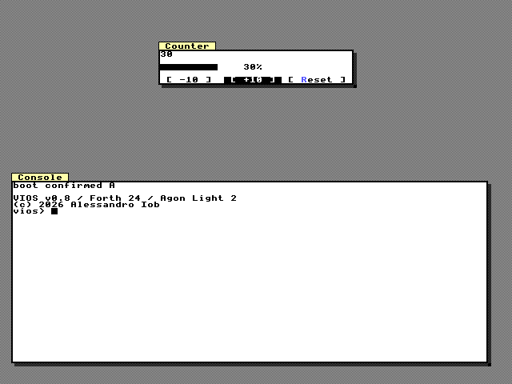

### A settings form with a menu and an animation

A small form that changes the GUI itself: two radio buttons choose the style,
a check box sets the window snap, and choosing a row of the list slides the
window to the left, the centre or the right with a tween. It also defines two
commands: *Quit* with the accelerator Ctrl+Q (listed on the Turbo Vision status
line because it has the `UI-STATUS` flag) and *Defaults*, both in a pane menu
opened with Shift+F10.

- The radios share the parent box 22, so they form one group: selecting one
  clears the other, and each selection sends `UI-EV-CHANGE` with value 1.
- The check box sends `UI-EV-CHANGE` with its new value.
- The list sends `UI-EV-SELECT` with the selected row; `FMOVE` animates the
  window's x from where it is to the new place with `UI-OUT` easing.
- Commands arrive as `UI-EV-COMMAND` with the command id in `arg`. Ctrl+Q works
  whichever window has the focus, because accelerators are global.
- Instead of taking the event apart on the stack, `EVENT?` stores it in three
  variables and `IS?` compares kind and id.
- Commands outlive windows, so `SETTINGS` disables its two commands when it
  ends; otherwise Ctrl+Q would keep sending events that nobody reads.

```forth
\ Settings: radios switch the style, a check box sets the snap, a list moves the window.
3 CONSTANT FWIN   2 CONSTANT FSURF
100 CONSTANT CMD-QUIT   101 CONSTANT CMD-DEFAULTS
VARIABLE FDONE   VARIABLE FX
VARIABLE KIND   VARIABLE WHO   VARIABLE ARG
: EVENT? ( -- flag )  UI-NEXT DUP IF >R ARG ! WHO ! KIND ! R> THEN ;
: IS? ( kind id -- flag )  WHO @ =  SWAP KIND @ =  AND ;
: FCOMMANDS ( -- )
  S" &Quit" CMD-QUIT UI-ENABLED UI-STATUS OR 0 UI-CTRL 113 UI-COMMAND
  S" &Defaults" CMD-DEFAULTS UI-ENABLED 0 0 0 UI-COMMAND
  CMD-DEFAULTS UI-SEPARATOR CMD-QUIT 3 S" Settings" 1 UI-MENU
  FWIN 1 UI-POPUP ;
: FDEFAULTS ( -- )  23 1 UI-WVALUE 0 UI-STYLE  25 1 UI-WVALUE 8 UI-SNAP ;
: FORM-OPEN ( -- )
  UI-BEGIN
  FSURF 34 10 48 UI-SURFACE
  288 FX !
  FWIN FSURF 288 48 34 10 UI-VISIBLE UI-DECOR OR UI-SHADOW OR UI-WINDOW
  S" Settings" FWIN UI-TITLE
  20 FWIN UI-BOX UI-NONE 0 0 0 0 UI-WF-FILL UI-WIDGET   20 UI-COLUMN 0 UI-LAYOUT
  21 FWIN UI-LABEL 20 0 0 0 0 0 UI-WIDGET   21 1 0 UI-WSIZE   S" Style" 21 UI-WTEXT
  22 FWIN UI-BOX 20 0 0 0 0 0 UI-WIDGET     22 2 0 UI-WSIZE   22 UI-COLUMN 0 UI-LAYOUT
  23 FWIN UI-RADIO 22 0 0 0 0 0 UI-WIDGET   S" S&malltalk" 23 UI-WTEXT
  24 FWIN UI-RADIO 22 0 0 0 0 0 UI-WIDGET   S" &Turbo Vision" 24 UI-WTEXT
  25 FWIN UI-CHECK 20 0 0 0 0 0 UI-WIDGET   25 1 0 UI-WSIZE   S" Snap windows to &8 px" 25 UI-WTEXT
  26 FWIN UI-LABEL 20 0 0 0 0 0 UI-WIDGET   26 1 0 UI-WSIZE   S" Position" 26 UI-WTEXT
  27 FWIN UI-LIST 20 0 0 0 0 0 UI-WIDGET    27 0 1 UI-WSIZE
  27 3 UI-ITEMS  S" Left" 27 0 UI-ITEM  S" Centre" 27 1 UI-ITEM  S" Right" 27 2 UI-ITEM  27 2 UI-WVALUE
  28 FWIN UI-BOX 20 0 0 0 0 0 UI-WIDGET     28 1 0 UI-WSIZE   28 UI-ROW 2 UI-LAYOUT
  29 FWIN UI-BUTTON 28 0 0 0 0 0 UI-WIDGET  S" &Close" 29 UI-WTEXT
  23 1 UI-WVALUE  25 1 UI-WVALUE
  FCOMMANDS
  FWIN UI-FOCUS
  UI-COMMIT ;
: FMOVE ( index -- )               \ slide the window to column 2, 19 or 36
  136 * 16 +  >R
  UI-TWEEN-WINDOW FWIN UI-X  FX @ R@  400 UI-OUT UI-ANIMATE
  R> FX ! ;
: FHANDLE ( -- )
  UI-EV-CHANGE 23 IS? IF 0 UI-STYLE THEN
  UI-EV-CHANGE 24 IS? IF 1 UI-STYLE THEN
  UI-EV-CHANGE 25 IS? IF ARG @ IF 8 ELSE 1 THEN UI-SNAP THEN
  UI-EV-SELECT 27 IS? IF ARG @ FMOVE THEN
  UI-EV-ACTIVATE 29 IS? IF TRUE FDONE ! THEN
  KIND @ UI-EV-COMMAND = IF
    ARG @ CMD-QUIT = IF TRUE FDONE ! THEN
    ARG @ CMD-DEFAULTS = IF FDEFAULTS THEN
  THEN
  UI-EV-WIN FWIN IS?  ARG @ 255 AND 2 =  AND IF TRUE FDONE ! THEN ;
: FSTEP ( -- )  BEGIN EVENT? WHILE FHANDLE REPEAT ;
: SETTINGS ( -- )
  FORM-OPEN  FALSE FDONE !
  BEGIN FSTEP 20 MS  FDONE @ UNTIL
  CMD-QUIT 0 UI-STATE  CMD-DEFAULTS 0 UI-STATE      \ disable Ctrl+Q again
  FWIN UI-CLOSE ;
```

<!-- nocheck -->
```forth
SETTINGS
```

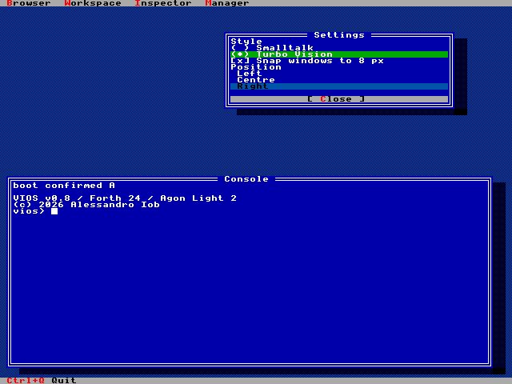

Both programs leave the window ids, surfaces and widget ids of the other
untouched, so you can load them together; run one loop at a time.

## Word Reference

<!-- BEGIN WORD REFERENCE (generated by tools/vios_manual.py words) -->

This reference lists all 404 words that VIOS accepts, generated from the sources by `tools/vios_manual.py words`. **Kind** is how the word is made: *primitive* (a VM opcode), *native* (a C function), *prelude* or *colon* (defined in Forth; the definition is shown), *constant*, *variable*, *defer* (a replaceable binding), *compiler* (parsed by the outer interpreter) or *command* (a line command parsed by the kernel; the rest of the line is its argument). Words marked **board** do real work only on the board (on the host build they talk to stubs).

**Sections:** [Stack](#ref-stack) · [Arithmetic](#ref-arith) · [Bits and logic](#ref-logic) · [Comparison](#ref-compare) · [Memory and data space](#ref-memory) · [Numbers and BASE](#ref-numbers) · [Control flow](#ref-control) · [Defining words](#ref-defining) · [Extending the compiler](#ref-compiler) · [Strings and characters](#ref-strings) · [Output](#ref-output) · [Input](#ref-input) · [Inspection and debugging](#ref-inspect) · [Engines and benchmarks](#ref-engine) · [System services](#ref-system) · [Time and interrupts](#ref-timing) · [Display and VDP](#ref-display) · [Audio](#ref-audio) · [Tasks](#ref-tasks) · [Pipes and pipelines](#ref-pipes) · [Handles and devices](#ref-handles) · [Files and loading](#ref-files) · [Modules](#ref-modules) · [Boot slots](#ref-boot) · [GUI: setup and batching](#ref-ui-setup) · [GUI: windows](#ref-ui-window) · [GUI: surfaces and cells](#ref-ui-surface) · [GUI: commands and menus](#ref-ui-menu) · [GUI: widgets](#ref-ui-widget) · [GUI: text views](#ref-ui-text) · [GUI: events](#ref-ui-event) · [GUI: animation](#ref-ui-anim) · [GUI: canvases and icons](#ref-ui-canvas) · [GUI: sprites and pointer](#ref-ui-sprite) · [GUI: constants](#ref-ui-const) · [GUI tools](#ref-tools) · [Text workbench](#ref-workbench)

<a id="ref-stack"></a>

### Stack

Moving cells on the data and return stacks.

| Word | Stack effect | Description | Kind |
| --- | --- | --- | --- |
| <a id="w-dup"></a>`DUP` | `( x -- x x )` | Duplicate the top cell. Primitive (one VM opcode). Example: `5 DUP * .  \ 25` | primitive |
| <a id="w-drop"></a>`DROP` | `( x -- )` | Discard the top cell. Primitive. Example: `1 2 DROP .  \ 1` | primitive |
| <a id="w-swap"></a>`SWAP` | `( x1 x2 -- x2 x1 )` | Exchange the top two cells. Primitive. Example: `1 2 SWAP . .  \ 1 2` | primitive |
| <a id="w-over"></a>`OVER` | `( x1 x2 -- x1 x2 x1 )` | Copy the second cell to the top. Primitive. Example: `1 2 OVER . . .  \ 1 2 1` | primitive |
| <a id="w-gtr"></a>`>R` | `( x -- ) ( R: -- x )` | Move the top cell to the return stack. Use only inside a colon definition and move it back before the definition ends: `;` returns through whatever is on top of the return stack, so an unbalanced `>R` fails with "invalid memory" (on the board it jumps to that address). The return stack is separate from the DO loop stack, so `I` still works after `>R`. Example: `: SUM3 >R + R> + ;  1 2 3 SUM3 .  \ 6` | primitive |
| <a id="w-rgt"></a>`R>` | `( -- x ) ( R: x -- )` | Move the top of the return stack to the data stack. Inside definitions only, paired with `>R`; fails with "return stack underflow" if the return stack is empty. Example: `: SUM3 >R + R> + ;  1 2 3 SUM3 .  \ 6` | primitive |
| <a id="w-rfetch"></a>`R@` | `( -- x ) ( R: x -- x )` | Copy the top of the return stack to the data stack. Inside definitions only. Example: `: TWICE >R R@ R> + ;  21 TWICE .  \ 42` | primitive |
| <a id="w-depth"></a>`DEPTH` | `( -- u )` | Number of cells on the data stack before DEPTH ran. The foreground data stack holds 256 cells; a background task saves at most 64. Example: `1 2 3 DEPTH .  \ 3` | primitive |
| <a id="w-2dup"></a>`2DUP` | `( x1 x2 -- x1 x2 x1 x2 )` | Duplicate the top pair. Defined in Forth as `OVER OVER`. Example: `1 2 2DUP .S  \ <4> 1 2 1 2` Definition: `: 2DUP OVER OVER ;` | colon |
| <a id="w-2drop"></a>`2DROP` | `( x1 x2 -- )` | Discard the top pair. Defined as `DROP DROP`. Example: `1 2 3 2DROP .  \ 1` Definition: `: 2DROP DROP DROP ;` | colon |
| <a id="w-rot"></a>`ROT` | `( x1 x2 x3 -- x2 x3 x1 )` | Rotate the third cell to the top. Library word from the kernel prelude. Example: `1 2 3 ROT .S  \ <3> 2 3 1` Definition: `: ROT >R SWAP R> SWAP ;` | prelude |
| <a id="w--rot"></a>`-ROT` | `( x1 x2 x3 -- x3 x1 x2 )` | Rotate the top cell down to third place (`ROT ROT`). Not ANS standard but common. Example: `1 2 3 -ROT .S  \ <3> 3 1 2` Definition: `: -ROT ROT ROT ;` | prelude |
| <a id="w-nip"></a>`NIP` | `( x1 x2 -- x2 )` | Discard the second cell. Example: `1 2 NIP .  \ 2` Definition: `: NIP SWAP DROP ;` | prelude |
| <a id="w-tuck"></a>`TUCK` | `( x1 x2 -- x2 x1 x2 )` | Copy the top cell below the second. Example: `1 2 TUCK .S  \ <3> 2 1 2` Definition: `: TUCK SWAP OVER ;` | prelude |
| <a id="w-qdup"></a>`?DUP` | `( x -- 0 \| x x )` | Duplicate the top cell only if it is non-zero. Example: `7 ?DUP .S  \ <2> 7 7` Definition: `: ?DUP DUP IF DUP THEN ;` | prelude |
| <a id="w-2swap"></a>`2SWAP` | `( x1 x2 x3 x4 -- x3 x4 x1 x2 )` | Exchange the top two pairs. Example: `1 2 3 4 2SWAP .S  \ <4> 3 4 1 2` Definition: `: 2SWAP ROT >R ROT R> ;` | prelude |
| <a id="w-2over"></a>`2OVER` | `( x1 x2 x3 x4 -- x1 x2 x3 x4 x1 x2 )` | Copy the second pair to the top. Example: `1 2 3 4 2OVER .S  \ <6> 1 2 3 4 1 2` Definition: `: 2OVER >R >R 2DUP R> R> 2SWAP ;` | prelude |

<a id="ref-arith"></a>

### Arithmetic

Integer arithmetic on cells (24 bits on the board).

| Word | Stack effect | Description | Kind |
| --- | --- | --- | --- |
| <a id="w-plus"></a>`+` | `( n1 n2 -- n3 )` | Add. Results wrap modulo 2^24 (cells are 24 bits). Example: `8388607 1 + .  \ -8388608` | primitive |
| <a id="w--"></a>`-` | `( n1 n2 -- n3 )` | Subtract n2 from n1, modulo 2^24. Example: `10 3 - .  \ 7` | primitive |
| <a id="w-star"></a>`*` | `( n1 n2 -- n3 )` | Multiply, keeping the low 24 bits of the product. Example: `6 7 * .  \ 42` | primitive |
| <a id="w-slash"></a>`/` | `( n1 n2 -- n3 )` | Signed division that truncates toward zero (C semantics, not floored): `-7 2 /` is -3. Division by zero, or -8388608 by -1, fails with "arithmetic error". Example: `-7 2 / .  \ -3` | primitive |
| <a id="w-mod"></a>`MOD` | `( n1 n2 -- n3 )` | Signed remainder with the sign of n1 (C semantics). Fails with "arithmetic error" on division by zero. Example: `7 -2 MOD .  \ 1` | primitive |
| <a id="w-1plus"></a>`1+` | `( n -- n+1 )` | Add one. Defined in Forth as `1 +`. Example: `41 1+ .  \ 42` Definition: `: 1+ 1 + ;` | colon |
| <a id="w-1-"></a>`1-` | `( n -- n-1 )` | Subtract one. Example: `43 1- .  \ 42` Definition: `: 1- 1 - ;` | colon |
| <a id="w-negate"></a>`NEGATE` | `( n -- -n )` | Two's complement negation (`0 SWAP -`). Example: `5 NEGATE .  \ -5` Definition: `: NEGATE 0 SWAP - ;` | colon |
| <a id="w-abs"></a>`ABS` | `( n -- u )` | Absolute value. -8388608 stays -8388608 (it has no positive 24-bit counterpart). Example: `-3 ABS .  \ 3` Definition: `: ABS DUP 0< IF NEGATE THEN ;` | prelude |
| <a id="w-max"></a>`MAX` | `( n1 n2 -- n3 )` | The larger of two signed numbers. Example: `2 7 MAX .  \ 7` Definition: `: MAX 2DUP < IF SWAP THEN DROP ;` | prelude |
| <a id="w-min"></a>`MIN` | `( n1 n2 -- n3 )` | The smaller of two signed numbers. Example: `2 7 MIN .  \ 2` Definition: `: MIN 2DUP SWAP < IF SWAP THEN DROP ;` | prelude |
| <a id="w-2star"></a>`2*` | `( x -- x*2 )` | Shift left by one bit (`1 LSHIFT`). Example: `21 2* .  \ 42` Definition: `: 2* 1 LSHIFT ;` | prelude |
| <a id="w-slashmod"></a>`/MOD` | `( n1 n2 -- rem quot )` | Remainder and quotient of a truncating division (`2DUP MOD -ROT /`). Example: `17 5 /MOD . .  \ 3 2` Definition: `: /MOD 2DUP MOD -ROT / ;` | prelude |
| <a id="w-starslash"></a>`*/` | `( n1 n2 n3 -- n4 )` | n1*n2/n3. Unlike ANS Forth there is no double-cell intermediate: the product is truncated to 24 bits before the division, so keep n1*n2 within -8388608..8388607. Example: `100 3 4 */ .  \ 75` Definition: `: */ >R * R> / ;` | prelude |

<a id="ref-logic"></a>

### Bits and logic

Bitwise operations and shifts.

| Word | Stack effect | Description | Kind |
| --- | --- | --- | --- |
| <a id="w-and"></a>`AND` | `( x1 x2 -- x3 )` | Bitwise AND. Example: `12 10 AND .  \ 8` | primitive |
| <a id="w-or"></a>`OR` | `( x1 x2 -- x3 )` | Bitwise OR. Example: `12 10 OR .  \ 14` | primitive |
| <a id="w-xor"></a>`XOR` | `( x1 x2 -- x3 )` | Bitwise exclusive OR. Example: `12 10 XOR .  \ 6` | primitive |
| <a id="w-invert"></a>`INVERT` | `( x -- x' )` | Flip all 24 bits. Example: `0 INVERT .  \ -1` | primitive |
| <a id="w-lshift"></a>`LSHIFT` | `( x u -- x' )` | Logical shift left by u bits; u of 24 or more gives 0. Example: `1 4 LSHIFT .  \ 16` | primitive |
| <a id="w-rshift"></a>`RSHIFT` | `( x u -- x' )` | Logical (unsigned) shift right by u bits; u of 24 or more gives 0. Example: `-1 1 RSHIFT .  \ 8388607` | primitive |
| <a id="w-true"></a>`TRUE` | `( -- -1 )` | The canonical true flag: all 24 bits set (hex FFFFFF). Example: `TRUE .  \ -1` Definition: `: TRUE -1 ;` | colon |
| <a id="w-false"></a>`FALSE` | `( -- 0 )` | The false flag. Example: `FALSE .  \ 0` Definition: `: FALSE 0 ;` | colon |

<a id="ref-compare"></a>

### Comparison

Flags are -1 (true) and 0 (false).

| Word | Stack effect | Description | Kind |
| --- | --- | --- | --- |
| <a id="w-eq"></a>`=` | `( x1 x2 -- flag )` | True (-1) if the cells are equal. Example: `3 3 = .  \ -1` | primitive |
| <a id="w-lt"></a>`<` | `( n1 n2 -- flag )` | Signed less-than on 24-bit values. Example: `-1 1 < .  \ -1` | primitive |
| <a id="w-ult"></a>`U<` | `( u1 u2 -- flag )` | Unsigned less-than (-1 counts as 16777215). Example: `-1 1 U< .  \ 0` | primitive |
| <a id="w-0eq"></a>`0=` | `( x -- flag )` | True if x is zero; also the usual logical NOT of a flag. Example: `0 0= .  \ -1` | primitive |
| <a id="w-gt"></a>`>` | `( n1 n2 -- flag )` | Signed greater-than (`SWAP <`). Example: `2 1 > .  \ -1` Definition: `: > SWAP < ;` | prelude |
| <a id="w-0lt"></a>`0<` | `( n -- flag )` | True if n is negative (bit 23 set). Example: `-5 0< .  \ -1` Definition: `: 0< 0 < ;` | prelude |
| <a id="w-0gt"></a>`0>` | `( n -- flag )` | True if n is greater than zero. Example: `5 0> .  \ -1` Definition: `: 0> 0 SWAP < ;` | prelude |
| <a id="w-ltgt"></a>`<>` | `( x1 x2 -- flag )` | True if the cells differ (`= 0=`). Example: `1 2 <> .  \ -1` Definition: `: <> = 0= ;` | prelude |
| <a id="w-ugt"></a>`U>` | `( u1 u2 -- flag )` | Unsigned greater-than. Example: `-1 1 U> .  \ -1` Definition: `: U> SWAP U< ;` | prelude |
| <a id="w-within"></a>`WITHIN` | `( n lo hi -- flag )` | True if lo <= n < hi (computed unsigned, so it also works across the sign boundary when lo <= hi). Example: `3 1 5 WITHIN .  \ -1` Definition: `: WITHIN OVER - >R - R> U< ;` | prelude |

<a id="ref-memory"></a>

### Memory and data space

Fetching, storing and reserving data space.

| Word | Stack effect | Description | Kind |
| --- | --- | --- | --- |
| <a id="w-fetch"></a>`@` | `( addr -- x )` | Fetch a 3-byte little-endian cell. On the board any address is accepted (native eZ80 addressing, no protection); on the host only the dictionary regions exist and other addresses fail with "invalid memory". Example: `VARIABLE V1  42 V1 !  V1 @ .  \ 42` | primitive |
| <a id="w-store"></a>`!` | `( x addr -- )` | Store a 3-byte cell at addr. No alignment is needed. On the board a bad address silently overwrites memory. Example: `VARIABLE V2  7 V2 !  V2 @ .  \ 7` | primitive |
| <a id="w-cfetch"></a>`C@` | `( addr -- c )` | Fetch one byte. Example: `S" A" DROP C@ .  \ 65` | primitive |
| <a id="w-cstore"></a>`C!` | `( c addr -- )` | Store the low 8 bits of c at addr. Example: `CREATE B1 2 ALLOT  66 B1 C!  B1 C@ .  \ 66` | primitive |
| <a id="w-fill"></a>`FILL` | `( addr u c -- )` | Set u bytes from addr to c. Works in chunks of 256 bytes so a timer tick can preempt a long fill; the result is the same. Example: `CREATE F1 8 ALLOT  F1 8 42 FILL  F1 8 TYPE  \ ********` | native |
| <a id="w-move"></a>`MOVE` | `( src dst u -- )` | Copy u bytes from src to dst; overlapping regions are handled. Chunked like FILL. Example: `CREATE M1 3 ALLOT  S" abc" DROP M1 3 MOVE  M1 3 TYPE  \ abc` | native |
| <a id="w-cells"></a>`CELLS` | `( n -- n*3 )` | Size in bytes of n cells. A cell is 3 bytes in VIOS, on the board and on the host. Example: `2 CELLS .  \ 6` Definition: `: CELLS 3 * ;` | colon |
| <a id="w-cellplus"></a>`CELL+` | `( addr -- addr+3 )` | Advance an address by one cell. Example: `100 CELL+ .  \ 103` Definition: `: CELL+ 3 + ;` | colon |
| <a id="w-plusstore"></a>`+!` | `( n addr -- )` | Add n to the cell at addr. Example: `VARIABLE C1  5 C1 !  3 C1 +!  C1 @ .  \ 8` Definition: `: +! DUP @ ROT + SWAP ! ;` | prelude |
| <a id="w-q"></a>`?` | `( addr -- )` | Print the cell at addr (`@ .`). Example: `VARIABLE Q1  99 Q1 !  Q1 ?  \ 99` Definition: `: ? @ . ;` | prelude |
| <a id="w-erase"></a>`ERASE` | `( addr u -- )` | Set u bytes to zero (`0 FILL`). Example: `CREATE E1 4 ALLOT  E1 4 ERASE  E1 C@ .  \ 0` Definition: `: ERASE 0 FILL ;` | prelude |
| <a id="w-bounds"></a>`BOUNDS` | `( addr u -- addr+u addr )` | Turn an address and length into DO loop limits. Example: `: SHOW BOUNDS ?DO I C@ EMIT LOOP ;  S" hi" SHOW  \ hi` Definition: `: BOUNDS OVER + SWAP ;` | prelude |
| <a id="w-comma"></a>`,` | `( x -- )` | Append a cell to data space. Works at the prompt and inside definitions (defining words); refused in background tasks. Fails with "data space full" past 8192 bytes. Example: `CREATE T1 10 , 20 ,  T1 CELL+ @ .  \ 20` | native |
| <a id="w-ccomma"></a>`C,` | `( c -- )` | Append one byte to data space. Works at the prompt and inside definitions; refused in background tasks. Example: `CREATE CS1 3 C, 65 C, 66 C, 67 C,  CS1 COUNT TYPE  \ ABC` | native |
| <a id="w-allot"></a>`ALLOT` | `( u -- )` | Reserve u zeroed bytes of data space; a negative u fails ("negative ALLOT"). Works inside definitions too (defining words with DOES>). If the first ALLOT after CREATE does not fit, the CREATEd word is removed again. Example: `CREATE BUF1 16 ALLOT  BUF1 16 ERASE` | native |
| <a id="w-here"></a>`HERE` | `( -- addr )` | The next free data-space address. Works at the prompt and inside definitions. Example: `HERE 3 ALLOT HERE SWAP - .  \ 3` | native |

<a id="ref-numbers"></a>

### Numbers and BASE

Number conversion and printing radix.

| Word | Stack effect | Description | Kind |
| --- | --- | --- | --- |
| <a id="w-base"></a>`BASE` | `( -- addr )` | Variable holding the number radix (2..36) used for parsing and printing. Starts at 10; each background task has its own BASE, inherited from its spawner. Module source is always compiled in decimal. Example: `2 BASE ! 101 . DECIMAL  \ 101 (read and printed in binary)` | variable |
| <a id="w-hex"></a>`HEX` | `( -- )` | Set BASE to 16. Example: `HEX FF . DECIMAL  \ FF` Definition: `: HEX 16 BASE ! ;` | colon |
| <a id="w-decimal"></a>`DECIMAL` | `( -- )` | Set BASE to 10. Example: `HEX 10 DECIMAL .  \ 16` Definition: `: DECIMAL 10 BASE ! ;` | colon |
| <a id="w-dothex2"></a>`.HEX2` | `( u -- )` | Print u with a leading 0 when it is below 16, then a space. Meant for use while BASE is 16 (as DUMP does), where it prints bytes as two hex digits. Example: `HEX 10 .HEX2 A .HEX2 DECIMAL  \ 10 0A` Definition: `: .HEX2 DUP 16 < IF 48 EMIT THEN . ;` | prelude |

<a id="ref-control"></a>

### Control flow

Conditionals, loops and execution tokens.

| Word | Stack effect | Description | Kind |
| --- | --- | --- | --- |
| <a id="w-if"></a>`IF` | `( flag -- )` | Parser keyword: `flag IF ... [ELSE ...] THEN`. Runs the first branch when flag is non-zero. Compile-only ("compile-only word" outside a definition). Example: `: SIGN 0< IF ." neg" ELSE ." pos" THEN ;  -3 SIGN  \ neg` | compiler |
| <a id="w-else"></a>`ELSE` | `( -- )` | Parser keyword: starts the false branch of IF. Fails with "ELSE needs IF" when misplaced. Example: `: ODD? 1 AND IF ." odd" ELSE ." even" THEN ;  4 ODD?  \ even` | compiler |
| <a id="w-then"></a>`THEN` | `( -- )` | Parser keyword: ends an IF or IF ... ELSE structure. Example: `: ?NL DUP 0= IF CR THEN DROP ;  0 ?NL` | compiler |
| <a id="w-begin"></a>`BEGIN` | `( -- )` | Parser keyword: marks the start of `BEGIN ... UNTIL`, `BEGIN ... AGAIN` or `BEGIN ... WHILE ... REPEAT`. Compile-only. Example: `: COUNTDOWN BEGIN DUP . 1- DUP 0= UNTIL DROP ;  3 COUNTDOWN  \ 3 2 1` | compiler |
| <a id="w-until"></a>`UNTIL` | `( flag -- )` | Parser keyword: loop back to BEGIN while flag is zero. Example: `: UPTO5 0 BEGIN 1+ DUP 5 = UNTIL . ;  UPTO5  \ 5` | compiler |
| <a id="w-again"></a>`AGAIN` | `( -- )` | Parser keyword: loop back to BEGIN unconditionally. A foreground command stops after 1,000,000 VM instructions ("execution budget exhausted"), so endless loops belong in background tasks or must EXIT. Example: `: FIRST-OVER-100 1 BEGIN 2* DUP 100 > IF EXIT THEN AGAIN ;  FIRST-OVER-100 .  \ 128` | compiler |
| <a id="w-while"></a>`WHILE` | `( flag -- )` | Parser keyword: in `BEGIN ... WHILE ... REPEAT`, leave the loop when flag is zero. Fails with "WHILE needs BEGIN" when misplaced. Example: `: LT3 0 BEGIN DUP 3 < WHILE 1+ REPEAT . ;  LT3  \ 3` | compiler |
| <a id="w-repeat"></a>`REPEAT` | `( -- )` | Parser keyword: ends `BEGIN ... WHILE ... REPEAT`, jumping back to BEGIN. Example: `: HALVES BEGIN DUP WHILE DUP . 2 / REPEAT DROP ;  20 HALVES  \ 20 10 5 2 1` | compiler |
| <a id="w-do"></a>`DO` | `( limit start -- )` | Parser keyword: start a counted loop ending in LOOP or +LOOP. The body runs at least once; with start = limit it runs 2^24 times, so use ?DO when the count may be zero. Loop frames live on a separate loop stack of 32 frames (16 in a background task). Example: `: TENS 5 0 DO I 10 * . LOOP ;  TENS  \ 0 10 20 30 40` | compiler |
| <a id="w-qdo"></a>`?DO` | `( limit start -- )` | Parser keyword: like DO but skips the loop entirely when start equals limit. Example: `: STARS 0 ?DO 42 EMIT LOOP ;  0 STARS 3 STARS  \ ***` | compiler |
| <a id="w-loop"></a>`LOOP` | `( -- )` | Parser keyword: add one to the index; repeat until the index reaches the limit. Fails with "LOOP needs DO" when misplaced. Example: `: ABC 3 0 DO 65 I + EMIT LOOP ;  ABC  \ ABC` | compiler |
| <a id="w-plusloop"></a>`+LOOP` | `( n -- )` | Parser keyword: add n to the index and repeat unless the index crossed the boundary between limit-1 and limit (either direction). Compiles a call to the internal `(+LOOP)`. Example: `: DOWN 0 10 DO I . -3 +LOOP ;  DOWN  \ 10 7 4 1` | compiler |
| <a id="w-lppluslooprp"></a>`(+LOOP)` | `( n -- flag )` | Internal native compiled by +LOOP: steps the innermost loop index by n and returns true (dropping the loop frame) when the loop is finished. You cannot call it by name: any token that starts with `(` is read as a comment. | native |
| <a id="w-i"></a>`I` | `( -- n )` | Index of the innermost DO loop. Fails with "loop stack underflow" outside a loop. Unaffected by `>R`, because loop frames are not on the return stack. Example: `: SQUARES 4 1 DO I I * . LOOP ;  SQUARES  \ 1 4 9` | primitive |
| <a id="w-j"></a>`J` | `( -- n )` | Index of the next outer DO loop. There is no K. Example: `: GRID 2 0 DO 2 0 DO J . I . LOOP LOOP ;  GRID  \ 0 0 0 1 1 0 1 1` | native |
| <a id="w-leave"></a>`LEAVE` | `( -- )` | Parser keyword: drop the innermost loop frame and continue after its LOOP/+LOOP. At most 16 LEAVE/?DO exits can be pending in one definition. Example: `: UNTIL5 10 0 DO I 5 = IF LEAVE THEN I . LOOP ;  UNTIL5  \ 0 1 2 3 4` | compiler |
| <a id="w-unloop"></a>`UNLOOP` | `( -- )` | Drop the innermost loop frame. Use it before EXIT inside a DO loop: EXIT returns through the return stack but leaves the loop frame on the separate loop stack. Example: `: FIND7 10 0 DO I 7 = IF I UNLOOP EXIT THEN LOOP -1 ;  FIND7 .  \ 7` | native |
| <a id="w-exit"></a>`EXIT` | `( -- )` | Parser keyword: return from the current definition at once. Compile-only; outside a definition EXIT is an unknown word. Example: `: POS? DUP 0> IF DROP ." yes" EXIT THEN DROP ." no" ;  5 POS?  \ yes` | compiler |
| <a id="w-recurse"></a>`RECURSE` | `( -- )` | Parser keyword: compile a call to the definition being compiled (its own name is not visible until `;`). Example: `: FACT DUP 1 > IF DUP 1- RECURSE * ELSE DROP 1 THEN ;  10 FACT .  \ 3628800` | compiler |
| <a id="w-execute"></a>`EXECUTE` | `( i*x xt -- j*x )` | Run the word whose execution token is xt. Fails with "invalid execution token" for 0 or an xt beyond the dictionary. Example: `' DUP 3 SWAP EXECUTE .S  \ <2> 3 3` | primitive |
| <a id="w-tick"></a>`'` | `( "name" -- xt )` | Parser keyword: push the execution token (dictionary index, 1-based) of name. Interpretation only; inside a definition use ['] ("use ['] in definitions"). Parser keywords such as IF or VARIABLE have no xt. Example: `' DUP .  \ 1` | compiler |
| <a id="w-lbtickrb"></a>`[']` | `( "name" -- ) compile; runtime ( -- xt )` | Parser keyword: compile name's execution token as a literal. Use inside definitions. Example: `: XT-OF-DUP ['] DUP ;  XT-OF-DUP .  \ 1` | compiler |

<a id="ref-defining"></a>

### Defining words

Words that create other words.

| Word | Stack effect | Description | Kind |
| --- | --- | --- | --- |
| <a id="w-doesgt"></a>`DOES>` | `( -- )  child: ( -- addr ) then the code after DOES>` | Parser keyword, used in a defining word after CREATE: ends the defining part; each word it creates then pushes its data address and runs the code after DOES>. Callers inline a child's address. Example: `: CONST CREATE , DOES> @ ;  42 CONST ANSWER  ANSWER .  \ 42` | compiler |
| <a id="w-gtbody"></a>`>BODY` | `( xt -- addr )` | The data address of a word made by CREATE, VARIABLE or a DOES> defining word; fails for other kinds. | native |
| <a id="w-marker"></a>`MARKER` | `( "name" -- )  name: ( -- )` | Create a word that, when run, removes itself and every word defined after it and gives back their dictionary, code, data, name and source-map space. It refuses to remove module words, words a DEFER is still bound to, or code while tasks are live. Run it from the prompt. Example: `MARKER SCRATCH` | native |
| <a id="w-lpmarkerrp"></a>`(MARKER)` | `( -- )` | Internal: the code a MARKER word runs to cut the dictionary back. | native |
| <a id="w-lpdoesgtrp"></a>`(DOES>)` | `( t d -- )` | Internal: compiled by DOES>; at run time it turns the word just CREATEd into a child that runs the does-part. | native |
| <a id="w-colon"></a>`:` | `( "name" -- )` | Parser keyword: start a colon definition. Names are 1..31 characters, case-insensitive (stored upper case); definitions cannot nest. The word becomes visible only at `;`, and a definition that fails is discarded. Redefining a name does not change words already compiled against the old one. Example: `: SQ DUP * ;  7 SQ .  \ 49` | compiler |
| <a id="w-semi"></a>`;` | `( -- )` | Parser keyword: end the current definition and publish it. Fails with "unbalanced control flow" if an IF/BEGIN/DO is still open, or "unexpected semicolon" outside a definition. Example: `: HELLO ." hello" ;  HELLO  \ hello` | compiler |
| <a id="w-variable"></a>`VARIABLE` | `( "name" -- )  name: ( -- addr )` | Create a word that pushes the address of a fresh 3-byte cell in data space, initialised to 0. A dictionary word: it can be used inside definitions, ticked and postponed. Example: `VARIABLE SCORE  10 SCORE !  SCORE ?  \ 10` | native |
| <a id="w-constant"></a>`CONSTANT` | `( x "name" -- )  name: ( -- x )` | Create a word that pushes x. Callers compile the value as a literal, so redefining the constant later does not change them. A dictionary word, usable inside defining words. Example: `7 CONSTANT DAYS  DAYS .  \ 7` | native |
| <a id="w-create"></a>`CREATE` | `( "name" -- )  name: ( -- addr )` | Create a word that pushes its data-space address; reserve its body with ALLOT, `,` or `C,`. Works inside definitions, where DOES> can then give the new word its own behaviour (see Extending the compiler). Example: `CREATE PRIMES 2 , 3 , 5 ,  PRIMES 2 CELLS + @ .  \ 5` | native |
| <a id="w-defer"></a>`DEFER` | `( "name" -- )  name: ( i*x -- j*x )` | Create a replaceable binding. Calling it runs the word stored with IS; compiled callers follow every rebinding. Executing an unbound DEFER fails with "invalid execution token". A dictionary word. Example: `DEFER GREET  : HI ." hi" ;  ' HI IS GREET  GREET  \ hi` | native |
| <a id="w-is"></a>`IS` | `( xt "name" -- )` | Parser keyword: bind the DEFER name to xt. Works interactively (checks xt) and inside definitions (stores at run time). Fails with "IS requires deferred word" for any other kind of word. Example: `DEFER SHOUT  : LOUD ." HEY" ;  : ARM ['] LOUD IS SHOUT ;  ARM SHOUT  \ HEY` | compiler |

<a id="ref-compiler"></a>

### Extending the compiler

Compile-time execution, macros and text evaluation.

| Word | Stack effect | Description | Kind |
| --- | --- | --- | --- |
| <a id="w-state"></a>`STATE` | `( -- addr )` | A variable that holds true while a definition is being compiled and false while interpreting. Read it, do not store into it: use [ and ] to switch. Example: `STATE @ .  \ 0` | variable |
| <a id="w-lb"></a>`[` | `( -- )` | Parser keyword: switch to interpreting inside an open definition, for example to compute a value at compile time. Example: `: DAY [ 60 60 * 24 * ] LITERAL ;` | compiler |
| <a id="w-rb"></a>`]` | `( -- )` | Parser keyword: switch back to compiling. Needs an open definition. | compiler |
| <a id="w-literal"></a>`LITERAL` | `compile: ( x -- )  run: ( -- x )` | Parser keyword, compile-only: compile the number on the stack as a literal, typically after [ ... ]. | compiler |
| <a id="w-immediate"></a>`IMMEDIATE` | `( -- )` | Parser keyword: make the word just defined immediate, so inside definitions it runs at compile time instead of being compiled. It applies only to a word defined in the same unit (line, LOAD or module). Example: `: UNLESS POSTPONE 0= POSTPONE IF ; IMMEDIATE` | compiler |
| <a id="w-postpone"></a>`POSTPONE` | `( "name" -- )` | Parser keyword, compile-only: compile name's compilation behaviour into the current definition. For an ordinary word that compiles code that will compile a call to it; for an immediate word or a control keyword (IF, THEN, DO ...) it makes the word act when the new word runs. Postponing a parsing keyword (S", .", [CHAR], ['], IS, POSTPONE) is refused. | compiler |
| <a id="w-compilecomma"></a>`COMPILE,` | `( xt -- )` | Compile a call to xt into the open definition (constants and variables are inlined, as the compiler does). Refused in background tasks. | native |
| <a id="w-find"></a>`FIND` | `( c-addr -- c-addr 0 \| xt 1 \| xt -1 )` | Look up a counted string (case-insensitive): 1 for an immediate word, -1 for an ordinary one, 0 if not found. Parser keywords are not dictionary words and give 0. | native |
| <a id="w-evaluate"></a>`EVALUATE` | `( i*x addr u -- j*x )` | Interpret a string as if it were typed, sharing the compiler state, so inside an immediate word it compiles into the open definition (a text macro). Nests up to 4 levels, at most 512 bytes of text each. Refused in background tasks; outer commands, SYNC and ABORT are not available inside it. Example: `S" 2 3 + ." EVALUATE  \ 5` | native |
| <a id="w-lpkeywordrp"></a>`(KEYWORD)` | `( id -- )` | Internal: compiled by POSTPONE of a control keyword; runs that keyword's compiler action when the new word executes. | native |
| <a id="w-lpeval-returnrp"></a>`(EVAL-RETURN)` | `( -- )` | Internal: the return point EVALUATE uses to come back from words it runs. | native |

<a id="ref-strings"></a>

### Strings and characters

String literals, characters and comments.

| Word | Stack effect | Description | Kind |
| --- | --- | --- | --- |
| <a id="w-sq"></a>`S"` | `( "text<quote>" -- addr u )` | Parser keyword: copy text (up to the next `"` on the same line, one leading space skipped, case preserved) into data space with a trailing NUL and push its address and length. Interactively and in definitions alike, each S" takes data space permanently; fails with "unterminated string" when the quote is missing. Example: `S" hello" TYPE  \ hello` | compiler |
| <a id="w-dotq"></a>`."` | `( "text<quote>" -- )` | Parser keyword: print text; equivalent to `S" text" TYPE`, so the text also lives in data space. Works both interactively and in definitions. Example: `." VIOS" CR` | compiler |
| <a id="w-char"></a>`CHAR` | `( "c" -- c )` | Parser keyword: push the code of the first character of the next token (case preserved). Interpretation only; use [CHAR] in definitions. Example: `CHAR a .  \ 97` | compiler |
| <a id="w-lbcharrb"></a>`[CHAR]` | `( "c" -- ) compile; runtime ( -- c )` | Parser keyword: compile the code of the next token's first character as a literal. Example: `: STAR [CHAR] * EMIT ;  STAR  \ *` | compiler |
| <a id="w-count"></a>`COUNT` | `( addr -- addr+1 u )` | Unpack a counted string (length byte first). Example: `CREATE CNT1 2 C, 79 C, 75 C,  CNT1 COUNT TYPE  \ OK` Definition: `: COUNT DUP 1+ SWAP C@ ;` | prelude |

<a id="ref-output"></a>

### Output

Printing to the console (or to a task's output).

| Word | Stack effect | Description | Kind |
| --- | --- | --- | --- |
| <a id="w-emit"></a>`EMIT` | `( c -- )` | Write one byte to the console (in a background task: to the task's output ring or redirected handle). Example: `65 EMIT  \ A` | primitive |
| <a id="w-dot"></a>`.` | `( n -- )` | Print n as a signed 24-bit number in the current BASE, followed by a space. Example: `-1 .  \ -1` | primitive |
| <a id="w-udot"></a>`U.` | `( u -- )` | Print u unsigned (0..16777215) in the current BASE, followed by a space. Example: `-1 U.  \ 16777215` | native |
| <a id="w-cr"></a>`CR` | `( -- )` | Write a CR LF pair. Example: `." line" CR` | primitive |
| <a id="w-type"></a>`TYPE` | `( addr u -- )` | Write u bytes from addr to the console in one native call. A redirected background task may stop part-way and resume the rest in its next slice. Example: `S" text" TYPE  \ text` | native |
| <a id="w-bl"></a>`BL` | `( -- 32 )` | The space character code. Example: `BL .  \ 32` Definition: `: BL 32 ;` | prelude |
| <a id="w-space"></a>`SPACE` | `( -- )` | Write one space. Example: `65 EMIT SPACE 66 EMIT  \ A B` Definition: `: SPACE BL EMIT ;` | prelude |
| <a id="w-spaces"></a>`SPACES` | `( n -- )` | Write n spaces; nothing when n is zero or negative. Example: `3 SPACES 42 EMIT  \    *` Definition: `: SPACES BEGIN DUP 0> WHILE SPACE 1- REPEAT DROP ;` | prelude |
| <a id="w-console-write"></a>`CONSOLE-WRITE` | `( addr u -- )` | Kernel service: write u bytes to the console through the task-aware emitter, byte by byte (like TYPE, without TYPE's resume-on-full behaviour). Example: `S" via service" CONSOLE-WRITE CR` | native |
| <a id="w-console-emit"></a>`CONSOLE-EMIT` | `( c -- )` | Deferred service binding, initially EMIT. Rebind it with IS to redirect output of code that calls CONSOLE-EMIT; the system's own EMIT, TYPE and . do not go through it. Example: `72 CONSOLE-EMIT 73 CONSOLE-EMIT  \ HI` | defer |

<a id="ref-input"></a>

### Input

Reading keys.

| Word | Stack effect | Description | Kind |
| --- | --- | --- | --- |
| <a id="w-key"></a>`KEY` | `( -- c )` | Wait for the next input byte. In the foreground it reads console input (physical keys typed while the command runs, or host bytes) and runs background tasks while it waits; arrow and function keys produce no byte. In a background task it reads the task's input handle (-1 at end of file) or fails with "KEY unavailable in background task". Example: `: ECHO1 KEY EMIT ;` | primitive, board |
| <a id="w-console-key"></a>`CONSOLE-KEY` | `( -- c )` | Deferred service binding, initially KEY. Code that reads through CONSOLE-KEY can be pointed at another input source with IS. Example: `: ASK CONSOLE-KEY EMIT ;` | defer, board |

<a id="ref-inspect"></a>

### Inspection and debugging

Looking inside the running system.

| Word | Stack effect | Description | Kind |
| --- | --- | --- | --- |
| <a id="w-dots"></a>`.S` | `( -- )` | Parser keyword: print `<depth>` and the data stack bottom to top as signed numbers, without changing it. Interpretation only. Example: `1 2 3 .S  \ <3> 1 2 3` | compiler |
| <a id="w-dump"></a>`DUMP` | `( addr u -- )` | Hex dump of u bytes. Each byte is two hex digits; a new line with the address starts at every 16-byte boundary (so an unaligned start has no address on its first line). BASE is restored afterwards. Example: `S" ABC" DUMP` | prelude |
| <a id="w-words"></a>`WORDS` | `( -- )` | Parser keyword: list every dictionary entry, oldest first, including shadowed older definitions. Parser keywords (IF, VARIABLE, SEE ...) and outer commands are not dictionary entries and are not listed. Example: `WORDS` | compiler |
| <a id="w-see"></a>`SEE` | `( "name" -- )` | Parser keyword: show a colon word's stored source (upper case, comments removed) or `primitive NAME` / `data word NAME`, then a metadata line: xt, kind (0 primitive, 1 colon, 2 constant, 3 variable, 4 defer, 5 native, 6 does, 7 marker), code addresses and sizes for both code formats, the module it came from, and ` immediate` for an immediate word. Example: `: CUBE DUP DUP * * ;  SEE CUBE` | compiler |
| <a id="w-resources"></a>`RESOURCES` | `( -- )` | Parser keyword: one line with the engine, words used/512, token, direct, data and source bytes used, source-map entries used/1792 (the map TRACE and LAST-ERROR read), and the peak data and return stack depths. Example: `RESOURCES` | compiler |
| <a id="w-last-error"></a>`LAST-ERROR` | `( -- )` | Parser keyword: report the last foreground runtime failure as captured before the stacks were cleared: serial, engine, whether the dictionary changed since (stale), BASE, message, failing word, code offset and source token, stack depths, the top 8 data cells, then one `frame` line per caller (up to 16). The message and word names are printed as hex bytes; the host CLI's `:why` decodes them. Example: `LAST-ERROR` | compiler |
| <a id="w-trace"></a>`TRACE` | `( i*x "name" "n" -- j*x )` | Parser keyword: run name one VM instruction at a time for at most n (1..100000) steps, printing step number, word+offset, source token, stack depths and top of stack before each, then `trace returned` or `trace failed`. Uses the current engine. Interpretation only. Example: `: SQ2 DUP * ;  4 TRACE SQ2 10 .` | compiler |

<a id="ref-engine"></a>

### Engines and benchmarks

Choosing and measuring the execution engine.

| Word | Stack effect | Description | Kind |
| --- | --- | --- | --- |
| <a id="w-engine"></a>`ENGINE` | `( "C\|TOKEN\|DIRECT" -- )` | Parser keyword: select the execution engine for compiled code: C (the portable reference interpreter of token code), TOKEN (eZ80 assembly, one-byte opcodes) or DIRECT (eZ80 direct-threaded, the board default). TOKEN and DIRECT exist only on the board; refused while background tasks are live. The name is C, not REFERENCE. Example: `ENGINE C` | compiler |
| <a id="w-bench"></a>`BENCH` | `( -- )` | Parser keyword, board only: time arithmetic, call, branch, loop and memory micro-benchmarks on all three engines with the 288 kHz timer (9 samples each) and print SAMPLE/CODE lines ending in `BENCH DONE`. Restores engine, BASE and stack. | compiler, board |

<a id="ref-system"></a>

### System services

Replaceable service bindings and system control.

| Word | Stack effect | Description | Kind |
| --- | --- | --- | --- |
| <a id="w-lp"></a>`(` | `( "text)" -- )` | Comment up to the next `)`. Handled by the tokenizer: any token that begins with `(` starts a comment, and no space is needed after it. Comments are not stored, so SEE does not show them. Example: `1 ( a comment ) 2 + .  \ 3` | compiler |
| <a id="w-bs"></a>`\` | `( "rest of line" -- )` | Comment to the end of the line, handled by the tokenizer (any token beginning with a backslash). Inside S" and ." text it is an ordinary character. Example: `5 . \ prints 5` | compiler |
| <a id="w-abort"></a>`ABORT` | `( i*x -- )` | Parser keyword: clear the data, return and loop stacks, discard an unfinished definition and ignore the rest of the input line. It acts immediately when read, even inside a definition, so it cannot be compiled as a run-time abort. Example: `1 2 3 ABORT` | compiler |
| <a id="w-sync"></a>`SYNC` | `( "name" -- )` | Parser keyword for host framing: print `@NAME` (upper-cased) on its own line, touching no stacks. The harness uses it to find a known point in the output. It does not flush storage. Example: `SYNC MARK  \ @MARK` | compiler |
| <a id="w-reboot"></a>`REBOOT` | `( -- )` | Flush console output and restart. After a MOS boot this is a watchdog CPU reset, so MOS loads VIOS again; everything not saved is lost. Foreground only. | native, board |
| <a id="w-irq-probe"></a>`IRQ-PROBE` | `( -- )` | Board only, read-only: report the boot path (mos or zdi), the I register, the interrupt jump table and its default handler, vectors with other handlers, and the timer, clock-gating, UART and GPIO interrupt ports. Valid only when MOS booted this run. Example: `IRQ-PROBE` | native, board |
| <a id="w-irq-stats"></a>`IRQ-STATS` | `( -- )` | Board only: print whether the 1 kHz tick runs, its millisecond count, the stray-interrupt count (should stay 0) and UART bytes dropped by the receive ring. Example: `IRQ-STATS` | native, board |

<a id="ref-timing"></a>

### Time and interrupts

Clocks, ticks and the interrupt probe.

| Word | Stack effect | Description | Kind |
| --- | --- | --- | --- |
| <a id="w-timerfetch"></a>`TIMER@` | `( -- u )` | Raw value of the eZ80's 16-bit down-counting timer at 288 kHz; it wraps about every 227 ms. Subtract two readings (earlier minus later, low 16 bits) for short intervals. Example: `TIMER@ TIMER@ - 65535 AND .` | native |
| <a id="w-millis"></a>`MILLIS` | `( -- u )` | The VDP (ESP32) millisecond clock, masked to 24 bits (wraps after about 4.6 hours). Costs a request/reply round trip; fails with "VDP clock timeout" after about 1 s without a reply. Example: `MILLIS .` | native |
| <a id="w-millis2"></a>`MILLIS2` | `( -- lo hi )` | The full 32-bit VDP millisecond clock as its low 24 bits and high 8 bits. Example: `MILLIS2 . .` | native |
| <a id="w-clock-ms"></a>`CLOCK-MS` | `( -- u )` | Deferred service binding for a millisecond clock, initially MILLIS. MS, FRAME-WAIT and the task scheduler do not use it; they read the board tick (or the 288 kHz timer). Example: `CLOCK-MS .` | defer |
| <a id="w-ticks"></a>`TICKS` | `( -- u )` | Board only: milliseconds counted by the 1 kHz PRT1 tick interrupt, masked to 24 bits; 0 when the tick is off (after a ZDI load). No VDP round trip, unlike MILLIS. Example: `TICKS .` | native, board |

<a id="ref-display"></a>

### Display and VDP

Low-level text and graphics through the VDP.

| Word | Stack effect | Description | Kind |
| --- | --- | --- | --- |
| <a id="w-vdu"></a>`VDU` | `( c -- )` | Send one byte to the VDP, as BBC BASIC's VDU. Multi-byte commands are built from several VDU calls or with VTYPE. Example: `7 VDU` | native, board |
| <a id="w-vtype"></a>`VTYPE` | `( addr u -- )` | Send u raw bytes to the VDP (in 64-byte pieces). Unlike TYPE the bytes do not go to the console stream, so they are not echoed to USB. Example: `S" Hi" VTYPE` | native, board |
| <a id="w-vdp-info"></a>`VDP-INFO` | `( -- )` | Ask the VDP for its mode and print `vdp width W height H colours C mode M console-dropped N` (N counts console input bytes lost on the CPU side). Fails with "VDP mode timeout". Example: `VDP-INFO` | native, board |
| <a id="w-mode"></a>`MODE` | `( n -- )` | Change screen mode (VDU 22,n) and verify it; fails with "VDP mode rejected" if the VDP reports another mode. Mode 0 (640x480, 16 colours) is the VIOS display mode; any other mode suspends the GUI compositor until `0 MODE`. Example: `0 MODE` | native, board |
| <a id="w-cls"></a>`CLS` | `( -- )` | Clear the VDP text area (VDU 12). Example: `CLS` | native, board |
| <a id="w-colour"></a>`COLOUR` | `( n -- )` | Set the VDP text colour (VDU 17,n): n below 128 is the foreground palette index, 128+n the background. Example: `10 COLOUR` | native, board |
| <a id="w-plot"></a>`PLOT` | `( mode x y -- )` | VDU 25 graphics command with 16-bit coordinates. By default coordinates are BBC logical units (1280x1024, origin bottom left). Common modes: 4 move, 5 line, 69 point, 85 filled triangle, 101 filled rectangle, 157 filled circle. Example: `4 100 100 PLOT 5 600 400 PLOT` | native, board |
| <a id="w-charfetch"></a>`CHAR@` | `( x y -- c )` | Read back the character at text column x, row y (VDU 23,0,&83); the VDP matches glyphs against the current text colours. Fails with "VDP character timeout". Example: `0 0 CHAR@ .` | native, board |
| <a id="w-pixelfetch"></a>`PIXEL@` | `( x y -- rgb index )` | Read back a pixel at graphics coordinates x y (VDU 23,0,&84): rgb packs red, green, blue as r + g*256 + b*65536; index is its palette entry. Fails with "VDP pixel timeout". Example: `0 0 PIXEL@ . .` | native, board |
| <a id="w-display-write"></a>`DISPLAY-WRITE` | `( addr u -- )` | Deferred service binding for raw display output, initially VTYPE. Rebind it to send display bytes elsewhere; the console never depends on it. Example: `S" " DISPLAY-WRITE` | defer, board |

<a id="ref-audio"></a>

### Audio

The three-voice synthesizer on the ESP32.

| Word | Stack effect | Description | Kind |
| --- | --- | --- | --- |
| <a id="w-beep"></a>`BEEP` | `( freq ms -- status )` | Play a note on VDP audio channel 0 at volume 64 for ms milliseconds and return the VDP's status byte (non-zero when accepted). Both arguments must fit in 16 bits ("BEEP argument exceeds 16 bits"); fails with "VDP audio timeout". Example: `440 200 BEEP DROP` | native, board |
| <a id="w-tone"></a>`TONE` | `( freq ms -- )` | Play a square tone of freq Hz (up to 8191) for ms milliseconds on the first idle voice, or on voice 0 when all three are busy, so a tone does not cut a playing tune. Returns at once; the ESP times the note. Example: `440 200 TONE` | native, board |
| <a id="w-tune"></a>`TUNE` | `( addr u slot -- )` | Store tune text (at most 255 bytes) in slot 0..7 on the ESP; u 0 frees the slot. The ESP checks the whole text first: an invalid tune is not stored (SOUND? cannot show where; the host harness's audio status can). Voices playing that slot stop. Tunes live in ESP RAM and are lost when the ESP restarts. Example: `S" t140 l8 cdefg>c" 0 TUNE` | native, board |
| <a id="w-play"></a>`PLAY` | `( slot voice -- )` | Start the tune in slot (0..7) on voice 0..2 from its beginning, with the default settings o4 l4 t120 v12 w0 q7. Nothing happens for an empty slot. Example: `0 0 PLAY` | native, board |
| <a id="w-stop"></a>`STOP` | `( voice -- )` | Silence voice 0..2 and end its tune; -1 (or any value above 2) stops all voices. Example: `-1 STOP` | native, board |
| <a id="w-volume"></a>`VOLUME` | `( n -- )` | Set the master volume, 0..127 (default 127). It scales all three voices. Example: `100 VOLUME` | native, board |
| <a id="w-soundq"></a>`SOUND?` | `( -- mask )` | Ask the ESP which voices are sounding: bit n is set while voice n plays a tone or tune. The only audio word that waits for a reply. Example: `SOUND? .` | native, board |

<a id="ref-tasks"></a>

### Tasks

Background tasks and preemption.

| Word | Stack effect | Description | Kind |
| --- | --- | --- | --- |
| <a id="w-spawn"></a>`SPAWN` | `( xt -- id )` | Start xt as a background task in a free slot and return its id (1..4). The task's output (EMIT, TYPE, ., CR) goes to a private 128-byte ring that TASK-OUT reads; it starts with an empty stack and its spawner's BASE. Fails with "no free task slot" when all four slots are live, and inside a module transaction. Example: `: T 6 7 * . ;  ' T SPAWN .  \ 1` | native |
| <a id="w-spawn-con"></a>`SPAWN-CON` | `( xt -- id )` | Like SPAWN, but the task's output goes to the console: it waits in the task's ring and is printed on its own lines when the REPL is idle, followed by a fresh prompt. This is how AUTORUN starts. A slot whose console text has not been printed yet is not reused. Example: `: HI ." hello" CR ;  ' HI SPAWN-CON .  \ 1` | native |
| <a id="w-pause"></a>`PAUSE` | `( -- )` | In a task: end the current slice now and let the others run. In the foreground: run one scheduler round, giving each ready task one slice. With tick preemption on, a task does not need PAUSE to share the CPU, but it is still the cheapest way to yield. Example: `PAUSE` | native |
| <a id="w-ms"></a>`MS` | `( u -- )` | Wait u milliseconds. A task sleeps without using the CPU (state sleeping) and is woken by the scheduler. In the foreground the wait runs tasks meanwhile and Ctrl-C interrupts it. The task clock is the eZ80's 288 kHz timer, sampled at scheduling points. Example: `10 MS` | native |
| <a id="w-task-kill"></a>`TASK-KILL` | `( id -- )` | Stop task id: its state becomes killed (5), its remaining output is delivered where possible and every handle it owns is closed. Killing a task that already ended does nothing; an id outside 1..4 fails with "invalid task id". Example: `: T BEGIN 5 MS AGAIN ;  ' T SPAWN DUP TASK-KILL TASK-STATE .  \ 5` | native |
| <a id="w-task-state"></a>`TASK-STATE` | `( id -- n )` | Return the state of task id: 0 free, 1 ready, 2 sleeping, 3 done, 4 failed, 5 killed. The state stays readable after the task ends until its slot is reused. Example: `: T ;  ' T SPAWN  10 MS  TASK-STATE .  \ 3` | native |
| <a id="w-preempt"></a>`PREEMPT` | `( flag -- )` | Turn tick preemption on (non-zero, the default) or off (0). With it on, the board's timer ends a background slice after 4 ms and lets ready tasks run every 4 ms even while a foreground command computes. With it off, tasks switch only at PAUSE, MS, FRAME-WAIT, a waiting KEY, the end of an instruction budget (TASK-SLICE), or when the REPL is idle. Example: `0 PREEMPT  1 PREEMPT` | native |
| <a id="w-preempt-stats"></a>`PREEMPT-STATS` | `( -- )` | Print "preempt on\|off\|none switches N ignored N critical N": whether preemption is on, how many tick switches happened, how many ticks were ignored (inside CRITICAL(, compilation, module transactions, TRACE) and the current CRITICAL( depth. "none" means no tick source is installed (host builds). Example: `PREEMPT-STATS` | native |
| <a id="w-frame-wait"></a>`FRAME-WAIT` | `( -- )` | Sleep until the next 60 Hz frame boundary (multiples of 50/3 ms on the task clock, rounded up), so a render loop wakes at a steady rate whatever its own work took. In the foreground it waits like MS and Ctrl-C interrupts it. Example: `FRAME-WAIT` | native |
| <a id="w-criticallp"></a>`CRITICAL(` | `( -- )` | Begin a section in which timer ticks are ignored, so no other task runs until the matching )CRITICAL. Use it around read-modify-write of shared variables and multi-part VDU sequences. Sections nest up to 255 deep; the normal execution budget still bounds a forgotten )CRITICAL, and a failing command resets the depth. Example: `VARIABLE HITS  CRITICAL( 1 HITS +! )CRITICAL  HITS @ .  \ 1` | native |
| <a id="w-rpcritical"></a>`)CRITICAL` | `( -- )` | End a section started by CRITICAL(. Extra )CRITICAL words are ignored. Example: `CRITICAL( )CRITICAL` | native |
| <a id="w-task-input"></a>`TASK-INPUT` | `( id h -- )` | Make handle h the standard input of task id: its KEY reads bytes from h. On an empty pipe KEY waits (the task retries on its next slice); at end of input KEY returns -1. The task takes ownership of h, which is closed when the task ends. Without TASK-INPUT, KEY in a task fails. | native |
| <a id="w-task-output"></a>`TASK-OUTPUT` | `( id h -- )` | Make handle h the standard output of task id: EMIT, TYPE, . and CR go to h, drained from the task's ring between slices (a full pipe makes the task wait). The task takes ownership of h. If the reader closes the pipe the task fails with "broken pipe". | native |
| <a id="w-task-out"></a>`TASK-OUT` | `( -- ) TASK-OUT id` | Command: print and empty the output ring of task id as "task-out ID hex BYTES dropped N", the bytes in hexadecimal and N the bytes lost because the 128-byte ring was full. Use it to collect the output of a SPAWNed task. Example: `: T 42 . ;  ' T SPAWN DROP  10 MS  TASK-OUT 1` | compiler |
| <a id="w-task-slice"></a>`TASK-SLICE` | `( -- ) TASK-SLICE n` | Command: set the instruction budget of one background slice, 64..65535 (default 1024). With preemption on, the 4 ms tick usually ends a slice first; with it off (or on host builds) this budget is the only bound. Example: `TASK-SLICE 2048  TASK-SLICE 1024` | compiler |
| <a id="w-tasks"></a>`TASKS` | `( -- ) TASKS` | Command: print "task-slice N", then one line per slot with state, xt, name (as hex bytes), slices and instructions run, stack depths and peaks, buffered and dropped output bytes, error text (hex) and the task's BASE. Example: `TASKS` | compiler |

<a id="ref-pipes"></a>

### Pipes and pipelines

Connecting tasks through pipes.

| Word | Stack effect | Description | Kind |
| --- | --- | --- | --- |
| <a id="w-pipe"></a>`PIPE` | `( -- hr hw \| -err 0 )` | Create a 128-byte pipe and return its read handle hr and write handle hw (hw on top). When no pipe or handle is free it returns a negative error code and 0 instead. Writes to a full pipe and reads from an empty one return -1 (try again); a read returns 0 once every writer has closed; a write fails with -2 once every reader has closed. Example: `PIPE CLOSE . CLOSE .  \ 0 0` | native |
| <a id="w-pipeline"></a>`PIPELINE` | `( xt1 xt2 -- id1 id2 )` | Run xt1 and xt2 as two tasks joined by a pipe: everything xt1 prints becomes xt2's KEY input, and xt2 prints to the console (SPAWN-CON). Returns both task ids, the consumer's id on top. Each task owns its end, so xt2 sees end of input (-1) when xt1 finishes. | colon |
| <a id="w-pl-r"></a>`PL-R` | `( -- addr )` | Variable used by PIPELINE: the read handle of the pipe it created most recently. Internal; the consumer task owns that handle. Example: `PL-R @ .` | variable |
| <a id="w-pl-w"></a>`PL-W` | `( -- addr )` | Variable used by PIPELINE: the write handle of the pipe it created most recently. Internal; the producer task owns that handle. Example: `PL-W @ .` | variable |

<a id="ref-handles"></a>

### Handles and devices

Uniform non-blocking I/O on files, pipes and /dev endpoints.

| Word | Stack effect | Description | Kind |
| --- | --- | --- | --- |
| <a id="w-open"></a>`OPEN` | `( addr u mode -- h \| -err )` | Open the path addr u for reading (mode 1) or writing (mode 2) and return a handle 1..8, or a negative error code (-4 nothing free, -5 bad path or file not found, -7 bad mode). SD files opened for writing are created or truncated. Paths: SD files, /host/... (Mac files through the harness), /dev/null, /dev/cons (write), /dev/tasks (read) and devices made with DEVICE. Example: `S" /dev/null" 2 OPEN DUP . CLOSE .  \ 1 0` | native |
| <a id="w-close"></a>`CLOSE` | `( h -- 0 \| -err )` | Close handle h and return 0, -3 for a handle that is not open, or -6 when the file system reported an error while closing (the message is in HANDLES). Closing the last writer of a pipe gives its reader end of input. Example: `S" /dev/null" 1 OPEN CLOSE .  \ 0` | native |
| <a id="w-read"></a>`READ` | `( addr u h -- n \| -err )` | Read up to u bytes from handle h into addr and return the count; 0 means end of input. Never blocks: an empty pipe returns -1. Other errors: -3 bad handle, -6 I/O error, -7 handle opened for writing. READ-WAIT is the blocking form. | native |
| <a id="w-write"></a>`WRITE` | `( addr u h -- n \| -err )` | Write up to u bytes from addr to handle h and return how many were accepted, possibly fewer than u for a pipe. Never blocks: a full pipe returns -1; a pipe without readers returns -2. Other errors: -3 bad handle, -6 I/O error, -7 handle opened for reading. WRITE-ALL is the blocking form. Example: `S" /dev/null" 2 OPEN CONSTANT N  S" hi" N WRITE .  N CLOSE .  \ 2 0` | native |
| <a id="w-read-wait"></a>`READ-WAIT` | `( addr u h -- n )` | Like READ, but while READ returns -1 (no data yet) it calls PAUSE and tries again. Returns the byte count, 0 at end of input, or another negative error code. Defined in Forth over READ, so you can replace the policy. Definition: `: READ-WAIT >R BEGIN 2DUP R@ READ DUP -1 = WHILE DROP PAUSE REPEAT R> DROP >R 2DROP R> ;` | colon |
| <a id="w-write-all"></a>`WRITE-ALL` | `( addr u h -- 0 \| -err )` | Write all u bytes to h, calling PAUSE whenever the pipe is full, and return 0, or the first negative error code (such as -2 broken pipe). Defined in Forth over WRITE. Example: `S" /dev/null" 2 OPEN CONSTANT N  S" hi" N WRITE-ALL .  N CLOSE .  \ 0 0` | colon |
| <a id="w-device"></a>`DEVICE` | `( addr u xt -- )` | Register /dev/NAME (addr u, 1..11 printable characters) served by the word xt, or replace an existing one; xt 0 removes it. Opening the device creates a pipe and starts xt as a task: opened for reading, the task's output is what you read; opened for writing, what you write is the task's KEY input. At most 4 devices. Example: `: TEN 10 0 DO I . LOOP ;  S" ten" ' TEN DEVICE` | native |
| <a id="w-handles"></a>`HANDLES` | `( -- ) HANDLES` | Command: list every open handle (number, kind file/pipe/null/cons/snapshot/host, direction, owner task, bytes moved, bytes buffered in a pipe, path), every registered device, and the last I/O error message. Example: `HANDLES` | command |
| <a id="w-handle-get"></a>`HANDLE-GET` | `( -- ) HANDLE-GET h n` | Command for host tools: read up to n bytes (1..64) from handle h without blocking and print "get HEX", or "get -" at end of input (an empty pipe prints "get " with no bytes). | command |
| <a id="w-handle-put"></a>`HANDLE-PUT` | `( -- ) HANDLE-PUT h HEX` | Command for host tools: write the bytes given as hexadecimal digits to handle h and print "put N", the number accepted (a pipe can take fewer). | command |

<a id="ref-files"></a>

### Files and loading

The SD card, Mac host files and source loading.

| Word | Stack effect | Description | Kind |
| --- | --- | --- | --- |
| <a id="w-fs-read"></a>`FS-READ` | `( addr u dest cap -- n ior )` | Deferred service binding, initially FILE-READ: read the whole file named by addr u (1..127 printable characters) into dest, at most cap bytes (capped at 4096); push the byte count and 0 on success, 1 on failure. Example: `CREATE FB 64 ALLOT  S" /VIOS/NONE.TXT" FB 64 FS-READ . .` | defer |
| <a id="w-fs-write"></a>`FS-WRITE` | `( addr u src n -- ior )` | Deferred service binding, initially FILE-WRITE: write n bytes from src as the file named by addr u, replacing it. Pushes 0 on success, 1 on failure, 2 when n exceeds 4096. Example: `S" /VIOS/FSW.TXT" S" hi" FS-WRITE .  \ 0` | defer |
| <a id="w-sd-mount"></a>`SD-MOUNT` | `( -- ior )` | Mount the SD card again (after swapping it, for example) and return 0 on success or 1 on failure; FS-ERROR prints why. Only FAT32 cards are accepted. Note the result is 0 for success, not a Forth true flag. Example: `SD-MOUNT .  \ 0` | native |
| <a id="w-fs-error"></a>`FS-ERROR` | `( -- )` | Print the last SD file system message ("ok", "file not found", "file exceeds buffer", "not FAT32", ...) on its own line. Example: `FS-ERROR` | native |
| <a id="w-file-read"></a>`FILE-READ` | `( addr u dest cap -- n ior )` | Read the whole SD file named addr u into dest (at most cap bytes, capped at 4096) and return its length n and ior 0, or 0 and ior 1 on failure (FS-ERROR says why; a file larger than cap fails with "file exceeds buffer"). For larger files use OPEN and READ. Not for /host/ paths. Example: `CREATE B 64 ALLOT  S" /VIOS/T.TXT" S" abc" FILE-WRITE DROP  S" /VIOS/T.TXT" B 64 FILE-READ . .  \ 0 3` | native |
| <a id="w-file-write"></a>`FILE-WRITE` | `( addr u src n -- ior )` | Create or replace the SD file named addr u with the n bytes at src, flushed to the card before it returns. Returns 0 on success, 1 on a file system error, 2 when n exceeds 4096. Not for /host/ paths. Example: `S" /VIOS/T.TXT" S" hello" FILE-WRITE .  \ 0` | native |
| <a id="w-file-remove"></a>`FILE-REMOVE` | `( addr u -- ior )` | Delete the SD file (or empty directory) named addr u. Returns 0 on success, 1 on failure. Example: `S" /VIOS/T.TXT" S" x" FILE-WRITE DROP  S" /VIOS/T.TXT" FILE-REMOVE .  \ 0` | native |
| <a id="w-dir"></a>`DIR` | `( -- ) DIR path` | Command: list an SD directory, one line per entry: "entry NAME size N dir 0\|1". Paths are absolute; names are 8.3. Example: `DIR /VIOS` | command |
| <a id="w-load"></a>`LOAD` | `( -- ) LOAD path` | Command: read a Forth source file (at most 4096 bytes) from SD, or from the Mac for /host/ paths, and evaluate it. A file that ends inside a definition fails with "incomplete definition in source file". Files may LOAD or INCLUDE others up to 4 deep. Example: `S" /VIOS/HI.FTH" S" 6 7 * ." FILE-WRITE DROP  LOAD /VIOS/HI.FTH  \ 42` | command |
| <a id="w-include"></a>`INCLUDE` | `( -- ) INCLUDE path` | Command: the same as LOAD (same code, same limits); both names are accepted. Example: `S" /VIOS/HI.FTH" S" 6 7 * ." FILE-WRITE DROP  INCLUDE /VIOS/HI.FTH  \ 42` | command |

<a id="ref-modules"></a>

### Modules

Staged, tested, transactional source modules.

| Word | Stack effect | Description | Kind |
| --- | --- | --- | --- |
| <a id="w-module-begin"></a>`MODULE-BEGIN` | `( -- ) MODULE-BEGIN name version test\|-` | Command: start building a module source in the builder: name and version are 1..31 printable characters, test is the name of a word that must return one true flag after loading, or - for none. Follow with MODULE-DEP lines, MODULE-DATA lines and MODULE-STAGE. Example: `MODULE-BEGIN DEMO 1.0 -` | command |
| <a id="w-module-dep"></a>`MODULE-DEP` | `( -- ) MODULE-DEP name crc` | Command: pin a dependency of the module being built: the live module name with source CRC-32 crc (eight hex digits, as MODULES prints in decimal). Up to 4 per module; staging fails if the dependency is missing or has another CRC. | command |
| <a id="w-module-data"></a>`MODULE-DATA` | `( -- ) MODULE-DATA hex` | Command: append source bytes, given as an even number of hex digits (at most 232 digits, 116 bytes, per line, though 220 digits keep the line within the 235-character console limit; no 00 byte), to the module being built. The whole source is ASCII and at most 4096 bytes. Example: `MODULE-BEGIN DEMO 1.0 -  MODULE-DATA 3A2058203B` | command |
| <a id="w-module-stage"></a>`MODULE-STAGE` | `( -- ) MODULE-STAGE` | Command: check and dry-run the built source in a transaction (compile it, run the test word, then undo everything) and keep it as the pending module; prints "staged NAME crc32 N". Only one module can be pending; MODULE-ACTIVATE or MODULE-DISCARD it first. | command |
| <a id="w-module-activate"></a>`MODULE-ACTIVATE` | `( -- ) MODULE-ACTIVATE name` | Command: compile the pending module for real in one transaction (the test word runs again) and make it the module's current generation; the old current becomes previous. If anything fails nothing changes. | command |
| <a id="w-module-rollback"></a>`MODULE-ROLLBACK` | `( -- ) MODULE-ROLLBACK name` | Command: undo the latest activation, which must be of name: its words disappear and the module records return to what they were. Only the most recent activation has a rollback checkpoint, and no module may be pending. | command |
| <a id="w-module-discard"></a>`MODULE-DISCARD` | `( -- ) MODULE-DISCARD` | Command: drop the pending (staged) module and any module being built. Always succeeds. Example: `MODULE-DISCARD` | command |
| <a id="w-module-source"></a>`MODULE-SOURCE` | `( -- ) MODULE-SOURCE name [PREVIOUS]` | Command: print the exact source of a module's current generation (or its previous one with PREVIOUS) as "source-hex" lines of up to 64 bytes in hex. | command |
| <a id="w-module-load"></a>`MODULE-LOAD` | `( -- ) MODULE-LOAD path` | Command: read a saved package (.VIM), check its header and CRCs, then compile and activate it in one transaction (dependencies must already be live). Boot uses the same path for each slot entry. | command |
| <a id="w-modules"></a>`MODULES` | `( -- ) MODULES` | Command: list the active modules, one line each ("module NAME version V crc32 N bytes N deps N active 1 previous 0\|1"), followed by a "dependency" line per pinned dependency. CRCs are printed in decimal. Example: `MODULES` | command |
| <a id="w-save"></a>`SAVE` | `( -- ) SAVE name [/path.ext]` | Command: write the current generation of module name, and first every module it depends on, as immutable package files /VIOS/<CRC of name>/<CRC of package>.VIM, and print "saved PATH". With a path (8.3 name with an extension) it also writes a copy there. Writing the same package twice is harmless; different data at the same path is an error. | command |

<a id="ref-boot"></a>

### Boot slots

A/B source slots and startup.

| Word | Stack effect | Description | Kind |
| --- | --- | --- | --- |
| <a id="w-boot-trial"></a>`BOOT-TRIAL` | `( -- ) BOOT-TRIAL` | Command: write every active module (saved as packages, in dependency order) into the boot slot that is not confirmed (B when A is confirmed, otherwise A) and mark it as the candidate for the next boot. The next boot tries it; if it loads and passes the health check it becomes confirmed, otherwise the confirmed slot boots. | command |
| <a id="w-boot-confirm"></a>`BOOT-CONFIRM` | `( -- ) BOOT-CONFIRM` | Command: confirm the running trial slot. Startup already confirms a healthy trial by itself, so this normally reports success without changes; it matters only if that automatic record write failed. Fails with "no running trial boot to confirm" otherwise. | command, board |
| <a id="w-boot-revert"></a>`BOOT-REVERT` | `( -- ) BOOT-REVERT` | Command: cancel a pending trial, or, when none is pending, swap the confirmed slot with the previous confirmed one. Takes effect at the next boot; it does not reboot. | command |
| <a id="w-boot-status"></a>`BOOT-STATUS` | `( -- ) BOOT-STATUS` | Command: print "boot confirmed A\|B\|NONE candidate A\|B\|NONE state CLEAN\|PENDING\|TRIED current A\|B\|NONE generation N": the slots in the boot record, the slot that was loaded at this boot, and the record's write count. Example: `BOOT-STATUS` | command |
| <a id="w-boot-manifest"></a>`BOOT-MANIFEST` | `( -- ) BOOT-MANIFEST` | Command: show what a power cycle would load: for the confirmed and the candidate slot a "manifest" line (module count and bundle CRC, or the error), then one "manifest-module" line per module with version, CRC and whether its package file is ok, bad or unreadable. Read-only. Example: `BOOT-MANIFEST` | command |
| <a id="w-boot-times"></a>`BOOT-TIMES` | `( -- ) BOOT-TIMES` | Command: print how long each startup step took in ms (storage, state, modules, health, finish, total), with the number of module loads, the slowest module, the boot-module cache result (hit, stale, corrupt, absent, unstamped, identity, saved) and the read/check/compile split. Example: `BOOT-TIMES` | command |

<a id="ref-ui-setup"></a>

### GUI: setup and batching

Resetting, configuring and batching display-server operations.

| Word | Stack effect | Description | Kind |
| --- | --- | --- | --- |
| <a id="w-ui-reset"></a>`UI-RESET` | `( -- )` | Reset the display server (op 34): close every window, undefine all sprites and surfaces, forget all commands, menus and widgets, go back to the Smalltalk style and 8-pixel snap, clear the error count and start a new epoch; the CPU's pending batch and event ring are dropped too. On the board this also closes the server's own Console window and removes the GUI tools' commands and world menu, which come back only after a reboot, so prefer closing your own windows with UI-CLOSE. Example: `UI-RESET` | native, board |
| <a id="w-ui-raw"></a>`UI-RAW` | `( flag -- )` | While flag is true, legacy VDU drawing owns the screen and the compositor stops drawing; false gives the screen back and repaints everything (op 35). Example: `TRUE UI-RAW  FALSE UI-RAW` | native, board |
| <a id="w-ui-style"></a>`UI-STYLE` | `( n -- )` | Switch the presentation style: 0 Smalltalk (grey desktop, white windows, title tabs, pop-up menus), 1 Turbo Vision (blue desktop, double frames, centred titles, menu bar and status line). Every window is re-decorated and repainted; no state is lost. Other values fail with an error. Example: `1 UI-STYLE  0 UI-STYLE` | native, board |
| <a id="w-ui-snap"></a>`UI-SNAP` | `( n -- )` | Set the horizontal snap of window positions: 8 (default, client x on a cell boundary, fastest text drawing) or 1 (any pixel). Other values fail. A single window can opt out of snapping with the UI-FREE-X flag. Example: `1 UI-SNAP  8 UI-SNAP` | variable, board |
| <a id="w-ui-begin"></a>`UI-BEGIN` | `( -- )` | Start a batch: the following UI words collect their ops in the CPU's 250-byte buffer instead of sending each at once (a full buffer is sent and collecting goes on). End the batch with UI-COMMIT so the ESP shows the whole change at once. Example: `UI-BEGIN  S" Notes" 1 UI-TITLE  UI-COMMIT` | native, board |
| <a id="w-ui-commit"></a>`UI-COMMIT` | `( -- )` | End a batch and send it with a COMMIT op (30): everything sent so far appears in the same frame. Also useful without UI-BEGIN: unbatched ops are held on the ESP until a commit or for at most 33 ms. Example: `UI-COMMIT` | native, board |
| <a id="w-ui-sync"></a>`UI-SYNC` | `( -- epoch generation errors )` | Ask the display server for its state (op 31) and wait for the reply: epoch (counts UI-RESETs), generation (batches applied) and the number of refused ops since the last reset (at most 255). Fails with "UI-SYNC: no display server reply" when no server answers. Foreground only: it cannot run in a background task. | native, board |
| <a id="w-ui-snapshot"></a>`UI-SNAPSHOT` | `( -- )` | Print Forth source that rebuilds the display server's current windows and widgets, text views' text included (the contents of /dev/ui/tree). Save it to a file and LOAD it to restore the layout. | colon, board |

<a id="ref-ui-window"></a>

### GUI: windows

Opening, placing and managing windows.

| Word | Stack effect | Description | Kind |
| --- | --- | --- | --- |
| <a id="w-ui-window"></a>`UI-WINDOW` | `( id surface x y cols rows flags -- )` | Open window id (0..26; 20..24 are the GUI tools', 26 the workbench's, so applications use 0..19) showing surface (or 255 for none). x, y is the pixel position of the client area's top-left corner (x snaps to 8 unless UI-FREE-X or UI-SNAP 1); cols x rows is its size in cells, 1..255. flags: UI-VISIBLE UI-DECOR UI-SHADOW UI-ACTIVE UI-FREE-X UI-MODAL, added together. The title starts empty (UI-TITLE). Example: `0 40 10 48 UI-SURFACE  1 0 160 120 40 10 7 UI-WINDOW` | native, board |
| <a id="w-ui-title"></a>`UI-TITLE` | `( addr len id -- )` | Set the title of window id (at most 31 characters, else an error). Smalltalk shows it in a tab above the top-left corner, Turbo Vision centred in the top frame. Example: `S" Notes" 1 UI-TITLE` | native, board |
| <a id="w-ui-place"></a>`UI-PLACE` | `( id x y cols rows -- )` | Move and resize window id in one step (pixels for x, y; cells for cols, rows, 1..255). Widgets inside lay themselves out again. Example: `1 200 100 30 8 UI-PLACE` | native, board |
| <a id="w-ui-raise"></a>`UI-RAISE` | `( id -- )` | Bring window id to the top of the stacking order without giving it the keyboard. Example: `1 UI-RAISE` | native, board |
| <a id="w-ui-close"></a>`UI-CLOSE` | `( id -- )` | Close window id. The ESP forgets its widgets (their ids become free) and its pop-up menu binding; its surface stays and can be shown again. Example: `1 UI-CLOSE` | native, board |
| <a id="w-ui-focus"></a>`UI-FOCUS` | `( id -- )` | Give window id the keyboard: raise it, mark it active and send a FOCUS event. Only visible decorated windows can take focus, and none other than the topmost modal window while one is shown (the request is then refused as an ERROR event). Example: `1 UI-FOCUS` | native, board |
| <a id="w-ui-flags"></a>`UI-FLAGS` | `( id flags -- )` | Replace the flags of window id (0..255): UI-VISIBLE 1, UI-DECOR 2, UI-SHADOW 4, UI-ACTIVE 8, UI-FREE-X 16, UI-MODAL 32. Clearing UI-VISIBLE hides the window without closing it. Example: `1 UI-VISIBLE UI-DECOR OR UI-FLAGS` | native, board |
| <a id="w-ui-client"></a>`UI-CLIENT` | `( id surface -- )` | Show another surface in window id; several windows may show the same surface. Example: `1 0 UI-CLIENT` | native, board |
| <a id="w-ui-view"></a>`UI-VIEW` | `( id col row -- )` | Scroll the client area of window id so that surface cell col, row is at its top-left corner (for a surface bigger than the window). Example: `1 0 2 UI-VIEW` | native, board |
| <a id="w-ui-keys"></a>`UI-KEYS` | `( id policy -- )` | Key policy of window id: 0 (default) passes keys that no window-manager binding or widget uses on to the CPU's keyboard input; 1 drops them (F1 still goes through). The GUI tools use 1. Example: `1 1 UI-KEYS  1 0 UI-KEYS` | native, board |

<a id="ref-ui-surface"></a>

### GUI: surfaces and cells

Character surfaces that windows show.

| Word | Stack effect | Description | Kind |
| --- | --- | --- | --- |
| <a id="w-ui-surface"></a>`UI-SURFACE` | `( id cols rows attr -- )` | Create (or resize and clear) surface id, a grid of cols x rows character cells filled with spaces in attr. Ids 0..10 belong to the CPU (5..9 are used by the GUI tools, 10 by the workbench); cols 1..80, rows 1..60. attr is fg + 16 * bg, palette indices; 0..3 are black, red, yellow and white in both styles. Example: `0 40 10 48 UI-SURFACE` | native, board |
| <a id="w-ui-type"></a>`UI-TYPE` | `( addr len id col row attr -- )` | Write a string of at most 255 characters into surface id at col, row in one attribute; longer text is sent in 64-character runs. Text past the right edge is clipped. Every window that shows the surface updates. Example: `S" Hello" 0 1 1 48 UI-TYPE` | native, board |
| <a id="w-ui-fill"></a>`UI-FILL` | `( id col row w h char attr -- )` | Fill a w x h rectangle of surface id with character char in attr. Characters 1 and 2 are the server's one-pixel vertical and horizontal line glyphs (used for pane dividers). Example: `0 0 0 40 10 32 48 UI-FILL` | native, board |
| <a id="w-ui-scroll"></a>`UI-SCROLL` | `( id dy attr -- )` | Scroll the whole surface by dy rows, -127..127; a positive dy moves the text up. Vacated rows become spaces in attr. Example: `0 1 48 UI-SCROLL` | native, board |
| <a id="w-ui-caret"></a>`UI-CARET` | `( id col row shape blink -- )` | Place the text caret of surface id at col, row. shape: 0 off, 1 block, 2 underline, 3 bar; a true blink makes the ESP blink it every 500 ms by itself. Example: `0 5 1 2 TRUE UI-CARET` | native, board |

<a id="ref-ui-menu"></a>

### GUI: commands and menus

Commands, menus, popups and accelerators.

| Word | Stack effect | Description | Kind |
| --- | --- | --- | --- |
| <a id="w-ui-command"></a>`UI-COMMAND` | `( addr len id flags vk mods ascii -- )` | Define (or redefine) command id (0..65023; 32512..32767 = $7F00.. are the GUI tools') with a label of at most 23 characters ('&' marks the mnemonic). flags: UI-ENABLED (needed to be chosen), UI-CHECKED, UI-STATUS (shown on the Turbo Vision status line). The accelerator is vk (a virtual key such as 159..170 for F1..F12, or 0) or else ascii, plus mods (UI-CTRL UI-SHIFT UI-ALT). Choosing it from a menu, the palette or its accelerator sends a COMMAND event. The ESP holds 64 commands. Example: `S" &Quit" 100 UI-ENABLED 0 UI-CTRL 113 UI-COMMAND` | native, board |
| <a id="w-ui-menu"></a>`UI-MENU` | `( item1 .. itemN n addr len menu -- )` | Define menu 0..15 with a title (at most 15 characters) and n items (at most 16): command ids, UI-SEPARATOR, or `m UI-SUBMENU` for menu m. Note that n sits under the title string. Menu 0 is the world menu (Smalltalk) or the menu bar (Turbo Vision); the GUI tools define menu 0, 12, 14 and 15, so pick other ids unless you mean to replace them. Example: `100 101 2 S" File" 1 UI-MENU` | native, board |
| <a id="w-ui-state"></a>`UI-STATE` | `( id flags -- )` | Change the flags of command id: UI-ENABLED 2, UI-CHECKED 4 (a '*' in menus), UI-STATUS 8. Pass all the flags you want; the old ones are replaced. Example: `100 UI-ENABLED UI-CHECKED OR UI-STATE` | native, board |
| <a id="w-ui-popup"></a>`UI-POPUP` | `( id menu -- )` | Bind menu 0..15 as the pop-up menu of window id, opened with Shift+F10 while the window has focus; 255 restores the default (the world menu). It does not open the menu. Example: `1 1 UI-POPUP` | native, board |
| <a id="w-ui-submenu"></a>`UI-SUBMENU` | `( menu -- item )` | Turn a menu id into a menu item that opens it as a submenu (65024 OR menu). Submenus nest at most three levels deep. Example: `2 UI-SUBMENU .  \ 65026` Definition: `: UI-SUBMENU 65024 OR ;` | colon |

<a id="ref-ui-widget"></a>

### GUI: widgets

Widgets and their layout.

| Word | Stack effect | Description | Kind |
| --- | --- | --- | --- |
| <a id="w-ui-widget"></a>`UI-WIDGET` | `( id window kind parent col row w h flags -- )` | Create widget id (0..63, shared by all windows; 40..63 are the GUI tools') in window id. kind: UI-BOX UI-LABEL UI-BUTTON UI-CHECK UI-RADIO UI-INPUT UI-LIST UI-PROGRESS UI-TEXTVIEW UI-TABS (1..10). parent is a box widget of the same window or UI-NONE; col, row, w, h place it in client cells unless the parent box lays it out. flags: UI-HIDDEN UI-DISABLED UI-WF-FILL UI-READONLY UI-TREE UI-PAGER. Reusing an id replaces that widget; Tab order is creation order. Example: `0 40 10 48 UI-SURFACE  1 0 160 120 40 10 7 UI-WINDOW  5 1 UI-BUTTON UI-NONE 0 0 10 1 0 UI-WIDGET` | native, board |
| <a id="w-ui-wtext"></a>`UI-WTEXT` | `( addr len id -- )` | Set the text of widget id (at most 47 characters): the caption of a label, button, check box or radio ('&' marks a mnemonic, shown highlighted), the contents of an input field, the header of a table (cells separated by a tab character) or the tab labels of a tabs widget, separated by '\|'. Example: `S" &Go" 5 UI-WTEXT` | native, board |
| <a id="w-ui-wvalue"></a>`UI-WVALUE` | `( id value -- )` | Set the value of widget id (signed 16 bits): 0/1 for a check box; nonzero selects a radio and clears the others with the same parent; 0..100 for a progress bar; the selected row of a list or tab of a tabs widget (clamped); the caret of an input field. For a TextView it sets (nonzero) or clears (0) the dirty flag. No event is sent. Example: `5 1 UI-WVALUE` | native, board |
| <a id="w-ui-layout"></a>`UI-LAYOUT` | `( id layout gap -- )` | Make box id lay out its children in creation order: layout 0 none, 1 column (UI-COLUMN), 2 row (UI-ROW), with gap empty cells between them. Each child gets its fixed size from UI-WSIZE, the rest is shared by weight. A one-pixel divider line is drawn in the gap between two panes (lists, text views, boxes). Example: `0 1 UI-BOX UI-NONE 0 0 0 0 UI-WF-FILL UI-WIDGET  0 UI-COLUMN 1 UI-LAYOUT` | native, board |
| <a id="w-ui-wsize"></a>`UI-WSIZE` | `( id fixed weight -- )` | Size of widget id inside a laid-out box: fixed cells along the box's direction (0..255), or, when fixed is 0, a share of the remaining room by weight (0 counts as 1; the default weight is 1). Example: `5 1 0 UI-WSIZE` | native, board |
| <a id="w-ui-item"></a>`UI-ITEM` | `( addr len id index -- )` | Set row index (0..1023, below the list's count) of list widget id to a string of at most 31 characters. In a table, a tab character (9) separates the cells. Lists share a pool of 1024 rows on the ESP. Example: `S" alpha" 3 0 UI-ITEM` | native, board |
| <a id="w-ui-items"></a>`UI-ITEMS` | `( id count -- )` | Set the number of rows of list widget id (0..1024). New rows start empty; fill them with UI-ITEM. To append rows one at a time use UI-ROW+. Example: `3 2 UI-ITEMS` | native, board |
| <a id="w-ui-wdelete"></a>`UI-WDELETE` | `( id -- )` | Delete widget id and all its children; its area is cleared and the window lays out again. Example: `5 UI-WDELETE` | native, board |
| <a id="w-ui-wfocus"></a>`UI-WFOCUS` | `( id -- )` | Make widget id the focused widget of its window (it gets the keys while the window has focus). Disabled, hidden or non-interactive widgets are refused. Example: `5 UI-WFOCUS` | native, board |
| <a id="w-ui-wget"></a>`UI-WGET` | `( id addr -- value len )` | Read widget id back from the ESP: its value (signed; the caret position for an input field) and its text, of which at most 25 characters are copied to addr; len is the number copied. Fails with "UI-WGET: no such widget". Foreground only. | native, board |
| <a id="w-ui-rowplus"></a>`UI-ROW+` | `( addr len id -- )` | Append one row to list widget id (protocol op 92), as UI-TEXT+ appends text. The row count grows by one; at most 1024 rows. Example: `S" first" 10 UI-ROW+` | native, board |
| <a id="w-ui-columns"></a>`UI-COLUMNS` | `( w1 .. wn n id -- )` | Turn list id into a table with n columns (at most 8) of widths w1..wn cells (0..80 each); 0 UI-COLUMNS makes it a plain list again. Rows and the header (widget text) separate cells with a tab character; each cell is clipped to its width. Example: `8 12 2 3 UI-COLUMNS` | native, board |
| <a id="w-ui-wname"></a>`UI-WNAME` | `( addr len id -- )` | Give widget id a name, as /dev/win lists it (spaces show as _). | native, board |
| <a id="w-ui-wstyle"></a>`UI-WSTYLE` | `( id style -- )` | Set a widget's look: 0 normal, 1 strong, 2 fault (drawn in red). The same as writing style N to /dev/win/N/ctl. | native, board |

<a id="ref-ui-text"></a>

### GUI: text views

Editable text views.

| Word | Stack effect | Description | Kind |
| --- | --- | --- | --- |
| <a id="w-ui-text"></a>`UI-TEXT` | `( addr len id -- )` | Replace the whole text of TextView id (at most 4096 bytes; lines end in a line feed, CR is dropped). The text is sent in 200-byte runs. The view is edited locally on the ESP from then on. Example: `S" : SQ DUP * ;" 11 UI-TEXT` | native, board |
| <a id="w-ui-textplus"></a>`UI-TEXT+` | `( addr len id -- )` | Append text to TextView id, up to its 4096-byte limit. Example: `S"  3 SQ ." 11 UI-TEXT+` | native, board |
| <a id="w-ui-insert"></a>`UI-INSERT` | `( addr len id -- )` | Insert at most 200 bytes at the caret of TextView id, replacing the selection; the inserted text is then selected (the Workspace's print it works this way). Example: `S"  9" 11 UI-INSERT` | native, board |
| <a id="w-ui-select"></a>`UI-SELECT` | `( id caret anchor -- )` | Set the caret and the selection anchor of TextView id (byte offsets; caret = anchor means no selection). The view scrolls to show the caret. Example: `11 0 0 UI-SELECT` | native, board |
| <a id="w-ui-textfetch"></a>`UI-TEXT@` | `( id addr max -- len )` | Copy the text of TextView id into addr, at most max bytes, and return the length copied; it asks for the length first, then reads 25 bytes per reply. Fails with "UI-TEXT@: no such TextView". Foreground only. | native, board |
| <a id="w-ui-ch"></a>`UI-CH` | `( char id -- )` | Append one character to text view id (through UI-TEXT+). /dev/ui/tree uses it for newlines and quote characters that S" cannot hold. Definition: `: UI-CH >R UI-CH-BUF C! UI-CH-BUF 1 R> UI-TEXT+ ;` | colon, board |
| <a id="w-ui-ch-buf"></a>`UI-CH-BUF` | `( -- addr )` | The one-byte buffer UI-CH sends from. Internal. | variable |

<a id="ref-ui-event"></a>

### GUI: events

Pulling and decoding display-server events.

| Word | Stack effect | Description | Kind |
| --- | --- | --- | --- |
| <a id="w-ui-event"></a>`UI-EVENT` | `( addr -- len )` | Take the next event as raw bytes: seq kind id and up to 26 argument bytes (at most 29 bytes) are stored at addr and len is returned, or 0 when no event waits. When the CPU's 8-event ring is empty it polls the ESP first. Fails with "UI-EVENT: no display server reply". Foreground only. | native, board |
| <a id="w-ui-next"></a>`UI-NEXT` | `( -- kind id arg true \| false )` | Take the next event, decoded: kind (UI-EV-*), id (window, widget or 0) and arg, the first two argument bytes as an unsigned little-endian number (one byte if the event has only one): the command id, list row, widget value, previous focus... For UI-EV-WIN use `arg 255 AND` for what happened (2 = close request). Returns false when nothing waits. Fails with "UI-NEXT: no display server reply". Foreground only. | native, board |

<a id="ref-ui-anim"></a>

### GUI: animation

Tweens and their easing.

| Word | Stack effect | Description | Kind |
| --- | --- | --- | --- |
| <a id="w-ui-animate"></a>`UI-ANIMATE` | `( target id prop from to ms easing -- )` | Start a tween run by the ESP at frame rate: target UI-TWEEN-WINDOW (window 0..26) or UI-TWEEN-SPRITE (0..15); prop UI-X, UI-Y (pixels) or, for windows, UI-SCROLL-ROW, UI-SCROLL-COL; from and to are signed; ms 0..65535 (0 jumps at once); easing UI-LINEAR, UI-IN-OUT, UI-OUT, UI-SPRING (overshoots). A new tween on the same target, id and property replaces the old one; at most 16 run at once. An ANIMDONE event reports the end. Example: `UI-TWEEN-WINDOW 1 UI-Y 0 120 400 UI-OUT UI-ANIMATE` | native, board |
| <a id="w-ui-stop"></a>`UI-STOP` | `( target id prop -- )` | Stop the tween on that target, id and property where it is, without an ANIMDONE event. Example: `UI-TWEEN-WINDOW 1 UI-Y UI-STOP` | native, board |

<a id="ref-ui-canvas"></a>

### GUI: canvases and icons

Pixel graphics as display lists the ESP keeps.

| Word | Stack effect | Description | Kind |
| --- | --- | --- | --- |
| <a id="w-ui-canvas"></a>`UI-CANVAS` | `( canvas surface x y w h bg flags -- )` | Create or replace canvas 0..7: w x h pixels (up to 640 x 480) at pixel x y (x a multiple of 8) of a surface, background colour bg, flags UI-CV-VISIBLE and/or UI-CV-CLEAR (transparent: bg is the key colour). Replacing a canvas drops its items. All canvas rasters together are limited to 256 KB. Example: `3 2 0 0 320 144 3 UI-CV-VISIBLE UI-CANVAS` | native, board |
| <a id="w-ui-canvas-at"></a>`UI-CANVAS-AT` | `( canvas x y -- )` | Move a canvas on its surface (x a multiple of 8). | native, board |
| <a id="w-ui-canvas-flags"></a>`UI-CANVAS-FLAGS` | `( canvas flags -- )` | Set a canvas's flags (UI-CV-VISIBLE, UI-CV-CLEAR): show, hide or make it transparent. Flags -1 deletes the canvas and its items. | native, board |
| <a id="w-ui-pen"></a>`UI-PEN` | `( canvas colour -- )` | Choose the canvas and colour (0..15) that the following item words use. CPU state only: nothing is sent. Example: `3 4 UI-PEN` | native |
| <a id="w-ui-shape"></a>`UI-SHAPE` | `( item a b c d kind -- )` | Set item 0..254 of the pen's canvas to a shape: kind 1 dot, 2 line, 3 rectangle outline, 4 filled bar, 5 oval, 6 disc, 9 stipple (with the second colour in bits 8..11 of kind). The named words UI-DOT ... UI-STIPPLE are colon definitions over it. | native, board |
| <a id="w-ui-dot"></a>`UI-DOT` | `( item x y -- )` | Set an item to one pixel in the pen colour. Definition: `: UI-DOT 0 0 1 UI-SHAPE ;` | colon, board |
| <a id="w-ui-line"></a>`UI-LINE` | `( item x0 y0 x1 y1 -- )` | Set an item to a line, both end points included. Example: `0 10 130 300 130 UI-LINE` Definition: `: UI-LINE 2 UI-SHAPE ;` | colon, board |
| <a id="w-ui-rect"></a>`UI-RECT` | `( item x y w h -- )` | Set an item to a 1-pixel rectangle outline. Definition: `: UI-RECT 3 UI-SHAPE ;` | colon, board |
| <a id="w-ui-bar"></a>`UI-BAR` | `( item x y w h -- )` | Set an item to a filled rectangle. Example: `1 20 60 30 70 UI-BAR` Definition: `: UI-BAR 4 UI-SHAPE ;` | colon, board |
| <a id="w-ui-oval"></a>`UI-OVAL` | `( item x y w h -- )` | Set an item to an ellipse outline inscribed in the box. Definition: `: UI-OVAL 5 UI-SHAPE ;` | colon, board |
| <a id="w-ui-disc"></a>`UI-DISC` | `( item x y w h -- )` | Set an item to a filled ellipse inscribed in the box. Definition: `: UI-DISC 6 UI-SHAPE ;` | colon, board |
| <a id="w-ui-stipple"></a>`UI-STIPPLE` | `( item x y w h colour2 -- )` | Set an item to a filled rectangle in a two-colour checker of the pen colour and colour2: the way to shade with 16 colours. Definition: `: UI-STIPPLE 256 * 9 + UI-SHAPE ;` | colon, board |
| <a id="w-ui-print"></a>`UI-PRINT` | `( addr n item x y -- )` | Set an item to text (up to 20 characters) in the 8x8 font at pixel x y, in the pen colour, with a transparent background. Put a UI-BAR under it for a background. Example: `S" sales" 2 20 132 UI-PRINT` | native, board |
| <a id="w-ui-icon"></a>`UI-ICON` | `( item x y bitmap -- )` | Set an item to a bitmap (0..31; 24..31 are the built-in icons) at pixel x y; the bitmap's transparent colour is skipped. Example: `5 4 4 UI-ICON-FOLDER UI-ICON` | native, board |
| <a id="w-ui-erase"></a>`UI-ERASE` | `( item -- )` | Delete an item of the pen's canvas; 255 deletes them all. | native, board |
| <a id="w-ui-wipe"></a>`UI-WIPE` | `( -- )` | Delete every item of the pen's canvas (255 UI-ERASE). Definition: `: UI-WIPE 255 UI-ERASE ;` | colon, board |
| <a id="w-ui-nudge"></a>`UI-NUDGE` | `( item dx dy -- )` | Move an item by dx dy pixels. Example: `1 0 -20 UI-NUDGE` | native, board |
| <a id="w-ui-ink"></a>`UI-INK` | `( item colour -- )` | Recolour an item. | native, board |
| <a id="w-ui-bitmap"></a>`UI-BITMAP` | `( bitmap w h transparent -- )` | Define your own bitmap 0..23, up to 64 x 64 pixels at 4 bits per pixel, with transparent as the colour that is not drawn. Fill it with UI-BITS. Bitmaps are shared by all canvases. | native, board |
| <a id="w-ui-bits"></a>`UI-BITS` | `( addr n bitmap offset -- )` | Copy n bytes of 4-bit pixels (two a byte, rows packed) from addr into a bitmap at byte offset; sent in chunks of 64 bytes. | native, board |

<a id="ref-ui-sprite"></a>

### GUI: sprites and pointer

Sprites, the arrow and the keyboard pointer.

| Word | Stack effect | Description | Kind |
| --- | --- | --- | --- |
| <a id="w-ui-sprite"></a>`UI-SPRITE` | `( id w h hotx hoty transparent -- )` | Define sprite id (0..15, 15 is the pointer by convention): w x h pixels (1..64), hotspot hotx, hoty inside it, and the colour index drawn as transparent (255: none). Pixels come from a 4096-byte pool on the ESP and start hidden; send them with UI-PIXELS. Example: `1 8 8 4 4 15 UI-SPRITE` | native, board |
| <a id="w-ui-pixels"></a>`UI-PIXELS` | `( addr len id offset -- )` | Copy len bytes of 4-bit pixels into sprite id starting at byte offset (rows of (w + 1) / 2 bytes, high nibble = left pixel), in 64-byte runs. offset + len must stay within the sprite. Example: `CREATE PX 32 ALLOT  PX 32 34 FILL  1 8 8 4 4 15 UI-SPRITE  PX 32 1 0 UI-PIXELS` | native, board |
| <a id="w-ui-sprite-at"></a>`UI-SPRITE-AT` | `( id x y -- )` | Move sprite id so that its hotspot is at screen pixel x, y. Sprites draw above all windows, higher ids on top. Example: `1 320 240 UI-SPRITE-AT` | native, board |
| <a id="w-ui-sprite-show"></a>`UI-SPRITE-SHOW` | `( id flag -- )` | Show (true) or hide (false) sprite id. Example: `1 TRUE UI-SPRITE-SHOW` | native, board |
| <a id="w-ui-arrow"></a>`UI-ARROW` | `( id -- )` | Define sprite id as the built-in 12x16 arrow (black and white, hotspot at its tip). Usually `UI-CURSOR UI-ARROW`; the server also does this by itself on the first pointer move. Example: `UI-CURSOR UI-ARROW` | native, board |
| <a id="w-ui-pointer"></a>`UI-POINTER` | `( x y buttons -- )` | Report a pointer position and button state (bit 0 primary) to the server, as a mouse would: the arrow moves there and shows, a press focuses the window under it (and clicks the widget under it in the focused window's client area), and every button change sends a POINTER event. Ctrl+F12 gives the same pointer to the keyboard. Example: `320 240 0 UI-POINTER` | native, board |

<a id="ref-ui-const"></a>

### GUI: constants

Named values for flags, kinds, events and modifiers.

| Word | Stack effect | Description | Kind |
| --- | --- | --- | --- |
| <a id="w-ui-cv-visible"></a>`UI-CV-VISIBLE` | `( -- 1 )` | Canvas flag: shown. | constant |
| <a id="w-ui-cv-clear"></a>`UI-CV-CLEAR` | `( -- 2 )` | Canvas flag: transparent; the background colour is the key and the surface's cells show through. | constant |
| <a id="w-ui-ev-canvas"></a>`UI-EV-CANVAS` | `( -- 19 )` | Event kind: a click in a visible canvas, with the point in canvas pixels and the topmost item there (255 for none). | constant |
| <a id="w-ui-tween-canvas"></a>`UI-TWEEN-CANVAS` | `( -- 2 )` | UI-ANIMATE target: a canvas (properties UI-X and UI-Y slide it over its surface). | constant |
| <a id="w-ui-icon-document"></a>`UI-ICON-DOCUMENT` | `( -- 24 )` | Built-in 16x16 icon: a document. | constant |
| <a id="w-ui-icon-folder"></a>`UI-ICON-FOLDER` | `( -- 25 )` | Built-in 16x16 icon: a folder. | constant |
| <a id="w-ui-icon-word"></a>`UI-ICON-WORD` | `( -- 26 )` | Built-in 16x16 icon: a Forth word. | constant |
| <a id="w-ui-icon-module"></a>`UI-ICON-MODULE` | `( -- 27 )` | Built-in 16x16 icon: a module. | constant |
| <a id="w-ui-icon-info"></a>`UI-ICON-INFO` | `( -- 28 )` | Built-in 16x16 icon: information. | constant |
| <a id="w-ui-icon-warning"></a>`UI-ICON-WARNING` | `( -- 29 )` | Built-in 16x16 icon: a warning. | constant |
| <a id="w-ui-icon-error"></a>`UI-ICON-ERROR` | `( -- 30 )` | Built-in 16x16 icon: an error. | constant |
| <a id="w-ui-icon-disk"></a>`UI-ICON-DISK` | `( -- 31 )` | Built-in 16x16 icon: a disk. | constant |
| <a id="w-ui-row"></a>`UI-ROW` | `( -- 2 )` | The layout code 2 for UI-LAYOUT: children side by side. (To append a list row use UI-ROW+.) Example: `UI-ROW .  \ 2` | constant |
| <a id="w-ui-visible"></a>`UI-VISIBLE` | `( -- 1 )` | Window flag: shown. Example: `UI-VISIBLE UI-DECOR OR UI-SHADOW OR .  \ 7` | constant |
| <a id="w-ui-decor"></a>`UI-DECOR` | `( -- 2 )` | Window flag: frame and title in the current style. Only visible decorated windows can take focus. Example: `UI-DECOR .  \ 2` | constant |
| <a id="w-ui-shadow"></a>`UI-SHADOW` | `( -- 4 )` | Window flag: drop shadow (4 pixels in Smalltalk, two cells by one cell in Turbo Vision). Example: `UI-SHADOW .  \ 4` | constant |
| <a id="w-ui-active"></a>`UI-ACTIVE` | `( -- 8 )` | Window flag: drawn as the active window. The server sets and clears it as focus moves. Example: `UI-ACTIVE .  \ 8` | constant |
| <a id="w-ui-free-x"></a>`UI-FREE-X` | `( -- 16 )` | Window flag: never snap this window's x position to 8 pixels. Example: `UI-FREE-X .  \ 16` | constant |
| <a id="w-ui-modal"></a>`UI-MODAL` | `( -- 32 )` | Window flag: a dialog. The topmost visible modal window dims everything below it, keeps the focus, and turns Esc into a close request. Example: `UI-MODAL .  \ 32` | constant |
| <a id="w-ui-enabled"></a>`UI-ENABLED` | `( -- 2 )` | Command flag: can be chosen (menus show other commands greyed; accelerators and the palette ignore them). Example: `UI-ENABLED .  \ 2` | constant |
| <a id="w-ui-checked"></a>`UI-CHECKED` | `( -- 4 )` | Command flag: shown with a '*' in menus. Example: `UI-CHECKED .  \ 4` | constant |
| <a id="w-ui-status"></a>`UI-STATUS` | `( -- 8 )` | Command flag: listed with its accelerator on the Turbo Vision status line (bottom row). Commands without an accelerator are not shown. Example: `UI-STATUS .  \ 8` | constant |
| <a id="w-ui-separator"></a>`UI-SEPARATOR` | `( -- 65535 )` | Menu item: a separator line. Example: `UI-SEPARATOR .  \ 65535` | constant |
| <a id="w-ui-ctrl"></a>`UI-CTRL` | `( -- 1 )` | Accelerator modifier: Ctrl. Example: `UI-CTRL UI-SHIFT OR .  \ 3` | constant |
| <a id="w-ui-shift"></a>`UI-SHIFT` | `( -- 2 )` | Accelerator modifier: Shift. Example: `UI-SHIFT .  \ 2` | constant |
| <a id="w-ui-alt"></a>`UI-ALT` | `( -- 4 )` | Accelerator modifier: Alt (left or right). Example: `UI-ALT .  \ 4` | constant |
| <a id="w-ui-ev-activate"></a>`UI-EV-ACTIVATE` | `( -- 2 )` | Event kind: a button was pressed, or Enter in an input field or list. id = widget, arg = its window. Example: `UI-EV-ACTIVATE .  \ 2` | constant |
| <a id="w-ui-ev-select"></a>`UI-EV-SELECT` | `( -- 3 )` | Event kind: a list selection or a tab changed. id = widget, arg = the new row or tab. Example: `UI-EV-SELECT .  \ 3` | constant |
| <a id="w-ui-ev-change"></a>`UI-EV-CHANGE` | `( -- 4 )` | Event kind: a check box or radio changed (arg = new value), an input field was edited (arg = text length), or a TextView became dirty (once). id = widget. Example: `UI-EV-CHANGE .  \ 4` | constant |
| <a id="w-ui-ev-text"></a>`UI-EV-TEXT` | `( -- 5 )` | Event kind: a TextView command. id = widget; with UI-NEXT, `arg 255 AND` is what: 1 accept (Ctrl+S), 2 do it (Ctrl+D), 3 print it (Ctrl+P), 4 inspect it (Ctrl+I). UI-EVENT also gives the selection start and end (u16 each) and the window. Example: `UI-EV-TEXT .  \ 5` | constant |
| <a id="w-ui-ev-focus"></a>`UI-EV-FOCUS` | `( -- 6 )` | Event kind: window id got the keyboard; arg = the previous focus (255: none). Example: `UI-EV-FOCUS .  \ 6` | constant |
| <a id="w-ui-ev-pointer"></a>`UI-EV-POINTER` | `( -- 7 )` | Event kind: pointer buttons changed. id = window under the pointer (255: desktop), arg = x; UI-EVENT also gives y, the cell column and row, the part (1 client, 2 frame, 3 title tab) and the buttons. Example: `UI-EV-POINTER .  \ 7` | constant |
| <a id="w-ui-ev-expand"></a>`UI-EV-EXPAND` | `( -- 8 )` | Event kind: Right (open) or Left (close) on a row of a UI-TREE list. id = widget, arg = row; the open flag is the fourth argument byte (UI-EVENT). The CPU rewrites the rows. Example: `UI-EV-EXPAND .  \ 8` | constant |
| <a id="w-ui-ev-page"></a>`UI-EV-PAGE` | `( -- 9 )` | Event kind: a UI-PAGER list was moved past its first or last row. id = widget; `arg 255 AND` is the direction as a signed byte: 1 / 255 (-1) for Down / Up, 2 / 254 (-2) for PgDn / PgUp. The CPU supplies the next rows. Example: `UI-EV-PAGE .  \ 9` | constant |
| <a id="w-ui-ev-overflow"></a>`UI-EV-OVERFLOW` | `( -- 14 )` | Event kind: the ESP's 16-event queue was full and older events were lost; arg = how many. Resynchronise your view of the screen. Example: `UI-EV-OVERFLOW .  \ 14` | constant |
| <a id="w-ui-ev-error"></a>`UI-EV-ERROR` | `( -- 15 )` | Event kind: the server refused an op (unknown window, full table, a malformed batch...). id = 0; arg = op code + 256 * its offset in the batch. UI-SYNC counts these. Example: `UI-EV-ERROR .  \ 15` | constant |
| <a id="w-ui-ev-win"></a>`UI-EV-WIN` | `( -- 16 )` | Event kind: something happened to window id. `arg 255 AND` is what: 1 moved/resized by the keyboard, 2 close request (Ctrl+W, Alt+F3, Esc in a dialog), 3 zoomed, 4 restored. The server never closes a window by itself: close it with UI-CLOSE if you agree. Example: `UI-EV-WIN .  \ 16` | constant |
| <a id="w-ui-ev-command"></a>`UI-EV-COMMAND` | `( -- 17 )` | Event kind: a command was chosen. id = the focused window, arg = the command id; the third argument byte (UI-EVENT) is the source: 1 menu, 2 accelerator, 3 palette. Example: `UI-EV-COMMAND .  \ 17` | constant |
| <a id="w-ui-ev-animdone"></a>`UI-EV-ANIMDONE` | `( -- 18 )` | Event kind: a tween ended. id = window or sprite, arg = target + 256 * property. Example: `UI-EV-ANIMDONE .  \ 18` | constant |
| <a id="w-ui-cursor"></a>`UI-CURSOR` | `( -- 15 )` | The sprite id of the pointer (the topmost sprite). Example: `UI-CURSOR .  \ 15` | constant |
| <a id="w-ui-tween-window"></a>`UI-TWEEN-WINDOW` | `( -- 0 )` | Tween target: a window. Example: `UI-TWEEN-WINDOW .  \ 0` | constant |
| <a id="w-ui-tween-sprite"></a>`UI-TWEEN-SPRITE` | `( -- 1 )` | Tween target: a sprite (properties UI-X and UI-Y only). Example: `UI-TWEEN-SPRITE .  \ 1` | constant |
| <a id="w-ui-x"></a>`UI-X` | `( -- 0 )` | Tween property: x position in pixels. Example: `UI-X .  \ 0` | constant |
| <a id="w-ui-y"></a>`UI-Y` | `( -- 1 )` | Tween property: y position in pixels. Example: `UI-Y .  \ 1` | constant |
| <a id="w-ui-scroll-row"></a>`UI-SCROLL-ROW` | `( -- 2 )` | Tween property of a window: the first surface row shown (0..255). Example: `UI-SCROLL-ROW .  \ 2` | constant |
| <a id="w-ui-scroll-col"></a>`UI-SCROLL-COL` | `( -- 3 )` | Tween property of a window: the first surface column shown (0..255). Example: `UI-SCROLL-COL .  \ 3` | constant |
| <a id="w-ui-linear"></a>`UI-LINEAR` | `( -- 0 )` | Easing: constant speed. Example: `UI-LINEAR .  \ 0` | constant |
| <a id="w-ui-in-out"></a>`UI-IN-OUT` | `( -- 1 )` | Easing: slow start and slow end. Example: `UI-IN-OUT .  \ 1` | constant |
| <a id="w-ui-out"></a>`UI-OUT` | `( -- 2 )` | Easing: fast start, slow end. Example: `UI-OUT .  \ 2` | constant |
| <a id="w-ui-spring"></a>`UI-SPRING` | `( -- 3 )` | Easing: overshoots the end and settles back. Example: `UI-SPRING .  \ 3` | constant |
| <a id="w-ui-box"></a>`UI-BOX` | `( -- 1 )` | Widget kind: an invisible container that lays out its children (UI-LAYOUT). With UI-WF-FILL and no parent it covers the window's client area and follows its size. Example: `UI-BOX .  \ 1` | constant |
| <a id="w-ui-label"></a>`UI-LABEL` | `( -- 2 )` | Widget kind: one line of text; not focusable. Example: `UI-LABEL .  \ 2` | constant |
| <a id="w-ui-button"></a>`UI-BUTTON` | `( -- 3 )` | Widget kind: a push button, drawn as [ text ] centred; Space, Enter or a click sends ACTIVATE. Example: `UI-BUTTON .  \ 3` | constant |
| <a id="w-ui-check"></a>`UI-CHECK` | `( -- 4 )` | Widget kind: a check box [x]; Space or a click toggles it and sends CHANGE with the new value. Example: `UI-CHECK .  \ 4` | constant |
| <a id="w-ui-radio"></a>`UI-RADIO` | `( -- 5 )` | Widget kind: a radio button (*); radios with the same parent form a group. Space, a click, or Up/Down within the group selects and sends CHANGE. Example: `UI-RADIO .  \ 5` | constant |
| <a id="w-ui-input"></a>`UI-INPUT` | `( -- 6 )` | Widget kind: a one-line input field of up to 47 characters, edited on the ESP (Left, Right, Home, End, Backspace, Delete); every edit sends CHANGE, Enter sends ACTIVATE. Read it with UI-WGET. Example: `UI-INPUT .  \ 6` | constant |
| <a id="w-ui-list"></a>`UI-LIST` | `( -- 7 )` | Widget kind: a scrolling list (a table with UI-COLUMNS). Up, Down, PgUp, PgDn, Home, End and a letter (type-ahead) move the selection and send SELECT; Enter sends ACTIVATE. Example: `UI-LIST .  \ 7` | constant |
| <a id="w-ui-progress"></a>`UI-PROGRESS` | `( -- 8 )` | Widget kind: a progress bar showing its value 0..100 as a bar and a percentage. Example: `UI-PROGRESS .  \ 8` | constant |
| <a id="w-ui-textview"></a>`UI-TEXTVIEW` | `( -- 9 )` | Widget kind: a multi-line text editor (4096 bytes) run on the ESP, with selection, a 1 KB clipboard and the Smalltalk evaluation keys. At most 4 exist at a time, shared with the GUI tools. Example: `UI-TEXTVIEW .  \ 9` | constant |
| <a id="w-ui-tabs"></a>`UI-TABS` | `( -- 10 )` | Widget kind: a row of tabs from the widget text split at '\|'; the value is the selected tab. Left/Right, or Ctrl+Tab anywhere in the window, change it and send SELECT. Example: `UI-TABS .  \ 10` | constant |
| <a id="w-ui-hidden"></a>`UI-HIDDEN` | `( -- 1 )` | Widget flag: not shown and skipped by layout and Tab. Example: `UI-HIDDEN .  \ 1` | constant |
| <a id="w-ui-disabled"></a>`UI-DISABLED` | `( -- 2 )` | Widget flag: greyed and not focusable. Example: `UI-DISABLED .  \ 2` | constant |
| <a id="w-ui-wf-fill"></a>`UI-WF-FILL` | `( -- 4 )` | Widget flag for a root box (parent UI-NONE): cover the whole client area and resize with the window. Example: `UI-WF-FILL .  \ 4` | constant |
| <a id="w-ui-readonly"></a>`UI-READONLY` | `( -- 8 )` | Widget flag for a TextView: the caret moves and text can be selected and copied, but not edited. Example: `UI-READONLY .  \ 8` | constant |
| <a id="w-ui-tree"></a>`UI-TREE` | `( -- 16 )` | Widget flag for a list: Right and Left send EXPAND events for the selected row instead of doing nothing; type-ahead skips leading spaces, '+' and '-'. Example: `UI-TREE .  \ 16` | constant |
| <a id="w-ui-pager"></a>`UI-PAGER` | `( -- 32 )` | Widget flag for a list: moving past the first or last row sends a PAGE event so the CPU can fill in the next rows (the Inspector's memory view). Example: `UI-PAGER .  \ 32` | constant |
| <a id="w-ui-column"></a>`UI-COLUMN` | `( -- 1 )` | Layout code for UI-LAYOUT: children stacked top to bottom. Example: `UI-COLUMN .  \ 1` | constant |
| <a id="w-ui-none"></a>`UI-NONE` | `( -- 255 )` | No parent (a root widget), no surface, or no window: the server's 'none' id. Example: `UI-NONE .  \ 255` | constant |

<a id="ref-tools"></a>

### GUI tools

The Browser, Workspace, Inspector and Manager.

| Word | Stack effect | Description | Kind |
| --- | --- | --- | --- |
| <a id="w-tool"></a>`TOOL` | `( n -- )` | Open GUI tool n, or focus it if it is already open: 0 Browser, 1 Workspace, 2 Inspector, 3 Manager; -1 closes every tool window (and the Confirm dialog). Other values fail. The tools need the display server, so on the host build TOOL fails. | native, board |

<a id="ref-workbench"></a>

### Text workbench

The full-screen text workbench and console view.

| Word | Stack effect | Description | Kind |
| --- | --- | --- | --- |
| <a id="w-wb-paint-default"></a>`WB-PAINT-DEFAULT` | `( -- )` | The native workbench painter: sends at most one batch of changed screen cells to the display. WB-PAINT is deferred to it by default. Example: `' WB-PAINT-DEFAULT IS WB-PAINT` | native |
| <a id="w-wb-save-default"></a>`WB-SAVE-DEFAULT` | `( -- )` | The native save service behind WB-SAVE and F7: saves the exact active draft as its module package on SD. WB-SAVE refuses to run if this name has been redefined. | native, board |
| <a id="w-wb-paint"></a>`WB-PAINT` | `( -- )` | Deferred painter the workbench calls at the REPL idle boundary, on a temporary stack with a 4096-instruction budget. If a replacement fails, painting stops and the draft stays; restore it with `' WB-PAINT-DEFAULT IS WB-PAINT` and WB-REDRAW. Example: `' WB-PAINT-DEFAULT IS WB-PAINT` | defer |
| <a id="w-wb-activate"></a>`WB-ACTIVATE` | `( -- ) WB-ACTIVATE revision` | Command: activate the draft staged at that revision (F6), if the live catalog has not changed since; prints a WB-STATUS line. Like every WB- command it reads its arguments from the rest of the line and cannot be compiled into a definition. | command, board |
| <a id="w-wb-browse"></a>`WB-BROWSE` | `( -- ) WB-BROWSE MODULES \| WORDS [module]` | Command: switch the workbench browser to the module list or to the words (of one module), print one WB-ITEM line per entry (names in hex), then a WB-STATUS line. Example: `WB-BROWSE MODULES` | command |
| <a id="w-wb-close"></a>`WB-CLOSE` | `( -- ) WB-CLOSE` | Command: close the workbench (F10), keeping the draft in RAM; returns to the console view if it was opened before. Prints a WB-STATUS line. Example: `WB-CLOSE` | command |
| <a id="w-wb-compose"></a>`WB-COMPOSE` | `( -- ) WB-COMPOSE` | Command: compose the workbench screen once and print the time it took in 288 kHz timer ticks (valid below 227 ms), for profiling. Example: `WB-COMPOSE` | command |
| <a id="w-wb-console"></a>`WB-CONSOLE` | `( -- ) WB-CONSOLE` | Command: show the REPL console (closing the workbench if open). Under the GUI the console is the Console window, brought to the front. Prints `WB-CONSOLE open 1`. Example: `WB-CONSOLE` | command |
| <a id="w-wb-console-clear"></a>`WB-CONSOLE-CLEAR` | `( -- ) WB-CONSOLE-CLEAR` | Command: clear the console view's text on the ESP. Example: `WB-CONSOLE-CLEAR` | command |
| <a id="w-wb-consoleq"></a>`WB-CONSOLE?` | `( -- ) WB-CONSOLE?` | Command: print whether the console view is open and whether it is the home view, e.g. `WB-CONSOLE open 1 home 1 renderer esp`. Example: `WB-CONSOLE?` | command |
| <a id="w-wb-edit"></a>`WB-EDIT` | `( -- ) WB-EDIT module discard` | Command: load the active source of module into the draft (discard 1 is needed to replace a modified draft). The revision goes up by one. | command, board |
| <a id="w-wb-flush"></a>`WB-FLUSH` | `( -- ) WB-FLUSH` | Command: compose and paint until nothing is pending, then print the time, bytes, spans, batches and cells sent. Example: `WB-FLUSH` | command |
| <a id="w-wb-flush-fenced"></a>`WB-FLUSH-FENCED` | `( -- ) WB-FLUSH-FENCED` | Command: as WB-FLUSH, then wait for a VDP reply so the ESP has also finished drawing (a completion fence before reading pixels back). Example: `WB-FLUSH-FENCED` | command |
| <a id="w-wb-key"></a>`WB-KEY` | `( -- ) WB-KEY code modifiers` | Command: inject a key into the workbench as if typed: code is ASCII or 256 Up, 257 Down, 258 Left, 259 Right, 260 Home, 261 End, 262 Delete, 263 F5, 264 F6, 265 F7, 266 F8, 267 F10; modifiers 1 Ctrl, 4/8 Alt. | command, board |
| <a id="w-wb-meta"></a>`WB-META` | `( -- ) WB-META revision version test\|-` | Command: set the draft's version and test word (`-` for none), keeping its dependencies. Revision-checked. | command, board |
| <a id="w-wb-new"></a>`WB-NEW` | `( -- ) WB-NEW module version discard` | Command: start an empty draft for a new module (names up to 31 printable characters). discard 1 replaces a modified draft. Prints a WB-STATUS line with the new revision. | command, board |
| <a id="w-wb-open"></a>`WB-OPEN` | `( -- ) WB-OPEN` | Command: open the text workbench (browser, inspector and source editor on an 80x60 screen; under the GUI a full-screen window that owns the keyboard). Needs the VIOS display mode (mode 0, 16 colours). Prints a WB-STATUS line. | command, board |
| <a id="w-wb-patch"></a>`WB-PATCH` | `( -- ) WB-PATCH revision offset remove hex\|-` | Command: replace remove bytes at offset of the draft with the bytes given in hex (at most 80 bytes; `-` inserts nothing), only if revision is current. The revision goes up by one. | command, board |
| <a id="w-wb-redraw"></a>`WB-REDRAW` | `( -- ) WB-REDRAW` | Command: full recovery: set the display mode again (outside the GUI), reset the renderer cache and repaint. Use after raw VDU or MODE changes. | command, board |
| <a id="w-wb-render-stats"></a>`WB-RENDER-STATS` | `( -- ) WB-RENDER-STATS [RESET]` | Command: print the painter's totals (cells, spans, batches, bytes, ticks, pending); RESET clears them first. Example: `WB-RENDER-STATS` | command |
| <a id="w-wb-repaint"></a>`WB-REPAINT` | `( -- ) WB-REPAINT` | Command: repaint the workbench screen without a mode change (falls back to WB-REDRAW if the mode is wrong). | command, board |
| <a id="w-wb-save"></a>`WB-SAVE` | `( -- ) WB-SAVE revision` | Command: save the exact active draft as its module package on SD (F7). It does not change the boot slots. | command, board |
| <a id="w-wb-select"></a>`WB-SELECT` | `( -- ) WB-SELECT MODULE name \| WORD index` | Command: select a module by name or a word by dictionary index in the workbench browser. | command, board |
| <a id="w-wb-source"></a>`WB-SOURCE` | `( -- ) WB-SOURCE offset count` | Command: print up to 80 bytes of the draft from offset, in hex, with the revision and total length. | command, board |
| <a id="w-wb-stage"></a>`WB-STAGE` | `( -- ) WB-STAGE revision` | Command: compile and test the draft at that revision in an isolated transaction (F5), without changing the live system. | command, board |
| <a id="w-wb-status"></a>`WB-STATUS` | `( -- ) WB-STATUS` | Command: print the workbench state: revision, catalog, open, draft, dirty, staged, active, saved, length, cursor, focus, word counts, and the module, version, test word and last error in hex. Example: `WB-STATUS` | command |
| <a id="w-wb-undo"></a>`WB-UNDO` | `( -- ) WB-UNDO revision` | Command: restore the single undo snapshot taken before the last edit (F8). Fails with "no undo snapshot" when there is none. | command, board |
| <a id="w-wb-view"></a>`WB-VIEW` | `( -- ) WB-VIEW row count` | Command: print count rows of the workbench's desired 80-column screen from row, characters and attributes in hex (a headless view). | command, board |
| <a id="w-wb-zoom"></a>`WB-ZOOM` | `( -- ) WB-ZOOM 0\|1` | Command: 1 widens the source editor to all 80 columns, 0 restores the 54-column pane (Ctrl+Space toggles). Example: `WB-ZOOM 0` | command |
| <a id="w-wb-zoomq"></a>`WB-ZOOM?` | `( -- ) WB-ZOOM?` | Command: print `WB-ZOOM enabled 0` or `1`. Example: `WB-ZOOM?` | command |

### Index of words

All words in ASCII order:

[`!`](#w-store) [`'`](#w-tick) [`(`](#w-lp) [`(+LOOP)`](#w-lppluslooprp) [`(DOES>)`](#w-lpdoesgtrp) [`(EVAL-RETURN)`](#w-lpeval-returnrp) [`(KEYWORD)`](#w-lpkeywordrp) [`(MARKER)`](#w-lpmarkerrp) [`)CRITICAL`](#w-rpcritical) [`*`](#w-star) [`*/`](#w-starslash) [`+`](#w-plus) [`+!`](#w-plusstore) [`+LOOP`](#w-plusloop) [`,`](#w-comma) [`-`](#w--) [`-ROT`](#w--rot) [`.`](#w-dot) [`."`](#w-dotq) [`.HEX2`](#w-dothex2) [`.S`](#w-dots) [`/`](#w-slash) [`/MOD`](#w-slashmod) [`0<`](#w-0lt) [`0=`](#w-0eq) [`0>`](#w-0gt) [`1+`](#w-1plus) [`1-`](#w-1-) [`2*`](#w-2star) [`2DROP`](#w-2drop) [`2DUP`](#w-2dup) [`2OVER`](#w-2over) [`2SWAP`](#w-2swap) [`:`](#w-colon) [`;`](#w-semi) [`<`](#w-lt) [`<>`](#w-ltgt) [`=`](#w-eq) [`>`](#w-gt) [`>BODY`](#w-gtbody) [`>R`](#w-gtr) [`?`](#w-q) [`?DO`](#w-qdo) [`?DUP`](#w-qdup) [`@`](#w-fetch) [`ABORT`](#w-abort) [`ABS`](#w-abs) [`AGAIN`](#w-again) [`ALLOT`](#w-allot) [`AND`](#w-and) [`BASE`](#w-base) [`BEEP`](#w-beep) [`BEGIN`](#w-begin) [`BENCH`](#w-bench) [`BL`](#w-bl) [`BOOT-CONFIRM`](#w-boot-confirm) [`BOOT-MANIFEST`](#w-boot-manifest) [`BOOT-REVERT`](#w-boot-revert) [`BOOT-STATUS`](#w-boot-status) [`BOOT-TIMES`](#w-boot-times) [`BOOT-TRIAL`](#w-boot-trial) [`BOUNDS`](#w-bounds) [`C!`](#w-cstore) [`C,`](#w-ccomma) [`C@`](#w-cfetch) [`CELL+`](#w-cellplus) [`CELLS`](#w-cells) [`CHAR`](#w-char) [`CHAR@`](#w-charfetch) [`CLOCK-MS`](#w-clock-ms) [`CLOSE`](#w-close) [`CLS`](#w-cls) [`COLOUR`](#w-colour) [`COMPILE,`](#w-compilecomma) [`CONSOLE-EMIT`](#w-console-emit) [`CONSOLE-KEY`](#w-console-key) [`CONSOLE-WRITE`](#w-console-write) [`CONSTANT`](#w-constant) [`COUNT`](#w-count) [`CR`](#w-cr) [`CREATE`](#w-create) [`CRITICAL(`](#w-criticallp) [`DECIMAL`](#w-decimal) [`DEFER`](#w-defer) [`DEPTH`](#w-depth) [`DEVICE`](#w-device) [`DIR`](#w-dir) [`DISPLAY-WRITE`](#w-display-write) [`DO`](#w-do) [`DOES>`](#w-doesgt) [`DROP`](#w-drop) [`DUMP`](#w-dump) [`DUP`](#w-dup) [`ELSE`](#w-else) [`EMIT`](#w-emit) [`ENGINE`](#w-engine) [`ERASE`](#w-erase) [`EVALUATE`](#w-evaluate) [`EXECUTE`](#w-execute) [`EXIT`](#w-exit) [`FALSE`](#w-false) [`FILE-READ`](#w-file-read) [`FILE-REMOVE`](#w-file-remove) [`FILE-WRITE`](#w-file-write) [`FILL`](#w-fill) [`FIND`](#w-find) [`FRAME-WAIT`](#w-frame-wait) [`FS-ERROR`](#w-fs-error) [`FS-READ`](#w-fs-read) [`FS-WRITE`](#w-fs-write) [`HANDLE-GET`](#w-handle-get) [`HANDLE-PUT`](#w-handle-put) [`HANDLES`](#w-handles) [`HERE`](#w-here) [`HEX`](#w-hex) [`I`](#w-i) [`IF`](#w-if) [`IMMEDIATE`](#w-immediate) [`INCLUDE`](#w-include) [`INVERT`](#w-invert) [`IRQ-PROBE`](#w-irq-probe) [`IRQ-STATS`](#w-irq-stats) [`IS`](#w-is) [`J`](#w-j) [`KEY`](#w-key) [`LAST-ERROR`](#w-last-error) [`LEAVE`](#w-leave) [`LITERAL`](#w-literal) [`LOAD`](#w-load) [`LOOP`](#w-loop) [`LSHIFT`](#w-lshift) [`MARKER`](#w-marker) [`MAX`](#w-max) [`MILLIS`](#w-millis) [`MILLIS2`](#w-millis2) [`MIN`](#w-min) [`MOD`](#w-mod) [`MODE`](#w-mode) [`MODULE-ACTIVATE`](#w-module-activate) [`MODULE-BEGIN`](#w-module-begin) [`MODULE-DATA`](#w-module-data) [`MODULE-DEP`](#w-module-dep) [`MODULE-DISCARD`](#w-module-discard) [`MODULE-LOAD`](#w-module-load) [`MODULE-ROLLBACK`](#w-module-rollback) [`MODULE-SOURCE`](#w-module-source) [`MODULE-STAGE`](#w-module-stage) [`MODULES`](#w-modules) [`MOVE`](#w-move) [`MS`](#w-ms) [`NEGATE`](#w-negate) [`NIP`](#w-nip) [`OPEN`](#w-open) [`OR`](#w-or) [`OVER`](#w-over) [`PAUSE`](#w-pause) [`PIPE`](#w-pipe) [`PIPELINE`](#w-pipeline) [`PIXEL@`](#w-pixelfetch) [`PL-R`](#w-pl-r) [`PL-W`](#w-pl-w) [`PLAY`](#w-play) [`PLOT`](#w-plot) [`POSTPONE`](#w-postpone) [`PREEMPT`](#w-preempt) [`PREEMPT-STATS`](#w-preempt-stats) [`R>`](#w-rgt) [`R@`](#w-rfetch) [`READ`](#w-read) [`READ-WAIT`](#w-read-wait) [`REBOOT`](#w-reboot) [`RECURSE`](#w-recurse) [`REPEAT`](#w-repeat) [`RESOURCES`](#w-resources) [`ROT`](#w-rot) [`RSHIFT`](#w-rshift) [`S"`](#w-sq) [`SAVE`](#w-save) [`SD-MOUNT`](#w-sd-mount) [`SEE`](#w-see) [`SOUND?`](#w-soundq) [`SPACE`](#w-space) [`SPACES`](#w-spaces) [`SPAWN`](#w-spawn) [`SPAWN-CON`](#w-spawn-con) [`STATE`](#w-state) [`STOP`](#w-stop) [`SWAP`](#w-swap) [`SYNC`](#w-sync) [`TASK-INPUT`](#w-task-input) [`TASK-KILL`](#w-task-kill) [`TASK-OUT`](#w-task-out) [`TASK-OUTPUT`](#w-task-output) [`TASK-SLICE`](#w-task-slice) [`TASK-STATE`](#w-task-state) [`TASKS`](#w-tasks) [`THEN`](#w-then) [`TICKS`](#w-ticks) [`TIMER@`](#w-timerfetch) [`TONE`](#w-tone) [`TOOL`](#w-tool) [`TRACE`](#w-trace) [`TRUE`](#w-true) [`TUCK`](#w-tuck) [`TUNE`](#w-tune) [`TYPE`](#w-type) [`U.`](#w-udot) [`U<`](#w-ult) [`U>`](#w-ugt) [`UI-ACTIVE`](#w-ui-active) [`UI-ALT`](#w-ui-alt) [`UI-ANIMATE`](#w-ui-animate) [`UI-ARROW`](#w-ui-arrow) [`UI-BAR`](#w-ui-bar) [`UI-BEGIN`](#w-ui-begin) [`UI-BITMAP`](#w-ui-bitmap) [`UI-BITS`](#w-ui-bits) [`UI-BOX`](#w-ui-box) [`UI-BUTTON`](#w-ui-button) [`UI-CANVAS`](#w-ui-canvas) [`UI-CANVAS-AT`](#w-ui-canvas-at) [`UI-CANVAS-FLAGS`](#w-ui-canvas-flags) [`UI-CARET`](#w-ui-caret) [`UI-CH`](#w-ui-ch) [`UI-CH-BUF`](#w-ui-ch-buf) [`UI-CHECK`](#w-ui-check) [`UI-CHECKED`](#w-ui-checked) [`UI-CLIENT`](#w-ui-client) [`UI-CLOSE`](#w-ui-close) [`UI-COLUMN`](#w-ui-column) [`UI-COLUMNS`](#w-ui-columns) [`UI-COMMAND`](#w-ui-command) [`UI-COMMIT`](#w-ui-commit) [`UI-CTRL`](#w-ui-ctrl) [`UI-CURSOR`](#w-ui-cursor) [`UI-CV-CLEAR`](#w-ui-cv-clear) [`UI-CV-VISIBLE`](#w-ui-cv-visible) [`UI-DECOR`](#w-ui-decor) [`UI-DISABLED`](#w-ui-disabled) [`UI-DISC`](#w-ui-disc) [`UI-DOT`](#w-ui-dot) [`UI-ENABLED`](#w-ui-enabled) [`UI-ERASE`](#w-ui-erase) [`UI-EV-ACTIVATE`](#w-ui-ev-activate) [`UI-EV-ANIMDONE`](#w-ui-ev-animdone) [`UI-EV-CANVAS`](#w-ui-ev-canvas) [`UI-EV-CHANGE`](#w-ui-ev-change) [`UI-EV-COMMAND`](#w-ui-ev-command) [`UI-EV-ERROR`](#w-ui-ev-error) [`UI-EV-EXPAND`](#w-ui-ev-expand) [`UI-EV-FOCUS`](#w-ui-ev-focus) [`UI-EV-OVERFLOW`](#w-ui-ev-overflow) [`UI-EV-PAGE`](#w-ui-ev-page) [`UI-EV-POINTER`](#w-ui-ev-pointer) [`UI-EV-SELECT`](#w-ui-ev-select) [`UI-EV-TEXT`](#w-ui-ev-text) [`UI-EV-WIN`](#w-ui-ev-win) [`UI-EVENT`](#w-ui-event) [`UI-FILL`](#w-ui-fill) [`UI-FLAGS`](#w-ui-flags) [`UI-FOCUS`](#w-ui-focus) [`UI-FREE-X`](#w-ui-free-x) [`UI-HIDDEN`](#w-ui-hidden) [`UI-ICON`](#w-ui-icon) [`UI-ICON-DISK`](#w-ui-icon-disk) [`UI-ICON-DOCUMENT`](#w-ui-icon-document) [`UI-ICON-ERROR`](#w-ui-icon-error) [`UI-ICON-FOLDER`](#w-ui-icon-folder) [`UI-ICON-INFO`](#w-ui-icon-info) [`UI-ICON-MODULE`](#w-ui-icon-module) [`UI-ICON-WARNING`](#w-ui-icon-warning) [`UI-ICON-WORD`](#w-ui-icon-word) [`UI-IN-OUT`](#w-ui-in-out) [`UI-INK`](#w-ui-ink) [`UI-INPUT`](#w-ui-input) [`UI-INSERT`](#w-ui-insert) [`UI-ITEM`](#w-ui-item) [`UI-ITEMS`](#w-ui-items) [`UI-KEYS`](#w-ui-keys) [`UI-LABEL`](#w-ui-label) [`UI-LAYOUT`](#w-ui-layout) [`UI-LINE`](#w-ui-line) [`UI-LINEAR`](#w-ui-linear) [`UI-LIST`](#w-ui-list) [`UI-MENU`](#w-ui-menu) [`UI-MODAL`](#w-ui-modal) [`UI-NEXT`](#w-ui-next) [`UI-NONE`](#w-ui-none) [`UI-NUDGE`](#w-ui-nudge) [`UI-OUT`](#w-ui-out) [`UI-OVAL`](#w-ui-oval) [`UI-PAGER`](#w-ui-pager) [`UI-PEN`](#w-ui-pen) [`UI-PIXELS`](#w-ui-pixels) [`UI-PLACE`](#w-ui-place) [`UI-POINTER`](#w-ui-pointer) [`UI-POPUP`](#w-ui-popup) [`UI-PRINT`](#w-ui-print) [`UI-PROGRESS`](#w-ui-progress) [`UI-RADIO`](#w-ui-radio) [`UI-RAISE`](#w-ui-raise) [`UI-RAW`](#w-ui-raw) [`UI-READONLY`](#w-ui-readonly) [`UI-RECT`](#w-ui-rect) [`UI-RESET`](#w-ui-reset) [`UI-ROW`](#w-ui-row) [`UI-ROW+`](#w-ui-rowplus) [`UI-SCROLL`](#w-ui-scroll) [`UI-SCROLL-COL`](#w-ui-scroll-col) [`UI-SCROLL-ROW`](#w-ui-scroll-row) [`UI-SELECT`](#w-ui-select) [`UI-SEPARATOR`](#w-ui-separator) [`UI-SHADOW`](#w-ui-shadow) [`UI-SHAPE`](#w-ui-shape) [`UI-SHIFT`](#w-ui-shift) [`UI-SNAP`](#w-ui-snap) [`UI-SNAPSHOT`](#w-ui-snapshot) [`UI-SPRING`](#w-ui-spring) [`UI-SPRITE`](#w-ui-sprite) [`UI-SPRITE-AT`](#w-ui-sprite-at) [`UI-SPRITE-SHOW`](#w-ui-sprite-show) [`UI-STATE`](#w-ui-state) [`UI-STATUS`](#w-ui-status) [`UI-STIPPLE`](#w-ui-stipple) [`UI-STOP`](#w-ui-stop) [`UI-STYLE`](#w-ui-style) [`UI-SUBMENU`](#w-ui-submenu) [`UI-SURFACE`](#w-ui-surface) [`UI-SYNC`](#w-ui-sync) [`UI-TABS`](#w-ui-tabs) [`UI-TEXT`](#w-ui-text) [`UI-TEXT+`](#w-ui-textplus) [`UI-TEXT@`](#w-ui-textfetch) [`UI-TEXTVIEW`](#w-ui-textview) [`UI-TITLE`](#w-ui-title) [`UI-TREE`](#w-ui-tree) [`UI-TWEEN-CANVAS`](#w-ui-tween-canvas) [`UI-TWEEN-SPRITE`](#w-ui-tween-sprite) [`UI-TWEEN-WINDOW`](#w-ui-tween-window) [`UI-TYPE`](#w-ui-type) [`UI-VIEW`](#w-ui-view) [`UI-VISIBLE`](#w-ui-visible) [`UI-WDELETE`](#w-ui-wdelete) [`UI-WF-FILL`](#w-ui-wf-fill) [`UI-WFOCUS`](#w-ui-wfocus) [`UI-WGET`](#w-ui-wget) [`UI-WIDGET`](#w-ui-widget) [`UI-WINDOW`](#w-ui-window) [`UI-WIPE`](#w-ui-wipe) [`UI-WNAME`](#w-ui-wname) [`UI-WSIZE`](#w-ui-wsize) [`UI-WSTYLE`](#w-ui-wstyle) [`UI-WTEXT`](#w-ui-wtext) [`UI-WVALUE`](#w-ui-wvalue) [`UI-X`](#w-ui-x) [`UI-Y`](#w-ui-y) [`UNLOOP`](#w-unloop) [`UNTIL`](#w-until) [`VARIABLE`](#w-variable) [`VDP-INFO`](#w-vdp-info) [`VDU`](#w-vdu) [`VOLUME`](#w-volume) [`VTYPE`](#w-vtype) [`WB-ACTIVATE`](#w-wb-activate) [`WB-BROWSE`](#w-wb-browse) [`WB-CLOSE`](#w-wb-close) [`WB-COMPOSE`](#w-wb-compose) [`WB-CONSOLE`](#w-wb-console) [`WB-CONSOLE-CLEAR`](#w-wb-console-clear) [`WB-CONSOLE?`](#w-wb-consoleq) [`WB-EDIT`](#w-wb-edit) [`WB-FLUSH`](#w-wb-flush) [`WB-FLUSH-FENCED`](#w-wb-flush-fenced) [`WB-KEY`](#w-wb-key) [`WB-META`](#w-wb-meta) [`WB-NEW`](#w-wb-new) [`WB-OPEN`](#w-wb-open) [`WB-PAINT`](#w-wb-paint) [`WB-PAINT-DEFAULT`](#w-wb-paint-default) [`WB-PATCH`](#w-wb-patch) [`WB-REDRAW`](#w-wb-redraw) [`WB-RENDER-STATS`](#w-wb-render-stats) [`WB-REPAINT`](#w-wb-repaint) [`WB-SAVE`](#w-wb-save) [`WB-SAVE-DEFAULT`](#w-wb-save-default) [`WB-SELECT`](#w-wb-select) [`WB-SOURCE`](#w-wb-source) [`WB-STAGE`](#w-wb-stage) [`WB-STATUS`](#w-wb-status) [`WB-UNDO`](#w-wb-undo) [`WB-VIEW`](#w-wb-view) [`WB-ZOOM`](#w-wb-zoom) [`WB-ZOOM?`](#w-wb-zoomq) [`WHILE`](#w-while) [`WITHIN`](#w-within) [`WORDS`](#w-words) [`WRITE`](#w-write) [`WRITE-ALL`](#w-write-all) [`XOR`](#w-xor) [`[`](#w-lb) [`[']`](#w-lbtickrb) [`[CHAR]`](#w-lbcharrb) [`\`](#w-bs) [`]`](#w-rb)

<!-- END WORD REFERENCE -->

## Appendix: Limits and Numbers

VIOS uses fixed-size tables and arenas everywhere: nothing is allocated
dynamically, so every capacity below is a compile-time constant. When a
limit is reached the operation fails with a message and the system carries
on. Each value is given with the source file that defines it (paths are
relative to the repository root; `firmware/` means
`firmware/esp32-vios/`).

### Forth system

| Item | Value | Source |
| --- | --- | --- |
| Cell size | 24 bits (3 bytes), little-endian | `include/forth/vm.h` (`FVM_MASK`) |
| Signed / unsigned cell range | -8388608..8388607 / 0..16777215 | `include/forth/vm.h` |
| Dictionary entries | 512 | `include/vios/config.h` (`VIOS_FORTH_WORDS_MAX`) |
| Name pool | 5120 bytes | `forth/system.c` (`VIOS_FORTH_NAME_BYTES`) |
| Dictionary hash buckets | 128 | `include/vios/config.h` |
| Word name length | 1..31 characters | `forth/system.c` (`NAME_MAX`) |
| Token code arena | 16384 bytes | `forth/system.c` (`TOKEN_BYTES`) |
| Direct-threaded code arena | 32768 bytes | `forth/system.c` (`DIRECT_BYTES`) |
| Data space (variables, `CREATE`, strings) | 8192 bytes | `forth/system.c` (`DATA_BYTES`) |
| Source arena (text kept for `SEE`) | 8192 bytes | `forth/system.c` (`SOURCE_BYTES`) |
| Source-map entries (`TRACE`/`LAST-ERROR` tokens) | 1792 | `forth/system.c` (`SOURCE_MAP_MAX`) |
| Native services | 150 | `forth/system.c` (`NATIVES_MAX`) |
| Data stack | 256 cells | `include/forth/vm.h` (`FVM_DS`) |
| Return stack | 256 cells | `include/forth/vm.h` (`FVM_RS`) |
| Loop stack | 32 frames | `include/forth/vm.h` (`FVM_LOOPS`) |
| Open control structures while compiling | 64 | `forth/system.c` (`CONTROL_MAX`) |
| Pending `LEAVE` / `?DO` exits per definition | 16 | `forth/system.c` (`LEAVES_MAX`) |
| Instructions per interactive command | 1,000,000 | `forth/system.c` (`execute_index`) |
| `TRACE` step limit | 1..100000 | `forth/system.c` |
| `LAST-ERROR` capture | top 8 data cells, 16 caller frames | `forth/system.c` (`CRASH_DS`, `CRASH_RS`) |
| Error message length | 95 characters | `forth/system.c` (`error_text`) |
| `FILL` / `MOVE` chunk (preemption point) | 256 bytes | `forth/system.c` (`MEM_CHUNK`) |
| `BASE` range | 2..36 | `forth/system.c` |
| Words defined at boot | about 250 | `RESOURCES` on a fresh system |

### Console and input

| Item | Value | Source |
| --- | --- | --- |
| REPL input line | 255 characters | `forth/system.c` (`forth_repl`, 256-byte buffer) |
| ESP line editor line | 235 characters | `firmware/include/vios_line.h` (`LENGTH`) |
| Line history | 4 lines | `firmware/include/vios_line.h` (`HISTORY`) |
| Console screen | 80 columns x 58 rows + 1 status row | `firmware/include/vios_console.h` |
| Cursor blink | 500 ms | `firmware/include/vios_console.h` |
| Console-task output held until idle | 500 ms | `forth/system.c` (`forth_repl`) |
| CPU console output buffer | 128 bytes per flush | `boards/agon-light-2/platform_resident.c` |
| CPU console input ring | 512 bytes | `include/drivers/vdp_transport.h` |
| CPU key-event queue (routed keys) | 32 events | `include/drivers/vdp_transport.h` |
| UART receive ring (interrupt-driven) | 256 bytes, RTS dropped at 192 | `boards/agon-light-2/platform_resident.c` |
| Ctrl+C check while a command runs | every 50 ms | `forth/system.c` (`PREEMPT_INTERRUPT_MS`) |

### Tasks

| Item | Value | Source |
| --- | --- | --- |
| Background tasks | 4 | `include/forth/system.h` (`FORTH_TASKS_MAX`) |
| Task data / return stack | 64 / 64 cells | `include/forth/system.h` |
| Task loop stack | 16 frames | `include/forth/system.h` |
| Task output ring | 128 bytes | `include/forth/system.h` (`FORTH_TASK_OUT`) |
| Instructions per slice (`TASK-SLICE`) | default 1024, range 64..65535 | `include/forth/system.h`, `forth/system.c` |
| Preemptive slice / foreground quantum | 4 ms / 4 ms | `forth/system.c` (`PREEMPT_SLICE_MS`, `PREEMPT_QUANTUM_MS`) |
| Task error text | 47 characters | `forth/system.c` (`struct task`) |
| `CRITICAL(` nesting | 255 | `forth/system.c` |

### Modules, files and handles

| Item | Value | Source |
| --- | --- | --- |
| Active modules | 8 | `include/forth/modules.h` (`FORTH_MODULES_MAX`) |
| Module source size | 4096 bytes | `include/forth/modules.h` (`FORTH_MODULE_SOURCE_MAX`) |
| Module source pool | 32768 bytes | `include/forth/modules.h` |
| Dependencies per module | 4 | `include/forth/modules.h` |
| `LOAD` / `INCLUDE` file size | 4096 bytes | `kernel/vios_runtime.c` (uses `FORTH_MODULE_SOURCE_MAX`) |
| `INCLUDE` nesting | 4 | `kernel/vios_runtime.c` |
| Path length for file services | 1..127 printable characters | `kernel/vios_services.c` |
| `FILE-READ` / `FILE-WRITE` transfer | 4096 bytes | `kernel/vios_services.c` (`file_data`) |
| Open handles | 8 | `kernel/vios_handles.c` (`HANDLES`) |
| Pipes | 4, 128 bytes each | `kernel/vios_handles.c` |
| User devices (`/dev/NAME`) | 4 | `kernel/vios_handles.c` (`DEVICES`) |
| Storage streams | 4 | `include/platform/storage.h` (`STORAGE_STREAMS`) |
| Boot source slots | 2 | `kernel/vios_boot.c` |
| Workbench draft | 4096 bytes | `include/vios/workbench.h` |

### GUI

| Item | Value | Source |
| --- | --- | --- |
| Screen | 640x480, 16 colours (mode 0) | `firmware/include/vios_gui.h` |
| Windows (display server total / CPU-owned ids) | 33 / 27 (ids 0..26) | `firmware/lib/vios-vds/src/vds.h`, `include/vios/ui.h` |
| Surfaces (total / CPU-owned ids) | 17 / 11 (ids 0..10) | `firmware/lib/vios-vds/src/vds.h`, `include/vios/ui.h` |
| Sprites | 16 (the topmost is the pointer), up to 64x64 | `firmware/lib/vios-vds/src/vds.h` |
| Widgets | 64 | `firmware/lib/vios-vds/src/vds_ui.h`, `include/vios/ui.h` |
| Menus / commands | 16 / 64 | `firmware/lib/vios-vds/src/vds_ui.h` |
| Simultaneous animations (tweens) | 16 | `firmware/lib/vios-vds/src/vds_ui.h` |
| Window title buffer | 32 bytes | `firmware/lib/vios-vds/src/vds.h` (`VDS_TITLE_MAX`) |
| Surface rows | 1024 | `include/vios/ui.h` (`VIOS_UI_ROWS`) |
| Text widget contents | 4096 bytes | `include/vios/ui.h` (`VIOS_UI_TEXT_MAX`) |
| GUI command batch | 250 bytes | `kernel/vios_ui.c` (`BATCH_MAX`) |
| CPU event ring | 8 events | `kernel/vios_ui.c` (`EVENT_RING`) |

### Memory map (eZ80)

| Range | Use | Source |
| --- | --- | --- |
| below 0x040000 | MOS (flash); only the bootstrap, VIOS makes no MOS calls after entry | `arch/ez80/start.s` |
| 0x040000 | VIOS resident image start (code, data, BSS follow) | `boards/agon-light-2/ram.ld` |
| up to 0x0AF000 | end of the area the image and BSS may use | `boards/agon-light-2/ram.ld` |
| 0x0AF000-0x0AFFFF | 4 KiB CPU stack (top at 0x0B0000) | `boards/agon-light-2/ram.ld` |
| 0x0B0000-0x0BFF00 | MOS's RAM interrupt jump table (48 vectors), which VIOS checks and takes over when the tick starts | `kernel/vios_irq.c` |

Forth addresses are these native addresses. On the host test build only
three regions exist: token code at 0x010000, direct code at 0x020000 and
data space at 0x040000 (`forth/system.c`, `forth_init`).

### Clocks and links

| Item | Value | Source |
| --- | --- | --- |
| eZ80 system clock | 18.432 MHz | `kernel/vios_irq.c` |
| Tick interrupt | 1 kHz (PRT1, reload 288 at /64) | `kernel/vios_irq.c` |
| `TIMER@` counter | 288 kHz, 16 bits (wraps every ~227 ms) | `kernel/vios_services.c`, `bench/forth_bench.c` |
| `MILLIS` range | 24 bits of the ESP millisecond clock (~4.6 h) | `kernel/vios_services.c` |
| eZ80 to ESP32 UART (VIOS) | 1152000 baud default; 115200 or 384000 selectable (`VIOS_INTERNAL_BAUD`) | `Makefile` |
| eZ80 to ESP32 UART (MOS phase) | 384000 baud | `firmware/include/vios_bridge.h` (`VIOS_MOS_BAUD`) |
| ESP32 USB serial to the Mac | 115200 baud | `tools/serial_monitor.py` |
| USB frame payload | 240 bytes | `include/vios/wire.h` (`VIOS_WIRE_PAYLOAD_MAX`) |
| Host request timeout (VDP queries, host files) | about 1 s | `boards/agon-light-2/platform_resident.c` |

---

*VIOS and this manual are © 2026 Alessandro Iob, released under the
[MIT License](https://github.com/alexiob/VIOS/blob/main/LICENSE). More at [iob.dev](https://iob.dev).*
